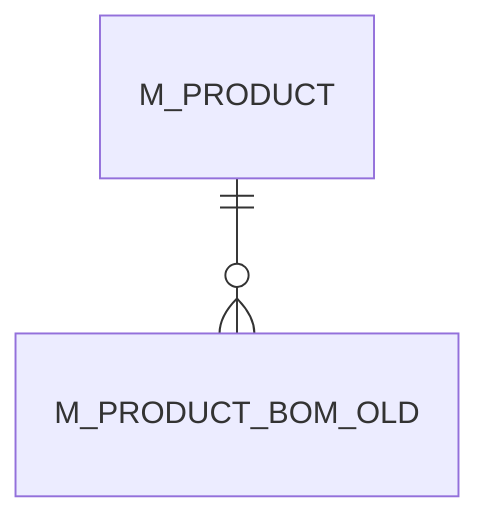

# M_PRODUCT_BOM_OLD

Area [M](../../data-model/m/index.md) · class **business** (proposed) · read from database `idempiere-db` (owner `ADEMPIERE`) · 21 row(s) when profiled

## Columns

| column | type | key | not null | business name | references (code) | nulls | distinct |
|---|---|---|---|---|---|---|---|
| `M_PRODUCT_BOM_ID` | NUMBER(10,0) | PK | yes |  |  | 0 | 21 |
| `AD_CLIENT_ID` | NUMBER(10,0) |  | yes |  |  | 0 | 1 |
| `AD_ORG_ID` | NUMBER(10,0) |  | yes |  |  | 0 | 1 |
| `ISACTIVE` | CHAR(1) |  | yes |  |  | 0 | 1 |
| `CREATED` | DATE |  | yes |  |  | 0 | 21 |
| `CREATEDBY` | NUMBER(10,0) |  | yes |  |  | 0 | 1 |
| `UPDATED` | DATE |  | yes |  |  | 0 | 21 |
| `UPDATEDBY` | NUMBER(10,0) |  | yes |  |  | 0 | 1 |
| `LINE` | NUMBER(10,0) |  | yes |  |  | 0 | 4 |
| `M_PRODUCT_ID` | NUMBER(10,0) |  | yes |  |  | 0 | 7 |
| `M_PRODUCTBOM_ID` | NUMBER(10,0) |  | yes |  |  | 0 | 18 |
| `BOMQTY` | NUMBER |  | yes |  |  | 0 | 9 |
| `DESCRIPTION` | VARCHAR2(255 CHAR) |  |  |  |  | 13 | 3 |
| `BOMTYPE` | CHAR(1) |  |  |  |  | 0 | 2 |
| `M_PRODUCT_BOM_UU` | VARCHAR2(36 CHAR) |  |  |  |  | 1 | 20 |

*references (code)* is the table the application model's code says a column points to; *Foreign keys* below are the constraints the database declares. Counts come from the profile; no value is ever shown.

## Check constraints

| name | expression |
|---|---|
| `SYS_C0020174` | `IsActive in ('Y','N')` |

## Foreign keys

**References**

| table | columns | on delete |
|---|---|---|
| [M_PRODUCT](../../data-model/m/m_product.md) | M_PRODUCT_BOM_OLD.M_PRODUCTBOM_ID → M_PRODUCT.M_PRODUCT_ID | NO ACTION |

**Referenced by**

_None._

## Write behaviour

- updates: **po_only**
- deletes: **never_deleted_in_code**
- change log: **unknown**
- evidence: 0 citation(s)

## Read by

| kind | name |
|---|---|
| View | `M_PACKAGELINES_AVAIL_V` |
| View | `m_packagelines_avail_v` |

## Schema history

4 change(s); the latest:

| applied | release | operation | column | tickets |
|---|---|---|---|---|
| 2021-12-05T16:45 | i8.2z | `add_constraint` |  | IDEMPIERE-5075 |
| 2021-12-05T16:45 | i8.2z | `drop_constraint` |  | IDEMPIERE-5075 |
| 2021-12-05T16:45 | i8.2z | `add_constraint` |  | IDEMPIERE-5075 |
| 2021-12-05T16:45 | i8.2z | `drop_constraint` |  | IDEMPIERE-5075 |

## Open conflicts

| type | attribute | explanation |
|---|---|---|
| `table_without_model` | `model_class` | unexplained |

## Notes

<!-- ekos:manual id="table.m_product_bom_old.notes" -->
_Business notes about this table._
<!-- /ekos:manual -->
