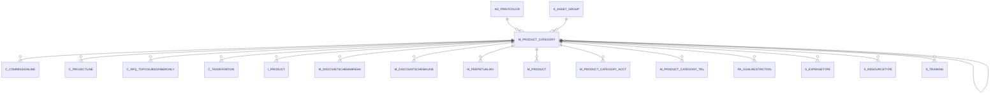

# M_PRODUCT_CATEGORY

Area [M](../../data-model/m/index.md) · class **business** (proposed) · read from database `idempiere-db` (owner `ADEMPIERE`) · 14 row(s) when profiled

Application model: `org.compiere.model.X_M_Product_Category`, access level 3 - Client - Org.

## Columns

| column | type | key | not null | business name | references (code) | nulls | distinct |
|---|---|---|---|---|---|---|---|
| `M_PRODUCT_CATEGORY_ID` | NUMBER(10,0) | PK | yes | Product Category |  | 0 | 14 |
| `AD_CLIENT_ID` | NUMBER(10,0) |  | yes | Tenant |  | 0 | 1 |
| `AD_ORG_ID` | NUMBER(10,0) |  | yes | Organization |  | 0 | 2 |
| `ISACTIVE` | CHAR(1) |  | yes | Active |  | 0 | 1 |
| `CREATED` | DATE |  | yes | Created |  | 0 | 14 |
| `CREATEDBY` | NUMBER(10,0) |  | yes | Created By |  | 0 | 2 |
| `UPDATED` | DATE |  | yes | Updated |  | 0 | 14 |
| `UPDATEDBY` | NUMBER(10,0) |  | yes | Updated By |  | 0 | 2 |
| `VALUE` | VARCHAR2(40 CHAR) |  | yes | Search Key |  | 0 | 14 |
| `NAME` | VARCHAR2(60 CHAR) |  | yes | Name |  | 0 | 14 |
| `DESCRIPTION` | VARCHAR2(255 CHAR) |  |  | Description |  | 10 | 4 |
| `ISDEFAULT` | CHAR(1) |  | yes | Default |  | 0 | 2 |
| `PLANNEDMARGIN` | NUMBER |  | yes | Planned Margin % |  | 0 | 3 |
| `A_ASSET_GROUP_ID` | NUMBER(10,0) |  |  | Asset Group | [A_ASSET_GROUP](../../data-model/a/a_asset_group.md) | 11 | 3 |
| `ISSELFSERVICE` | CHAR(1) |  | yes | Self-Service |  | 0 | 2 |
| `AD_PRINTCOLOR_ID` | NUMBER(10,0) |  |  | Print Color | [AD_PRINTCOLOR](../../data-model/ad/ad_printcolor.md) | 6 | 5 |
| `MMPOLICY` | CHAR(1) |  | yes | Material Policy |  | 0 | 1 |
| `M_PRODUCT_CATEGORY_PARENT_ID` | NUMBER(10,0) |  |  | Parent Product Category | [M_PRODUCT_CATEGORY](../../data-model/m/m_product_category.md) | 14 | 0 |
| `M_PRODUCT_CATEGORY_UU` | VARCHAR2(36 CHAR) |  |  | M_Product_Category_UU |  | 0 | 14 |

*references (code)* is the table the application model's code says a column points to; *Foreign keys* below are the constraints the database declares. Counts come from the profile; no value is ever shown.

## Check constraints

| name | expression |
|---|---|
| `SYS_C0020356` | `IsActive in ('Y','N')` |

## Foreign keys

**References**

| table | columns | on delete |
|---|---|---|
| [AD_PRINTCOLOR](../../data-model/ad/ad_printcolor.md) | M_PRODUCT_CATEGORY.AD_PRINTCOLOR_ID → AD_PRINTCOLOR.AD_PRINTCOLOR_ID | NO ACTION |
| [A_ASSET_GROUP](../../data-model/a/a_asset_group.md) | M_PRODUCT_CATEGORY.A_ASSET_GROUP_ID → A_ASSET_GROUP.A_ASSET_GROUP_ID | NO ACTION |
| [M_PRODUCT_CATEGORY](../../data-model/m/m_product_category.md) | M_PRODUCT_CATEGORY.M_PRODUCT_CATEGORY_PARENT_ID → M_PRODUCT_CATEGORY.M_PRODUCT_CATEGORY_ID | NO ACTION |

**Referenced by**

| table | columns | on delete |
|---|---|---|
| [C_COMMISSIONLINE](../../data-model/c/c_commissionline.md) | C_COMMISSIONLINE.M_PRODUCT_CATEGORY_ID → M_PRODUCT_CATEGORY.M_PRODUCT_CATEGORY_ID | NO ACTION |
| [C_PROJECTLINE](../../data-model/c/c_projectline.md) | C_PROJECTLINE.M_PRODUCT_CATEGORY_ID → M_PRODUCT_CATEGORY.M_PRODUCT_CATEGORY_ID | NO ACTION |
| [C_RFQ_TOPICSUBSCRIBERONLY](../../data-model/c/c_rfq_topicsubscriberonly.md) | C_RFQ_TOPICSUBSCRIBERONLY.M_PRODUCT_CATEGORY_ID → M_PRODUCT_CATEGORY.M_PRODUCT_CATEGORY_ID | NO ACTION |
| [C_TAXDEFINITION](../../data-model/c/c_taxdefinition.md) | C_TAXDEFINITION.M_PRODUCT_CATEGORY_ID → M_PRODUCT_CATEGORY.M_PRODUCT_CATEGORY_ID | NO ACTION |
| `I_PRODUCT` | I_PRODUCT.M_PRODUCT_CATEGORY_ID → M_PRODUCT_CATEGORY.M_PRODUCT_CATEGORY_ID | SET NULL |
| [M_DISCOUNTSCHEMABREAK](../../data-model/m/m_discountschemabreak.md) | M_DISCOUNTSCHEMABREAK.M_PRODUCT_CATEGORY_ID → M_PRODUCT_CATEGORY.M_PRODUCT_CATEGORY_ID | NO ACTION |
| [M_DISCOUNTSCHEMALINE](../../data-model/m/m_discountschemaline.md) | M_DISCOUNTSCHEMALINE.M_PRODUCT_CATEGORY_ID → M_PRODUCT_CATEGORY.M_PRODUCT_CATEGORY_ID | NO ACTION |
| [M_PERPETUALINV](../../data-model/m/m_perpetualinv.md) | M_PERPETUALINV.M_PRODUCT_CATEGORY_ID → M_PRODUCT_CATEGORY.M_PRODUCT_CATEGORY_ID | NO ACTION |
| [M_PRODUCT](../../data-model/m/m_product.md) | M_PRODUCT.M_PRODUCT_CATEGORY_ID → M_PRODUCT_CATEGORY.M_PRODUCT_CATEGORY_ID | NO ACTION |
| [M_PRODUCT_CATEGORY](../../data-model/m/m_product_category.md) | M_PRODUCT_CATEGORY.M_PRODUCT_CATEGORY_PARENT_ID → M_PRODUCT_CATEGORY.M_PRODUCT_CATEGORY_ID | NO ACTION |
| [M_PRODUCT_CATEGORY_ACCT](../../data-model/m/m_product_category_acct.md) | M_PRODUCT_CATEGORY_ACCT.M_PRODUCT_CATEGORY_ID → M_PRODUCT_CATEGORY.M_PRODUCT_CATEGORY_ID | CASCADE |
| [M_PRODUCT_CATEGORY_TRL](../../data-model/m/m_product_category_trl.md) | M_PRODUCT_CATEGORY_TRL.M_PRODUCT_CATEGORY_ID → M_PRODUCT_CATEGORY.M_PRODUCT_CATEGORY_ID | CASCADE |
| [PA_GOALRESTRICTION](../../data-model/pa/pa_goalrestriction.md) | PA_GOALRESTRICTION.M_PRODUCT_CATEGORY_ID → M_PRODUCT_CATEGORY.M_PRODUCT_CATEGORY_ID | NO ACTION |
| [S_EXPENSETYPE](../../data-model/s/s_expensetype.md) | S_EXPENSETYPE.M_PRODUCT_CATEGORY_ID → M_PRODUCT_CATEGORY.M_PRODUCT_CATEGORY_ID | NO ACTION |
| [S_RESOURCETYPE](../../data-model/s/s_resourcetype.md) | S_RESOURCETYPE.M_PRODUCT_CATEGORY_ID → M_PRODUCT_CATEGORY.M_PRODUCT_CATEGORY_ID | NO ACTION |
| [S_TRAINING](../../data-model/s/s_training.md) | S_TRAINING.M_PRODUCT_CATEGORY_ID → M_PRODUCT_CATEGORY.M_PRODUCT_CATEGORY_ID | NO ACTION |

## Write behaviour

- updates: **po_only**
- deletes: **deleted_by_users**
- change log: **recorded**
- evidence: 1 citation(s)

## Read by

| kind | name |
|---|---|
| Procedure | [C_AcctSchema_Default_Copy](../../logic/c_acctschema_default_copy.md) |
| View | `RV_C_INVOICELINE` |
| View | `RV_FACT_ADAXA` |
| View | `rv_c_invoiceline` |
| View | `rv_fact_adaxa` |

## Schema history

25 change(s); the latest:

| applied | release | operation | column | tickets |
|---|---|---|---|---|
| 2023-04-09T15:47 | iD11 | `add_constraint` |  | IDEMPIERE-5567 |
| 2023-04-09T15:47 | iD11 | `add_constraint` |  | IDEMPIERE-5567 |
| 2021-12-05T16:45 | i8.2z | `drop_constraint` |  | IDEMPIERE-5075 |
| 2021-12-05T16:45 | i8.2z | `drop_constraint` |  | IDEMPIERE-5075 |
| 2021-12-05T16:45 | i8.2z | `add_constraint` |  | IDEMPIERE-5075 |
| 2021-12-05T16:45 | i8.2z | `add_constraint` |  | IDEMPIERE-5075 |
| 2021-12-05T16:45 | i8.2z | `add_constraint` |  | IDEMPIERE-5075 |
| 2021-12-05T16:45 | i8.2z | `drop_constraint` |  | IDEMPIERE-5075 |
| 2020-08-04T01:00 | i7.1z | `modify_column` | VALUE | IDEMPIERE-3862 |
| 2020-08-04T01:00 | i7.1z | `drop_column` | tmp_col_4_tmp | IDEMPIERE-3862 |
| 2020-08-04T01:00 | i7.1z | `modify_column` | VALUE | IDEMPIERE-3862 |
| 2020-08-04T01:00 | i7.1z | `create_index` |  | IDEMPIERE-3862 |
| 2020-08-04T01:00 | i7.1z | `add_column` | tmp_col_1_tmp | IDEMPIERE-3862 |
| 2020-08-04T01:00 | i7.1z | `add_column` | tmp_col_2_tmp | IDEMPIERE-3862 |
| 2020-08-04T01:00 | i7.1z | `modify_column` | NAME | IDEMPIERE-3862 |

## Notes

<!-- ekos:manual id="table.m_product_category.notes" -->
_Business notes about this table._
<!-- /ekos:manual -->
