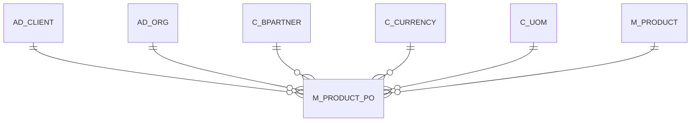

# M_PRODUCT_PO

Area [M](../../data-model/m/index.md) · class **business** (proposed) · read from database `idempiere-db` (owner `ADEMPIERE`) · 29 row(s) when profiled

Application model: `org.compiere.model.X_M_Product_PO`, access level 3 - Client - Org.

## Columns

| column | type | key | not null | business name | references (code) | nulls | distinct |
|---|---|---|---|---|---|---|---|
| `M_PRODUCT_ID` | NUMBER(10,0) | PK | yes | Product | [M_PRODUCT](../../data-model/m/m_product.md) | 0 | 29 |
| `C_BPARTNER_ID` | NUMBER(10,0) | PK | yes | Business Partner | [C_BPARTNER](../../data-model/c/c_bpartner.md) | 0 | 6 |
| `AD_CLIENT_ID` | NUMBER(10,0) |  | yes | Tenant |  | 0 | 1 |
| `AD_ORG_ID` | NUMBER(10,0) |  | yes | Organization |  | 0 | 2 |
| `ISACTIVE` | CHAR(1) |  | yes | Active |  | 0 | 1 |
| `CREATED` | DATE |  | yes | Created |  | 0 | 19 |
| `CREATEDBY` | NUMBER(10,0) |  | yes | Created By |  | 0 | 1 |
| `UPDATED` | DATE |  | yes | Updated |  | 0 | 18 |
| `UPDATEDBY` | NUMBER(10,0) |  | yes | Updated By |  | 0 | 2 |
| `ISCURRENTVENDOR` | CHAR(1) |  | yes | Current vendor |  | 0 | 1 |
| `C_UOM_ID` | NUMBER(10,0) |  |  | UOM | [C_UOM](../../data-model/c/c_uom.md) | 0 | 4 |
| `C_CURRENCY_ID` | NUMBER(10,0) |  |  | Currency | [C_CURRENCY](../../data-model/c/c_currency.md) | 0 | 2 |
| `PRICELIST` | NUMBER |  |  | List Price |  | 0 | 21 |
| `PRICEPO` | NUMBER |  |  | PO Price |  | 0 | 24 |
| `PRICEEFFECTIVE` | DATE |  |  | Price effective |  | 29 | 0 |
| `PRICELASTPO` | NUMBER |  |  | Last PO Price |  | 0 | 20 |
| `PRICELASTINV` | NUMBER |  |  | Last Invoice Price |  | 0 | 20 |
| `VENDORPRODUCTNO` | VARCHAR2(40 CHAR) |  | yes | Partner Product Key |  | 0 | 29 |
| `UPC` | VARCHAR2(20 CHAR) |  |  | UPC/EAN |  | 29 | 0 |
| `VENDORCATEGORY` | VARCHAR2(30 CHAR) |  |  | Partner Category |  | 29 | 0 |
| `DISCONTINUED` | CHAR(1) |  |  | Discontinued |  | 0 | 1 |
| `DISCONTINUEDBY` | DATE |  |  |  |  | 29 | 0 |
| `ORDER_MIN` | NUMBER |  |  | Minimum Order Qty |  | 0 | 8 |
| `ORDER_PACK` | NUMBER |  |  | Order Pack Qty |  | 0 | 8 |
| `COSTPERORDER` | NUMBER |  |  | Cost per Order |  | 0 | 1 |
| `DELIVERYTIME_PROMISED` | NUMBER(10,0) |  |  | Promised Delivery Time |  | 12 | 5 |
| `DELIVERYTIME_ACTUAL` | NUMBER(10,0) |  |  | Actual Delivery Time |  | 12 | 1 |
| `QUALITYRATING` | NUMBER |  |  | Quality Rating |  | 12 | 1 |
| `ROYALTYAMT` | NUMBER |  |  | Royalty Amount |  | 0 | 1 |
| `MANUFACTURER` | VARCHAR2(30 CHAR) |  |  | Manufacturer |  | 29 | 0 |
| `DISCONTINUEDAT` | DATE |  |  | Discontinued At |  | 29 | 0 |
| `M_PRODUCT_PO_UU` | VARCHAR2(36 CHAR) |  |  | M_Product_PO_UU |  | 0 | 29 |

*references (code)* is the table the application model's code says a column points to; *Foreign keys* below are the constraints the database declares. Counts come from the profile; no value is ever shown.

## Check constraints

| name | expression |
|---|---|
| `SYS_C0020223` | `IsCurrentVendor in ('Y','N')` |
| `SYS_C0020225` | `Discontinued in ('Y','N')` |
| `SYS_C0020226` | `IsActive in ('Y','N')` |

## Foreign keys

**References**

| table | columns | on delete |
|---|---|---|
| [AD_CLIENT](../../data-model/ad/ad_client.md) | M_PRODUCT_PO.AD_CLIENT_ID → AD_CLIENT.AD_CLIENT_ID | NO ACTION |
| [AD_ORG](../../data-model/ad/ad_org.md) | M_PRODUCT_PO.AD_ORG_ID → AD_ORG.AD_ORG_ID | NO ACTION |
| [C_BPARTNER](../../data-model/c/c_bpartner.md) | M_PRODUCT_PO.C_BPARTNER_ID → C_BPARTNER.C_BPARTNER_ID | NO ACTION |
| [C_CURRENCY](../../data-model/c/c_currency.md) | M_PRODUCT_PO.C_CURRENCY_ID → C_CURRENCY.C_CURRENCY_ID | NO ACTION |
| [C_UOM](../../data-model/c/c_uom.md) | M_PRODUCT_PO.C_UOM_ID → C_UOM.C_UOM_ID | NO ACTION |
| [M_PRODUCT](../../data-model/m/m_product.md) | M_PRODUCT_PO.M_PRODUCT_ID → M_PRODUCT.M_PRODUCT_ID | CASCADE |

**Referenced by**

_None._

## Write behaviour

- updates: **raw_sql_skips_updated**
- deletes: **deleted_by_users, deleted_by_cascade**
- change log: **recorded**
- evidence: 19 citation(s)

## Read by

| kind | name |
|---|---|
| Procedure | [M_PRICELIST_CREATE](../../logic/m_pricelist_create.md) |
| Procedure | [M_PriceList_Create](../../logic/m_pricelist_create.md) |
| View | `C_INVOICE_CREATEFROM_V` |
| View | `C_ORDER_LINETAX_V` |
| View | `C_ORDER_LINETAX_VT` |
| View | `M_INOUT_CREATEFROM_V` |
| View | `RV_C_INVOICE_CUSTOMERVENDQTR` |
| View | `RV_C_INVOICE_VENDORMONTH` |
| View | `RV_M_TRANSACTION` |
| View | `c_invoice_createfrom_v` |
| View | `c_order_linetax_v` |
| View | `c_order_linetax_vt` |
| View | `m_inout_createfrom_v` |
| View | `rv_c_invoice_customervendqtr` |
| View | `rv_c_invoice_vendormonth` |
| View | `rv_m_transaction` |

## Written by

| kind | name |
|---|---|
| Procedure | [M_PRICELIST_CREATE](../../logic/m_pricelist_create.md) |
| Procedure | [M_PriceList_Create](../../logic/m_pricelist_create.md) |

## Schema history

30 change(s); the latest:

| applied | release | operation | column | tickets |
|---|---|---|---|---|
| 2023-04-09T15:47 | iD11 | `add_constraint` |  | IDEMPIERE-5567 |
| 2023-04-09T15:47 | iD11 | `add_constraint` |  | IDEMPIERE-5567 |
| 2021-12-05T16:45 | i8.2z | `add_constraint` |  | IDEMPIERE-5075 |
| 2021-12-05T16:45 | i8.2z | `add_constraint` |  | IDEMPIERE-5075 |
| 2021-12-05T16:45 | i8.2z | `add_constraint` |  | IDEMPIERE-5075 |
| 2021-12-05T16:45 | i8.2z | `drop_constraint` |  | IDEMPIERE-5075 |
| 2021-12-05T16:45 | i8.2z | `drop_constraint` |  | IDEMPIERE-5075 |
| 2021-12-05T16:45 | i8.2z | `drop_constraint` |  | IDEMPIERE-5075 |
| 2021-12-05T16:45 | i8.2z | `add_constraint` |  | IDEMPIERE-5075 |
| 2021-12-05T16:45 | i8.2z | `drop_constraint` |  | IDEMPIERE-5075 |
| 2021-12-05T16:45 | i8.2z | `add_constraint` |  | IDEMPIERE-5075 |
| 2021-12-05T16:45 | i8.2z | `drop_constraint` |  | IDEMPIERE-5075 |
| 2021-12-05T16:45 | i8.2z | `add_constraint` |  | IDEMPIERE-5075 |
| 2021-12-05T16:45 | i8.2z | `drop_constraint` |  | IDEMPIERE-5075 |
| 2020-08-06T18:11 | i7.1z | `modify_column` | Manufacturer | IDEMPIERE-4398 |

## Notes

<!-- ekos:manual id="table.m_product_po.notes" -->
_Business notes about this table._
<!-- /ekos:manual -->
