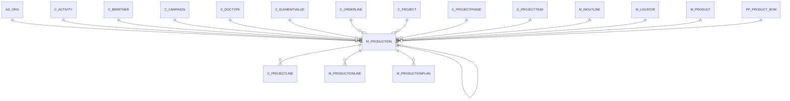

# M_PRODUCTION

Receipts & Vendor Returns

Area [M](../../data-model/m/index.md) · class **business** (proposed) · read from database `idempiere-db` (owner `ADEMPIERE`) · 0 row(s) when profiled

Application model: `org.compiere.model.X_M_Production`, access level 1 - Org.

## Columns

| column | type | key | not null | business name | references (code) | nulls | distinct |
|---|---|---|---|---|---|---|---|
| `M_PRODUCTION_ID` | NUMBER(10,0) | PK | yes | Production |  | 0 | 0 |
| `AD_CLIENT_ID` | NUMBER(10,0) |  | yes | Tenant |  | 0 | 0 |
| `AD_ORG_ID` | NUMBER(10,0) |  | yes | Organization |  | 0 | 0 |
| `ISACTIVE` | CHAR(1) |  | yes | Active |  | 0 | 0 |
| `CREATED` | DATE |  | yes | Created |  | 0 | 0 |
| `CREATEDBY` | NUMBER(10,0) |  | yes | Created By |  | 0 | 0 |
| `UPDATED` | DATE |  | yes | Updated |  | 0 | 0 |
| `UPDATEDBY` | NUMBER(10,0) |  | yes | Updated By |  | 0 | 0 |
| `NAME` | VARCHAR2(60 CHAR) |  |  | Name |  | 0 | 0 |
| `DESCRIPTION` | VARCHAR2(255 CHAR) |  |  | Description |  | 0 | 0 |
| `MOVEMENTDATE` | DATE |  | yes | Movement Date |  | 0 | 0 |
| `ISCREATED` | CHAR(1) |  | yes | Records created |  | 0 | 0 |
| `POSTED` | CHAR(1) |  | yes | Posted |  | 0 | 0 |
| `PROCESSED` | CHAR(1) |  | yes | Processed |  | 0 | 0 |
| `PROCESSING` | CHAR(1) |  |  | Process Now |  | 0 | 0 |
| `AD_ORGTRX_ID` | NUMBER(10,0) |  |  | Trx Organization |  | 0 | 0 |
| `C_PROJECT_ID` | NUMBER(10,0) |  |  | Project | [C_PROJECT](../../data-model/c/c_project.md) | 0 | 0 |
| `C_CAMPAIGN_ID` | NUMBER(10,0) |  |  | Campaign | [C_CAMPAIGN](../../data-model/c/c_campaign.md) | 0 | 0 |
| `C_ACTIVITY_ID` | NUMBER(10,0) |  |  | Activity | [C_ACTIVITY](../../data-model/c/c_activity.md) | 0 | 0 |
| `USER1_ID` | NUMBER(10,0) |  |  | User Element List 1 | [C_ELEMENTVALUE](../../data-model/c/c_elementvalue.md) | 0 | 0 |
| `USER2_ID` | NUMBER(10,0) |  |  | User Element List 2 | [C_ELEMENTVALUE](../../data-model/c/c_elementvalue.md) | 0 | 0 |
| `PROCESSEDON` | NUMBER |  |  | Processed On |  | 0 | 0 |
| `M_PRODUCTION_UU` | VARCHAR2(36 CHAR) |  |  | M_Production_UU |  | 0 | 0 |
| `DOCUMENTNO` | VARCHAR2(30 CHAR) |  | yes | Document No |  | 0 | 0 |
| `M_PRODUCT_ID` | NUMBER(10,0) |  | yes | Product | [M_PRODUCT](../../data-model/m/m_product.md) | 0 | 0 |
| `M_LOCATOR_ID` | NUMBER(10,0) |  | yes | Locator | [M_LOCATOR](../../data-model/m/m_locator.md) | 0 | 0 |
| `PRODUCTIONQTY` | NUMBER |  | yes | Production Quantity |  | 0 | 0 |
| `DATEPROMISED` | DATE |  |  | Date Promised |  | 0 | 0 |
| `ISCOMPLETE` | CHAR(1) |  |  | Complete |  | 0 | 0 |
| `C_ORDERLINE_ID` | NUMBER(10,0) |  |  | Sales Order Line | [C_ORDERLINE](../../data-model/c/c_orderline.md) | 0 | 0 |
| `CREATEFROM` | CHAR(1) |  |  | Create lines from |  | 0 | 0 |
| `C_BPARTNER_ID` | NUMBER(10,0) |  |  | Business Partner | [C_BPARTNER](../../data-model/c/c_bpartner.md) | 0 | 0 |
| `ISUSEPRODUCTIONPLAN` | CHAR(1) |  | yes | Use Production Plan |  | 0 | 0 |
| `DOCACTION` | CHAR(2) |  | yes | Document Action |  | 0 | 0 |
| `DOCSTATUS` | VARCHAR2(2 CHAR) |  | yes | Document Status |  | 0 | 0 |
| `REVERSAL_ID` | NUMBER(10,0) |  |  | Reversal ID | [M_PRODUCTION](../../data-model/m/m_production.md) | 0 | 0 |
| `C_PROJECTPHASE_ID` | NUMBER(10,0) |  |  | Project Phase | [C_PROJECTPHASE](../../data-model/c/c_projectphase.md) | 0 | 0 |
| `C_PROJECTTASK_ID` | NUMBER(10,0) |  |  | Project Task | [C_PROJECTTASK](../../data-model/c/c_projecttask.md) | 0 | 0 |
| `PP_PRODUCT_BOM_ID` | NUMBER(10,0) |  |  | BOM &amp; Formula | [PP_PRODUCT_BOM](../../data-model/pp/pp_product_bom.md) | 0 | 0 |
| `M_INOUTLINE_ID` | NUMBER(10,0) |  |  | Shipment/Receipt Line | [M_INOUTLINE](../../data-model/m/m_inoutline.md) | 0 | 0 |
| `C_DOCTYPE_ID` | NUMBER(10,0) |  | yes | Document Type | [C_DOCTYPE](../../data-model/c/c_doctype.md) | 0 | 0 |

*references (code)* is the table the application model's code says a column points to; *Foreign keys* below are the constraints the database declares. Counts come from the profile; no value is ever shown.

## Check constraints

| name | expression |
|---|---|
| `SYS_C0022566` | `IsUseProductionPlan IN ('Y','N')` |
| `SYS_C0022568` | `IsActive in ('Y','N')` |
| `SYS_C0022570` | `IsCreated in ('Y','N')` |
| `SYS_C0022571` | `Processed in ('Y','N')` |

## Foreign keys

**References**

| table | columns | on delete |
|---|---|---|
| [AD_ORG](../../data-model/ad/ad_org.md) | M_PRODUCTION.AD_ORGTRX_ID → AD_ORG.AD_ORG_ID | NO ACTION |
| [C_ACTIVITY](../../data-model/c/c_activity.md) | M_PRODUCTION.C_ACTIVITY_ID → C_ACTIVITY.C_ACTIVITY_ID | NO ACTION |
| [C_BPARTNER](../../data-model/c/c_bpartner.md) | M_PRODUCTION.C_BPARTNER_ID → C_BPARTNER.C_BPARTNER_ID | NO ACTION |
| [C_CAMPAIGN](../../data-model/c/c_campaign.md) | M_PRODUCTION.C_CAMPAIGN_ID → C_CAMPAIGN.C_CAMPAIGN_ID | NO ACTION |
| [C_DOCTYPE](../../data-model/c/c_doctype.md) | M_PRODUCTION.C_DOCTYPE_ID → C_DOCTYPE.C_DOCTYPE_ID | NO ACTION |
| [C_ELEMENTVALUE](../../data-model/c/c_elementvalue.md) | M_PRODUCTION.USER1_ID → C_ELEMENTVALUE.C_ELEMENTVALUE_ID | NO ACTION |
| [C_ORDERLINE](../../data-model/c/c_orderline.md) | M_PRODUCTION.C_ORDERLINE_ID → C_ORDERLINE.C_ORDERLINE_ID | NO ACTION |
| [C_PROJECT](../../data-model/c/c_project.md) | M_PRODUCTION.C_PROJECT_ID → C_PROJECT.C_PROJECT_ID | NO ACTION |
| [C_PROJECTPHASE](../../data-model/c/c_projectphase.md) | M_PRODUCTION.C_PROJECTPHASE_ID → C_PROJECTPHASE.C_PROJECTPHASE_ID | NO ACTION |
| [C_PROJECTTASK](../../data-model/c/c_projecttask.md) | M_PRODUCTION.C_PROJECTTASK_ID → C_PROJECTTASK.C_PROJECTTASK_ID | NO ACTION |
| [M_INOUTLINE](../../data-model/m/m_inoutline.md) | M_PRODUCTION.M_INOUTLINE_ID → M_INOUTLINE.M_INOUTLINE_ID | NO ACTION |
| [M_LOCATOR](../../data-model/m/m_locator.md) | M_PRODUCTION.M_LOCATOR_ID → M_LOCATOR.M_LOCATOR_ID | NO ACTION |
| [M_PRODUCT](../../data-model/m/m_product.md) | M_PRODUCTION.M_PRODUCT_ID → M_PRODUCT.M_PRODUCT_ID | NO ACTION |
| [M_PRODUCTION](../../data-model/m/m_production.md) | M_PRODUCTION.REVERSAL_ID → M_PRODUCTION.M_PRODUCTION_ID | NO ACTION |
| [PP_PRODUCT_BOM](../../data-model/pp/pp_product_bom.md) | M_PRODUCTION.PP_PRODUCT_BOM_ID → PP_PRODUCT_BOM.PP_PRODUCT_BOM_ID | NO ACTION |

**Referenced by**

| table | columns | on delete |
|---|---|---|
| [C_PROJECTLINE](../../data-model/c/c_projectline.md) | C_PROJECTLINE.M_PRODUCTION_ID → M_PRODUCTION.M_PRODUCTION_ID | NO ACTION |
| [M_PRODUCTION](../../data-model/m/m_production.md) | M_PRODUCTION.REVERSAL_ID → M_PRODUCTION.M_PRODUCTION_ID | NO ACTION |
| [M_PRODUCTIONLINE](../../data-model/m/m_productionline.md) | M_PRODUCTIONLINE.M_PRODUCTION_ID → M_PRODUCTION.M_PRODUCTION_ID | NO ACTION |
| [M_PRODUCTIONPLAN](../../data-model/m/m_productionplan.md) | M_PRODUCTIONPLAN.M_PRODUCTION_ID → M_PRODUCTION.M_PRODUCTION_ID | CASCADE |

## Write behaviour

- updates: **po_only**
- deletes: **deleted_by_users**
- change log: **recorded**
- evidence: 1 citation(s)

## Read by

| kind | name |
|---|---|
| View | `RV_UNPOSTED` |
| View | `rv_unposted` |

## Schema history

89 change(s); the latest:

| applied | release | operation | column | tickets |
|---|---|---|---|---|
| 2024-05-14T13:59 | iD13 | `add_constraint` |  | IDEMPIERE-5598 |
| 2024-05-14T13:59 | iD13 | `add_constraint` |  | IDEMPIERE-5598 |
| 2024-05-14T13:59 | iD13 | `add_column` | C_CostCenter_ID | IDEMPIERE-5598 |
| 2024-05-14T13:59 | iD13 | `add_constraint` |  | IDEMPIERE-5598 |
| 2024-05-14T13:59 | iD13 | `add_column` | C_Department_ID | IDEMPIERE-5598 |
| 2024-05-14T13:59 | iD13 | `add_column` | C_CostCenter_ID | IDEMPIERE-5598 |
| 2024-05-14T13:59 | iD13 | `add_column` | C_Department_ID | IDEMPIERE-5598 |
| 2024-05-14T13:59 | iD13 | `add_constraint` |  | IDEMPIERE-5598 |
| 2023-06-06T12:39 | iD10 | `modify_column` | C_DocType_ID | IDEMPIERE-5746 |
| 2023-06-06T12:39 | iD10 | `add_column` | C_DocType_ID | IDEMPIERE-5746 |
| 2023-06-06T12:39 | iD10 | `modify_column` | C_DocType_ID | IDEMPIERE-5746 |
| 2023-06-06T12:39 | iD10 | `add_column` | C_DocType_ID | IDEMPIERE-5746 |
| 2023-06-06T12:39 | iD10 | `modify_column` | C_DocType_ID | IDEMPIERE-5746 |
| 2023-06-06T12:39 | iD10 | `modify_column` | C_DocType_ID | IDEMPIERE-5746 |
| 2023-06-06T12:39 | iD10 | `add_constraint` |  | IDEMPIERE-5746 |

## Open conflicts

| type | attribute | explanation |
|---|---|---|
| `model_column_missing` | `columns.C_CostCenter_ID` | unexplained |
| `model_column_missing` | `columns.C_Department_ID` | unexplained |

## Notes

<!-- ekos:manual id="table.m_production.notes" -->
_Business notes about this table._
<!-- /ekos:manual -->
