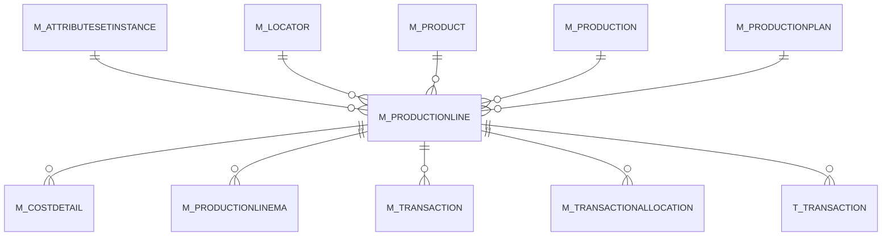

# M_PRODUCTIONLINE

The actual quantities (BOM = planned)

Area [M](../../data-model/m/index.md) · class **business** (proposed) · read from database `idempiere-db` (owner `ADEMPIERE`) · 0 row(s) when profiled

Application model: `org.compiere.model.X_M_ProductionLine`, access level 1 - Org.

## Columns

| column | type | key | not null | business name | references (code) | nulls | distinct |
|---|---|---|---|---|---|---|---|
| `M_PRODUCTIONLINE_ID` | NUMBER(10,0) | PK | yes | Production Line |  | 0 | 0 |
| `AD_CLIENT_ID` | NUMBER(10,0) |  | yes | Tenant |  | 0 | 0 |
| `AD_ORG_ID` | NUMBER(10,0) |  | yes | Organization |  | 0 | 0 |
| `ISACTIVE` | CHAR(1) |  | yes | Active |  | 0 | 0 |
| `CREATED` | DATE |  | yes | Created |  | 0 | 0 |
| `CREATEDBY` | NUMBER(10,0) |  | yes | Created By |  | 0 | 0 |
| `UPDATED` | DATE |  | yes | Updated |  | 0 | 0 |
| `UPDATEDBY` | NUMBER(10,0) |  | yes | Updated By |  | 0 | 0 |
| `M_PRODUCTIONPLAN_ID` | NUMBER(10,0) |  |  | Production Plan | [M_PRODUCTIONPLAN](../../data-model/m/m_productionplan.md) | 0 | 0 |
| `LINE` | NUMBER(10,0) |  | yes | Line No |  | 0 | 0 |
| `M_PRODUCT_ID` | NUMBER(10,0) |  | yes | Product | [M_PRODUCT](../../data-model/m/m_product.md) | 0 | 0 |
| `MOVEMENTQTY` | NUMBER |  | yes | Movement Quantity |  | 0 | 0 |
| `M_LOCATOR_ID` | NUMBER(10,0) |  | yes | Locator | [M_LOCATOR](../../data-model/m/m_locator.md) | 0 | 0 |
| `DESCRIPTION` | VARCHAR2(255 CHAR) |  |  | Description |  | 0 | 0 |
| `M_ATTRIBUTESETINSTANCE_ID` | NUMBER(10,0) |  |  | Attribute Set Instance | [M_ATTRIBUTESETINSTANCE](../../data-model/m/m_attributesetinstance.md) | 0 | 0 |
| `PROCESSED` | CHAR(1) |  | yes | Processed |  | 0 | 0 |
| `M_PRODUCTIONLINE_UU` | VARCHAR2(36 CHAR) |  |  | M_ProductionLine_UU |  | 0 | 0 |
| `M_PRODUCTION_ID` | NUMBER(10,0) |  | yes | Production | [M_PRODUCTION](../../data-model/m/m_production.md) | 0 | 0 |
| `PLANNEDQTY` | NUMBER |  |  | Planned Quantity |  | 0 | 0 |
| `QTYUSED` | NUMBER |  |  | Quantity Used |  | 0 | 0 |
| `ISENDPRODUCT` | CHAR(1) |  |  | End Product |  | 0 | 0 |

*references (code)* is the table the application model's code says a column points to; *Foreign keys* below are the constraints the database declares. Counts come from the profile; no value is ever shown.

## Check constraints

| name | expression |
|---|---|
| `SYS_C0021741` | `IsActive in ('Y','N')` |
| `SYS_C0021742` | `IsEndProduct IN ('Y','N')` |

## Foreign keys

**References**

| table | columns | on delete |
|---|---|---|
| [M_ATTRIBUTESETINSTANCE](../../data-model/m/m_attributesetinstance.md) | M_PRODUCTIONLINE.M_ATTRIBUTESETINSTANCE_ID → M_ATTRIBUTESETINSTANCE.M_ATTRIBUTESETINSTANCE_ID | NO ACTION |
| [M_LOCATOR](../../data-model/m/m_locator.md) | M_PRODUCTIONLINE.M_LOCATOR_ID → M_LOCATOR.M_LOCATOR_ID | NO ACTION |
| [M_PRODUCT](../../data-model/m/m_product.md) | M_PRODUCTIONLINE.M_PRODUCT_ID → M_PRODUCT.M_PRODUCT_ID | NO ACTION |
| [M_PRODUCTION](../../data-model/m/m_production.md) | M_PRODUCTIONLINE.M_PRODUCTION_ID → M_PRODUCTION.M_PRODUCTION_ID | NO ACTION |
| [M_PRODUCTIONPLAN](../../data-model/m/m_productionplan.md) | M_PRODUCTIONLINE.M_PRODUCTIONPLAN_ID → M_PRODUCTIONPLAN.M_PRODUCTIONPLAN_ID | CASCADE |

**Referenced by**

| table | columns | on delete |
|---|---|---|
| [M_COSTDETAIL](../../data-model/m/m_costdetail.md) | M_COSTDETAIL.M_PRODUCTIONLINE_ID → M_PRODUCTIONLINE.M_PRODUCTIONLINE_ID | NO ACTION |
| [M_PRODUCTIONLINEMA](../../data-model/m/m_productionlinema.md) | M_PRODUCTIONLINEMA.M_PRODUCTIONLINE_ID → M_PRODUCTIONLINE.M_PRODUCTIONLINE_ID | CASCADE |
| [M_TRANSACTION](../../data-model/m/m_transaction.md) | M_TRANSACTION.M_PRODUCTIONLINE_ID → M_PRODUCTIONLINE.M_PRODUCTIONLINE_ID | NO ACTION |
| [M_TRANSACTIONALLOCATION](../../data-model/m/m_transactionallocation.md) | M_TRANSACTIONALLOCATION.OUT_M_PRODUCTIONLINE_ID → M_PRODUCTIONLINE.M_PRODUCTIONLINE_ID | NO ACTION |
| `T_TRANSACTION` | T_TRANSACTION.M_PRODUCTIONLINE_ID → M_PRODUCTIONLINE.M_PRODUCTIONLINE_ID | CASCADE |

## Write behaviour

- updates: **po_only**
- deletes: **deleted_by_app, deleted_by_users, deleted_by_cascade**
- change log: **recorded**
- evidence: 5 citation(s)

## Read by

| kind | name |
|---|---|
| Procedure | [prodqtyordered](../../logic/prodqtyordered.md) |
| Procedure | [prodqtyreserved](../../logic/prodqtyreserved.md) |
| View | `M_TRANSACTION_V` |
| View | `RV_TRANSACTION` |
| View | `m_transaction_v` |
| View | `rv_transaction` |

## Schema history

28 change(s); the latest:

| applied | release | operation | column | tickets |
|---|---|---|---|---|
| 2024-05-14T13:59 | iD13 | `add_constraint` |  | IDEMPIERE-5598 |
| 2024-05-14T13:59 | iD13 | `add_column` | C_Department_ID | IDEMPIERE-5598 |
| 2024-05-14T13:59 | iD13 | `add_column` | C_CostCenter_ID | IDEMPIERE-5598 |
| 2024-05-14T13:59 | iD13 | `add_constraint` |  | IDEMPIERE-5598 |
| 2024-05-14T13:59 | iD13 | `add_constraint` |  | IDEMPIERE-5598 |
| 2024-05-14T13:59 | iD13 | `add_constraint` |  | IDEMPIERE-5598 |
| 2024-05-14T13:59 | iD13 | `add_column` | C_Department_ID | IDEMPIERE-5598 |
| 2024-05-14T13:59 | iD13 | `add_column` | C_CostCenter_ID | IDEMPIERE-5598 |
| 2023-04-09T15:47 | iD11 | `add_constraint` |  | IDEMPIERE-5567 |
| 2023-04-09T15:47 | iD11 | `add_constraint` |  | IDEMPIERE-5567 |
| 2021-12-05T16:45 | i8.2z | `drop_constraint` |  | IDEMPIERE-5075 |
| 2021-12-05T16:45 | i8.2z | `add_constraint` |  | IDEMPIERE-5075 |
| 2021-12-05T16:45 | i8.2z | `drop_constraint` |  | IDEMPIERE-5075 |
| 2021-12-05T16:45 | i8.2z | `add_constraint` |  | IDEMPIERE-5075 |
| 2021-12-05T16:45 | i8.2z | `add_constraint` |  | IDEMPIERE-5075 |

## Open conflicts

| type | attribute | explanation |
|---|---|---|
| `model_column_missing` | `columns.C_CostCenter_ID` | unexplained |
| `model_column_missing` | `columns.C_Department_ID` | unexplained |
| `mandatory_but_nullable` | `columns.M_AttributeSetInstance_ID.nullable` | unexplained |

## Notes

<!-- ekos:manual id="table.m_productionline.notes" -->
_Business notes about this table._
<!-- /ekos:manual -->
