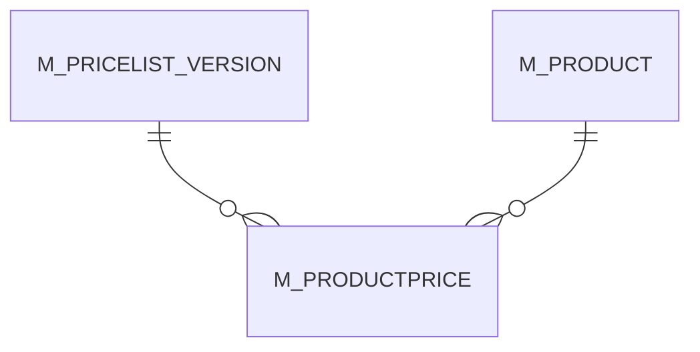

# M_PRODUCTPRICE

Area [M](../../data-model/m/index.md) · class **business** (proposed) · read from database `idempiere-db` (owner `ADEMPIERE`) · 114 row(s) when profiled

Application model: `org.compiere.model.X_M_ProductPrice`, access level 3 - Client - Org.

## Columns

| column | type | key | not null | business name | references (code) | nulls | distinct |
|---|---|---|---|---|---|---|---|
| `M_PRICELIST_VERSION_ID` | NUMBER(10,0) |  | yes | Price List Version | [M_PRICELIST_VERSION](../../data-model/m/m_pricelist_version.md) | 0 | 6 |
| `M_PRODUCT_ID` | NUMBER(10,0) |  | yes | Product | [M_PRODUCT](../../data-model/m/m_product.md) | 0 | 35 |
| `AD_CLIENT_ID` | NUMBER(10,0) |  | yes | Tenant |  | 0 | 1 |
| `AD_ORG_ID` | NUMBER(10,0) |  | yes | Organization |  | 0 | 2 |
| `ISACTIVE` | CHAR(1) |  | yes | Active |  | 0 | 1 |
| `CREATED` | DATE |  | yes | Created |  | 0 | 31 |
| `CREATEDBY` | NUMBER(10,0) |  | yes | Created By |  | 0 | 1 |
| `UPDATED` | DATE |  | yes | Updated |  | 0 | 34 |
| `UPDATEDBY` | NUMBER(10,0) |  | yes | Updated By |  | 0 | 2 |
| `PRICELIST` | NUMBER |  | yes | List Price |  | 0 | 58 |
| `PRICESTD` | NUMBER |  | yes | Standard Price |  | 0 | 83 |
| `PRICELIMIT` | NUMBER |  | yes | Limit Price |  | 0 | 80 |
| `M_PRODUCTPRICE_UU` | VARCHAR2(36 CHAR) |  |  | M_ProductPrice_UU |  | 0 | 114 |
| `M_PRODUCTPRICE_ID` | NUMBER(10,0) | PK | yes | Product Price |  | 0 | 114 |

*references (code)* is the table the application model's code says a column points to; *Foreign keys* below are the constraints the database declares. Counts come from the profile; no value is ever shown.

## Check constraints

| name | expression |
|---|---|
| `SYS_C0020317` | `IsActive in ('Y','N')` |

## Foreign keys

**References**

| table | columns | on delete |
|---|---|---|
| [M_PRICELIST_VERSION](../../data-model/m/m_pricelist_version.md) | M_PRODUCTPRICE.M_PRICELIST_VERSION_ID → M_PRICELIST_VERSION.M_PRICELIST_VERSION_ID | CASCADE |
| [M_PRODUCT](../../data-model/m/m_product.md) | M_PRODUCTPRICE.M_PRODUCT_ID → M_PRODUCT.M_PRODUCT_ID | CASCADE |

**Referenced by**

_None._

## Write behaviour

- updates: **po_only**
- deletes: **deleted_by_app, deleted_by_users, deleted_by_cascade**
- change log: **recorded**
- evidence: 5 citation(s)

## Read by

| kind | name |
|---|---|
| Procedure | [BOMPRICELIMIT](../../logic/bompricelimit.md) |
| Procedure | [BOMPRICELIST](../../logic/bompricelist.md) |
| Procedure | [BOMPRICESTD](../../logic/bompricestd.md) |
| Procedure | [Bompricelimit](../../logic/bompricelimit.md) |
| Procedure | [Bompricelist](../../logic/bompricelist.md) |
| Procedure | [Bompricestd](../../logic/bompricestd.md) |
| Procedure | [M_PRICELIST_CREATE](../../logic/m_pricelist_create.md) |
| Procedure | [M_PriceList_Create](../../logic/m_pricelist_create.md) |
| Procedure | [bompricelimit](../../logic/bompricelimit.md) |
| Procedure | [bompricelist](../../logic/bompricelist.md) |
| Procedure | [bompricestd](../../logic/bompricestd.md) |
| View | `M_PRODUCT_SUBSTITUTERELATED_V` |
| View | `RV_M_FORECAST` |
| View | `RV_WAREHOUSEPRICE` |
| View | `m_product_substituterelated_v` |
| View | `rv_m_forecast` |
| View | `rv_warehouseprice` |

## Written by

| kind | name |
|---|---|
| Procedure | [M_PRICELIST_CREATE](../../logic/m_pricelist_create.md) |
| Procedure | [M_PriceList_Create](../../logic/m_pricelist_create.md) |

## Schema history

17 change(s); the latest:

| applied | release | operation | column | tickets |
|---|---|---|---|---|
| 2023-04-09T15:47 | iD11 | `add_constraint` |  | IDEMPIERE-5567 |
| 2023-04-09T15:47 | iD11 | `add_constraint` |  | IDEMPIERE-5567 |
| 2021-12-05T16:45 | i8.2z | `drop_constraint` |  | IDEMPIERE-5075 |
| 2021-12-05T16:45 | i8.2z | `add_constraint` |  | IDEMPIERE-5075 |
| 2021-12-05T16:45 | i8.2z | `drop_constraint` |  | IDEMPIERE-5075 |
| 2021-12-05T16:45 | i8.2z | `add_constraint` |  | IDEMPIERE-5075 |
| 2020-08-04T01:00 | i7.1z | `drop_column` | tmp_col_1_tmp | IDEMPIERE-3862 |
| 2020-08-04T01:00 | i7.1z | `add_column` | tmp_col_1_tmp | IDEMPIERE-3862 |
| 2020-08-04T01:00 | i7.1z | `modify_column` | M_PRODUCTPRICE_UU | IDEMPIERE-3862 |
| 2015-10-16T08:47 | i2.1z | `add_constraint` |  | IDEMPIERE-2811 |
| 2015-10-16T08:47 | i2.1z | `add_constraint` |  | IDEMPIERE-2811 |
| 2015-10-16T08:47 | i2.1z | `drop_constraint` |  | IDEMPIERE-2811 |
| 2015-10-16T08:47 | i2.1z | `drop_constraint` |  | IDEMPIERE-2811 |
| 2015-10-16T08:47 | i2.1z | `add_constraint` |  | IDEMPIERE-2811 |
| 2015-10-16T08:47 | i2.1z | `add_column` | M_ProductPrice_ID | IDEMPIERE-2811 |

## Notes

<!-- ekos:manual id="table.m_productprice.notes" -->
_Business notes about this table._
<!-- /ekos:manual -->
