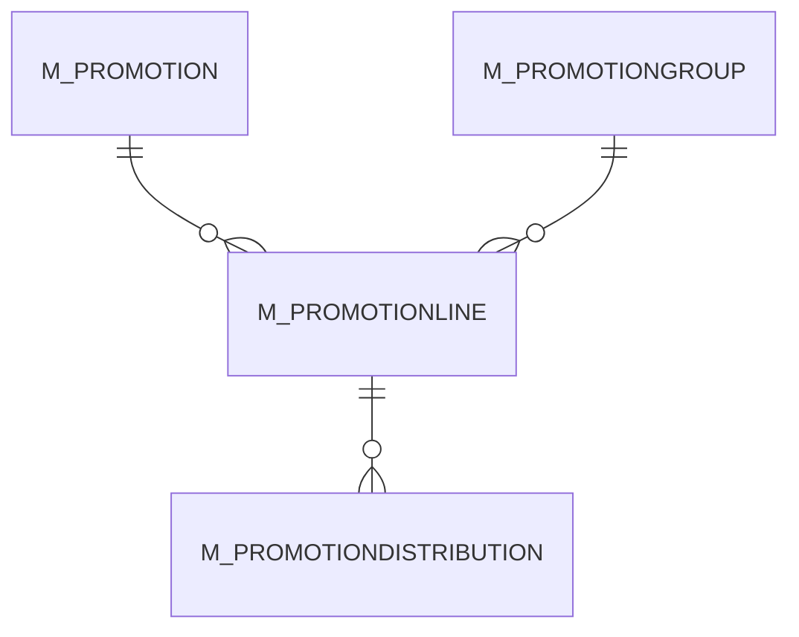

# M_PROMOTIONLINE

Area [M](../../data-model/m/index.md) · class **business** (proposed) · read from database `idempiere-db` (owner `ADEMPIERE`) · 0 row(s) when profiled

## Columns

| column | type | key | not null | business name | references (code) | nulls | distinct |
|---|---|---|---|---|---|---|---|
| `AD_CLIENT_ID` | NUMBER(10,0) |  | yes |  |  | 0 | 0 |
| `AD_ORG_ID` | NUMBER(10,0) |  | yes |  |  | 0 | 0 |
| `CREATED` | DATE |  | yes |  |  | 0 | 0 |
| `CREATEDBY` | NUMBER(10,0) |  | yes |  |  | 0 | 0 |
| `ISACTIVE` | CHAR(1) |  | yes |  |  | 0 | 0 |
| `ISMANDATORYPL` | CHAR(1) |  | yes |  |  | 0 | 0 |
| `M_PROMOTIONGROUP_ID` | NUMBER(10,0) |  |  |  |  | 0 | 0 |
| `M_PROMOTIONLINE_ID` | NUMBER(10,0) | PK | yes |  |  | 0 | 0 |
| `M_PROMOTION_ID` | NUMBER(10,0) |  | yes |  |  | 0 | 0 |
| `MINIMUMAMT` | NUMBER |  |  |  |  | 0 | 0 |
| `UPDATED` | DATE |  | yes |  |  | 0 | 0 |
| `UPDATEDBY` | NUMBER(10,0) |  | yes |  |  | 0 | 0 |
| `M_PROMOTIONLINE_UU` | VARCHAR2(36 CHAR) |  |  |  |  | 0 | 0 |

*references (code)* is the table the application model's code says a column points to; *Foreign keys* below are the constraints the database declares. Counts come from the profile; no value is ever shown.

## Check constraints

| name | expression |
|---|---|
| `SYS_C0022510` | `IsActive IN ('Y','N')` |
| `SYS_C0022512` | `IsMandatoryPL IN ('Y','N')` |

## Foreign keys

**References**

| table | columns | on delete |
|---|---|---|
| [M_PROMOTION](../../data-model/m/m_promotion.md) | M_PROMOTIONLINE.M_PROMOTION_ID → M_PROMOTION.M_PROMOTION_ID | NO ACTION |
| [M_PROMOTIONGROUP](../../data-model/m/m_promotiongroup.md) | M_PROMOTIONLINE.M_PROMOTIONGROUP_ID → M_PROMOTIONGROUP.M_PROMOTIONGROUP_ID | NO ACTION |

**Referenced by**

| table | columns | on delete |
|---|---|---|
| [M_PROMOTIONDISTRIBUTION](../../data-model/m/m_promotiondistribution.md) | M_PROMOTIONDISTRIBUTION.M_PROMOTIONLINE_ID → M_PROMOTIONLINE.M_PROMOTIONLINE_ID | NO ACTION |

## Write behaviour

- updates: **po_only**
- deletes: **deleted_by_users**
- change log: **recorded**
- evidence: 1 citation(s)

## Schema history

17 change(s); the latest:

| applied | release | operation | column | tickets |
|---|---|---|---|---|
| 2023-04-09T15:47 | iD11 | `add_constraint` |  | IDEMPIERE-5567 |
| 2023-04-09T15:47 | iD11 | `add_constraint` |  | IDEMPIERE-5567 |
| 2021-12-05T16:45 | i8.2z | `add_constraint` |  | IDEMPIERE-5075 |
| 2021-12-05T16:45 | i8.2z | `drop_constraint` |  | IDEMPIERE-5075 |
| 2021-12-05T16:45 | i8.2z | `add_constraint` |  | IDEMPIERE-5075 |
| 2021-12-05T16:45 | i8.2z | `drop_constraint` |  | IDEMPIERE-5075 |
| 2020-08-04T01:00 | i7.1z | `modify_column` | M_PROMOTIONLINE_UU | IDEMPIERE-3862 |
| 2020-08-04T01:00 | i7.1z | `add_column` | tmp_col_1_tmp | IDEMPIERE-3862 |
| 2020-08-04T01:00 | i7.1z | `drop_column` | tmp_col_1_tmp | IDEMPIERE-3862 |
| 2014-05-02T10:09 | i2.0 | `modify_column` | created | IDEMPIERE-709 |
| 2014-05-02T10:09 | i2.0 | `modify_column` | updated | IDEMPIERE-709 |
| 2014-04-17T15:00 | i2.0 | `modify_column` | created | IDEMPIERE-709 |
| 2014-04-17T15:00 | i2.0 | `modify_column` | updated | IDEMPIERE-709 |
| 2014-04-17T15:00 | i2.0 | `modify_column` | updated | IDEMPIERE-709 |
| 2014-04-17T15:00 | i2.0 | `modify_column` | created | IDEMPIERE-709 |

## Open conflicts

| type | attribute | explanation |
|---|---|---|
| `table_without_model` | `model_class` | unexplained |

## Notes

<!-- ekos:manual id="table.m_promotionline.notes" -->
_Business notes about this table._
<!-- /ekos:manual -->
