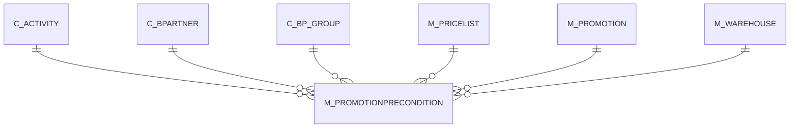

# M_PROMOTIONPRECONDITION

Area [M](../../data-model/m/index.md) · class **business** (proposed) · read from database `idempiere-db` (owner `ADEMPIERE`) · 0 row(s) when profiled

## Columns

| column | type | key | not null | business name | references (code) | nulls | distinct |
|---|---|---|---|---|---|---|---|
| `AD_CLIENT_ID` | NUMBER(10,0) |  | yes |  |  | 0 | 0 |
| `AD_ORG_ID` | NUMBER(10,0) |  | yes |  |  | 0 | 0 |
| `C_BP_GROUP_ID` | NUMBER(10,0) |  |  |  |  | 0 | 0 |
| `C_BPARTNER_ID` | NUMBER(10,0) |  |  |  |  | 0 | 0 |
| `CREATED` | DATE |  | yes |  |  | 0 | 0 |
| `CREATEDBY` | NUMBER(10,0) |  | yes |  |  | 0 | 0 |
| `ENDDATE` | DATE |  |  |  |  | 0 | 0 |
| `ISACTIVE` | CHAR(1) |  | yes |  |  | 0 | 0 |
| `M_PRICELIST_ID` | NUMBER(10,0) |  |  |  |  | 0 | 0 |
| `M_PROMOTIONPRECONDITION_ID` | NUMBER(10,0) | PK | yes |  |  | 0 | 0 |
| `M_PROMOTION_ID` | NUMBER(10,0) |  | yes |  |  | 0 | 0 |
| `M_WAREHOUSE_ID` | NUMBER(10,0) |  |  |  |  | 0 | 0 |
| `PROMOTIONCODE` | VARCHAR2(30 CHAR) |  |  |  |  | 0 | 0 |
| `PROMOTIONCOUNTER` | NUMBER(10,0) |  |  |  |  | 0 | 0 |
| `PROMOTIONUSAGELIMIT` | NUMBER(10,0) |  |  |  |  | 0 | 0 |
| `SEQNO` | NUMBER(10,0) |  | yes |  |  | 0 | 0 |
| `STARTDATE` | DATE |  | yes |  |  | 0 | 0 |
| `UPDATED` | DATE |  | yes |  |  | 0 | 0 |
| `UPDATEDBY` | NUMBER(10,0) |  | yes |  |  | 0 | 0 |
| `C_ACTIVITY_ID` | NUMBER(10,0) |  |  |  |  | 0 | 0 |
| `M_PROMOTIONPRECONDITION_UU` | VARCHAR2(36 CHAR) |  |  |  |  | 0 | 0 |

*references (code)* is the table the application model's code says a column points to; *Foreign keys* below are the constraints the database declares. Counts come from the profile; no value is ever shown.

## Check constraints

| name | expression |
|---|---|
| `SYS_C0022963` | `IsActive IN ('Y','N')` |

## Foreign keys

**References**

| table | columns | on delete |
|---|---|---|
| [C_ACTIVITY](../../data-model/c/c_activity.md) | M_PROMOTIONPRECONDITION.C_ACTIVITY_ID → C_ACTIVITY.C_ACTIVITY_ID | NO ACTION |
| [C_BPARTNER](../../data-model/c/c_bpartner.md) | M_PROMOTIONPRECONDITION.C_BPARTNER_ID → C_BPARTNER.C_BPARTNER_ID | NO ACTION |
| [C_BP_GROUP](../../data-model/c/c_bp_group.md) | M_PROMOTIONPRECONDITION.C_BP_GROUP_ID → C_BP_GROUP.C_BP_GROUP_ID | NO ACTION |
| [M_PRICELIST](../../data-model/m/m_pricelist.md) | M_PROMOTIONPRECONDITION.M_PRICELIST_ID → M_PRICELIST.M_PRICELIST_ID | NO ACTION |
| [M_PROMOTION](../../data-model/m/m_promotion.md) | M_PROMOTIONPRECONDITION.M_PROMOTION_ID → M_PROMOTION.M_PROMOTION_ID | NO ACTION |
| [M_WAREHOUSE](../../data-model/m/m_warehouse.md) | M_PROMOTIONPRECONDITION.M_WAREHOUSE_ID → M_WAREHOUSE.M_WAREHOUSE_ID | NO ACTION |

**Referenced by**

_None._

## Write behaviour

- updates: **po_only**
- deletes: **deleted_by_users**
- change log: **recorded**
- evidence: 1 citation(s)

## Schema history

28 change(s); the latest:

| applied | release | operation | column | tickets |
|---|---|---|---|---|
| 2023-04-09T15:47 | iD11 | `add_constraint` |  | IDEMPIERE-5567 |
| 2023-04-09T15:47 | iD11 | `add_constraint` |  | IDEMPIERE-5567 |
| 2021-12-05T16:45 | i8.2z | `drop_constraint` |  | IDEMPIERE-5075 |
| 2021-12-05T16:45 | i8.2z | `drop_constraint` |  | IDEMPIERE-5075 |
| 2021-12-05T16:45 | i8.2z | `add_constraint` |  | IDEMPIERE-5075 |
| 2021-12-05T16:45 | i8.2z | `drop_constraint` |  | IDEMPIERE-5075 |
| 2021-12-05T16:45 | i8.2z | `drop_constraint` |  | IDEMPIERE-5075 |
| 2021-12-05T16:45 | i8.2z | `add_constraint` |  | IDEMPIERE-5075 |
| 2021-12-05T16:45 | i8.2z | `drop_constraint` |  | IDEMPIERE-5075 |
| 2021-12-05T16:45 | i8.2z | `add_constraint` |  | IDEMPIERE-5075 |
| 2021-12-05T16:45 | i8.2z | `add_constraint` |  | IDEMPIERE-5075 |
| 2021-12-05T16:45 | i8.2z | `add_constraint` |  | IDEMPIERE-5075 |
| 2021-12-05T16:45 | i8.2z | `drop_constraint` |  | IDEMPIERE-5075 |
| 2021-12-05T16:45 | i8.2z | `add_constraint` |  | IDEMPIERE-5075 |
| 2020-08-04T01:00 | i7.1z | `modify_column` | M_PROMOTIONPRECONDITION_UU | IDEMPIERE-3862 |

## Open conflicts

| type | attribute | explanation |
|---|---|---|
| `table_without_model` | `model_class` | unexplained |

## Notes

<!-- ekos:manual id="table.m_promotionprecondition.notes" -->
_Business notes about this table._
<!-- /ekos:manual -->
