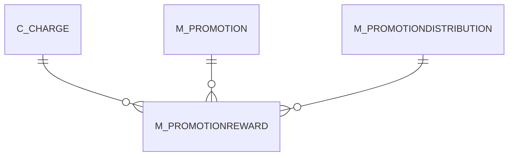

# M_PROMOTIONREWARD

Area [M](../../data-model/m/index.md) · class **business** (proposed) · read from database `idempiere-db` (owner `ADEMPIERE`) · 0 row(s) when profiled

## Columns

| column | type | key | not null | business name | references (code) | nulls | distinct |
|---|---|---|---|---|---|---|---|
| `AD_CLIENT_ID` | NUMBER(10,0) |  | yes |  |  | 0 | 0 |
| `AD_ORG_ID` | NUMBER(10,0) |  | yes |  |  | 0 | 0 |
| `AMOUNT` | NUMBER |  |  |  |  | 0 | 0 |
| `C_CHARGE_ID` | NUMBER(10,0) |  |  |  |  | 0 | 0 |
| `CREATED` | DATE |  | yes |  |  | 0 | 0 |
| `CREATEDBY` | NUMBER(10,0) |  | yes |  |  | 0 | 0 |
| `DISTRIBUTIONSORTING` | CHAR(1) |  |  |  |  | 0 | 0 |
| `ISACTIVE` | CHAR(1) |  | yes |  |  | 0 | 0 |
| `ISFORALLDISTRIBUTION` | CHAR(1) |  | yes |  |  | 0 | 0 |
| `ISSAMEDISTRIBUTION` | CHAR(1) |  | yes |  |  | 0 | 0 |
| `M_PROMOTIONDISTRIBUTION_ID` | NUMBER(10,0) |  |  |  |  | 0 | 0 |
| `M_PROMOTIONREWARD_ID` | NUMBER(10,0) | PK | yes |  |  | 0 | 0 |
| `M_PROMOTION_ID` | NUMBER(10,0) |  | yes |  |  | 0 | 0 |
| `M_TARGETDISTRIBUTION_ID` | NUMBER(10,0) |  |  |  |  | 0 | 0 |
| `QTY` | NUMBER |  |  |  |  | 0 | 0 |
| `REWARDTYPE` | CHAR(1) |  | yes |  |  | 0 | 0 |
| `SEQNO` | NUMBER(10,0) |  | yes |  |  | 0 | 0 |
| `UPDATED` | DATE |  | yes |  |  | 0 | 0 |
| `UPDATEDBY` | NUMBER(10,0) |  | yes |  |  | 0 | 0 |
| `M_PROMOTIONREWARD_UU` | VARCHAR2(36 CHAR) |  |  |  |  | 0 | 0 |

*references (code)* is the table the application model's code says a column points to; *Foreign keys* below are the constraints the database declares. Counts come from the profile; no value is ever shown.

## Check constraints

| name | expression |
|---|---|
| `SYS_C0021825` | `IsForAllDistribution IN ('Y','N')` |
| `SYS_C0021826` | `IsActive IN ('Y','N')` |
| `SYS_C0021829` | `IsSameDistribution IN ('Y','N')` |

## Foreign keys

**References**

| table | columns | on delete |
|---|---|---|
| [C_CHARGE](../../data-model/c/c_charge.md) | M_PROMOTIONREWARD.C_CHARGE_ID → C_CHARGE.C_CHARGE_ID | NO ACTION |
| [M_PROMOTION](../../data-model/m/m_promotion.md) | M_PROMOTIONREWARD.M_PROMOTION_ID → M_PROMOTION.M_PROMOTION_ID | NO ACTION |
| [M_PROMOTIONDISTRIBUTION](../../data-model/m/m_promotiondistribution.md) | M_PROMOTIONREWARD.M_PROMOTIONDISTRIBUTION_ID → M_PROMOTIONDISTRIBUTION.M_PROMOTIONDISTRIBUTION_ID | NO ACTION |

**Referenced by**

_None._

## Write behaviour

- updates: **po_only**
- deletes: **deleted_by_users**
- change log: **recorded**
- evidence: 1 citation(s)

## Schema history

25 change(s); the latest:

| applied | release | operation | column | tickets |
|---|---|---|---|---|
| 2024-06-17T13:22 | iD12 | `modify_column` | IsSameDistribution | IDEMPIERE-2826 |
| 2024-06-17T13:22 | iD12 | `modify_column` | IsSameDistribution | IDEMPIERE-2826 |
| 2024-06-17T13:22 | iD12 | `modify_column` | IsSameDistribution | IDEMPIERE-2826 |
| 2024-06-17T13:22 | iD12 | `modify_column` | IsSameDistribution | IDEMPIERE-2826 |
| 2023-04-09T15:47 | iD11 | `add_constraint` |  | IDEMPIERE-5567 |
| 2023-04-09T15:47 | iD11 | `add_constraint` |  | IDEMPIERE-5567 |
| 2021-12-05T16:45 | i8.2z | `add_constraint` |  | IDEMPIERE-5075 |
| 2021-12-05T16:45 | i8.2z | `add_constraint` |  | IDEMPIERE-5075 |
| 2021-12-05T16:45 | i8.2z | `drop_constraint` |  | IDEMPIERE-5075 |
| 2021-12-05T16:45 | i8.2z | `drop_constraint` |  | IDEMPIERE-5075 |
| 2021-12-05T16:45 | i8.2z | `drop_constraint` |  | IDEMPIERE-5075 |
| 2021-12-05T16:45 | i8.2z | `add_constraint` |  | IDEMPIERE-5075 |
| 2021-12-05T16:45 | i8.2z | `drop_constraint` |  | IDEMPIERE-5075 |
| 2021-12-05T16:45 | i8.2z | `add_constraint` |  | IDEMPIERE-5075 |
| 2020-08-04T01:00 | i7.1z | `add_column` | tmp_col_1_tmp | IDEMPIERE-3862 |

## Open conflicts

| type | attribute | explanation |
|---|---|---|
| `table_without_model` | `model_class` | unexplained |

## Notes

<!-- ekos:manual id="table.m_promotionreward.notes" -->
_Business notes about this table._
<!-- /ekos:manual -->
