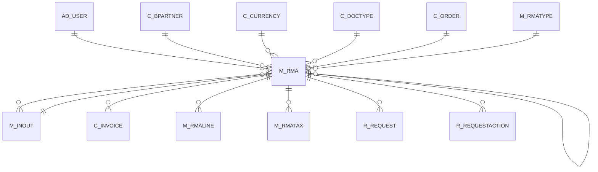

# M_RMA

Area [M](../../data-model/m/index.md) · class **business** (proposed) · read from database `idempiere-db` (owner `ADEMPIERE`) · 1 row(s) when profiled

Application model: `org.compiere.model.X_M_RMA`, access level 1 - Org.

## Columns

| column | type | key | not null | business name | references (code) | nulls | distinct |
|---|---|---|---|---|---|---|---|
| `M_RMA_ID` | NUMBER(10,0) | PK | yes | RMA |  | 0 | 1 |
| `AD_CLIENT_ID` | NUMBER(10,0) |  | yes | Tenant |  | 0 | 1 |
| `AD_ORG_ID` | NUMBER(10,0) |  | yes | Organization |  | 0 | 1 |
| `ISACTIVE` | CHAR(1) |  | yes | Active |  | 0 | 1 |
| `CREATED` | DATE |  | yes | Created |  | 0 | 1 |
| `CREATEDBY` | NUMBER(10,0) |  | yes | Created By |  | 0 | 1 |
| `UPDATED` | DATE |  | yes | Updated |  | 0 | 1 |
| `UPDATEDBY` | NUMBER(10,0) |  | yes | Updated By |  | 0 | 1 |
| `DOCUMENTNO` | VARCHAR2(30 CHAR) |  | yes | Document No |  | 0 | 1 |
| `NAME` | VARCHAR2(60 CHAR) |  | yes | Name |  | 0 | 1 |
| `DESCRIPTION` | VARCHAR2(255 CHAR) |  |  | Description |  | 1 | 0 |
| `INOUT_ID` | NUMBER(10,0) |  | yes | Shipment/Receipt | [M_INOUT](../../data-model/m/m_inout.md) | 0 | 1 |
| `PROCESSING` | CHAR(1) |  |  | Process Now |  | 0 | 1 |
| `PROCESSED` | CHAR(1) |  | yes | Processed |  | 0 | 1 |
| `C_ORDER_ID` | NUMBER(10,0) |  |  | Order | [C_ORDER](../../data-model/c/c_order.md) | 1 | 0 |
| `C_DOCTYPE_ID` | NUMBER(10,0) |  | yes | Document Type | [C_DOCTYPE](../../data-model/c/c_doctype.md) | 0 | 1 |
| `SALESREP_ID` | NUMBER(10,0) |  | yes | Sales Representative | [AD_USER](../../data-model/ad/ad_user.md) | 0 | 1 |
| `DOCACTION` | CHAR(2) |  | yes | Document Action |  | 0 | 1 |
| `DOCSTATUS` | CHAR(2) |  | yes | Document Status |  | 0 | 1 |
| `ISAPPROVED` | CHAR(1) |  | yes | Approved |  | 0 | 1 |
| `AMT` | NUMBER |  |  | Amount |  | 0 | 1 |
| `M_RMATYPE_ID` | NUMBER(10,0) |  |  | RMA Type | [M_RMATYPE](../../data-model/m/m_rmatype.md) | 0 | 1 |
| `HELP` | VARCHAR2(2000 CHAR) |  |  | Comment/Help |  | 1 | 0 |
| `C_CURRENCY_ID` | NUMBER(10,0) |  |  | Currency | [C_CURRENCY](../../data-model/c/c_currency.md) | 0 | 1 |
| `C_BPARTNER_ID` | NUMBER(10,0) |  |  | Business Partner | [C_BPARTNER](../../data-model/c/c_bpartner.md) | 0 | 1 |
| `ISSOTRX` | CHAR(1) |  | yes | Sales Transaction |  | 0 | 1 |
| `GENERATETO` | CHAR(1) |  |  | Generate To |  | 1 | 0 |
| `REF_RMA_ID` | NUMBER(10,0) |  |  | Referenced RMA | [M_RMA](../../data-model/m/m_rma.md) | 1 | 0 |
| `M_RMA_UU` | VARCHAR2(36 CHAR) |  |  | M_RMA_UU |  | 0 | 1 |
| `CREATEFROM` | CHAR(1) |  |  | Create lines from |  | 1 | 0 |
| `CREATELINESFROM` | CHAR(1) |  |  | Create lines from |  | 1 | 0 |

*references (code)* is the table the application model's code says a column points to; *Foreign keys* below are the constraints the database declares. Counts come from the profile; no value is ever shown.

## Check constraints

| name | expression |
|---|---|
| `SYS_C0020937` | `IsSOTrx IN ('Y', 'N')` |

## Foreign keys

**References**

| table | columns | on delete |
|---|---|---|
| [AD_USER](../../data-model/ad/ad_user.md) | M_RMA.SALESREP_ID → AD_USER.AD_USER_ID | NO ACTION |
| [C_BPARTNER](../../data-model/c/c_bpartner.md) | M_RMA.C_BPARTNER_ID → C_BPARTNER.C_BPARTNER_ID | NO ACTION |
| [C_CURRENCY](../../data-model/c/c_currency.md) | M_RMA.C_CURRENCY_ID → C_CURRENCY.C_CURRENCY_ID | NO ACTION |
| [C_DOCTYPE](../../data-model/c/c_doctype.md) | M_RMA.C_DOCTYPE_ID → C_DOCTYPE.C_DOCTYPE_ID | NO ACTION |
| [C_ORDER](../../data-model/c/c_order.md) | M_RMA.C_ORDER_ID → C_ORDER.C_ORDER_ID | NO ACTION |
| [M_INOUT](../../data-model/m/m_inout.md) | M_RMA.INOUT_ID → M_INOUT.M_INOUT_ID | NO ACTION |
| [M_RMA](../../data-model/m/m_rma.md) | M_RMA.REF_RMA_ID → M_RMA.M_RMA_ID | NO ACTION |
| [M_RMATYPE](../../data-model/m/m_rmatype.md) | M_RMA.M_RMATYPE_ID → M_RMATYPE.M_RMATYPE_ID | NO ACTION |

**Referenced by**

| table | columns | on delete |
|---|---|---|
| [C_INVOICE](../../data-model/c/c_invoice.md) | C_INVOICE.M_RMA_ID → M_RMA.M_RMA_ID | NO ACTION |
| [M_INOUT](../../data-model/m/m_inout.md) | M_INOUT.M_RMA_ID → M_RMA.M_RMA_ID | NO ACTION |
| [M_RMA](../../data-model/m/m_rma.md) | M_RMA.REF_RMA_ID → M_RMA.M_RMA_ID | NO ACTION |
| [M_RMALINE](../../data-model/m/m_rmaline.md) | M_RMALINE.M_RMA_ID → M_RMA.M_RMA_ID | NO ACTION |
| [M_RMATAX](../../data-model/m/m_rmatax.md) | M_RMATAX.M_RMA_ID → M_RMA.M_RMA_ID | NO ACTION |
| [R_REQUEST](../../data-model/r/r_request.md) | R_REQUEST.M_RMA_ID → M_RMA.M_RMA_ID | NO ACTION |
| [R_REQUESTACTION](../../data-model/r/r_requestaction.md) | R_REQUESTACTION.M_RMA_ID → M_RMA.M_RMA_ID | NO ACTION |

## Write behaviour

- updates: **raw_sql_skips_updated**
- deletes: **deleted_by_users**
- change log: **recorded**
- evidence: 2 citation(s)

## Read by

| kind | name |
|---|---|
| View | `C_INVOICE_CANDIDATE_V` |
| View | `C_INVOICE_CREATEFROM_V` |
| View | `M_INOUT_CANDIDATE_V` |
| View | `M_INOUT_CREATEFROM_V` |
| View | `M_RMA_CREATEFROM_V` |
| View | `c_invoice_candidate_v` |
| View | `c_invoice_createfrom_v` |
| View | `m_inout_candidate_v` |
| View | `m_inout_createfrom_v` |
| View | `m_rma_createfrom_v` |

## Schema history

41 change(s); the latest:

| applied | release | operation | column | tickets |
|---|---|---|---|---|
| 2023-04-09T15:47 | iD11 | `add_constraint` |  | IDEMPIERE-5567 |
| 2023-04-09T15:47 | iD11 | `add_constraint` |  | IDEMPIERE-5567 |
| 2022-09-05T12:34 | i9 | `add_column` | CreateLinesFrom | IDEMPIERE-5396 |
| 2022-09-05T12:34 | i9 | `add_column` | CreateLinesFrom | IDEMPIERE-5396 |
| 2021-12-05T16:45 | i8.2z | `drop_constraint` |  | IDEMPIERE-5075 |
| 2021-12-05T16:45 | i8.2z | `drop_constraint` |  | IDEMPIERE-5075 |
| 2021-12-05T16:45 | i8.2z | `drop_constraint` |  | IDEMPIERE-5075 |
| 2021-12-05T16:45 | i8.2z | `drop_constraint` |  | IDEMPIERE-5075 |
| 2021-12-05T16:45 | i8.2z | `drop_constraint` |  | IDEMPIERE-5075 |
| 2021-12-05T16:45 | i8.2z | `drop_constraint` |  | IDEMPIERE-5075 |
| 2021-12-05T16:45 | i8.2z | `drop_constraint` |  | IDEMPIERE-5075 |
| 2021-12-05T16:45 | i8.2z | `add_constraint` |  | IDEMPIERE-5075 |
| 2021-12-05T16:45 | i8.2z | `drop_constraint` |  | IDEMPIERE-5075 |
| 2021-12-05T16:45 | i8.2z | `add_constraint` |  | IDEMPIERE-5075 |
| 2021-12-05T16:45 | i8.2z | `add_constraint` |  | IDEMPIERE-5075 |

## Open conflicts

| type | attribute | explanation |
|---|---|---|
| `mandatory_but_nullable` | `columns.M_RMAType_ID.nullable` | unexplained |

## Notes

<!-- ekos:manual id="table.m_rma.notes" -->
_Business notes about this table._
<!-- /ekos:manual -->
