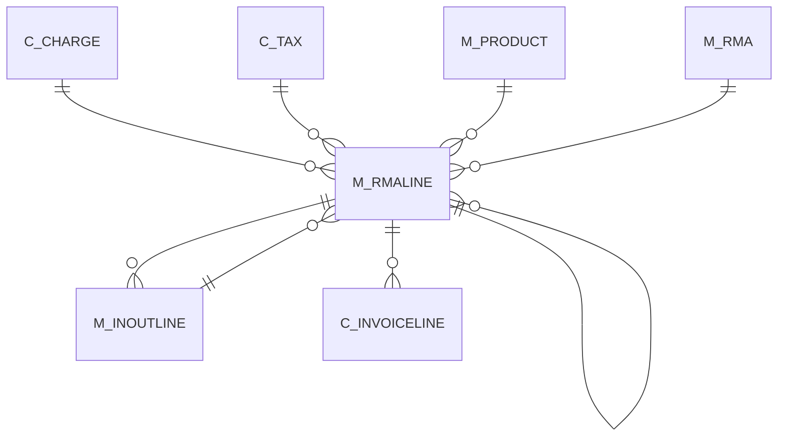

# M_RMALINE

Area [M](../../data-model/m/index.md) · class **business** (proposed) · read from database `idempiere-db` (owner `ADEMPIERE`) · 1 row(s) when profiled

Application model: `org.compiere.model.X_M_RMALine`, access level 1 - Org.

## Columns

| column | type | key | not null | business name | references (code) | nulls | distinct |
|---|---|---|---|---|---|---|---|
| `M_RMALINE_ID` | NUMBER(10,0) | PK | yes | RMA Line |  | 0 | 1 |
| `AD_CLIENT_ID` | NUMBER(10,0) |  | yes | Tenant |  | 0 | 1 |
| `AD_ORG_ID` | NUMBER(10,0) |  | yes | Organization |  | 0 | 1 |
| `ISACTIVE` | CHAR(1) |  | yes | Active |  | 0 | 1 |
| `CREATED` | DATE |  | yes | Created |  | 0 | 1 |
| `CREATEDBY` | NUMBER(10,0) |  | yes | Created By |  | 0 | 1 |
| `UPDATED` | DATE |  | yes | Updated |  | 0 | 1 |
| `UPDATEDBY` | NUMBER(10,0) |  | yes | Updated By |  | 0 | 1 |
| `M_RMA_ID` | NUMBER(10,0) |  | yes | RMA | [M_RMA](../../data-model/m/m_rma.md) | 0 | 1 |
| `M_INOUTLINE_ID` | NUMBER(10,0) |  |  | Shipment/Receipt Line | [M_INOUTLINE](../../data-model/m/m_inoutline.md) | 0 | 1 |
| `QTY` | NUMBER |  | yes | Quantity |  | 0 | 1 |
| `DESCRIPTION` | VARCHAR2(255 CHAR) |  |  | Description |  | 1 | 0 |
| `PROCESSED` | CHAR(1) |  | yes | Processed |  | 0 | 1 |
| `AMT` | NUMBER(22,2) |  |  | Amount |  | 0 | 1 |
| `C_CHARGE_ID` | NUMBER(10,0) |  |  | Charge | [C_CHARGE](../../data-model/c/c_charge.md) | 1 | 0 |
| `LINE` | NUMBER(10,0) |  | yes | Line No |  | 0 | 1 |
| `LINENETAMT` | NUMBER(22,2) |  |  | Line Amount |  | 0 | 1 |
| `QTYDELIVERED` | NUMBER(22,2) |  |  | Delivered Quantity |  | 1 | 0 |
| `QTYINVOICED` | NUMBER |  |  | Quantity Invoiced |  | 1 | 0 |
| `REF_RMALINE_ID` | NUMBER(10,0) |  |  | Referenced RMA Line | [M_RMALINE](../../data-model/m/m_rmaline.md) | 1 | 0 |
| `M_RMALINE_UU` | VARCHAR2(36 CHAR) |  |  | M_RMALine_UU |  | 0 | 1 |
| `C_TAX_ID` | NUMBER(10,0) |  | yes | Tax | [C_TAX](../../data-model/c/c_tax.md) | 0 | 1 |
| `M_PRODUCT_ID` | NUMBER(10,0) |  |  | Product | [M_PRODUCT](../../data-model/m/m_product.md) | 0 | 1 |

*references (code)* is the table the application model's code says a column points to; *Foreign keys* below are the constraints the database declares. Counts come from the profile; no value is ever shown.

## Foreign keys

**References**

| table | columns | on delete |
|---|---|---|
| [C_CHARGE](../../data-model/c/c_charge.md) | M_RMALINE.C_CHARGE_ID → C_CHARGE.C_CHARGE_ID | NO ACTION |
| [C_TAX](../../data-model/c/c_tax.md) | M_RMALINE.C_TAX_ID → C_TAX.C_TAX_ID | NO ACTION |
| [M_INOUTLINE](../../data-model/m/m_inoutline.md) | M_RMALINE.M_INOUTLINE_ID → M_INOUTLINE.M_INOUTLINE_ID | NO ACTION |
| [M_PRODUCT](../../data-model/m/m_product.md) | M_RMALINE.M_PRODUCT_ID → M_PRODUCT.M_PRODUCT_ID | NO ACTION |
| [M_RMA](../../data-model/m/m_rma.md) | M_RMALINE.M_RMA_ID → M_RMA.M_RMA_ID | NO ACTION |
| [M_RMALINE](../../data-model/m/m_rmaline.md) | M_RMALINE.REF_RMALINE_ID → M_RMALINE.M_RMALINE_ID | NO ACTION |

**Referenced by**

| table | columns | on delete |
|---|---|---|
| [C_INVOICELINE](../../data-model/c/c_invoiceline.md) | C_INVOICELINE.M_RMALINE_ID → M_RMALINE.M_RMALINE_ID | NO ACTION |
| [M_INOUTLINE](../../data-model/m/m_inoutline.md) | M_INOUTLINE.M_RMALINE_ID → M_RMALINE.M_RMALINE_ID | NO ACTION |
| [M_RMALINE](../../data-model/m/m_rmaline.md) | M_RMALINE.REF_RMALINE_ID → M_RMALINE.M_RMALINE_ID | NO ACTION |

## Write behaviour

- updates: **raw_sql_skips_updated**
- deletes: **deleted_by_users**
- change log: **recorded**
- evidence: 2 citation(s)

## Read by

| kind | name |
|---|---|
| View | `C_INVOICE_CANDIDATE_V` |
| View | `C_INVOICE_CREATEFROM_V` |
| View | `M_INOUTLINEMA_RETURNED` |
| View | `M_INOUT_CANDIDATE_V` |
| View | `M_INOUT_CREATEFROM_V` |
| View | `M_RMA_CREATEFROM_V` |
| View | `c_invoice_candidate_v` |
| View | `c_invoice_createfrom_v` |
| View | `m_inout_candidate_v` |
| View | `m_inout_createfrom_v` |
| View | `m_inoutlinema_returned` |
| View | `m_rma_createfrom_v` |

## Schema history

36 change(s); the latest:

| applied | release | operation | column | tickets |
|---|---|---|---|---|
| 2024-05-14T13:59 | iD13 | `add_column` | C_CostCenter_ID | IDEMPIERE-5598 |
| 2024-05-14T13:59 | iD13 | `add_constraint` |  | IDEMPIERE-5598 |
| 2024-05-14T13:59 | iD13 | `add_column` | C_CostCenter_ID | IDEMPIERE-5598 |
| 2024-05-14T13:59 | iD13 | `add_constraint` |  | IDEMPIERE-5598 |
| 2024-05-14T13:59 | iD13 | `add_column` | C_Department_ID | IDEMPIERE-5598 |
| 2024-05-14T13:59 | iD13 | `add_constraint` |  | IDEMPIERE-5598 |
| 2024-05-14T13:59 | iD13 | `add_column` | C_Department_ID | IDEMPIERE-5598 |
| 2024-05-14T13:59 | iD13 | `add_constraint` |  | IDEMPIERE-5598 |
| 2023-04-09T15:47 | iD11 | `add_constraint` |  | IDEMPIERE-5567 |
| 2023-04-09T15:47 | iD11 | `add_constraint` |  | IDEMPIERE-5567 |
| 2021-12-05T16:45 | i8.2z | `drop_constraint` |  | IDEMPIERE-5075 |
| 2021-12-05T16:45 | i8.2z | `drop_constraint` |  | IDEMPIERE-5075 |
| 2021-12-05T16:45 | i8.2z | `add_constraint` |  | IDEMPIERE-5075 |
| 2021-12-05T16:45 | i8.2z | `add_constraint` |  | IDEMPIERE-5075 |
| 2021-12-05T16:45 | i8.2z | `drop_constraint` |  | IDEMPIERE-5075 |

## Open conflicts

| type | attribute | explanation |
|---|---|---|
| `model_column_missing` | `columns.C_CostCenter_ID` | unexplained |
| `model_column_missing` | `columns.C_Department_ID` | unexplained |

## Notes

<!-- ekos:manual id="table.m_rmaline.notes" -->
_Business notes about this table._
<!-- /ekos:manual -->
