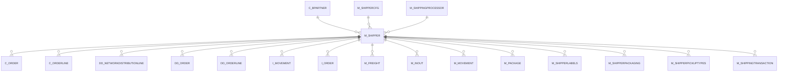

# M_SHIPPER

Area [M](../../data-model/m/index.md) · class **business** (proposed) · read from database `idempiere-db` (owner `ADEMPIERE`) · 3 row(s) when profiled

Application model: `org.compiere.model.X_M_Shipper`, access level 3 - Client - Org.

## Columns

| column | type | key | not null | business name | references (code) | nulls | distinct |
|---|---|---|---|---|---|---|---|
| `M_SHIPPER_ID` | NUMBER(10,0) | PK | yes | Shipper |  | 0 | 3 |
| `AD_CLIENT_ID` | NUMBER(10,0) |  | yes | Tenant |  | 0 | 1 |
| `AD_ORG_ID` | NUMBER(10,0) |  | yes | Organization |  | 0 | 2 |
| `ISACTIVE` | CHAR(1) |  | yes | Active |  | 0 | 1 |
| `CREATED` | DATE |  | yes | Created |  | 0 | 3 |
| `CREATEDBY` | NUMBER(10,0) |  | yes | Created By |  | 0 | 1 |
| `UPDATED` | DATE |  | yes | Updated |  | 0 | 3 |
| `UPDATEDBY` | NUMBER(10,0) |  | yes | Updated By |  | 0 | 1 |
| `C_BPARTNER_ID` | NUMBER(10,0) |  |  | Business Partner | [C_BPARTNER](../../data-model/c/c_bpartner.md) | 3 | 0 |
| `M_SHIPPER_UU` | VARCHAR2(36 CHAR) |  |  | M_Shipper_UU |  | 0 | 3 |
| `M_SHIPPINGPROCESSOR_ID` | NUMBER(10,0) |  |  | Shipping Processor | [M_SHIPPINGPROCESSOR](../../data-model/m/m_shippingprocessor.md) | 2 | 1 |
| `M_SHIPPERCFG_ID` | NUMBER(10,0) |  |  | Shipper Configuration | [M_SHIPPERCFG](../../data-model/m/m_shippercfg.md) | 2 | 1 |
| `CREATEFROM` | CHAR(1) |  |  | Create lines from |  | 3 | 0 |
| `NAME` | VARCHAR2(60 CHAR) |  | yes | Name |  | 0 | 3 |

*references (code)* is the table the application model's code says a column points to; *Foreign keys* below are the constraints the database declares. Counts come from the profile; no value is ever shown.

## Check constraints

| name | expression |
|---|---|
| `SYS_C0021135` | `IsActive in ('Y','N')` |

## Foreign keys

**References**

| table | columns | on delete |
|---|---|---|
| [C_BPARTNER](../../data-model/c/c_bpartner.md) | M_SHIPPER.C_BPARTNER_ID → C_BPARTNER.C_BPARTNER_ID | NO ACTION |
| [M_SHIPPERCFG](../../data-model/m/m_shippercfg.md) | M_SHIPPER.M_SHIPPERCFG_ID → M_SHIPPERCFG.M_SHIPPERCFG_ID | NO ACTION |
| [M_SHIPPINGPROCESSOR](../../data-model/m/m_shippingprocessor.md) | M_SHIPPER.M_SHIPPINGPROCESSOR_ID → M_SHIPPINGPROCESSOR.M_SHIPPINGPROCESSOR_ID | NO ACTION |

**Referenced by**

| table | columns | on delete |
|---|---|---|
| [C_ORDER](../../data-model/c/c_order.md) | C_ORDER.M_SHIPPER_ID → M_SHIPPER.M_SHIPPER_ID | NO ACTION |
| [C_ORDERLINE](../../data-model/c/c_orderline.md) | C_ORDERLINE.M_SHIPPER_ID → M_SHIPPER.M_SHIPPER_ID | NO ACTION |
| [DD_NETWORKDISTRIBUTIONLINE](../../data-model/dd/dd_networkdistributionline.md) | DD_NETWORKDISTRIBUTIONLINE.M_SHIPPER_ID → M_SHIPPER.M_SHIPPER_ID | NO ACTION |
| [DD_ORDER](../../data-model/dd/dd_order.md) | DD_ORDER.M_SHIPPER_ID → M_SHIPPER.M_SHIPPER_ID | NO ACTION |
| [DD_ORDERLINE](../../data-model/dd/dd_orderline.md) | DD_ORDERLINE.M_SHIPPER_ID → M_SHIPPER.M_SHIPPER_ID | NO ACTION |
| `I_MOVEMENT` | I_MOVEMENT.M_SHIPPER_ID → M_SHIPPER.M_SHIPPER_ID | NO ACTION |
| `I_ORDER` | I_ORDER.M_SHIPPER_ID → M_SHIPPER.M_SHIPPER_ID | SET NULL |
| [M_FREIGHT](../../data-model/m/m_freight.md) | M_FREIGHT.M_SHIPPER_ID → M_SHIPPER.M_SHIPPER_ID | NO ACTION |
| [M_INOUT](../../data-model/m/m_inout.md) | M_INOUT.M_SHIPPER_ID → M_SHIPPER.M_SHIPPER_ID | NO ACTION |
| [M_MOVEMENT](../../data-model/m/m_movement.md) | M_MOVEMENT.M_SHIPPER_ID → M_SHIPPER.M_SHIPPER_ID | NO ACTION |
| [M_PACKAGE](../../data-model/m/m_package.md) | M_PACKAGE.M_SHIPPER_ID → M_SHIPPER.M_SHIPPER_ID | NO ACTION |
| [M_SHIPPERLABELS](../../data-model/m/m_shipperlabels.md) | M_SHIPPERLABELS.M_SHIPPER_ID → M_SHIPPER.M_SHIPPER_ID | NO ACTION |
| [M_SHIPPERPACKAGING](../../data-model/m/m_shipperpackaging.md) | M_SHIPPERPACKAGING.M_SHIPPER_ID → M_SHIPPER.M_SHIPPER_ID | NO ACTION |
| [M_SHIPPERPICKUPTYPES](../../data-model/m/m_shipperpickuptypes.md) | M_SHIPPERPICKUPTYPES.M_SHIPPER_ID → M_SHIPPER.M_SHIPPER_ID | NO ACTION |
| [M_SHIPPINGTRANSACTION](../../data-model/m/m_shippingtransaction.md) | M_SHIPPINGTRANSACTION.M_SHIPPER_ID → M_SHIPPER.M_SHIPPER_ID | NO ACTION |

## Write behaviour

- updates: **po_only**
- deletes: **deleted_by_users**
- change log: **recorded**
- evidence: 1 citation(s)

## Schema history

60 change(s); the latest:

| applied | release | operation | column | tickets |
|---|---|---|---|---|
| 2023-04-09T15:47 | iD11 | `add_constraint` |  | IDEMPIERE-5567 |
| 2023-04-09T15:47 | iD11 | `add_constraint` |  | IDEMPIERE-5567 |
| 2021-12-05T16:45 | i8.2z | `drop_constraint` |  | IDEMPIERE-5075 |
| 2021-12-05T16:45 | i8.2z | `add_constraint` |  | IDEMPIERE-5075 |
| 2020-08-04T01:00 | i7.1z | `modify_column` | NAME | IDEMPIERE-3862 |
| 2020-08-04T01:00 | i7.1z | `drop_column` | tmp_col_2_tmp | IDEMPIERE-3862 |
| 2020-08-04T01:00 | i7.1z | `add_column` | tmp_col_1_tmp | IDEMPIERE-3862 |
| 2020-08-04T01:00 | i7.1z | `add_column` | tmp_col_2_tmp | IDEMPIERE-3862 |
| 2020-08-04T01:00 | i7.1z | `modify_column` | NAME | IDEMPIERE-3862 |
| 2020-08-04T01:00 | i7.1z | `modify_column` | M_SHIPPER_UU | IDEMPIERE-3862 |
| 2020-08-04T01:00 | i7.1z | `drop_column` | tmp_col_1_tmp | IDEMPIERE-3862 |
| 2020-08-04T01:00 | i7.1z | `modify_column` | NAME | IDEMPIERE-3862 |
| 2013-04-18T15:26 | i1.0a-i1.0b | `add_constraint` |  |  |
| 2013-04-18T15:26 | i1.0a-i1.0b | `add_constraint` |  |  |
| 2013-04-18T15:26 | i1.0a-i1.0b | `add_constraint` |  |  |

## Notes

<!-- ekos:manual id="table.m_shipper.notes" -->
_Business notes about this table._
<!-- /ekos:manual -->
