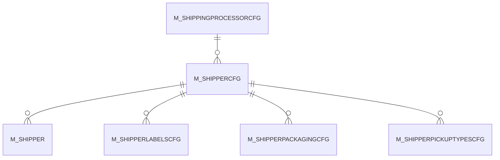

# M_SHIPPERCFG

Area [M](../../data-model/m/index.md) · class **business** (proposed) · read from database `idempiere-db` (owner `ADEMPIERE`) · 1 row(s) when profiled

Application model: `org.compiere.model.X_M_ShipperCfg`, access level 6 - System - Client.

## Columns

| column | type | key | not null | business name | references (code) | nulls | distinct |
|---|---|---|---|---|---|---|---|
| `AD_CLIENT_ID` | NUMBER(10,0) |  | yes | Tenant |  | 0 | 1 |
| `AD_ORG_ID` | NUMBER(10,0) |  | yes | Organization |  | 0 | 1 |
| `CREATED` | DATE |  | yes | Created |  | 0 | 1 |
| `CREATEDBY` | NUMBER(10,0) |  | yes | Created By |  | 0 | 1 |
| `DESCRIPTION` | VARCHAR2(255 CHAR) |  |  | Description |  | 1 | 0 |
| `ISACTIVE` | CHAR(1) |  | yes | Active |  | 0 | 1 |
| `ISINTERNATIONAL` | CHAR(1) |  | yes | International |  | 0 | 1 |
| `ISONLINE` | CHAR(1) |  | yes | Online Access |  | 0 | 1 |
| `ISRESIDENTIAL` | CHAR(1) |  | yes | Residential |  | 0 | 1 |
| `ISSATURDAYDELIVERY` | CHAR(1) |  | yes | Saturday Delivery |  | 0 | 1 |
| `NAME` | VARCHAR2(60 CHAR) |  | yes | Name |  | 0 | 1 |
| `SHIPPINGSERVICECODE` | VARCHAR2(40 CHAR) |  |  | Service Code |  | 1 | 0 |
| `TRACKINGURL` | VARCHAR2(120 CHAR) |  |  | Tracking URL |  | 1 | 0 |
| `UPDATED` | DATE |  | yes | Updated |  | 0 | 1 |
| `UPDATEDBY` | NUMBER(10,0) |  | yes | Updated By |  | 0 | 1 |
| `M_SHIPPERCFG_ID` | NUMBER(10,0) | PK | yes | Shipper Configuration |  | 0 | 1 |
| `M_SHIPPERCFG_UU` | VARCHAR2(36 CHAR) |  |  | M_ShipperCfg_UU |  | 0 | 1 |
| `M_SHIPPINGPROCESSORCFG_ID` | NUMBER(10,0) |  |  | Shipping Processor Configuration | [M_SHIPPINGPROCESSORCFG](../../data-model/m/m_shippingprocessorcfg.md) | 0 | 1 |
| `COPYFROM` | CHAR(1) |  |  | Copy From |  | 0 | 1 |

*references (code)* is the table the application model's code says a column points to; *Foreign keys* below are the constraints the database declares. Counts come from the profile; no value is ever shown.

## Check constraints

| name | expression |
|---|---|
| `SYS_C0019644` | `IsActive IN ('Y','N')` |
| `SYS_C0019646` | `IsResidential IN ('Y','N')` |
| `SYS_C0019647` | `IsSaturdayDelivery IN ('Y','N')` |
| `SYS_C0019650` | `IsOnline IN ('Y','N')` |
| `SYS_C0019651` | `IsInternational IN ('Y','N')` |

## Foreign keys

**References**

| table | columns | on delete |
|---|---|---|
| [M_SHIPPINGPROCESSORCFG](../../data-model/m/m_shippingprocessorcfg.md) | M_SHIPPERCFG.M_SHIPPINGPROCESSORCFG_ID → M_SHIPPINGPROCESSORCFG.M_SHIPPINGPROCESSORCFG_ID | NO ACTION |

**Referenced by**

| table | columns | on delete |
|---|---|---|
| [M_SHIPPER](../../data-model/m/m_shipper.md) | M_SHIPPER.M_SHIPPERCFG_ID → M_SHIPPERCFG.M_SHIPPERCFG_ID | NO ACTION |
| [M_SHIPPERLABELSCFG](../../data-model/m/m_shipperlabelscfg.md) | M_SHIPPERLABELSCFG.M_SHIPPERCFG_ID → M_SHIPPERCFG.M_SHIPPERCFG_ID | NO ACTION |
| [M_SHIPPERPACKAGINGCFG](../../data-model/m/m_shipperpackagingcfg.md) | M_SHIPPERPACKAGINGCFG.M_SHIPPERCFG_ID → M_SHIPPERCFG.M_SHIPPERCFG_ID | NO ACTION |
| [M_SHIPPERPICKUPTYPESCFG](../../data-model/m/m_shipperpickuptypescfg.md) | M_SHIPPERPICKUPTYPESCFG.M_SHIPPERCFG_ID → M_SHIPPERCFG.M_SHIPPERCFG_ID | NO ACTION |

## Write behaviour

- updates: **po_only**
- deletes: **deleted_by_users**
- change log: **recorded**
- evidence: 1 citation(s)

## Schema history

39 change(s); the latest:

| applied | release | operation | column | tickets |
|---|---|---|---|---|
| 2023-04-09T15:47 | iD11 | `add_constraint` |  | IDEMPIERE-5567 |
| 2023-04-09T15:47 | iD11 | `add_constraint` |  | IDEMPIERE-5567 |
| 2020-08-04T01:00 | i7.1z | `modify_column` | NAME | IDEMPIERE-3862 |
| 2020-08-04T01:00 | i7.1z | `add_constraint` |  | IDEMPIERE-3862 |
| 2020-08-04T01:00 | i7.1z | `add_column` | tmp_col_3_tmp | IDEMPIERE-3862 |
| 2020-08-04T01:00 | i7.1z | `modify_column` | SHIPPINGSERVICECODE | IDEMPIERE-3862 |
| 2020-08-04T01:00 | i7.1z | `drop_column` | tmp_col_1_tmp | IDEMPIERE-3862 |
| 2020-08-04T01:00 | i7.1z | `add_column` | tmp_col_1_tmp | IDEMPIERE-3862 |
| 2020-08-04T01:00 | i7.1z | `drop_column` | tmp_col_2_tmp | IDEMPIERE-3862 |
| 2020-08-04T01:00 | i7.1z | `drop_column` | tmp_col_3_tmp | IDEMPIERE-3862 |
| 2020-08-04T01:00 | i7.1z | `modify_column` | TRACKINGURL | IDEMPIERE-3862 |
| 2020-08-04T01:00 | i7.1z | `add_column` | tmp_col_4_tmp | IDEMPIERE-3862 |
| 2020-08-04T01:00 | i7.1z | `add_column` | tmp_col_2_tmp | IDEMPIERE-3862 |
| 2020-08-04T01:00 | i7.1z | `drop_column` | tmp_col_4_tmp | IDEMPIERE-3862 |
| 2020-08-04T01:00 | i7.1z | `modify_column` | DESCRIPTION | IDEMPIERE-3862 |

## Notes

<!-- ekos:manual id="table.m_shippercfg.notes" -->
_Business notes about this table._
<!-- /ekos:manual -->
