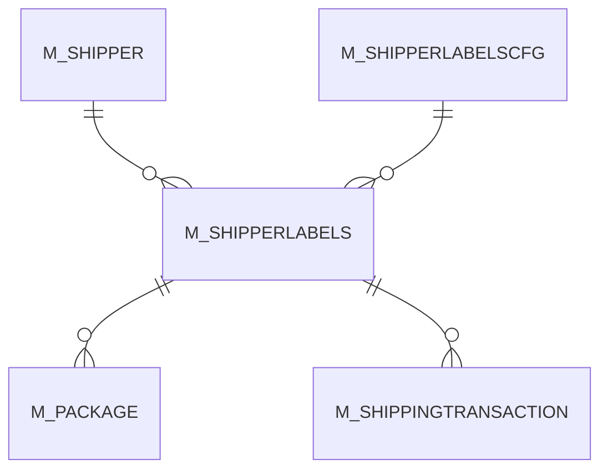

# M_SHIPPERLABELS

Area [M](../../data-model/m/index.md) · class **business** (proposed) · read from database `idempiere-db` (owner `ADEMPIERE`) · 0 row(s) when profiled

Application model: `org.compiere.model.X_M_ShipperLabels`, access level 3 - Client - Org.

## Columns

| column | type | key | not null | business name | references (code) | nulls | distinct |
|---|---|---|---|---|---|---|---|
| `AD_CLIENT_ID` | NUMBER(10,0) |  | yes | Tenant |  | 0 | 0 |
| `AD_ORG_ID` | NUMBER(10,0) |  | yes | Organization |  | 0 | 0 |
| `CREATED` | DATE |  | yes | Created |  | 0 | 0 |
| `CREATEDBY` | NUMBER(10,0) |  | yes | Created By |  | 0 | 0 |
| `ISACTIVE` | CHAR(1) |  | yes | Active |  | 0 | 0 |
| `ISDEFAULT` | CHAR(1) |  | yes | Default |  | 0 | 0 |
| `LABELPRINTMETHOD` | CHAR(1) |  |  | Label Print Method |  | 0 | 0 |
| `M_SHIPPER_ID` | NUMBER(10,0) |  | yes | Shipper | [M_SHIPPER](../../data-model/m/m_shipper.md) | 0 | 0 |
| `M_SHIPPERLABELS_ID` | NUMBER(10,0) | PK | yes | Shipper Labels |  | 0 | 0 |
| `M_SHIPPERLABELS_UU` | VARCHAR2(36 CHAR) |  |  | M_ShipperLabels_UU |  | 0 | 0 |
| `UPDATED` | DATE |  | yes | Updated |  | 0 | 0 |
| `UPDATEDBY` | NUMBER(10,0) |  | yes | Updated By |  | 0 | 0 |
| `M_SHIPPERLABELSCFG_ID` | NUMBER(10,0) |  | yes | Shipper Labels Configuration | [M_SHIPPERLABELSCFG](../../data-model/m/m_shipperlabelscfg.md) | 0 | 0 |
| `NAME` | VARCHAR2(60 CHAR) |  | yes | Name |  | 0 | 0 |

*references (code)* is the table the application model's code says a column points to; *Foreign keys* below are the constraints the database declares. Counts come from the profile; no value is ever shown.

## Check constraints

| name | expression |
|---|---|
| `SYS_C0020799` | `IsActive IN ('Y','N')` |
| `SYS_C0020801` | `IsDefault IN ('Y','N')` |

## Foreign keys

**References**

| table | columns | on delete |
|---|---|---|
| [M_SHIPPER](../../data-model/m/m_shipper.md) | M_SHIPPERLABELS.M_SHIPPER_ID → M_SHIPPER.M_SHIPPER_ID | NO ACTION |
| [M_SHIPPERLABELSCFG](../../data-model/m/m_shipperlabelscfg.md) | M_SHIPPERLABELS.M_SHIPPERLABELSCFG_ID → M_SHIPPERLABELSCFG.M_SHIPPERLABELSCFG_ID | NO ACTION |

**Referenced by**

| table | columns | on delete |
|---|---|---|
| [M_PACKAGE](../../data-model/m/m_package.md) | M_PACKAGE.M_SHIPPERLABELS_ID → M_SHIPPERLABELS.M_SHIPPERLABELS_ID | NO ACTION |
| [M_SHIPPINGTRANSACTION](../../data-model/m/m_shippingtransaction.md) | M_SHIPPINGTRANSACTION.M_SHIPPERLABELS_ID → M_SHIPPERLABELS.M_SHIPPERLABELS_ID | NO ACTION |

## Write behaviour

- updates: **po_only**
- deletes: **deleted_by_users**
- change log: **recorded**
- evidence: 1 citation(s)

## Schema history

52 change(s); the latest:

| applied | release | operation | column | tickets |
|---|---|---|---|---|
| 2023-04-09T15:47 | iD11 | `add_constraint` |  | IDEMPIERE-5567 |
| 2023-04-09T15:47 | iD11 | `add_constraint` |  | IDEMPIERE-5567 |
| 2020-08-04T01:00 | i7.1z | `modify_column` | NAME | IDEMPIERE-3862 |
| 2020-08-04T01:00 | i7.1z | `drop_column` | tmp_col_2_tmp | IDEMPIERE-3862 |
| 2020-08-04T01:00 | i7.1z | `drop_column` | tmp_col_1_tmp | IDEMPIERE-3862 |
| 2020-08-04T01:00 | i7.1z | `modify_column` | NAME | IDEMPIERE-3862 |
| 2020-08-04T01:00 | i7.1z | `add_column` | tmp_col_1_tmp | IDEMPIERE-3862 |
| 2020-08-04T01:00 | i7.1z | `add_column` | tmp_col_2_tmp | IDEMPIERE-3862 |
| 2020-08-04T01:00 | i7.1z | `modify_column` | NAME | IDEMPIERE-3862 |
| 2020-08-04T01:00 | i7.1z | `modify_column` | M_SHIPPERLABELS_UU | IDEMPIERE-3862 |
| 2014-05-02T10:09 | i2.0 | `modify_column` | updated | IDEMPIERE-709 |
| 2014-05-02T10:09 | i2.0 | `modify_column` | created | IDEMPIERE-709 |
| 2014-04-17T15:00 | i2.0 | `modify_column` | created | IDEMPIERE-709 |
| 2014-04-17T15:00 | i2.0 | `modify_column` | updated | IDEMPIERE-709 |
| 2014-04-17T15:00 | i2.0 | `modify_column` | updated | IDEMPIERE-709 |

## Notes

<!-- ekos:manual id="table.m_shipperlabels.notes" -->
_Business notes about this table._
<!-- /ekos:manual -->
