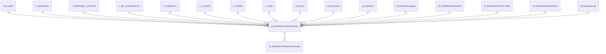

# M_SHIPPINGTRANSACTION

Area [M](../../data-model/m/index.md) · class **business** (proposed) · read from database `idempiere-db` (owner `ADEMPIERE`) · 0 row(s) when profiled

Application model: `org.compiere.model.X_M_ShippingTransaction`, access level 3 - Client - Org.

## Columns

| column | type | key | not null | business name | references (code) | nulls | distinct |
|---|---|---|---|---|---|---|---|
| `ACTION` | VARCHAR2(2 CHAR) |  | yes | Action |  | 0 | 0 |
| `AD_CLIENT_ID` | NUMBER(10,0) |  | yes | Tenant |  | 0 | 0 |
| `AD_ORG_ID` | NUMBER(10,0) |  | yes | Organization |  | 0 | 0 |
| `BOXCOUNT` | NUMBER(10,0) |  |  | Box Count |  | 0 | 0 |
| `C_BP_SHIPPINGACCT_ID` | NUMBER(10,0) |  |  | Business Partner Shipping Account | [C_BP_SHIPPINGACCT](../../data-model/c/c_bp_shippingacct.md) | 0 | 0 |
| `C_BPARTNER_LOCATION_ID` | NUMBER(10,0) |  |  | Partner Location | [C_BPARTNER_LOCATION](../../data-model/c/c_bpartner_location.md) | 0 | 0 |
| `C_CURRENCY_ID` | NUMBER(10,0) |  |  | Currency | [C_CURRENCY](../../data-model/c/c_currency.md) | 0 | 0 |
| `C_ORDER_ID` | NUMBER(10,0) |  |  | Order | [C_ORDER](../../data-model/c/c_order.md) | 0 | 0 |
| `C_UOM_LENGTH_ID` | NUMBER(10,0) |  |  | UOM for Length | [C_UOM](../../data-model/c/c_uom.md) | 0 | 0 |
| `C_UOM_WEIGHT_ID` | NUMBER(10,0) |  |  | UOM for Weight | [C_UOM](../../data-model/c/c_uom.md) | 0 | 0 |
| `CASHONDELIVERY` | CHAR(1) |  | yes | COD |  | 0 | 0 |
| `CREATED` | DATE |  | yes | Created |  | 0 | 0 |
| `CREATEDBY` | NUMBER(10,0) |  | yes | Created By |  | 0 | 0 |
| `DATERECEIVED` | DATE |  |  | Date Received |  | 0 | 0 |
| `DELIVERYCONFIRMATION` | CHAR(1) |  | yes | Delivery Confirmation |  | 0 | 0 |
| `DELIVERYCONFIRMATIONTYPE` | VARCHAR2(30 CHAR) |  |  | Delivery Confirmation Type |  | 0 | 0 |
| `DESCRIPTION` | VARCHAR2(255 CHAR) |  |  | Description |  | 0 | 0 |
| `DOTHAZARDCLASSORDIVISION` | VARCHAR2(30 CHAR) |  |  | Dot Hazard Class or Division |  | 0 | 0 |
| `DRYICEWEIGHT` | NUMBER |  |  | Dry Ice Weight |  | 0 | 0 |
| `DUTIESSHIPPERACCOUNT` | VARCHAR2(40 CHAR) |  |  | Duties Shipper Account |  | 0 | 0 |
| `FOB` | VARCHAR2(10 CHAR) |  |  | Freight Terms |  | 0 | 0 |
| `FREIGHTCHARGES` | VARCHAR2(10 CHAR) |  |  | Freight Charges |  | 0 | 0 |
| `HANDLINGCHARGE` | NUMBER |  |  | Handling Charge |  | 0 | 0 |
| `HEIGHT` | NUMBER |  |  | Height |  | 0 | 0 |
| `HOMEDELIVERYPREMIUMDATE` | DATE |  |  | Date |  | 0 | 0 |
| `HOMEDELIVERYPREMIUMPHONE` | VARCHAR2(30 CHAR) |  |  | Phone Number |  | 0 | 0 |
| `HOMEDELIVERYPREMIUMTYPE` | VARCHAR2(30 CHAR) |  |  | Home Delivery Premium Type |  | 0 | 0 |
| `INSURANCE` | CHAR(1) |  |  | Insurance |  | 0 | 0 |
| `INSUREDAMOUNT` | NUMBER |  |  | Insured Amount |  | 0 | 0 |
| `ISACCESSIBLE` | CHAR(1) |  | yes | Accessible |  | 0 | 0 |
| `ISACTIVE` | CHAR(1) |  | yes | Active |  | 0 | 0 |
| `ISADDEDHANDLING` | CHAR(1) |  | yes | Added Handling |  | 0 | 0 |
| `ISCARGOAIRCRAFTONLY` | CHAR(1) |  | yes | Cargo Aircraft Only |  | 0 | 0 |
| `ISDRYICE` | CHAR(1) |  | yes | Dry Ice |  | 0 | 0 |
| `ISDUTIABLE` | CHAR(1) |  | yes | Dutiable |  | 0 | 0 |
| `ISFUTUREDAYSHIPMENT` | CHAR(1) |  | yes | Future Day Shipment |  | 0 | 0 |
| `ISHAZMAT` | CHAR(1) |  | yes | Hazardous Materials |  | 0 | 0 |
| `ISHOLDATLOCATION` | CHAR(1) |  | yes | Hold At Location |  | 0 | 0 |
| `ISIGNOREZIPNOTFOUND` | CHAR(1) |  | yes | Ignore Zip Not Found |  | 0 | 0 |
| `ISIGNOREZIPSTATENOTMATCH` | CHAR(1) |  | yes | Ignore Zip State Not Match |  | 0 | 0 |
| `ISRESIDENTIAL` | CHAR(1) |  | yes | Residential |  | 0 | 0 |
| `ISSATURDAYDELIVERY` | CHAR(1) |  | yes | Saturday Delivery |  | 0 | 0 |
| `ISSATURDAYPICKUP` | CHAR(1) |  | yes | Saturday Pickup |  | 0 | 0 |
| `ISVERBALCONFIRMATION` | CHAR(1) |  | yes | Verbal Confirmation |  | 0 | 0 |
| `LATESTPICKUPTIME` | DATE |  |  | Latest Pickup Time |  | 0 | 0 |
| `LENGTH` | NUMBER |  |  | Length |  | 0 | 0 |
| `M_INOUT_ID` | NUMBER(10,0) |  |  | Shipment/Receipt | [M_INOUT](../../data-model/m/m_inout.md) | 0 | 0 |
| `M_PACKAGE_ID` | NUMBER(10,0) |  |  | Package | [M_PACKAGE](../../data-model/m/m_package.md) | 0 | 0 |
| `M_SHIPPER_ID` | NUMBER(10,0) |  | yes | Shipper | [M_SHIPPER](../../data-model/m/m_shipper.md) | 0 | 0 |
| `M_SHIPPERLABELS_ID` | NUMBER(10,0) |  |  | Shipper Labels | [M_SHIPPERLABELS](../../data-model/m/m_shipperlabels.md) | 0 | 0 |
| `M_SHIPPERPACKAGING_ID` | NUMBER(10,0) |  |  | Shipper Packaging | [M_SHIPPERPACKAGING](../../data-model/m/m_shipperpackaging.md) | 0 | 0 |
| `M_SHIPPERPICKUPTYPES_ID` | NUMBER(10,0) |  |  | Shipper Pickup Types | [M_SHIPPERPICKUPTYPES](../../data-model/m/m_shipperpickuptypes.md) | 0 | 0 |
| `M_SHIPPINGPROCESSOR_ID` | NUMBER(10,0) |  |  | Shipping Processor | [M_SHIPPINGPROCESSOR](../../data-model/m/m_shippingprocessor.md) | 0 | 0 |
| `M_SHIPPINGTRANSACTION_ID` | NUMBER(10,0) | PK | yes | Shipping Transaction |  | 0 | 0 |
| `M_SHIPPINGTRANSACTION_UU` | VARCHAR2(36 CHAR) |  |  | M_ShippingTransaction_UU |  | 0 | 0 |
| `NOTIFICATIONMESSAGE` | VARCHAR2(255 CHAR) |  |  | Notification Message |  | 0 | 0 |
| `NOTIFICATIONTYPE` | VARCHAR2(2 CHAR) |  |  | Notification Type |  | 0 | 0 |
| `PAYMENTRULE` | CHAR(1) |  |  | Payment Rule |  | 0 | 0 |
| `PRICE` | NUMBER |  |  | Price |  | 0 | 0 |
| `PRICEACTUAL` | NUMBER |  |  | Unit Price |  | 0 | 0 |
| `PROCESSED` | CHAR(1) |  | yes | Processed |  | 0 | 0 |
| `RATEINQUIRYMESSAGE` | VARCHAR2(2000 CHAR) |  |  |  |  | 0 | 0 |
| `RECEIVEDINFO` | VARCHAR2(255 CHAR) |  |  | Info Received |  | 0 | 0 |
| `SHIPDATE` | DATE |  |  | Ship Date |  | 0 | 0 |
| `SHIPPERACCOUNT` | VARCHAR2(40 CHAR) |  |  | Shipper Account Number |  | 0 | 0 |
| `SHIPPINGRESPMESSAGE` | VARCHAR2(2000 CHAR) |  |  | Response Message |  | 0 | 0 |
| `SURCHARGES` | NUMBER |  |  | Surcharges |  | 0 | 0 |
| `TRACKINGINFO` | VARCHAR2(255 CHAR) |  |  | Tracking Info |  | 0 | 0 |
| `TRACKINGNO` | VARCHAR2(255 CHAR) |  |  | Tracking No |  | 0 | 0 |
| `UPDATED` | DATE |  | yes | Updated |  | 0 | 0 |
| `UPDATEDBY` | NUMBER(10,0) |  | yes | Updated By |  | 0 | 0 |
| `WEIGHT` | NUMBER |  |  | Weight |  | 0 | 0 |
| `WIDTH` | NUMBER |  |  | Width |  | 0 | 0 |
| `ISALTERNATERETURNADDRESS` | CHAR(1) |  | yes | Alternate Return Address |  | 0 | 0 |
| `RETURNBPARTNER_ID` | NUMBER(10,0) |  |  | Return Partner | [C_BPARTNER](../../data-model/c/c_bpartner.md) | 0 | 0 |
| `RETURNLOCATION_ID` | NUMBER(10,0) |  |  | Return Location | [C_BPARTNER_LOCATION](../../data-model/c/c_bpartner_location.md) | 0 | 0 |
| `RETURNUSER_ID` | NUMBER(10,0) |  |  | Return User/Contact | [AD_USER](../../data-model/ad/ad_user.md) | 0 | 0 |
| `CODAMOUNT` | NUMBER |  |  | COD Amount |  | 0 | 0 |
| `CUSTOMSVALUE` | NUMBER |  |  | Customs Value |  | 0 | 0 |
| `FREIGHTAMT` | NUMBER |  |  | Freight Amount |  | 0 | 0 |
| `SALESREP_ID` | NUMBER(10,0) |  |  | Sales Representative | [AD_USER](../../data-model/ad/ad_user.md) | 0 | 0 |
| `M_WAREHOUSE_ID` | NUMBER(10,0) |  |  | Warehouse | [M_WAREHOUSE](../../data-model/m/m_warehouse.md) | 0 | 0 |
| `C_BPARTNER_ID` | NUMBER(10,0) |  |  | Business Partner | [C_BPARTNER](../../data-model/c/c_bpartner.md) | 0 | 0 |
| `AD_USER_ID` | NUMBER(10,0) |  |  | User/Contact | [AD_USER](../../data-model/ad/ad_user.md) | 0 | 0 |
| `POREFERENCE` | VARCHAR2(30 CHAR) |  |  | Order Reference |  | 0 | 0 |
| `C_INVOICE_ID` | NUMBER(10,0) |  |  | Invoice | [C_INVOICE](../../data-model/c/c_invoice.md) | 0 | 0 |
| `BILL_LOCATION_ID` | NUMBER(10,0) |  |  | Invoice Location | [C_BPARTNER_LOCATION](../../data-model/c/c_bpartner_location.md) | 0 | 0 |
| `ISPRIVILEDGEDRATE` | CHAR(1) |  | yes | Privileged Rate |  | 0 | 0 |
| `HOLDADDRESS_ID` | NUMBER(10,0) |  |  | Hold Address | [C_BPARTNER_LOCATION](../../data-model/c/c_bpartner_location.md) | 0 | 0 |

*references (code)* is the table the application model's code says a column points to; *Foreign keys* below are the constraints the database declares. Counts come from the profile; no value is ever shown.

## Check constraints

| name | expression |
|---|---|
| `SYS_C0022185` | `IsHoldAtLocation IN ('Y','N')` |
| `SYS_C0022186` | `IsActive IN ('Y','N')` |
| `SYS_C0022187` | `IsCargoAircraftOnly IN ('Y','N')` |
| `SYS_C0022188` | `IsVerbalConfirmation IN ('Y','N')` |
| `SYS_C0022189` | `IsResidential IN ('Y','N')` |
| `SYS_C0022190` | `IsHazMat IN ('Y','N')` |
| `SYS_C0022191` | `IsIgnoreZipNotFound IN ('Y','N')` |
| `SYS_C0022193` | `DeliveryConfirmation IN ('Y','N')` |
| `SYS_C0022194` | `IsDryIce IN ('Y','N')` |
| `SYS_C0022195` | `IsAddedHandling IN ('Y','N')` |
| `SYS_C0022196` | `CashOnDelivery IN ('Y','N')` |
| `SYS_C0022197` | `IsIgnoreZipStateNotMatch IN ('Y','N')` |
| `SYS_C0022199` | `IsAccessible IN ('Y','N')` |
| `SYS_C0022200` | `Processed IN ('Y','N')` |
| `SYS_C0022201` | `IsSaturdayPickup IN ('Y','N')` |
| `SYS_C0022202` | `IsFutureDayShipment IN ('Y','N')` |
| `SYS_C0022203` | `IsAlternateReturnAddress IN ('Y','N')` |
| `SYS_C0022204` | `IsDutiable IN ('Y','N')` |
| `SYS_C0022205` | `IsPriviledgedRate IN ('Y','N')` |
| `SYS_C0022206` | `IsSaturdayDelivery IN ('Y','N')` |

## Foreign keys

**References**

| table | columns | on delete |
|---|---|---|
| [AD_USER](../../data-model/ad/ad_user.md) | M_SHIPPINGTRANSACTION.AD_USER_ID → AD_USER.AD_USER_ID | NO ACTION |
| [C_BPARTNER](../../data-model/c/c_bpartner.md) | M_SHIPPINGTRANSACTION.C_BPARTNER_ID → C_BPARTNER.C_BPARTNER_ID | NO ACTION |
| [C_BPARTNER_LOCATION](../../data-model/c/c_bpartner_location.md) | M_SHIPPINGTRANSACTION.BILL_LOCATION_ID → C_BPARTNER_LOCATION.C_BPARTNER_LOCATION_ID | NO ACTION |
| [C_BP_SHIPPINGACCT](../../data-model/c/c_bp_shippingacct.md) | M_SHIPPINGTRANSACTION.C_BP_SHIPPINGACCT_ID → C_BP_SHIPPINGACCT.C_BP_SHIPPINGACCT_ID | NO ACTION |
| [C_CURRENCY](../../data-model/c/c_currency.md) | M_SHIPPINGTRANSACTION.C_CURRENCY_ID → C_CURRENCY.C_CURRENCY_ID | NO ACTION |
| [C_INVOICE](../../data-model/c/c_invoice.md) | M_SHIPPINGTRANSACTION.C_INVOICE_ID → C_INVOICE.C_INVOICE_ID | NO ACTION |
| [C_ORDER](../../data-model/c/c_order.md) | M_SHIPPINGTRANSACTION.C_ORDER_ID → C_ORDER.C_ORDER_ID | NO ACTION |
| [C_UOM](../../data-model/c/c_uom.md) | M_SHIPPINGTRANSACTION.C_UOM_LENGTH_ID → C_UOM.C_UOM_ID | NO ACTION |
| [M_INOUT](../../data-model/m/m_inout.md) | M_SHIPPINGTRANSACTION.M_INOUT_ID → M_INOUT.M_INOUT_ID | NO ACTION |
| [M_PACKAGE](../../data-model/m/m_package.md) | M_SHIPPINGTRANSACTION.M_PACKAGE_ID → M_PACKAGE.M_PACKAGE_ID | NO ACTION |
| [M_SHIPPER](../../data-model/m/m_shipper.md) | M_SHIPPINGTRANSACTION.M_SHIPPER_ID → M_SHIPPER.M_SHIPPER_ID | NO ACTION |
| [M_SHIPPERLABELS](../../data-model/m/m_shipperlabels.md) | M_SHIPPINGTRANSACTION.M_SHIPPERLABELS_ID → M_SHIPPERLABELS.M_SHIPPERLABELS_ID | NO ACTION |
| [M_SHIPPERPACKAGING](../../data-model/m/m_shipperpackaging.md) | M_SHIPPINGTRANSACTION.M_SHIPPERPACKAGING_ID → M_SHIPPERPACKAGING.M_SHIPPERPACKAGING_ID | NO ACTION |
| [M_SHIPPERPICKUPTYPES](../../data-model/m/m_shipperpickuptypes.md) | M_SHIPPINGTRANSACTION.M_SHIPPERPICKUPTYPES_ID → M_SHIPPERPICKUPTYPES.M_SHIPPERPICKUPTYPES_ID | NO ACTION |
| [M_SHIPPINGPROCESSOR](../../data-model/m/m_shippingprocessor.md) | M_SHIPPINGTRANSACTION.M_SHIPPINGPROCESSOR_ID → M_SHIPPINGPROCESSOR.M_SHIPPINGPROCESSOR_ID | NO ACTION |
| [M_WAREHOUSE](../../data-model/m/m_warehouse.md) | M_SHIPPINGTRANSACTION.M_WAREHOUSE_ID → M_WAREHOUSE.M_WAREHOUSE_ID | NO ACTION |

**Referenced by**

| table | columns | on delete |
|---|---|---|
| [M_SHIPPINGTRANSACTIONLINE](../../data-model/m/m_shippingtransactionline.md) | M_SHIPPINGTRANSACTIONLINE.M_SHIPPINGTRANSACTION_ID → M_SHIPPINGTRANSACTION.M_SHIPPINGTRANSACTION_ID | NO ACTION |

## Write behaviour

- updates: **po_only**
- deletes: **deleted_by_users**
- change log: **recorded**
- evidence: 1 citation(s)

## Schema history

153 change(s); the latest:

| applied | release | operation | column | tickets |
|---|---|---|---|---|
| 2023-04-09T15:47 | iD11 | `add_constraint` |  | IDEMPIERE-5567 |
| 2023-04-09T15:47 | iD11 | `add_constraint` |  | IDEMPIERE-5567 |
| 2020-08-04T01:00 | i7.1z | `drop_column` | tmp_col_8_tmp | IDEMPIERE-3862 |
| 2020-08-04T01:00 | i7.1z | `drop_column` | tmp_col_4_tmp | IDEMPIERE-3862 |
| 2020-08-04T01:00 | i7.1z | `add_column` | tmp_col_3_tmp | IDEMPIERE-3862 |
| 2020-08-04T01:00 | i7.1z | `add_column` | tmp_col_8_tmp | IDEMPIERE-3862 |
| 2020-08-04T01:00 | i7.1z | `modify_column` | NOTIFICATIONMESSAGE | IDEMPIERE-3862 |
| 2020-08-04T01:00 | i7.1z | `add_column` | tmp_col_17_tmp | IDEMPIERE-3862 |
| 2020-08-04T01:00 | i7.1z | `add_column` | tmp_col_4_tmp | IDEMPIERE-3862 |
| 2020-08-04T01:00 | i7.1z | `modify_column` | DOTHAZARDCLASSORDIVISION | IDEMPIERE-3862 |
| 2020-08-04T01:00 | i7.1z | `drop_column` | tmp_col_18_tmp | IDEMPIERE-3862 |
| 2020-08-04T01:00 | i7.1z | `modify_column` | TRACKINGINFO | IDEMPIERE-3862 |
| 2020-08-04T01:00 | i7.1z | `drop_column` | tmp_col_12_tmp | IDEMPIERE-3862 |
| 2020-08-04T01:00 | i7.1z | `add_column` | tmp_col_13_tmp | IDEMPIERE-3862 |
| 2020-08-04T01:00 | i7.1z | `modify_column` | HOMEDELIVERYPREMIUMPHONE | IDEMPIERE-3862 |

## Notes

<!-- ekos:manual id="table.m_shippingtransaction.notes" -->
_Business notes about this table._
<!-- /ekos:manual -->
