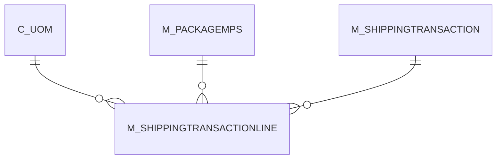

# M_SHIPPINGTRANSACTIONLINE

Area [M](../../data-model/m/index.md) · class **business** (proposed) · read from database `idempiere-db` (owner `ADEMPIERE`) · 0 row(s) when profiled

Application model: `org.compiere.model.X_M_ShippingTransactionLine`, access level 3 - Client - Org.

## Columns

| column | type | key | not null | business name | references (code) | nulls | distinct |
|---|---|---|---|---|---|---|---|
| `AD_CLIENT_ID` | NUMBER(10,0) |  | yes | Tenant |  | 0 | 0 |
| `AD_ORG_ID` | NUMBER(10,0) |  | yes | Organization |  | 0 | 0 |
| `C_UOM_LENGTH_ID` | NUMBER(10,0) |  |  | UOM for Length | [C_UOM](../../data-model/c/c_uom.md) | 0 | 0 |
| `C_UOM_WEIGHT_ID` | NUMBER(10,0) |  |  | UOM for Weight | [C_UOM](../../data-model/c/c_uom.md) | 0 | 0 |
| `CREATED` | DATE |  | yes | Created |  | 0 | 0 |
| `CREATEDBY` | NUMBER(10,0) |  | yes | Created By |  | 0 | 0 |
| `DESCRIPTION` | VARCHAR2(255 CHAR) |  |  | Description |  | 0 | 0 |
| `HEIGHT` | NUMBER |  |  | Height |  | 0 | 0 |
| `ISACTIVE` | CHAR(1) |  | yes | Active |  | 0 | 0 |
| `LENGTH` | NUMBER |  |  | Length |  | 0 | 0 |
| `M_SHIPPINGTRANSACTION_ID` | NUMBER(10,0) |  | yes | Shipping Transaction | [M_SHIPPINGTRANSACTION](../../data-model/m/m_shippingtransaction.md) | 0 | 0 |
| `M_SHIPPINGTRANSACTIONLINE_ID` | NUMBER(10,0) | PK | yes | Shipping Transaction Line |  | 0 | 0 |
| `M_SHIPPINGTRANSACTIONLINE_UU` | VARCHAR2(36 CHAR) |  |  | M_ShippingTransactionLine_UU |  | 0 | 0 |
| `MASTERTRACKINGNO` | VARCHAR2(255 CHAR) |  |  | Master Tracking No |  | 0 | 0 |
| `PRICE` | NUMBER |  |  | Price |  | 0 | 0 |
| `PROCESSED` | CHAR(1) |  | yes | Processed |  | 0 | 0 |
| `SEQNO` | NUMBER(10,0) |  |  | Sequence |  | 0 | 0 |
| `TRACKINGNO` | VARCHAR2(255 CHAR) |  |  | Tracking No |  | 0 | 0 |
| `UPDATED` | DATE |  | yes | Updated |  | 0 | 0 |
| `UPDATEDBY` | NUMBER(10,0) |  | yes | Updated By |  | 0 | 0 |
| `WEIGHT` | NUMBER |  |  | Weight |  | 0 | 0 |
| `WIDTH` | NUMBER |  |  | Width |  | 0 | 0 |
| `M_PACKAGEMPS_ID` | NUMBER(10,0) |  |  | Package MPS | [M_PACKAGEMPS](../../data-model/m/m_packagemps.md) | 0 | 0 |

*references (code)* is the table the application model's code says a column points to; *Foreign keys* below are the constraints the database declares. Counts come from the profile; no value is ever shown.

## Check constraints

| name | expression |
|---|---|
| `SYS_C0022446` | `Processed IN ('Y','N')` |
| `SYS_C0022449` | `IsActive IN ('Y','N')` |

## Foreign keys

**References**

| table | columns | on delete |
|---|---|---|
| [C_UOM](../../data-model/c/c_uom.md) | M_SHIPPINGTRANSACTIONLINE.C_UOM_LENGTH_ID → C_UOM.C_UOM_ID | NO ACTION |
| [M_PACKAGEMPS](../../data-model/m/m_packagemps.md) | M_SHIPPINGTRANSACTIONLINE.M_PACKAGEMPS_ID → M_PACKAGEMPS.M_PACKAGEMPS_ID | NO ACTION |
| [M_SHIPPINGTRANSACTION](../../data-model/m/m_shippingtransaction.md) | M_SHIPPINGTRANSACTIONLINE.M_SHIPPINGTRANSACTION_ID → M_SHIPPINGTRANSACTION.M_SHIPPINGTRANSACTION_ID | NO ACTION |

**Referenced by**

_None._

## Write behaviour

- updates: **po_only**
- deletes: **deleted_by_users**
- change log: **recorded**
- evidence: 1 citation(s)

## Schema history

36 change(s); the latest:

| applied | release | operation | column | tickets |
|---|---|---|---|---|
| 2023-04-09T15:47 | iD11 | `add_constraint` |  | IDEMPIERE-5567 |
| 2023-04-09T15:47 | iD11 | `add_constraint` |  | IDEMPIERE-5567 |
| 2020-08-04T01:00 | i7.1z | `add_column` | tmp_col_3_tmp | IDEMPIERE-3862 |
| 2020-08-04T01:00 | i7.1z | `drop_column` | tmp_col_2_tmp | IDEMPIERE-3862 |
| 2020-08-04T01:00 | i7.1z | `modify_column` | DESCRIPTION | IDEMPIERE-3862 |
| 2020-08-04T01:00 | i7.1z | `drop_column` | tmp_col_4_tmp | IDEMPIERE-3862 |
| 2020-08-04T01:00 | i7.1z | `modify_column` | MASTERTRACKINGNO | IDEMPIERE-3862 |
| 2020-08-04T01:00 | i7.1z | `add_column` | tmp_col_4_tmp | IDEMPIERE-3862 |
| 2020-08-04T01:00 | i7.1z | `modify_column` | M_SHIPPINGTRANSACTIONLINE_UU | IDEMPIERE-3862 |
| 2020-08-04T01:00 | i7.1z | `modify_column` | TRACKINGNO | IDEMPIERE-3862 |
| 2020-08-04T01:00 | i7.1z | `add_column` | tmp_col_2_tmp | IDEMPIERE-3862 |
| 2020-08-04T01:00 | i7.1z | `add_column` | tmp_col_1_tmp | IDEMPIERE-3862 |
| 2020-08-04T01:00 | i7.1z | `drop_column` | tmp_col_1_tmp | IDEMPIERE-3862 |
| 2020-08-04T01:00 | i7.1z | `drop_column` | tmp_col_3_tmp | IDEMPIERE-3862 |
| 2014-05-02T10:09 | i2.0 | `modify_column` | created | IDEMPIERE-709 |

## Notes

<!-- ekos:manual id="table.m_shippingtransactionline.notes" -->
_Business notes about this table._
<!-- /ekos:manual -->
