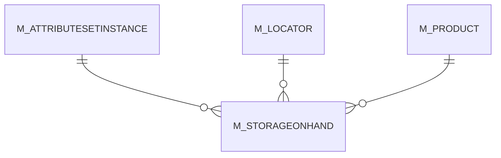

# M_STORAGEONHAND

Area [M](../../data-model/m/index.md) · class **business** (proposed) · read from database `idempiere-db` (owner `ADEMPIERE`) · 20 row(s) when profiled

Application model: `org.compiere.model.X_M_StorageOnHand`, access level 3 - Client - Org.

## Columns

| column | type | key | not null | business name | references (code) | nulls | distinct |
|---|---|---|---|---|---|---|---|
| `AD_CLIENT_ID` | NUMBER(10,0) |  | yes | Tenant |  | 0 | 1 |
| `AD_ORG_ID` | NUMBER(10,0) |  | yes | Organization |  | 0 | 2 |
| `CREATED` | DATE |  | yes | Created |  | 0 | 6 |
| `CREATEDBY` | NUMBER(10,0) |  | yes | Created By |  | 0 | 2 |
| `DATELASTINVENTORY` | DATE |  |  | Date Last Inventory Count |  | 20 | 0 |
| `ISACTIVE` | CHAR(1) |  | yes | Active |  | 0 | 1 |
| `M_ATTRIBUTESETINSTANCE_ID` | NUMBER(10,0) | PK | yes | Attribute Set Instance | [M_ATTRIBUTESETINSTANCE](../../data-model/m/m_attributesetinstance.md) | 0 | 1 |
| `M_LOCATOR_ID` | NUMBER(10,0) | PK | yes | Locator | [M_LOCATOR](../../data-model/m/m_locator.md) | 0 | 2 |
| `M_PRODUCT_ID` | NUMBER(10,0) | PK | yes | Product | [M_PRODUCT](../../data-model/m/m_product.md) | 0 | 19 |
| `QTYONHAND` | NUMBER |  | yes | On Hand Quantity |  | 0 | 11 |
| `UPDATED` | DATE |  | yes | Updated |  | 0 | 5 |
| `UPDATEDBY` | NUMBER(10,0) |  | yes | Updated By |  | 0 | 2 |
| `M_STORAGEONHAND_UU` | VARCHAR2(36 CHAR) |  |  | M_StorageOnHand_UU |  | 0 | 20 |
| `DATEMATERIALPOLICY` | DATE | PK | yes | Date  Material Policy |  | 0 | 4 |

*references (code)* is the table the application model's code says a column points to; *Foreign keys* below are the constraints the database declares. Counts come from the profile; no value is ever shown.

## Check constraints

| name | expression |
|---|---|
| `SYS_C0019950` | `IsActive IN ('Y','N')` |

## Foreign keys

**References**

| table | columns | on delete |
|---|---|---|
| [M_ATTRIBUTESETINSTANCE](../../data-model/m/m_attributesetinstance.md) | M_STORAGEONHAND.M_ATTRIBUTESETINSTANCE_ID → M_ATTRIBUTESETINSTANCE.M_ATTRIBUTESETINSTANCE_ID | NO ACTION |
| [M_LOCATOR](../../data-model/m/m_locator.md) | M_STORAGEONHAND.M_LOCATOR_ID → M_LOCATOR.M_LOCATOR_ID | NO ACTION |
| [M_PRODUCT](../../data-model/m/m_product.md) | M_STORAGEONHAND.M_PRODUCT_ID → M_PRODUCT.M_PRODUCT_ID | NO ACTION |

**Referenced by**

_None._

## Write behaviour

- updates: **raw_sql_skips_updated**
- deletes: **deleted_by_app, purged**
- change log: **not_recorded**
- evidence: 15 citation(s)

## Read by

| kind | name |
|---|---|
| Procedure | [BOMQTYONHAND](../../logic/bomqtyonhand.md) |
| Procedure | [BOMQTYONHANDFORRESERVATION](../../logic/bomqtyonhandforreservation.md) |
| Procedure | [BOMQtyOnHand](../../logic/bomqtyonhand.md) |
| Procedure | [BOMQtyOnHandForReservation](../../logic/bomqtyonhandforreservation.md) |
| View | `M_STORAGE` |
| View | `m_product_stock_v` |
| View | `m_product_substituterelated_v` |
| View | `m_storage` |

## Schema history

39 change(s); the latest:

| applied | release | operation | column | tickets |
|---|---|---|---|---|
| 2023-04-09T15:47 | iD11 | `add_constraint` |  | IDEMPIERE-5567 |
| 2023-04-09T15:47 | iD11 | `add_constraint` |  | IDEMPIERE-5567 |
| 2020-08-04T01:00 | i7.1z | `drop_column` | tmp_col_1_tmp | IDEMPIERE-3862 |
| 2020-08-04T01:00 | i7.1z | `add_column` | tmp_col_1_tmp | IDEMPIERE-3862 |
| 2020-08-04T01:00 | i7.1z | `modify_column` | M_STORAGEONHAND_UU | IDEMPIERE-3862 |
| 2014-05-02T10:09 | i2.0 | `modify_column` | updated | IDEMPIERE-709 |
| 2014-05-02T10:09 | i2.0 | `modify_column` | created | IDEMPIERE-709 |
| 2014-04-17T15:00 | i2.0 | `modify_column` | updated | IDEMPIERE-709 |
| 2014-04-17T15:00 | i2.0 | `modify_column` | updated | IDEMPIERE-709 |
| 2014-04-17T15:00 | i2.0 | `modify_column` | created | IDEMPIERE-709 |
| 2014-04-17T15:00 | i2.0 | `modify_column` | updated | IDEMPIERE-709 |
| 2014-04-17T15:00 | i2.0 | `modify_column` | created | IDEMPIERE-709 |
| 2014-04-17T15:00 | i2.0 | `modify_column` | created | IDEMPIERE-709 |
| 2013-10-14T12:46 | i1.0z | `modify_column` | DateMaterialPolicy | IDEMPIERE-386 |
| 2013-10-14T12:46 | i1.0z | `drop_constraint` |  | IDEMPIERE-386 |

## Notes

<!-- ekos:manual id="table.m_storageonhand.notes" -->
_Business notes about this table._
<!-- /ekos:manual -->
