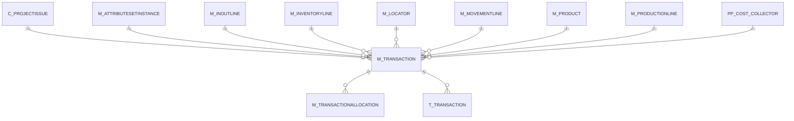

# M_TRANSACTION

Area [M](../../data-model/m/index.md) · class **business** (proposed) · read from database `idempiere-db` (owner `ADEMPIERE`) · 28 row(s) when profiled

Application model: `org.compiere.model.X_M_Transaction`, access level 1 - Org.

## Columns

| column | type | key | not null | business name | references (code) | nulls | distinct |
|---|---|---|---|---|---|---|---|
| `M_TRANSACTION_ID` | NUMBER(10,0) | PK | yes | Inventory Transaction |  | 0 | 28 |
| `AD_CLIENT_ID` | NUMBER(10,0) |  | yes | Tenant |  | 0 | 1 |
| `AD_ORG_ID` | NUMBER(10,0) |  | yes | Organization |  | 0 | 1 |
| `ISACTIVE` | CHAR(1) |  | yes | Active |  | 0 | 1 |
| `CREATED` | DATE |  | yes | Created |  | 0 | 10 |
| `CREATEDBY` | NUMBER(10,0) |  | yes | Created By |  | 0 | 2 |
| `UPDATED` | DATE |  | yes | Updated |  | 0 | 10 |
| `UPDATEDBY` | NUMBER(10,0) |  | yes | Updated By |  | 0 | 2 |
| `MOVEMENTTYPE` | CHAR(2) |  | yes | Movement Type |  | 0 | 4 |
| `M_LOCATOR_ID` | NUMBER(10,0) |  | yes | Locator | [M_LOCATOR](../../data-model/m/m_locator.md) | 0 | 2 |
| `M_PRODUCT_ID` | NUMBER(10,0) |  | yes | Product | [M_PRODUCT](../../data-model/m/m_product.md) | 0 | 19 |
| `MOVEMENTDATE` | DATE |  | yes | Movement Date |  | 0 | 8 |
| `MOVEMENTQTY` | NUMBER |  | yes | Movement Quantity |  | 0 | 13 |
| `M_INVENTORYLINE_ID` | NUMBER(10,0) |  |  | Phys.Inventory Line | [M_INVENTORYLINE](../../data-model/m/m_inventoryline.md) | 28 | 0 |
| `M_MOVEMENTLINE_ID` | NUMBER(10,0) |  |  | Move Line | [M_MOVEMENTLINE](../../data-model/m/m_movementline.md) | 26 | 1 |
| `M_INOUTLINE_ID` | NUMBER(10,0) |  |  | Shipment/Receipt Line | [M_INOUTLINE](../../data-model/m/m_inoutline.md) | 2 | 26 |
| `M_PRODUCTIONLINE_ID` | NUMBER(10,0) |  |  | Production Line | [M_PRODUCTIONLINE](../../data-model/m/m_productionline.md) | 28 | 0 |
| `C_PROJECTISSUE_ID` | NUMBER(10,0) |  |  | Project Issue | [C_PROJECTISSUE](../../data-model/c/c_projectissue.md) | 28 | 0 |
| `M_ATTRIBUTESETINSTANCE_ID` | NUMBER(10,0) |  | yes | Attribute Set Instance | [M_ATTRIBUTESETINSTANCE](../../data-model/m/m_attributesetinstance.md) | 0 | 1 |
| `PP_COST_COLLECTOR_ID` | NUMBER(10,0) |  |  | Manufacturing Cost Collector | [PP_COST_COLLECTOR](../../data-model/pp/pp_cost_collector.md) | 28 | 0 |
| `M_TRANSACTION_UU` | VARCHAR2(36 CHAR) |  |  | M_Transaction_UU |  | 0 | 28 |

*references (code)* is the table the application model's code says a column points to; *Foreign keys* below are the constraints the database declares. Counts come from the profile; no value is ever shown.

## Check constraints

| name | expression |
|---|---|
| `SYS_C0020568` | `IsActive in ('Y','N')` |

## Foreign keys

**References**

| table | columns | on delete |
|---|---|---|
| [C_PROJECTISSUE](../../data-model/c/c_projectissue.md) | M_TRANSACTION.C_PROJECTISSUE_ID → C_PROJECTISSUE.C_PROJECTISSUE_ID | NO ACTION |
| [M_ATTRIBUTESETINSTANCE](../../data-model/m/m_attributesetinstance.md) | M_TRANSACTION.M_ATTRIBUTESETINSTANCE_ID → M_ATTRIBUTESETINSTANCE.M_ATTRIBUTESETINSTANCE_ID | NO ACTION |
| [M_INOUTLINE](../../data-model/m/m_inoutline.md) | M_TRANSACTION.M_INOUTLINE_ID → M_INOUTLINE.M_INOUTLINE_ID | NO ACTION |
| [M_INVENTORYLINE](../../data-model/m/m_inventoryline.md) | M_TRANSACTION.M_INVENTORYLINE_ID → M_INVENTORYLINE.M_INVENTORYLINE_ID | NO ACTION |
| [M_LOCATOR](../../data-model/m/m_locator.md) | M_TRANSACTION.M_LOCATOR_ID → M_LOCATOR.M_LOCATOR_ID | NO ACTION |
| [M_MOVEMENTLINE](../../data-model/m/m_movementline.md) | M_TRANSACTION.M_MOVEMENTLINE_ID → M_MOVEMENTLINE.M_MOVEMENTLINE_ID | NO ACTION |
| [M_PRODUCT](../../data-model/m/m_product.md) | M_TRANSACTION.M_PRODUCT_ID → M_PRODUCT.M_PRODUCT_ID | NO ACTION |
| [M_PRODUCTIONLINE](../../data-model/m/m_productionline.md) | M_TRANSACTION.M_PRODUCTIONLINE_ID → M_PRODUCTIONLINE.M_PRODUCTIONLINE_ID | NO ACTION |
| [PP_COST_COLLECTOR](../../data-model/pp/pp_cost_collector.md) | M_TRANSACTION.PP_COST_COLLECTOR_ID → PP_COST_COLLECTOR.PP_COST_COLLECTOR_ID | NO ACTION |

**Referenced by**

| table | columns | on delete |
|---|---|---|
| [M_TRANSACTIONALLOCATION](../../data-model/m/m_transactionallocation.md) | M_TRANSACTIONALLOCATION.OUT_M_TRANSACTION_ID → M_TRANSACTION.M_TRANSACTION_ID | NO ACTION |
| `T_TRANSACTION` | T_TRANSACTION.M_TRANSACTION_ID → M_TRANSACTION.M_TRANSACTION_ID | CASCADE |

## Write behaviour

- updates: **po_only**
- deletes: **soft_delete_only**
- change log: **recorded**
- evidence: 1 citation(s)

## Read by

| kind | name |
|---|---|
| View | `M_TRANSACTION_V` |
| View | `RV_M_TRANSACTION` |
| View | `RV_M_TRANSACTION_SUM` |
| View | `RV_PP_ORDER_TRANSACTIONS` |
| View | `RV_TRANSACTION` |
| View | `m_transaction_v` |
| View | `rv_m_transaction` |
| View | `rv_m_transaction_sum` |
| View | `rv_pp_order_transactions` |
| View | `rv_transaction` |

## Schema history

23 change(s); the latest:

| applied | release | operation | column | tickets |
|---|---|---|---|---|
| 2023-04-09T15:47 | iD11 | `add_constraint` |  | IDEMPIERE-5567 |
| 2023-04-09T15:47 | iD11 | `add_constraint` |  | IDEMPIERE-5567 |
| 2021-12-05T16:45 | i8.2z | `add_constraint` |  | IDEMPIERE-5075 |
| 2021-12-05T16:45 | i8.2z | `add_constraint` |  | IDEMPIERE-5075 |
| 2021-12-05T16:45 | i8.2z | `add_constraint` |  | IDEMPIERE-5075 |
| 2021-12-05T16:45 | i8.2z | `drop_constraint` |  | IDEMPIERE-5075 |
| 2021-12-05T16:45 | i8.2z | `drop_constraint` |  | IDEMPIERE-5075 |
| 2021-12-05T16:45 | i8.2z | `add_constraint` |  | IDEMPIERE-5075 |
| 2021-12-05T16:45 | i8.2z | `add_constraint` |  | IDEMPIERE-5075 |
| 2021-12-05T16:45 | i8.2z | `add_constraint` |  | IDEMPIERE-5075 |
| 2021-12-05T16:45 | i8.2z | `add_constraint` |  | IDEMPIERE-5075 |
| 2021-12-05T16:45 | i8.2z | `drop_constraint` |  | IDEMPIERE-5075 |
| 2021-12-05T16:45 | i8.2z | `add_constraint` |  | IDEMPIERE-5075 |
| 2021-12-05T16:45 | i8.2z | `drop_constraint` |  | IDEMPIERE-5075 |
| 2021-12-05T16:45 | i8.2z | `drop_constraint` |  | IDEMPIERE-5075 |

## Notes

<!-- ekos:manual id="table.m_transaction.notes" -->
_Business notes about this table._
<!-- /ekos:manual -->
