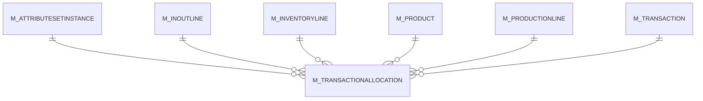

# M_TRANSACTIONALLOCATION

Area [M](../../data-model/m/index.md) · class **business** (proposed) · read from database `idempiere-db` (owner `ADEMPIERE`) · 0 row(s) when profiled

Application model: `org.compiere.model.X_M_TransactionAllocation`, access level 1 - Org.

## Columns

| column | type | key | not null | business name | references (code) | nulls | distinct |
|---|---|---|---|---|---|---|---|
| `M_TRANSACTION_ID` | NUMBER(10,0) | PK | yes | Inventory Transaction | [M_TRANSACTION](../../data-model/m/m_transaction.md) | 0 | 0 |
| `ALLOCATIONSTRATEGYTYPE` | CHAR(1) | PK | yes | Allocation Strategy |  | 0 | 0 |
| `AD_CLIENT_ID` | NUMBER(10,0) |  | yes | Tenant |  | 0 | 0 |
| `AD_ORG_ID` | NUMBER(10,0) |  | yes | Organization |  | 0 | 0 |
| `ISACTIVE` | CHAR(1) |  | yes | Active |  | 0 | 0 |
| `CREATED` | DATE |  | yes | Created |  | 0 | 0 |
| `CREATEDBY` | NUMBER(10,0) |  | yes | Created By |  | 0 | 0 |
| `UPDATED` | DATE |  | yes | Updated |  | 0 | 0 |
| `UPDATEDBY` | NUMBER(10,0) |  | yes | Updated By |  | 0 | 0 |
| `M_PRODUCT_ID` | NUMBER(10,0) |  | yes | Product | [M_PRODUCT](../../data-model/m/m_product.md) | 0 | 0 |
| `M_ATTRIBUTESETINSTANCE_ID` | NUMBER(10,0) |  | yes | Attribute Set Instance | [M_ATTRIBUTESETINSTANCE](../../data-model/m/m_attributesetinstance.md) | 0 | 0 |
| `ISALLOCATED` | CHAR(1) |  | yes | Allocated |  | 0 | 0 |
| `QTY` | NUMBER |  | yes | Quantity |  | 0 | 0 |
| `ISMANUAL` | CHAR(1) |  | yes | Manual |  | 0 | 0 |
| `M_INOUTLINE_ID` | NUMBER(10,0) |  |  | Shipment/Receipt Line | [M_INOUTLINE](../../data-model/m/m_inoutline.md) | 0 | 0 |
| `M_PRODUCTIONLINE_ID` | NUMBER(10,0) |  |  | Production Line | [M_PRODUCTIONLINE](../../data-model/m/m_productionline.md) | 0 | 0 |
| `M_INVENTORYLINE_ID` | NUMBER(10,0) |  |  | Phys.Inventory Line | [M_INVENTORYLINE](../../data-model/m/m_inventoryline.md) | 0 | 0 |
| `OUT_M_TRANSACTION_ID` | NUMBER(10,0) |  |  | Out Transaction | [M_TRANSACTION](../../data-model/m/m_transaction.md) | 0 | 0 |
| `OUT_M_INOUTLINE_ID` | NUMBER(10,0) |  |  | Out Shipment Line | [M_INOUTLINE](../../data-model/m/m_inoutline.md) | 0 | 0 |
| `OUT_M_PRODUCTIONLINE_ID` | NUMBER(10,0) |  |  | Out Production Line | [M_PRODUCTIONLINE](../../data-model/m/m_productionline.md) | 0 | 0 |
| `OUT_M_INVENTORYLINE_ID` | NUMBER(10,0) |  |  | Out Inventory Line | [M_INVENTORYLINE](../../data-model/m/m_inventoryline.md) | 0 | 0 |
| `M_TRANSACTIONALLOCATION_UU` | VARCHAR2(36 CHAR) |  |  | M_TransactionAllocation_UU |  | 0 | 0 |

*references (code)* is the table the application model's code says a column points to; *Foreign keys* below are the constraints the database declares. Counts come from the profile; no value is ever shown.

## Check constraints

| name | expression |
|---|---|
| `SYS_C0019415` | `IsActive in ('Y','N')` |
| `SYS_C0019418` | `IsManual in ('Y','N')` |
| `SYS_C0019419` | `IsAllocated in ('Y','N')` |

## Foreign keys

**References**

| table | columns | on delete |
|---|---|---|
| [M_ATTRIBUTESETINSTANCE](../../data-model/m/m_attributesetinstance.md) | M_TRANSACTIONALLOCATION.M_ATTRIBUTESETINSTANCE_ID → M_ATTRIBUTESETINSTANCE.M_ATTRIBUTESETINSTANCE_ID | NO ACTION |
| [M_INOUTLINE](../../data-model/m/m_inoutline.md) | M_TRANSACTIONALLOCATION.OUT_M_INOUTLINE_ID → M_INOUTLINE.M_INOUTLINE_ID | NO ACTION |
| [M_INVENTORYLINE](../../data-model/m/m_inventoryline.md) | M_TRANSACTIONALLOCATION.OUT_M_INVENTORYLINE_ID → M_INVENTORYLINE.M_INVENTORYLINE_ID | NO ACTION |
| [M_PRODUCT](../../data-model/m/m_product.md) | M_TRANSACTIONALLOCATION.M_PRODUCT_ID → M_PRODUCT.M_PRODUCT_ID | NO ACTION |
| [M_PRODUCTIONLINE](../../data-model/m/m_productionline.md) | M_TRANSACTIONALLOCATION.OUT_M_PRODUCTIONLINE_ID → M_PRODUCTIONLINE.M_PRODUCTIONLINE_ID | NO ACTION |
| [M_TRANSACTION](../../data-model/m/m_transaction.md) | M_TRANSACTIONALLOCATION.OUT_M_TRANSACTION_ID → M_TRANSACTION.M_TRANSACTION_ID | NO ACTION |

**Referenced by**

_None._

## Write behaviour

- updates: **po_only**
- deletes: **deleted_by_users**
- change log: **recorded**
- evidence: 1 citation(s)

## Schema history

25 change(s); the latest:

| applied | release | operation | column | tickets |
|---|---|---|---|---|
| 2023-04-09T15:47 | iD11 | `add_constraint` |  | IDEMPIERE-5567 |
| 2023-04-09T15:47 | iD11 | `add_constraint` |  | IDEMPIERE-5567 |
| 2021-12-05T16:45 | i8.2z | `add_constraint` |  | IDEMPIERE-5075 |
| 2021-12-05T16:45 | i8.2z | `add_constraint` |  | IDEMPIERE-5075 |
| 2021-12-05T16:45 | i8.2z | `drop_constraint` |  | IDEMPIERE-5075 |
| 2021-12-05T16:45 | i8.2z | `drop_constraint` |  | IDEMPIERE-5075 |
| 2021-12-05T16:45 | i8.2z | `add_constraint` |  | IDEMPIERE-5075 |
| 2021-12-05T16:45 | i8.2z | `drop_constraint` |  | IDEMPIERE-5075 |
| 2021-12-05T16:45 | i8.2z | `add_constraint` |  | IDEMPIERE-5075 |
| 2021-12-05T16:45 | i8.2z | `drop_constraint` |  | IDEMPIERE-5075 |
| 2021-12-05T16:45 | i8.2z | `add_constraint` |  | IDEMPIERE-5075 |
| 2021-12-05T16:45 | i8.2z | `add_constraint` |  | IDEMPIERE-5075 |
| 2021-12-05T16:45 | i8.2z | `add_constraint` |  | IDEMPIERE-5075 |
| 2021-12-05T16:45 | i8.2z | `drop_constraint` |  | IDEMPIERE-5075 |
| 2021-12-05T16:45 | i8.2z | `drop_constraint` |  | IDEMPIERE-5075 |

## Notes

<!-- ekos:manual id="table.m_transactionallocation.notes" -->
_Business notes about this table._
<!-- /ekos:manual -->
