# M_WAREHOUSE

Area [M](../../data-model/m/index.md) · class **business** (proposed) · read from database `idempiere-db` (owner `ADEMPIERE`) · 11 row(s) when profiled

Application model: `org.compiere.model.X_M_Warehouse`, access level 3 - Client - Org.

## Columns

| column | type | key | not null | business name | references (code) | nulls | distinct |
|---|---|---|---|---|---|---|---|
| `M_WAREHOUSE_ID` | NUMBER(10,0) | PK | yes | Warehouse |  | 0 | 11 |
| `AD_CLIENT_ID` | NUMBER(10,0) |  | yes | Tenant |  | 0 | 1 |
| `AD_ORG_ID` | NUMBER(10,0) |  | yes | Organization |  | 0 | 8 |
| `ISACTIVE` | CHAR(1) |  | yes | Active |  | 0 | 1 |
| `CREATED` | DATE |  | yes | Created |  | 0 | 11 |
| `CREATEDBY` | NUMBER(10,0) |  | yes | Created By |  | 0 | 2 |
| `UPDATED` | DATE |  | yes | Updated |  | 0 | 11 |
| `UPDATEDBY` | NUMBER(10,0) |  | yes | Updated By |  | 0 | 1 |
| `VALUE` | VARCHAR2(40 CHAR) |  | yes | Search Key |  | 0 | 11 |
| `NAME` | VARCHAR2(60 CHAR) |  | yes | Name |  | 0 | 11 |
| `DESCRIPTION` | VARCHAR2(255 CHAR) |  |  | Description |  | 7 | 4 |
| `C_LOCATION_ID` | NUMBER(10,0) |  | yes | Address | [C_LOCATION](../../data-model/c/c_location.md) | 0 | 11 |
| `SEPARATOR` | CHAR(1) |  | yes | Element Separator |  | 0 | 2 |
| `M_WAREHOUSESOURCE_ID` | NUMBER(10,0) |  |  | Source Warehouse | [M_WAREHOUSE](../../data-model/m/m_warehouse.md) | 11 | 0 |
| `REPLENISHMENTCLASS` | VARCHAR2(60 CHAR) |  |  | Replenishment Class |  | 11 | 0 |
| `ISINTRANSIT` | CHAR(1) |  |  | In Transit |  | 0 | 2 |
| `ISDISALLOWNEGATIVEINV` | CHAR(1) |  | yes | Disallow Negative Inventory |  | 0 | 1 |
| `M_WAREHOUSE_UU` | VARCHAR2(36 CHAR) |  |  | M_Warehouse_UU |  | 0 | 11 |
| `M_RESERVELOCATOR_ID` | NUMBER(10,0) |  |  | Reservation Locator | [M_LOCATOR](../../data-model/m/m_locator.md) | 0 | 11 |

*references (code)* is the table the application model's code says a column points to; *Foreign keys* below are the constraints the database declares. Counts come from the profile; no value is ever shown.

## Check constraints

| name | expression |
|---|---|
| `SYS_C0019902` | `IsInTransit IN ('Y','N')` |
| `SYS_C0019905` | `IsDisallowNegativeInv IN ('Y','N')` |
| `SYS_C0019906` | `IsActive in ('Y','N')` |

## Foreign keys

**References**

| table | columns | on delete |
|---|---|---|
| [AD_CLIENT](../../data-model/ad/ad_client.md) | M_WAREHOUSE.AD_CLIENT_ID → AD_CLIENT.AD_CLIENT_ID | NO ACTION |
| [AD_ORG](../../data-model/ad/ad_org.md) | M_WAREHOUSE.AD_ORG_ID → AD_ORG.AD_ORG_ID | NO ACTION |
| [C_LOCATION](../../data-model/c/c_location.md) | M_WAREHOUSE.C_LOCATION_ID → C_LOCATION.C_LOCATION_ID | NO ACTION |
| [M_LOCATOR](../../data-model/m/m_locator.md) | M_WAREHOUSE.M_RESERVELOCATOR_ID → M_LOCATOR.M_LOCATOR_ID | NO ACTION |
| [M_WAREHOUSE](../../data-model/m/m_warehouse.md) | M_WAREHOUSE.M_WAREHOUSESOURCE_ID → M_WAREHOUSE.M_WAREHOUSE_ID | NO ACTION |

**Referenced by**

| table | columns | on delete |
|---|---|---|
| [AD_ORGINFO](../../data-model/ad/ad_orginfo.md) | AD_ORGINFO.DROPSHIP_WAREHOUSE_ID → M_WAREHOUSE.M_WAREHOUSE_ID | NO ACTION |
| [C_BP_EDI](../../data-model/c/c_bp_edi.md) | C_BP_EDI.M_WAREHOUSE_ID → M_WAREHOUSE.M_WAREHOUSE_ID | NO ACTION |
| [C_ORDER](../../data-model/c/c_order.md) | C_ORDER.M_WAREHOUSE_ID → M_WAREHOUSE.M_WAREHOUSE_ID | NO ACTION |
| [C_ORDERLINE](../../data-model/c/c_orderline.md) | C_ORDERLINE.M_WAREHOUSE_ID → M_WAREHOUSE.M_WAREHOUSE_ID | NO ACTION |
| [C_POS](../../data-model/c/c_pos.md) | C_POS.M_WAREHOUSE_ID → M_WAREHOUSE.M_WAREHOUSE_ID | NO ACTION |
| [C_PROJECT](../../data-model/c/c_project.md) | C_PROJECT.M_WAREHOUSE_ID → M_WAREHOUSE.M_WAREHOUSE_ID | NO ACTION |
| [DD_NETWORKDISTRIBUTIONLINE](../../data-model/dd/dd_networkdistributionline.md) | DD_NETWORKDISTRIBUTIONLINE.M_WAREHOUSESOURCE_ID → M_WAREHOUSE.M_WAREHOUSE_ID | NO ACTION |
| [DD_ORDER](../../data-model/dd/dd_order.md) | DD_ORDER.M_WAREHOUSE_ID → M_WAREHOUSE.M_WAREHOUSE_ID | NO ACTION |
| `I_INVENTORY` | I_INVENTORY.M_WAREHOUSE_ID → M_WAREHOUSE.M_WAREHOUSE_ID | SET NULL |
| `I_ORDER` | I_ORDER.M_WAREHOUSE_ID → M_WAREHOUSE.M_WAREHOUSE_ID | SET NULL |
| `I_PRODUCTPLANNING` | I_PRODUCTPLANNING.M_WAREHOUSE_ID → M_WAREHOUSE.M_WAREHOUSE_ID | NO ACTION |
| [M_EDI](../../data-model/m/m_edi.md) | M_EDI.M_WAREHOUSE_ID → M_WAREHOUSE.M_WAREHOUSE_ID | NO ACTION |
| [M_FORECASTLINE](../../data-model/m/m_forecastline.md) | M_FORECASTLINE.M_WAREHOUSE_ID → M_WAREHOUSE.M_WAREHOUSE_ID | NO ACTION |
| [M_INOUT](../../data-model/m/m_inout.md) | M_INOUT.M_WAREHOUSE_ID → M_WAREHOUSE.M_WAREHOUSE_ID | NO ACTION |
| [M_INVENTORY](../../data-model/m/m_inventory.md) | M_INVENTORY.M_WAREHOUSE_ID → M_WAREHOUSE.M_WAREHOUSE_ID | NO ACTION |
| [M_LOCATOR](../../data-model/m/m_locator.md) | M_LOCATOR.M_WAREHOUSE_ID → M_WAREHOUSE.M_WAREHOUSE_ID | CASCADE |
| [M_MOVEMENT](../../data-model/m/m_movement.md) | M_MOVEMENT.M_WAREHOUSETO_ID → M_WAREHOUSE.M_WAREHOUSE_ID | NO ACTION |
| [M_PERPETUALINV](../../data-model/m/m_perpetualinv.md) | M_PERPETUALINV.M_WAREHOUSE_ID → M_WAREHOUSE.M_WAREHOUSE_ID | NO ACTION |
| [M_PROMOTIONPRECONDITION](../../data-model/m/m_promotionprecondition.md) | M_PROMOTIONPRECONDITION.M_WAREHOUSE_ID → M_WAREHOUSE.M_WAREHOUSE_ID | NO ACTION |
| [M_REPLENISH](../../data-model/m/m_replenish.md) | M_REPLENISH.M_WAREHOUSESOURCE_ID → M_WAREHOUSE.M_WAREHOUSE_ID | NO ACTION |
| [M_REQUISITION](../../data-model/m/m_requisition.md) | M_REQUISITION.M_WAREHOUSE_ID → M_WAREHOUSE.M_WAREHOUSE_ID | NO ACTION |
| [M_SHIPPINGTRANSACTION](../../data-model/m/m_shippingtransaction.md) | M_SHIPPINGTRANSACTION.M_WAREHOUSE_ID → M_WAREHOUSE.M_WAREHOUSE_ID | NO ACTION |
| [M_STORAGERESERVATION](../../data-model/m/m_storagereservation.md) | M_STORAGERESERVATION.M_WAREHOUSE_ID → M_WAREHOUSE.M_WAREHOUSE_ID | NO ACTION |
| `M_STORAGERESERVATIONLOG` | M_STORAGERESERVATIONLOG.M_WAREHOUSE_ID → M_WAREHOUSE.M_WAREHOUSE_ID | NO ACTION |
| [M_WAREHOUSE](../../data-model/m/m_warehouse.md) | M_WAREHOUSE.M_WAREHOUSESOURCE_ID → M_WAREHOUSE.M_WAREHOUSE_ID | NO ACTION |
| [M_WAREHOUSE_ACCT](../../data-model/m/m_warehouse_acct.md) | M_WAREHOUSE_ACCT.M_WAREHOUSE_ID → M_WAREHOUSE.M_WAREHOUSE_ID | CASCADE |
| [PP_COST_COLLECTOR](../../data-model/pp/pp_cost_collector.md) | PP_COST_COLLECTOR.M_WAREHOUSE_ID → M_WAREHOUSE.M_WAREHOUSE_ID | NO ACTION |
| [PP_MRP](../../data-model/pp/pp_mrp.md) | PP_MRP.M_WAREHOUSE_ID → M_WAREHOUSE.M_WAREHOUSE_ID | NO ACTION |
| [PP_ORDER](../../data-model/pp/pp_order.md) | PP_ORDER.M_WAREHOUSE_ID → M_WAREHOUSE.M_WAREHOUSE_ID | NO ACTION |
| [PP_ORDER_BOMLINE](../../data-model/pp/pp_order_bomline.md) | PP_ORDER_BOMLINE.M_WAREHOUSE_ID → M_WAREHOUSE.M_WAREHOUSE_ID | NO ACTION |
| [PP_PRODUCT_PLANNING](../../data-model/pp/pp_product_planning.md) | PP_PRODUCT_PLANNING.M_WAREHOUSE_ID → M_WAREHOUSE.M_WAREHOUSE_ID | NO ACTION |
| [S_RESOURCE](../../data-model/s/s_resource.md) | S_RESOURCE.M_WAREHOUSE_ID → M_WAREHOUSE.M_WAREHOUSE_ID | NO ACTION |
| [S_TIMEEXPENSE](../../data-model/s/s_timeexpense.md) | S_TIMEEXPENSE.M_WAREHOUSE_ID → M_WAREHOUSE.M_WAREHOUSE_ID | NO ACTION |
| `T_INVENTORYVALUE` | T_INVENTORYVALUE.M_WAREHOUSE_ID → M_WAREHOUSE.M_WAREHOUSE_ID | CASCADE |
| `T_REPLENISH` | T_REPLENISH.M_WAREHOUSESOURCE_ID → M_WAREHOUSE.M_WAREHOUSE_ID | CASCADE |
| [U_POSTERMINAL](../../data-model/u/u_posterminal.md) | U_POSTERMINAL.M_WAREHOUSE_ID → M_WAREHOUSE.M_WAREHOUSE_ID | NO ACTION |
| [W_STORE](../../data-model/w/w_store.md) | W_STORE.M_WAREHOUSE_ID → M_WAREHOUSE.M_WAREHOUSE_ID | NO ACTION |

```mermaid
erDiagram
  AD_CLIENT ||--o{ M_WAREHOUSE : ""
  AD_ORG ||--o{ M_WAREHOUSE : ""
  C_LOCATION ||--o{ M_WAREHOUSE : ""
  M_LOCATOR ||--o{ M_WAREHOUSE : ""
  M_WAREHOUSE ||--o{ AD_ORGINFO : ""
  M_WAREHOUSE ||--o{ C_BP_EDI : ""
  M_WAREHOUSE ||--o{ C_ORDER : ""
  M_WAREHOUSE ||--o{ C_ORDERLINE : ""
  M_WAREHOUSE ||--o{ C_POS : ""
  M_WAREHOUSE ||--o{ C_PROJECT : ""
  M_WAREHOUSE ||--o{ DD_NETWORKDISTRIBUTIONLINE : ""
  M_WAREHOUSE ||--o{ DD_ORDER : ""
  M_WAREHOUSE ||--o{ I_INVENTORY : ""
  M_WAREHOUSE ||--o{ I_ORDER : ""
  M_WAREHOUSE ||--o{ I_PRODUCTPLANNING : ""
  M_WAREHOUSE ||--o{ M_EDI : ""
  M_WAREHOUSE ||--o{ M_FORECASTLINE : ""
  M_WAREHOUSE ||--o{ M_INOUT : ""
  M_WAREHOUSE ||--o{ M_INVENTORY : ""
  M_WAREHOUSE ||--o{ M_LOCATOR : ""
  M_WAREHOUSE ||--o{ M_MOVEMENT : ""
  M_WAREHOUSE ||--o{ M_PERPETUALINV : ""
  M_WAREHOUSE ||--o{ M_PROMOTIONPRECONDITION : ""
  M_WAREHOUSE ||--o{ M_REPLENISH : ""
  M_WAREHOUSE ||--o{ M_REQUISITION : ""
  M_WAREHOUSE ||--o{ M_SHIPPINGTRANSACTION : ""
  M_WAREHOUSE ||--o{ M_STORAGERESERVATION : ""
  M_WAREHOUSE ||--o{ M_STORAGERESERVATIONLOG : ""
  M_WAREHOUSE ||--o{ M_WAREHOUSE : ""
  M_WAREHOUSE ||--o{ M_WAREHOUSE_ACCT : ""
  M_WAREHOUSE ||--o{ PP_COST_COLLECTOR : ""
```

10 more neighbour(s) not drawn.

## Write behaviour

- updates: **raw_sql_skips_updated**
- deletes: **soft_delete_only**
- change log: **recorded**
- evidence: 2 citation(s)

## Read by

| kind | name |
|---|---|
| Procedure | [C_AcctSchema_Default_Copy](../../logic/c_acctschema_default_copy.md) |
| View | `C_ORDER_HEADER_V` |
| View | `C_ORDER_HEADER_VT` |
| View | `DD_ORDER_HEADER_V` |
| View | `DD_ORDER_HEADER_VT` |
| View | `M_INOUT_HEADER_V` |
| View | `M_INOUT_HEADER_VT` |
| View | `M_PRODUCT_STOCK_V` |
| View | `M_PRODUCT_SUBSTITUTERELATED_V` |
| View | `M_STORAGE` |
| View | `PP_ORDER_BOM_HEADER_V` |
| View | `PP_ORDER_BOM_HEADER_VT` |
| View | `PP_ORDER_HEADER_V` |
| View | `PP_ORDER_HEADER_VT` |
| View | `PP_ORDER_WORKFLOW_HEADER_V` |
| View | `PP_ORDER_WORKFLOW_HEADER_VT` |
| View | `RV_PP_ORDER_RECEIPT_ISSUE` |
| View | `RV_WAREHOUSEPRICE` |
| View | `c_order_header_v` |
| View | `c_order_header_vt` |
| View | `dd_order_header_v` |
| View | `dd_order_header_vt` |
| View | `m_inout_header_v` |
| View | `m_inout_header_vt` |
| View | `m_product_stock_v` |
| View | `m_product_substituterelated_v` |
| View | `m_storage` |
| View | `pp_order_bom_header_v` |
| View | `pp_order_bom_header_vt` |
| View | `pp_order_header_v` |
| View | `pp_order_header_vt` |
| View | `pp_order_workflow_header_v` |
| View | `pp_order_workflow_header_vt` |
| View | `rv_pp_order_receipt_issue` |
| View | `rv_warehouseprice` |

## Schema history

36 change(s); the latest:

| applied | release | operation | column | tickets |
|---|---|---|---|---|
| 2025-05-16T11:45 | iD12 | `add_column` | IsDisableInventoryPopup | IDEMPIERE-6549 |
| 2025-05-16T11:45 | iD12 | `add_column` | IsDisableInventoryPopup | IDEMPIERE-6549 |
| 2023-04-09T15:47 | iD11 | `add_constraint` |  | IDEMPIERE-5567 |
| 2023-04-09T15:47 | iD11 | `add_constraint` |  | IDEMPIERE-5567 |
| 2021-12-05T16:45 | i8.2z | `drop_constraint` |  | IDEMPIERE-5075 |
| 2021-12-05T16:45 | i8.2z | `add_constraint` |  | IDEMPIERE-5075 |
| 2021-12-05T16:45 | i8.2z | `add_constraint` |  | IDEMPIERE-5075 |
| 2021-12-05T16:45 | i8.2z | `drop_constraint` |  | IDEMPIERE-5075 |
| 2021-12-05T16:45 | i8.2z | `add_constraint` |  | IDEMPIERE-5075 |
| 2021-12-05T16:45 | i8.2z | `drop_constraint` |  | IDEMPIERE-5075 |
| 2021-12-05T16:45 | i8.2z | `drop_constraint` |  | IDEMPIERE-5075 |
| 2021-12-05T16:45 | i8.2z | `add_constraint` |  | IDEMPIERE-5075 |
| 2020-08-04T01:00 | i7.1z | `modify_column` | NAME | IDEMPIERE-3862 |
| 2020-08-04T01:00 | i7.1z | `create_index` |  | IDEMPIERE-3862 |
| 2020-08-04T01:00 | i7.1z | `drop_column` | tmp_col_1_tmp | IDEMPIERE-3862 |

## Open conflicts

| type | attribute | explanation |
|---|---|---|
| `model_column_missing` | `columns.IsDisableInventoryPopup` | unexplained |

## Notes

<!-- ekos:manual id="table.m_warehouse.notes" -->
_Business notes about this table._
<!-- /ekos:manual -->
