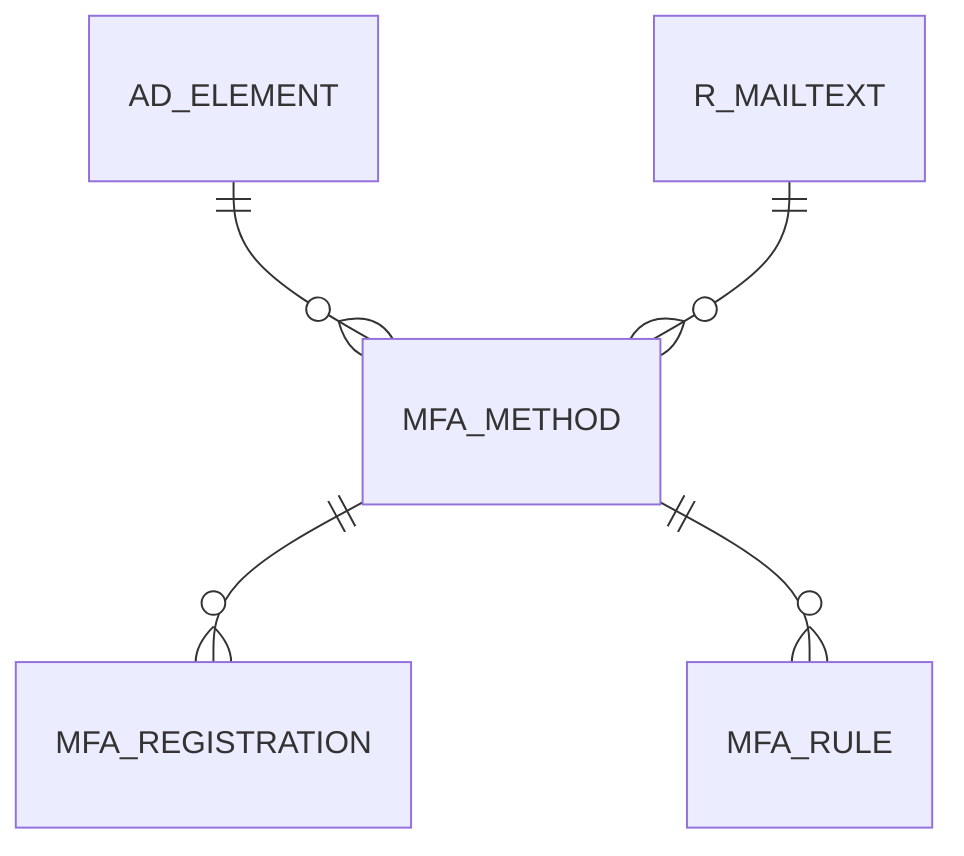

# MFA_METHOD

Area [MFA](../../data-model/mfa/index.md) · class **business** (proposed) · read from database `idempiere-db` (owner `ADEMPIERE`) · 2 row(s) when profiled

Application model: `org.compiere.model.X_MFA_Method`, access level 4 - System.

## Columns

| column | type | key | not null | business name | references (code) | nulls | distinct |
|---|---|---|---|---|---|---|---|
| `MFA_METHOD_ID` | NUMBER(10,0) | PK | yes | MFA Method |  | 0 | 2 |
| `AD_CLIENT_ID` | NUMBER(10,0) |  | yes | Tenant |  | 0 | 1 |
| `AD_ORG_ID` | NUMBER(10,0) |  | yes | Organization |  | 0 | 1 |
| `CREATED` | DATE |  | yes | Created |  | 0 | 2 |
| `CREATEDBY` | NUMBER(10,0) |  | yes | Created By |  | 0 | 1 |
| `DESCRIPTION` | VARCHAR2(255 CHAR) |  |  | Description |  | 2 | 0 |
| `HELP` | VARCHAR2(2000 CHAR) |  |  | Comment/Help |  | 2 | 0 |
| `ISACTIVE` | CHAR(1) |  | yes | Active |  | 0 | 1 |
| `MFA_METHOD_UU` | VARCHAR2(36 CHAR) |  |  | MFA_Method_UU |  | 0 | 2 |
| `NAME` | VARCHAR2(60 CHAR) |  | yes | Name |  | 0 | 2 |
| `UPDATED` | DATE |  | yes | Updated |  | 0 | 2 |
| `UPDATEDBY` | NUMBER(10,0) |  | yes | Updated By |  | 0 | 1 |
| `METHOD` | VARCHAR2(60 CHAR) |  | yes | Method |  | 0 | 2 |
| `MFATYPE` | CHAR(1) |  |  | MFA Type |  | 0 | 1 |
| `MFAISSUER` | VARCHAR2(2000 CHAR) |  |  | Issuer |  | 1 | 1 |
| `MFAALLOWEDTIMEDISCREPANCY` | NUMBER(10,0) |  |  | Allowed Time Period Discrepancy |  | 2 | 0 |
| `MFATIMEPROVIDER` | CHAR(1) |  |  | Time Provider |  | 2 | 0 |
| `MFATIMESERVER` | VARCHAR2(255 CHAR) |  |  | Time Server |  | 2 | 0 |
| `EXPIREINMINUTES` | NUMBER(10,0) |  |  | Expire in Minutes |  | 0 | 2 |
| `R_MAILTEXT_ID` | NUMBER(10,0) |  |  | Mail Template | [R_MAILTEXT](../../data-model/r/r_mailtext.md) | 1 | 1 |
| `MFA_ELEMENTPRM_ID` | NUMBER(10,0) |  |  | Parameter Element | [AD_ELEMENT](../../data-model/ad/ad_element.md) | 0 | 2 |

*references (code)* is the table the application model's code says a column points to; *Foreign keys* below are the constraints the database declares. Counts come from the profile; no value is ever shown.

## Check constraints

| name | expression |
|---|---|
| `SYS_C0020593` | `IsActive IN ('Y','N')` |

## Foreign keys

**References**

| table | columns | on delete |
|---|---|---|
| [AD_ELEMENT](../../data-model/ad/ad_element.md) | MFA_METHOD.MFA_ELEMENTPRM_ID → AD_ELEMENT.AD_ELEMENT_ID | NO ACTION |
| [R_MAILTEXT](../../data-model/r/r_mailtext.md) | MFA_METHOD.R_MAILTEXT_ID → R_MAILTEXT.R_MAILTEXT_ID | NO ACTION |

**Referenced by**

| table | columns | on delete |
|---|---|---|
| [MFA_REGISTRATION](../../data-model/mfa/mfa_registration.md) | MFA_REGISTRATION.MFA_METHOD_ID → MFA_METHOD.MFA_METHOD_ID | NO ACTION |
| [MFA_RULE](../../data-model/mfa/mfa_rule.md) | MFA_RULE.MFA_METHOD_ID → MFA_METHOD.MFA_METHOD_ID | NO ACTION |

## Write behaviour

- updates: **po_only**
- deletes: **deleted_by_users**
- change log: **recorded**
- evidence: 1 citation(s)

## Schema history

48 change(s); the latest:

| applied | release | operation | column | tickets |
|---|---|---|---|---|
| 2021-05-30T14:48 | i8.2 | `add_column` | AD_Org_ID | IDEMPIERE-4782 |
| 2021-05-30T14:48 | i8.2 | `add_column` | MFATimeProvider | IDEMPIERE-4782 |
| 2021-05-30T14:48 | i8.2 | `add_column` | MFAType | IDEMPIERE-4782 |
| 2021-05-30T14:48 | i8.2 | `add_column` | CreatedBy | IDEMPIERE-4782 |
| 2021-05-30T14:48 | i8.2 | `add_column` | Updated | IDEMPIERE-4782 |
| 2021-05-30T14:48 | i8.2 | `add_column` | IsActive | IDEMPIERE-4782 |
| 2021-05-30T14:48 | i8.2 | `add_column` | MFA_ElementPrm_ID | IDEMPIERE-4782 |
| 2021-05-30T14:48 | i8.2 | `add_column` | Description | IDEMPIERE-4782 |
| 2021-05-30T14:48 | i8.2 | `add_column` | MFATimeServer | IDEMPIERE-4782 |
| 2021-05-30T14:48 | i8.2 | `add_column` | MFA_Method_UU | IDEMPIERE-4782 |
| 2021-05-30T14:48 | i8.2 | `add_column` | R_MailText_ID | IDEMPIERE-4782 |
| 2021-05-30T14:48 | i8.2 | `add_column` | Help | IDEMPIERE-4782 |
| 2021-05-30T14:48 | i8.2 | `add_column` | MFAAllowedTimeDiscrepancy | IDEMPIERE-4782 |
| 2021-05-30T14:48 | i8.2 | `add_column` | CreatedBy | IDEMPIERE-4782 |
| 2021-05-30T14:48 | i8.2 | `add_column` | MFAIssuer | IDEMPIERE-4782 |

## Notes

<!-- ekos:manual id="table.mfa_method.notes" -->
_Business notes about this table._
<!-- /ekos:manual -->
