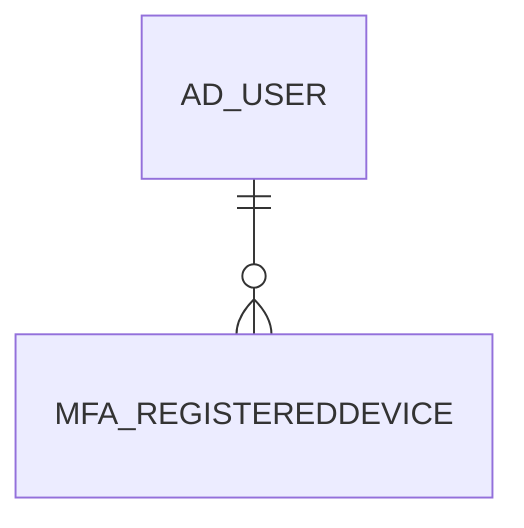

# MFA_REGISTEREDDEVICE

Area [MFA](../../data-model/mfa/index.md) · class **business** (proposed) · read from database `idempiere-db` (owner `ADEMPIERE`) · 0 row(s) when profiled

Application model: `org.compiere.model.X_MFA_RegisteredDevice`, access level 6 - System - Client.

## Columns

| column | type | key | not null | business name | references (code) | nulls | distinct |
|---|---|---|---|---|---|---|---|
| `MFA_REGISTEREDDEVICE_ID` | NUMBER(10,0) | PK | yes | MFA Registered Device |  | 0 | 0 |
| `AD_CLIENT_ID` | NUMBER(10,0) |  | yes | Tenant |  | 0 | 0 |
| `AD_ORG_ID` | NUMBER(10,0) |  | yes | Organization |  | 0 | 0 |
| `CREATED` | DATE |  | yes | Created |  | 0 | 0 |
| `CREATEDBY` | NUMBER(10,0) |  | yes | Created By |  | 0 | 0 |
| `ISACTIVE` | CHAR(1) |  | yes | Active |  | 0 | 0 |
| `MFA_REGISTEREDDEVICE_UU` | VARCHAR2(36 CHAR) |  |  | MFA_RegisteredDevice_UU |  | 0 | 0 |
| `UPDATED` | DATE |  | yes | Updated |  | 0 | 0 |
| `UPDATEDBY` | NUMBER(10,0) |  | yes | Updated By |  | 0 | 0 |
| `AD_USER_ID` | NUMBER(10,0) |  | yes | User/Contact | [AD_USER](../../data-model/ad/ad_user.md) | 0 | 0 |
| `MFADEVICEIDENTIFIER` | VARCHAR2(2000 CHAR) |  | yes | MFA Device Identifier |  | 0 | 0 |
| `EXPIRATION` | DATE |  |  | Expire On |  | 0 | 0 |
| `HELP` | VARCHAR2(2000 CHAR) |  |  | Comment/Help |  | 0 | 0 |

*references (code)* is the table the application model's code says a column points to; *Foreign keys* below are the constraints the database declares. Counts come from the profile; no value is ever shown.

## Check constraints

| name | expression |
|---|---|
| `SYS_C0019439` | `IsActive IN ('Y','N')` |

## Foreign keys

**References**

| table | columns | on delete |
|---|---|---|
| [AD_USER](../../data-model/ad/ad_user.md) | MFA_REGISTEREDDEVICE.AD_USER_ID → AD_USER.AD_USER_ID | NO ACTION |

**Referenced by**

_None._

## Write behaviour

- updates: **po_only**
- deletes: **deleted_by_users**
- change log: **recorded**
- evidence: 1 citation(s)

## Schema history

30 change(s); the latest:

| applied | release | operation | column | tickets |
|---|---|---|---|---|
| 2021-05-30T14:48 | i8.2 | `add_column` | Created | IDEMPIERE-4782 |
| 2021-05-30T14:48 | i8.2 | `add_column` | Expiration | IDEMPIERE-4782 |
| 2021-05-30T14:48 | i8.2 | `add_column` | CreatedBy | IDEMPIERE-4782 |
| 2021-05-30T14:48 | i8.2 | `create_table` |  | IDEMPIERE-4782 |
| 2021-05-30T14:48 | i8.2 | `add_column` | MFA_RegisteredDevice_UU | IDEMPIERE-4782 |
| 2021-05-30T14:48 | i8.2 | `add_column` | Updated | IDEMPIERE-4782 |
| 2021-05-30T14:48 | i8.2 | `add_column` | MFADeviceIdentifier | IDEMPIERE-4782 |
| 2021-05-30T14:48 | i8.2 | `add_column` | AD_Client_ID | IDEMPIERE-4782 |
| 2021-05-30T14:48 | i8.2 | `create_table` |  | IDEMPIERE-4782 |
| 2021-05-30T14:48 | i8.2 | `add_column` | Help | IDEMPIERE-4782 |
| 2021-05-30T14:48 | i8.2 | `add_column` | AD_User_ID | IDEMPIERE-4782 |
| 2021-05-30T14:48 | i8.2 | `add_column` | IsActive | IDEMPIERE-4782 |
| 2021-05-30T14:48 | i8.2 | `add_constraint` |  | IDEMPIERE-4782 |
| 2021-05-30T14:48 | i8.2 | `add_column` | Expiration | IDEMPIERE-4782 |
| 2021-05-30T14:48 | i8.2 | `add_constraint` |  | IDEMPIERE-4782 |

## Notes

<!-- ekos:manual id="table.mfa_registereddevice.notes" -->
_Business notes about this table._
<!-- /ekos:manual -->
