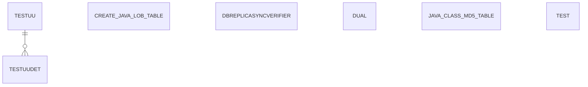

# Area OTHER

7 table(s), 7 in scope.

| table | class | scope | rows | description |
|---|---|---|---|---|
| [CREATE$JAVA$LOB$TABLE](../../data-model/other/create-java-lob-table.md) | business | in | 8 |  |
| [DBREPLICASYNCVERIFIER](../../data-model/other/dbreplicasyncverifier.md) | business | in | 1 |  |
| [DUAL](../../data-model/other/dual.md) | unclassified | in |  |  |
| [JAVA$CLASS$MD5$TABLE](../../data-model/other/java-class-md5-table.md) | business | in | 9 |  |
| [TEST](../../data-model/other/test.md) | business | in | 0 |  |
| [TESTUU](../../data-model/other/testuu.md) | business | in | 2 |  |
| [TESTUUDET](../../data-model/other/testuudet.md) | business | in | 3 |  |
