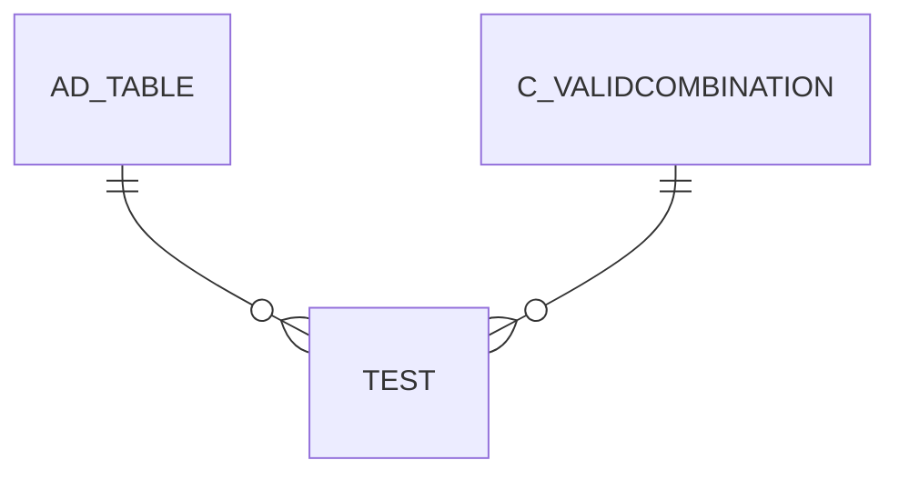

# TEST

Area [OTHER](../../data-model/other/index.md) · class **business** (proposed) · read from database `idempiere-db` (owner `ADEMPIERE`) · 0 row(s) when profiled

Application model: `org.compiere.model.X_Test`, access level 7 - System - Client - Org.

## Columns

| column | type | key | not null | business name | references (code) | nulls | distinct |
|---|---|---|---|---|---|---|---|
| `TEST_ID` | NUMBER(10,0) | PK | yes | Test ID |  | 0 | 0 |
| `AD_CLIENT_ID` | NUMBER(10,0) |  | yes | Tenant |  | 0 | 0 |
| `AD_ORG_ID` | NUMBER(10,0) |  | yes | Organization |  | 0 | 0 |
| `ISACTIVE` | CHAR(1) |  | yes | Active |  | 0 | 0 |
| `CREATED` | DATE |  | yes | Created |  | 0 | 0 |
| `CREATEDBY` | NUMBER(10,0) |  | yes | Created By |  | 0 | 0 |
| `UPDATED` | DATE |  | yes | Updated |  | 0 | 0 |
| `UPDATEDBY` | NUMBER(10,0) |  | yes | Updated By |  | 0 | 0 |
| `NAME` | VARCHAR2(60 CHAR) |  | yes | Name |  | 0 | 0 |
| `DESCRIPTION` | VARCHAR2(255 CHAR) |  |  | Description |  | 0 | 0 |
| `HELP` | VARCHAR2(2000 CHAR) |  |  | Comment/Help |  | 0 | 0 |
| `T_INTEGER` | NUMBER(10,0) |  |  | Integer |  | 0 | 0 |
| `T_NUMBER` | NUMBER |  |  | Number |  | 0 | 0 |
| `T_DATE` | DATE |  |  | Date |  | 0 | 0 |
| `T_DATETIME` | DATE |  |  | DateTime |  | 0 | 0 |
| `C_UOM_ID` | NUMBER(10,0) |  |  | UOM | [C_UOM](../../data-model/c/c_uom.md) | 0 | 0 |
| `T_QTY` | NUMBER |  |  | Qty |  | 0 | 0 |
| `C_CURRENCY_ID` | NUMBER(10,0) |  |  | Currency | [C_CURRENCY](../../data-model/c/c_currency.md) | 0 | 0 |
| `T_AMOUNT` | NUMBER |  |  | Amount |  | 0 | 0 |
| `C_LOCATION_ID` | NUMBER(10,0) |  |  | Address | [C_LOCATION](../../data-model/c/c_location.md) | 0 | 0 |
| `ACCOUNT_ACCT` | NUMBER(10,0) |  |  | Account_Acct |  | 0 | 0 |
| `C_PAYMENT_ID` | NUMBER(10,0) |  |  | Payment | [C_PAYMENT](../../data-model/c/c_payment.md) | 0 | 0 |
| `M_PRODUCT_ID` | NUMBER(10,0) |  |  | Product | [M_PRODUCT](../../data-model/m/m_product.md) | 0 | 0 |
| `C_BPARTNER_ID` | NUMBER(10,0) |  |  | Business Partner | [C_BPARTNER](../../data-model/c/c_bpartner.md) | 0 | 0 |
| `M_LOCATOR_ID` | NUMBER(10,0) |  |  | Locator | [M_LOCATOR](../../data-model/m/m_locator.md) | 0 | 0 |
| `PROCESSING` | CHAR(1) |  |  | Process Now |  | 0 | 0 |
| `BINARYDATA` | BLOB |  |  | Binary Data |  | 0 |  |
| `PROCESSED` | CHAR(1) |  |  | Processed |  | 0 | 0 |
| `CHARACTERDATA` | CLOB |  |  | Character Data |  | 0 |  |
| `TEST_UU` | VARCHAR2(36 CHAR) |  |  | Test_UU |  | 0 | 0 |
| `COLOR` | VARCHAR2(7 CHAR) |  |  | Color |  | 0 | 0 |
| `T_TIMESTAMP` | TIMESTAMP(6) WITH TIME ZONE |  |  | Timestamp |  | 0 | 0 |
| `AD_TABLE_ID` | NUMBER(10,0) |  |  | Table | [AD_TABLE](../../data-model/ad/ad_table.md) | 0 | 0 |
| `RECORD_ID` | NUMBER(10,0) |  |  | Record ID |  | 0 | 0 |
| `RECORD_UU` | VARCHAR2(36 CHAR) |  |  | Record UUID |  | 0 | 0 |
| `JSONDATA` | CLOB |  |  | JSON Data |  | 0 |  |

*references (code)* is the table the application model's code says a column points to; *Foreign keys* below are the constraints the database declares. Counts come from the profile; no value is ever shown.

## Check constraints

| name | expression |
|---|---|
| `SYS_C0020406` | `IsActive in ('Y','N')` |
| `SYS_C0020407` | `Processed in ('Y','N')` |
| `TEST_JSONDATA_IJ` | `JsonData IS JSON` |

## Foreign keys

**References**

| table | columns | on delete |
|---|---|---|
| [AD_TABLE](../../data-model/ad/ad_table.md) | TEST.AD_TABLE_ID → AD_TABLE.AD_TABLE_ID | NO ACTION |
| [C_VALIDCOMBINATION](../../data-model/c/c_validcombination.md) | TEST.ACCOUNT_ACCT → C_VALIDCOMBINATION.C_VALIDCOMBINATION_ID | NO ACTION |

**Referenced by**

_None._

## Write behaviour

- updates: **raw_sql_skips_updated**
- deletes: **deleted_by_app, deleted_by_users**
- change log: **recorded**
- evidence: 5 citation(s)

## Schema history

34 change(s); the latest:

| applied | release | operation | column | tickets |
|---|---|---|---|---|
| 2025-01-25T04:00 | iD12 | `modify_column` | JsonData | IDEMPIERE-6397 |
| 2024-02-26T13:54 | iD11 | `add_column` | JsonData | IDEMPIERE-2981 |
| 2024-02-26T13:54 | iD11 | `add_column` | JsonData | IDEMPIERE-2981 |
| 2023-04-09T15:47 | iD11 | `add_constraint` |  | IDEMPIERE-5567 |
| 2023-04-09T15:47 | iD11 | `add_constraint` |  | IDEMPIERE-5567 |
| 2023-04-06T00:01 | iD11 | `add_column` | Record_UU | IDEMPIERE-5567 |
| 2023-04-06T00:01 | iD11 | `add_column` | Record_UU | IDEMPIERE-5567 |
| 2023-02-16T14:43 | iD10 | `add_constraint` |  | IDEMPIERE-5238 |
| 2023-02-16T14:43 | iD10 | `add_column` | Record_ID | IDEMPIERE-5238 |
| 2023-02-16T14:43 | iD10 | `add_column` | AD_Table_ID | IDEMPIERE-5238 |
| 2023-02-16T14:43 | iD10 | `add_constraint` |  | IDEMPIERE-5238 |
| 2023-02-16T14:43 | iD10 | `add_column` | AD_Table_ID | IDEMPIERE-5238 |
| 2023-02-16T14:43 | iD10 | `add_column` | Record_ID | IDEMPIERE-5238 |
| 2022-04-11T15:08 | iD10 | `add_column` | T_Timestamp | IDEMPIERE-5093 |
| 2022-04-11T15:08 | iD10 | `add_column` | T_Timestamp | IDEMPIERE-5093 |

## Notes

<!-- ekos:manual id="table.test.notes" -->
_Business notes about this table._
<!-- /ekos:manual -->
