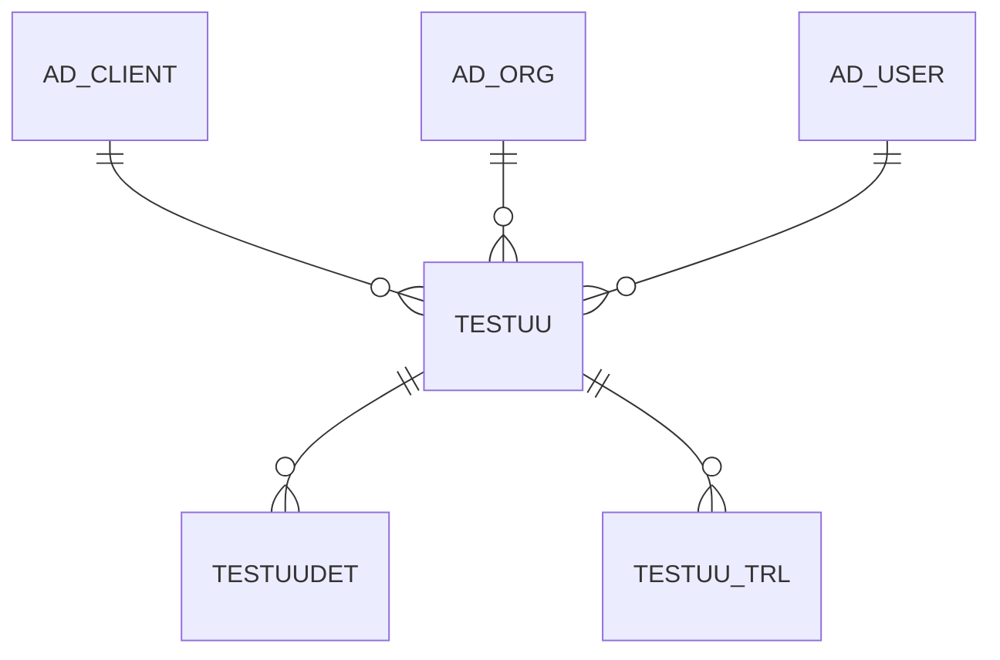

# TESTUU

Area [OTHER](../../data-model/other/index.md) · class **business** (proposed) · read from database `idempiere-db` (owner `ADEMPIERE`) · 2 row(s) when profiled

Application model: `org.compiere.model.X_TestUU`, access level 7 - System - Client - Org.

## Columns

| column | type | key | not null | business name | references (code) | nulls | distinct |
|---|---|---|---|---|---|---|---|
| `AD_CLIENT_ID` | NUMBER(10,0) |  | yes | Tenant |  | 0 | 2 |
| `AD_ORG_ID` | NUMBER(10,0) |  | yes | Organization |  | 0 | 1 |
| `CREATED` | DATE |  | yes | Created |  | 0 | 2 |
| `CREATEDBY` | NUMBER(10,0) |  | yes | Created By |  | 0 | 1 |
| `DESCRIPTION` | VARCHAR2(255 CHAR) |  |  | Description |  | 1 | 1 |
| `HELP` | VARCHAR2(2000 CHAR) |  |  | Comment/Help |  | 1 | 1 |
| `ISACTIVE` | CHAR(1) |  | yes | Active |  | 0 | 1 |
| `NAME` | VARCHAR2(60 CHAR) |  | yes | Name |  | 0 | 2 |
| `TESTUU_UU` | VARCHAR2(36 CHAR) | PK | yes | Test UU |  | 0 | 2 |
| `UPDATED` | DATE |  | yes | Updated |  | 0 | 2 |
| `UPDATEDBY` | NUMBER(10,0) |  | yes | Updated By |  | 0 | 1 |
| `VALUE` | VARCHAR2(40 CHAR) |  |  | Search Key |  | 0 | 2 |

*references (code)* is the table the application model's code says a column points to; *Foreign keys* below are the constraints the database declares. Counts come from the profile; no value is ever shown.

## Check constraints

| name | expression |
|---|---|
| `SYS_C0019696` | `IsActive IN ('Y','N')` |

## Foreign keys

**References**

| table | columns | on delete |
|---|---|---|
| [AD_CLIENT](../../data-model/ad/ad_client.md) | TESTUU.AD_CLIENT_ID → AD_CLIENT.AD_CLIENT_ID | NO ACTION |
| [AD_ORG](../../data-model/ad/ad_org.md) | TESTUU.AD_ORG_ID → AD_ORG.AD_ORG_ID | NO ACTION |
| [AD_USER](../../data-model/ad/ad_user.md) | TESTUU.CREATEDBY → AD_USER.AD_USER_ID | NO ACTION |

**Referenced by**

| table | columns | on delete |
|---|---|---|
| [TESTUUDET](../../data-model/other/testuudet.md) | TESTUUDET.ALTTESTUU_UU → TESTUU.TESTUU_UU | NO ACTION |
| [TESTUU_TRL](../../data-model/testuu/testuu_trl.md) | TESTUU_TRL.TESTUU_UU → TESTUU.TESTUU_UU | CASCADE |

## Write behaviour

- updates: **raw_sql_skips_updated**
- deletes: **deleted_by_users**
- change log: **recorded**
- evidence: 2 citation(s)

## Schema history

10 change(s); the latest:

| applied | release | operation | column | tickets |
|---|---|---|---|---|
| 2023-03-17T13:34 | iD11 | `add_constraint` |  | IDEMPIERE-5567 |
| 2023-03-17T13:34 | iD11 | `add_constraint` |  | IDEMPIERE-5567 |
| 2023-03-17T13:34 | iD11 | `add_constraint` |  | IDEMPIERE-5567 |
| 2023-03-17T13:34 | iD11 | `add_constraint` |  | IDEMPIERE-5567 |
| 2023-03-17T13:34 | iD11 | `add_constraint` |  | IDEMPIERE-5567 |
| 2023-03-17T13:34 | iD11 | `create_table` |  | IDEMPIERE-5567 |
| 2023-03-17T13:34 | iD11 | `add_constraint` |  | IDEMPIERE-5567 |
| 2023-03-17T13:34 | iD11 | `add_constraint` |  | IDEMPIERE-5567 |
| 2023-03-17T13:34 | iD11 | `create_table` |  | IDEMPIERE-5567 |
| 2023-03-17T13:34 | iD11 | `add_constraint` |  | IDEMPIERE-5567 |

## Notes

<!-- ekos:manual id="table.testuu.notes" -->
_Business notes about this table._
<!-- /ekos:manual -->
