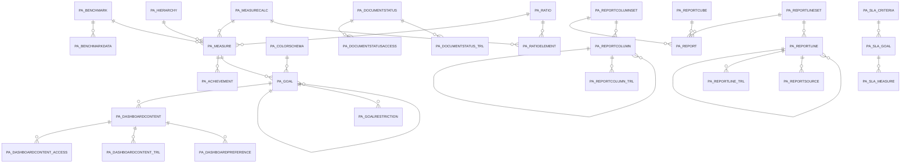

# Area PA

30 table(s), 30 in scope.

| table | class | scope | rows | description |
|---|---|---|---|---|
| [PA_ACHIEVEMENT](../../data-model/pa/pa_achievement.md) | business | in | 0 |  |
| [PA_BENCHMARK](../../data-model/pa/pa_benchmark.md) | business | in | 0 |  |
| [PA_BENCHMARKDATA](../../data-model/pa/pa_benchmarkdata.md) | business | in | 0 |  |
| [PA_COLORSCHEMA](../../data-model/pa/pa_colorschema.md) | business | in | 2 |  |
| [PA_DASHBOARDCONTENT](../../data-model/pa/pa_dashboardcontent.md) | business | in | 12 |  |
| [PA_DASHBOARDCONTENT_ACCESS](../../data-model/pa/pa_dashboardcontent_access.md) | business | in | 2 |  |
| [PA_DASHBOARDCONTENT_TRL](../../data-model/pa/pa_dashboardcontent_trl.md) | translation | in | 12 |  |
| [PA_DASHBOARDPREFERENCE](../../data-model/pa/pa_dashboardpreference.md) | business | in | 0 |  |
| [PA_DOCUMENTSTATUS](../../data-model/pa/pa_documentstatus.md) | business | in | 6 |  |
| [PA_DOCUMENTSTATUSACCESS](../../data-model/pa/pa_documentstatusaccess.md) | business | in | 0 |  |
| [PA_DOCUMENTSTATUS_TRL](../../data-model/pa/pa_documentstatus_trl.md) | translation | in | 6 |  |
| [PA_GOAL](../../data-model/pa/pa_goal.md) | business | in | 4 |  |
| [PA_GOALRESTRICTION](../../data-model/pa/pa_goalrestriction.md) | business | in | 0 |  |
| [PA_HIERARCHY](../../data-model/pa/pa_hierarchy.md) | business | in | 0 |  |
| [PA_MEASURE](../../data-model/pa/pa_measure.md) | business | in | 4 |  |
| [PA_MEASURECALC](../../data-model/pa/pa_measurecalc.md) | business | in | 6 |  |
| [PA_RATIO](../../data-model/pa/pa_ratio.md) | business | in | 1 |  |
| [PA_RATIOELEMENT](../../data-model/pa/pa_ratioelement.md) | business | in | 3 |  |
| [PA_REPORT](../../data-model/pa/pa_report.md) | business | in | 3 |  |
| [PA_REPORTCOLUMN](../../data-model/pa/pa_reportcolumn.md) | business | in | 17 |  |
| [PA_REPORTCOLUMNSET](../../data-model/pa/pa_reportcolumnset.md) | business | in | 3 |  |
| [PA_REPORTCOLUMN_TRL](../../data-model/pa/pa_reportcolumn_trl.md) | translation | in | 17 |  |
| [PA_REPORTCUBE](../../data-model/pa/pa_reportcube.md) | business | in | 0 |  |
| [PA_REPORTLINE](../../data-model/pa/pa_reportline.md) | business | in | 113 |  |
| [PA_REPORTLINESET](../../data-model/pa/pa_reportlineset.md) | business | in | 3 |  |
| [PA_REPORTLINE_TRL](../../data-model/pa/pa_reportline_trl.md) | translation | in | 113 |  |
| [PA_REPORTSOURCE](../../data-model/pa/pa_reportsource.md) | business | in | 93 |  |
| [PA_SLA_CRITERIA](../../data-model/pa/pa_sla_criteria.md) | business | in | 2 |  |
| [PA_SLA_GOAL](../../data-model/pa/pa_sla_goal.md) | business | in | 1 |  |
| [PA_SLA_MEASURE](../../data-model/pa/pa_sla_measure.md) | business | in | 1 |  |
