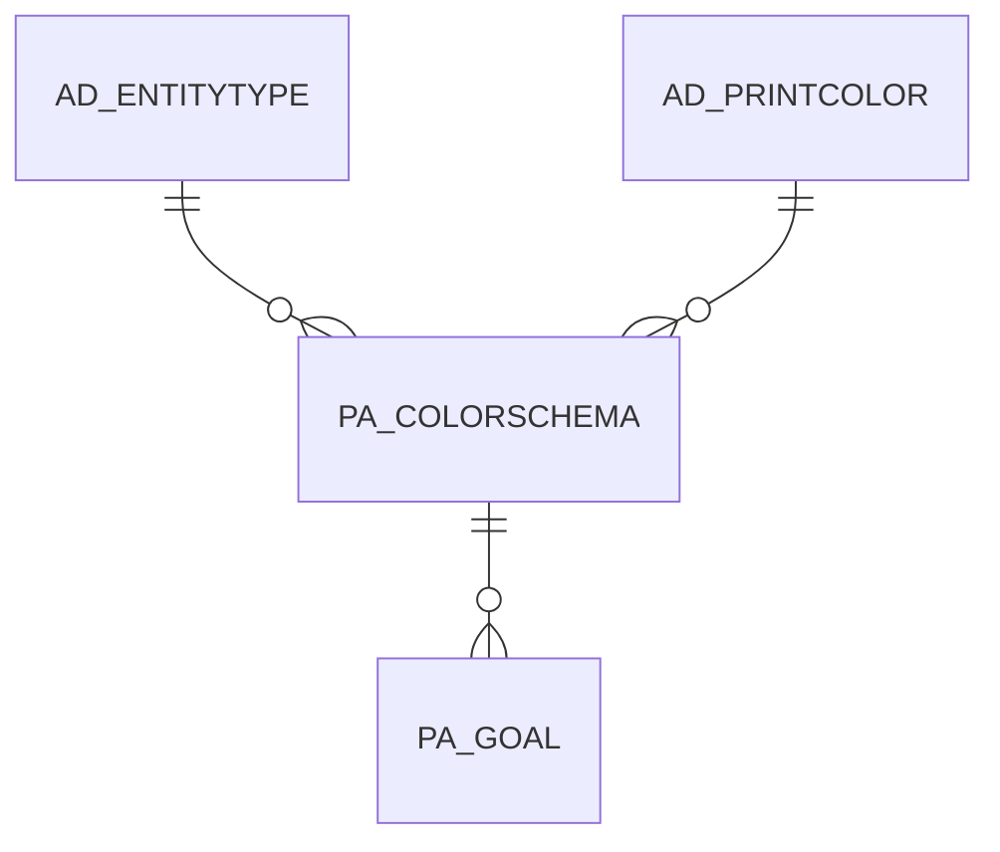

# PA_COLORSCHEMA

Area [PA](../../data-model/pa/index.md) · class **business** (proposed) · read from database `idempiere-db` (owner `ADEMPIERE`) · 2 row(s) when profiled

Application model: `org.compiere.model.X_PA_ColorSchema`, access level 6 - System - Client.

## Columns

| column | type | key | not null | business name | references (code) | nulls | distinct |
|---|---|---|---|---|---|---|---|
| `PA_COLORSCHEMA_ID` | NUMBER(10,0) | PK | yes | Color Schema |  | 0 | 2 |
| `AD_CLIENT_ID` | NUMBER(10,0) |  | yes | Tenant |  | 0 | 1 |
| `AD_ORG_ID` | NUMBER(10,0) |  | yes | Organization |  | 0 | 1 |
| `ISACTIVE` | CHAR(1) |  | yes | Active |  | 0 | 1 |
| `CREATED` | DATE |  | yes | Created |  | 0 | 2 |
| `CREATEDBY` | NUMBER(10,0) |  | yes | Created By |  | 0 | 1 |
| `UPDATED` | DATE |  | yes | Updated |  | 0 | 2 |
| `UPDATEDBY` | NUMBER(10,0) |  | yes | Updated By |  | 0 | 1 |
| `NAME` | VARCHAR2(60 CHAR) |  | yes | Name |  | 0 | 2 |
| `DESCRIPTION` | VARCHAR2(255 CHAR) |  |  | Description |  | 0 | 2 |
| `MARK1PERCENT` | NUMBER(10,0) |  | yes | Mark 1 Percent |  | 0 | 1 |
| `AD_PRINTCOLOR1_ID` | NUMBER(10,0) |  | yes | Color 1 | [AD_PRINTCOLOR](../../data-model/ad/ad_printcolor.md) | 0 | 2 |
| `MARK2PERCENT` | NUMBER(10,0) |  | yes | Mark 2 Percent |  | 0 | 1 |
| `AD_PRINTCOLOR2_ID` | NUMBER(10,0) |  | yes | Color 2 | [AD_PRINTCOLOR](../../data-model/ad/ad_printcolor.md) | 0 | 1 |
| `MARK3PERCENT` | NUMBER(10,0) |  |  | Mark 3 Percent |  | 0 | 1 |
| `AD_PRINTCOLOR3_ID` | NUMBER(10,0) |  |  | Color 3 | [AD_PRINTCOLOR](../../data-model/ad/ad_printcolor.md) | 0 | 2 |
| `MARK4PERCENT` | NUMBER(10,0) |  |  | Mark 4 Percent |  | 0 | 1 |
| `AD_PRINTCOLOR4_ID` | NUMBER(10,0) |  |  | Color 4 | [AD_PRINTCOLOR](../../data-model/ad/ad_printcolor.md) | 2 | 0 |
| `ENTITYTYPE` | VARCHAR2(40 CHAR) |  | yes | Entity Type |  | 0 | 1 |
| `PA_COLORSCHEMA_UU` | VARCHAR2(36 CHAR) |  |  | PA_ColorSchema_UU |  | 0 | 2 |

*references (code)* is the table the application model's code says a column points to; *Foreign keys* below are the constraints the database declares. Counts come from the profile; no value is ever shown.

## Check constraints

| name | expression |
|---|---|
| `SYS_C0020866` | `IsActive in ('Y','N')` |

## Foreign keys

**References**

| table | columns | on delete |
|---|---|---|
| [AD_ENTITYTYPE](../../data-model/ad/ad_entitytype.md) | PA_COLORSCHEMA.ENTITYTYPE → AD_ENTITYTYPE.ENTITYTYPE | NO ACTION |
| [AD_PRINTCOLOR](../../data-model/ad/ad_printcolor.md) | PA_COLORSCHEMA.AD_PRINTCOLOR1_ID → AD_PRINTCOLOR.AD_PRINTCOLOR_ID | NO ACTION |

**Referenced by**

| table | columns | on delete |
|---|---|---|
| [PA_GOAL](../../data-model/pa/pa_goal.md) | PA_GOAL.PA_COLORSCHEMA_ID → PA_COLORSCHEMA.PA_COLORSCHEMA_ID | NO ACTION |

## Write behaviour

- updates: **po_only**
- deletes: **deleted_by_users**
- change log: **recorded**
- evidence: 1 citation(s)

## Schema history

24 change(s); the latest:

| applied | release | operation | column | tickets |
|---|---|---|---|---|
| 2023-04-09T15:47 | iD11 | `add_constraint` |  | IDEMPIERE-5567 |
| 2023-04-09T15:47 | iD11 | `add_constraint` |  | IDEMPIERE-5567 |
| 2021-12-05T16:45 | i8.2z | `add_constraint` |  | IDEMPIERE-5075 |
| 2021-12-05T16:45 | i8.2z | `add_constraint` |  | IDEMPIERE-5075 |
| 2021-12-05T16:45 | i8.2z | `drop_constraint` |  | IDEMPIERE-5075 |
| 2021-12-05T16:45 | i8.2z | `drop_constraint` |  | IDEMPIERE-5075 |
| 2021-12-05T16:45 | i8.2z | `drop_constraint` |  | IDEMPIERE-5075 |
| 2021-12-05T16:45 | i8.2z | `add_constraint` |  | IDEMPIERE-5075 |
| 2021-12-05T16:45 | i8.2z | `add_constraint` |  | IDEMPIERE-5075 |
| 2021-12-05T16:45 | i8.2z | `drop_constraint` |  | IDEMPIERE-5075 |
| 2021-12-05T16:45 | i8.2z | `add_constraint` |  | IDEMPIERE-5075 |
| 2021-12-05T16:45 | i8.2z | `drop_constraint` |  | IDEMPIERE-5075 |
| 2020-08-04T01:00 | i7.1z | `add_column` | tmp_col_2_tmp | IDEMPIERE-3862 |
| 2020-08-04T01:00 | i7.1z | `drop_column` | tmp_col_1_tmp | IDEMPIERE-3862 |
| 2020-08-04T01:00 | i7.1z | `add_column` | tmp_col_1_tmp | IDEMPIERE-3862 |

## Notes

<!-- ekos:manual id="table.pa_colorschema.notes" -->
_Business notes about this table._
<!-- /ekos:manual -->
