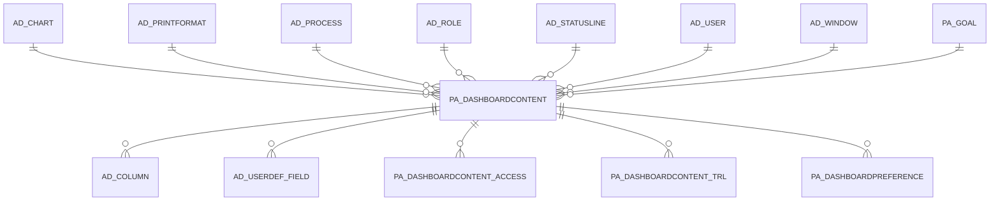

# PA_DASHBOARDCONTENT

Area [PA](../../data-model/pa/index.md) · class **business** (proposed) · read from database `idempiere-db` (owner `ADEMPIERE`) · 12 row(s) when profiled

Application model: `org.compiere.model.X_PA_DashboardContent`, access level 6 - System - Client.

## Columns

| column | type | key | not null | business name | references (code) | nulls | distinct |
|---|---|---|---|---|---|---|---|
| `PA_DASHBOARDCONTENT_ID` | NUMBER(10,0) | PK | yes | Dashboard Content |  | 0 | 12 |
| `AD_CLIENT_ID` | NUMBER(10,0) |  | yes | Tenant |  | 0 | 2 |
| `AD_ORG_ID` | NUMBER(10,0) |  | yes | Organization |  | 0 | 1 |
| `CREATED` | DATE |  | yes | Created |  | 0 | 12 |
| `CREATEDBY` | NUMBER(10,0) |  | yes | Created By |  | 0 | 1 |
| `UPDATED` | DATE |  | yes | Updated |  | 0 | 12 |
| `UPDATEDBY` | NUMBER(10,0) |  | yes | Updated By |  | 0 | 1 |
| `ISACTIVE` | CHAR(1) |  | yes | Active |  | 0 | 2 |
| `NAME` | VARCHAR2(120 CHAR) |  | yes | Name |  | 0 | 11 |
| `AD_WINDOW_ID` | NUMBER(10,0) |  |  | Window | [AD_WINDOW](../../data-model/ad/ad_window.md) | 12 | 0 |
| `DESCRIPTION` | VARCHAR2(255 CHAR) |  |  | Description |  | 4 | 8 |
| `HTML` | CLOB |  |  | HTML |  | 11 | 0 |
| `LINE` | NUMBER |  |  | Line No |  | 0 | 3 |
| `PA_GOAL_ID` | NUMBER(10,0) |  |  | Goal | [PA_GOAL](../../data-model/pa/pa_goal.md) | 12 | 0 |
| `COLUMNNO` | NUMBER(10,0) |  |  | Column No |  | 0 | 5 |
| `ZULFILEPATH` | VARCHAR2(255 CHAR) |  |  | Gadget URI |  | 3 | 9 |
| `ISCOLLAPSIBLE` | CHAR(1) |  | yes | Collapsible |  | 0 | 1 |
| `GOALDISPLAY` | CHAR(1) |  |  | Goal Display |  | 0 | 1 |
| `PA_DASHBOARDCONTENT_UU` | VARCHAR2(36 CHAR) |  |  | PA_DashboardContent_UU |  | 0 | 12 |
| `ISSHOWINDASHBOARD` | CHAR(1) |  | yes | Show in Dashboard |  | 0 | 2 |
| `AD_PROCESS_ID` | NUMBER(10,0) |  |  | Process | [AD_PROCESS](../../data-model/ad/ad_process.md) | 12 | 0 |
| `ISEMBEDREPORTCONTENT` | CHAR(1) |  | yes | Embed Report Content |  | 0 | 1 |
| `PROCESSPARAMETERS` | VARCHAR2(2000 CHAR) |  |  | Process Parameters |  | 12 | 0 |
| `ISCOLLAPSEDBYDEFAULT` | CHAR(1) |  | yes | Collapsed By Default |  | 0 | 1 |
| `AD_USER_ID` | NUMBER(10,0) |  |  | User/Contact | [AD_USER](../../data-model/ad/ad_user.md) | 0 | 2 |
| `AD_ROLE_ID` | NUMBER(10,0) |  |  | Role | [AD_ROLE](../../data-model/ad/ad_role.md) | 0 | 1 |
| `ISSHOWINLOGIN` | CHAR(1) |  |  | Show on Login |  | 0 | 1 |
| `AD_CHART_ID` | NUMBER(10,0) |  |  | Chart | [AD_CHART](../../data-model/ad/ad_chart.md) | 12 | 0 |
| `ISSHOWTITLE` | CHAR(1) |  | yes | Show Title |  | 0 | 1 |
| `AD_STATUSLINE_ID` | NUMBER(10,0) |  |  | Status Line | [AD_STATUSLINE](../../data-model/ad/ad_statusline.md) | 10 | 2 |
| `ISMAXIMIZABLE` | CHAR(1) |  | yes | Maximizable |  | 0 | 2 |
| `AD_PRINTFORMAT_ID` | NUMBER(10,0) |  |  | Print Format | [AD_PRINTFORMAT](../../data-model/ad/ad_printformat.md) | 12 | 0 |
| `HELP` | VARCHAR2(2000 CHAR) |  |  | Comment/Help |  | 10 | 2 |

*references (code)* is the table the application model's code says a column points to; *Foreign keys* below are the constraints the database declares. Counts come from the profile; no value is ever shown.

## Check constraints

| name | expression |
|---|---|
| `SYS_C0022090` | `IsEmbedReportContent IN ('Y','N')` |
| `SYS_C0022091` | `isactive IN ('Y','N')` |
| `SYS_C0022092` | `IsCollapsedByDefault IN ('Y','N')` |
| `SYS_C0022094` | `IsShowInDashboard IN ('Y','N')` |
| `SYS_C0022095` | `IsCollapsible IN ('Y','N')` |
| `SYS_C0022096` | `IsMaximizable IN ('Y','N')` |
| `SYS_C0022097` | `IsShowinLogin IN ('Y','N')` |
| `SYS_C0022099` | `IsShowTitle IN ('Y','N')` |

## Foreign keys

**References**

| table | columns | on delete |
|---|---|---|
| [AD_CHART](../../data-model/ad/ad_chart.md) | PA_DASHBOARDCONTENT.AD_CHART_ID → AD_CHART.AD_CHART_ID | NO ACTION |
| [AD_PRINTFORMAT](../../data-model/ad/ad_printformat.md) | PA_DASHBOARDCONTENT.AD_PRINTFORMAT_ID → AD_PRINTFORMAT.AD_PRINTFORMAT_ID | NO ACTION |
| [AD_PROCESS](../../data-model/ad/ad_process.md) | PA_DASHBOARDCONTENT.AD_PROCESS_ID → AD_PROCESS.AD_PROCESS_ID | NO ACTION |
| [AD_ROLE](../../data-model/ad/ad_role.md) | PA_DASHBOARDCONTENT.AD_ROLE_ID → AD_ROLE.AD_ROLE_ID | NO ACTION |
| [AD_STATUSLINE](../../data-model/ad/ad_statusline.md) | PA_DASHBOARDCONTENT.AD_STATUSLINE_ID → AD_STATUSLINE.AD_STATUSLINE_ID | NO ACTION |
| [AD_USER](../../data-model/ad/ad_user.md) | PA_DASHBOARDCONTENT.AD_USER_ID → AD_USER.AD_USER_ID | NO ACTION |
| [AD_WINDOW](../../data-model/ad/ad_window.md) | PA_DASHBOARDCONTENT.AD_WINDOW_ID → AD_WINDOW.AD_WINDOW_ID | NO ACTION |
| [PA_GOAL](../../data-model/pa/pa_goal.md) | PA_DASHBOARDCONTENT.PA_GOAL_ID → PA_GOAL.PA_GOAL_ID | NO ACTION |

**Referenced by**

| table | columns | on delete |
|---|---|---|
| [AD_COLUMN](../../data-model/ad/ad_column.md) | AD_COLUMN.PA_DASHBOARDCONTENT_ID → PA_DASHBOARDCONTENT.PA_DASHBOARDCONTENT_ID | NO ACTION |
| [AD_USERDEF_FIELD](../../data-model/ad/ad_userdef_field.md) | AD_USERDEF_FIELD.PA_DASHBOARDCONTENT_ID → PA_DASHBOARDCONTENT.PA_DASHBOARDCONTENT_ID | NO ACTION |
| [PA_DASHBOARDCONTENT_ACCESS](../../data-model/pa/pa_dashboardcontent_access.md) | PA_DASHBOARDCONTENT_ACCESS.PA_DASHBOARDCONTENT_ID → PA_DASHBOARDCONTENT.PA_DASHBOARDCONTENT_ID | NO ACTION |
| [PA_DASHBOARDCONTENT_TRL](../../data-model/pa/pa_dashboardcontent_trl.md) | PA_DASHBOARDCONTENT_TRL.PA_DASHBOARDCONTENT_ID → PA_DASHBOARDCONTENT.PA_DASHBOARDCONTENT_ID | NO ACTION |
| [PA_DASHBOARDPREFERENCE](../../data-model/pa/pa_dashboardpreference.md) | PA_DASHBOARDPREFERENCE.PA_DASHBOARDCONTENT_ID → PA_DASHBOARDCONTENT.PA_DASHBOARDCONTENT_ID | NO ACTION |

## Write behaviour

- updates: **po_only**
- deletes: **deleted_by_users**
- change log: **recorded**
- evidence: 1 citation(s)

## Schema history

61 change(s); the latest:

| applied | release | operation | column | tickets |
|---|---|---|---|---|
| 2024-11-28T06:13 | iD12 | `add_column` | Help | IDEMPIERE-6291 |
| 2024-11-28T06:13 | iD12 | `add_column` | Help | IDEMPIERE-6291 |
| 2023-04-09T15:47 | iD11 | `add_constraint` |  | IDEMPIERE-5567 |
| 2023-04-09T15:47 | iD11 | `add_constraint` |  | IDEMPIERE-5567 |
| 2022-11-29T08:11 | iD10 | `add_constraint` |  | IDEMPIERE-5490 |
| 2022-11-29T08:11 | iD10 | `add_column` | AD_PrintFormat_ID | IDEMPIERE-5490 |
| 2022-11-29T08:11 | iD10 | `add_column` | AD_PrintFormat_ID | IDEMPIERE-5490 |
| 2022-11-29T08:11 | iD10 | `add_constraint` |  | IDEMPIERE-5490 |
| 2022-09-06T15:47 | iD10 | `add_column` | IsMaximizable | IDEMPIERE-5409 |
| 2022-09-06T15:47 | iD10 | `add_column` | IsMaximizable | IDEMPIERE-5409 |
| 2022-08-22T09:22 | iD10 | `add_constraint` |  | IDEMPIERE-5393 |
| 2022-08-22T09:22 | iD10 | `add_column` | AD_StatusLine_ID | IDEMPIERE-5393 |
| 2022-08-22T09:22 | iD10 | `add_constraint` |  | IDEMPIERE-5393 |
| 2022-08-22T09:22 | iD10 | `add_column` | AD_StatusLine_ID | IDEMPIERE-5393 |
| 2022-07-12T16:57 | iD10 | `add_column` | IsShowTitle | IDEMPIERE-5342 |

## Notes

<!-- ekos:manual id="table.pa_dashboardcontent.notes" -->
_Business notes about this table._
<!-- /ekos:manual -->
