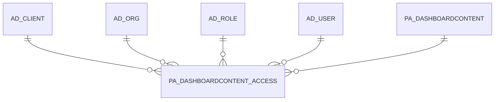

# PA_DASHBOARDCONTENT_ACCESS

Area [PA](../../data-model/pa/index.md) · class **business** (proposed) · read from database `idempiere-db` (owner `ADEMPIERE`) · 2 row(s) when profiled

Application model: `org.compiere.model.X_PA_DashboardContent_Access`, access level 7 - System - Client - Org.

## Columns

| column | type | key | not null | business name | references (code) | nulls | distinct |
|---|---|---|---|---|---|---|---|
| `AD_CLIENT_ID` | NUMBER(10,0) |  |  | Tenant |  | 0 | 2 |
| `AD_ORG_ID` | NUMBER(10,0) |  |  | Organization |  | 0 | 1 |
| `AD_ROLE_ID` | NUMBER(10,0) |  |  | Role | [AD_ROLE](../../data-model/ad/ad_role.md) | 0 | 2 |
| `AD_USER_ID` | NUMBER(10,0) |  |  | User/Contact | [AD_USER](../../data-model/ad/ad_user.md) | 2 | 0 |
| `CREATED` | DATE |  | yes | Created |  | 0 | 2 |
| `CREATEDBY` | NUMBER(10,0) |  |  | Created By |  | 0 | 1 |
| `ISACTIVE` | CHAR(1) |  |  | Active |  | 0 | 1 |
| `PA_DASHBOARDCONTENT_ACCESS_ID` | NUMBER(10,0) | PK | yes | PA_DashboardContent_Access_ID |  | 0 | 2 |
| `PA_DASHBOARDCONTENT_ACCESS_UU` | VARCHAR2(36 CHAR) |  |  | PA_DashboardContent_Access_UU |  | 0 | 2 |
| `PA_DASHBOARDCONTENT_ID` | NUMBER(10,0) |  |  | Dashboard Content | [PA_DASHBOARDCONTENT](../../data-model/pa/pa_dashboardcontent.md) | 0 | 1 |
| `UPDATED` | DATE |  | yes | Updated |  | 0 | 2 |
| `UPDATEDBY` | NUMBER(10,0) |  |  | Updated By |  | 0 | 1 |

*references (code)* is the table the application model's code says a column points to; *Foreign keys* below are the constraints the database declares. Counts come from the profile; no value is ever shown.

## Check constraints

| name | expression |
|---|---|
| `SYS_C0022154` | `IsActive IN ('Y','N')` |

## Foreign keys

**References**

| table | columns | on delete |
|---|---|---|
| [AD_CLIENT](../../data-model/ad/ad_client.md) | PA_DASHBOARDCONTENT_ACCESS.AD_CLIENT_ID → AD_CLIENT.AD_CLIENT_ID | NO ACTION |
| [AD_ORG](../../data-model/ad/ad_org.md) | PA_DASHBOARDCONTENT_ACCESS.AD_ORG_ID → AD_ORG.AD_ORG_ID | NO ACTION |
| [AD_ROLE](../../data-model/ad/ad_role.md) | PA_DASHBOARDCONTENT_ACCESS.AD_ROLE_ID → AD_ROLE.AD_ROLE_ID | NO ACTION |
| [AD_USER](../../data-model/ad/ad_user.md) | PA_DASHBOARDCONTENT_ACCESS.AD_USER_ID → AD_USER.AD_USER_ID | NO ACTION |
| [PA_DASHBOARDCONTENT](../../data-model/pa/pa_dashboardcontent.md) | PA_DASHBOARDCONTENT_ACCESS.PA_DASHBOARDCONTENT_ID → PA_DASHBOARDCONTENT.PA_DASHBOARDCONTENT_ID | NO ACTION |

**Referenced by**

_None._

## Write behaviour

- updates: **po_only**
- deletes: **deleted_by_users**
- change log: **recorded**
- evidence: 1 citation(s)

## Schema history

55 change(s); the latest:

| applied | release | operation | column | tickets |
|---|---|---|---|---|
| 2020-08-04T01:00 | i7.1z | `drop_column` | tmp_col_1_tmp | IDEMPIERE-3862 |
| 2020-08-04T01:00 | i7.1z | `modify_column` | PA_DASHBOARDCONTENT_ACCESS_UU | IDEMPIERE-3862 |
| 2020-08-04T01:00 | i7.1z | `add_column` | tmp_col_1_tmp | IDEMPIERE-3862 |
| 2014-05-02T10:09 | i2.0 | `modify_column` | updated | IDEMPIERE-709 |
| 2014-05-02T10:09 | i2.0 | `modify_column` | created | IDEMPIERE-709 |
| 2014-04-17T15:00 | i2.0 | `modify_column` | updated | IDEMPIERE-709 |
| 2014-04-17T15:00 | i2.0 | `modify_column` | created | IDEMPIERE-709 |
| 2014-04-17T15:00 | i2.0 | `modify_column` | created | IDEMPIERE-709 |
| 2014-04-17T15:00 | i2.0 | `modify_column` | updated | IDEMPIERE-709 |
| 2014-04-17T15:00 | i2.0 | `modify_column` | created | IDEMPIERE-709 |
| 2014-04-17T15:00 | i2.0 | `modify_column` | updated | IDEMPIERE-709 |
| 2013-12-11T17:45 | i2.0 | `drop_constraint` |  | IDEMPIERE-1132 |
| 2013-12-11T17:45 | i2.0 | `drop_constraint` |  | IDEMPIERE-1132 |
| 2013-12-11T17:45 | i2.0 | `add_constraint` |  | IDEMPIERE-1132 |
| 2013-12-11T17:45 | i2.0 | `add_constraint` |  | IDEMPIERE-1132 |

## Notes

<!-- ekos:manual id="table.pa_dashboardcontent_access.notes" -->
_Business notes about this table._
<!-- /ekos:manual -->
