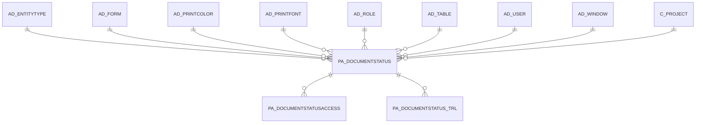

# PA_DOCUMENTSTATUS

Area [PA](../../data-model/pa/index.md) · class **business** (proposed) · read from database `idempiere-db` (owner `ADEMPIERE`) · 6 row(s) when profiled

Application model: `org.compiere.model.X_PA_DocumentStatus`, access level 7 - System - Client - Org.

## Columns

| column | type | key | not null | business name | references (code) | nulls | distinct |
|---|---|---|---|---|---|---|---|
| `PA_DOCUMENTSTATUS_ID` | NUMBER(10,0) | PK | yes | Document Status |  | 0 | 6 |
| `AD_CLIENT_ID` | NUMBER(10,0) |  | yes | Tenant |  | 0 | 2 |
| `AD_ORG_ID` | NUMBER(10,0) |  | yes | Organization |  | 0 | 1 |
| `AD_ROLE_ID` | NUMBER(10,0) |  |  | Role | [AD_ROLE](../../data-model/ad/ad_role.md) | 6 | 0 |
| `AD_USER_ID` | NUMBER(10,0) |  |  | User/Contact | [AD_USER](../../data-model/ad/ad_user.md) | 6 | 0 |
| `C_PROJECT_ID` | NUMBER(10,0) |  |  | Project | [C_PROJECT](../../data-model/c/c_project.md) | 6 | 0 |
| `CREATED` | DATE |  | yes | Created |  | 0 | 6 |
| `CREATEDBY` | NUMBER(10,0) |  | yes | Created By |  | 0 | 1 |
| `UPDATED` | DATE |  | yes | Updated |  | 0 | 6 |
| `UPDATEDBY` | NUMBER(10,0) |  | yes | Updated By |  | 0 | 1 |
| `NAME` | VARCHAR2(60 CHAR) |  | yes | Name |  | 0 | 6 |
| `DESCRIPTION` | VARCHAR2(255 CHAR) |  |  | Description |  | 6 | 0 |
| `ISACTIVE` | CHAR(1) |  | yes | Active |  | 0 | 1 |
| `SEQNO` | NUMBER(10,0) |  | yes | Sequence |  | 0 | 6 |
| `NAME_PRINTCOLOR_ID` | NUMBER(10,0) |  |  | Print Color for Name | [AD_PRINTCOLOR](../../data-model/ad/ad_printcolor.md) | 4 | 1 |
| `NAME_PRINTFONT_ID` | NUMBER(10,0) |  |  | Print Font for Name | [AD_PRINTFONT](../../data-model/ad/ad_printfont.md) | 6 | 0 |
| `NUMBER_PRINTCOLOR_ID` | NUMBER(10,0) |  |  | Print Color for Number | [AD_PRINTCOLOR](../../data-model/ad/ad_printcolor.md) | 4 | 1 |
| `NUMBER_PRINTFONT_ID` | NUMBER(10,0) |  |  | Print Font for Number | [AD_PRINTFONT](../../data-model/ad/ad_printfont.md) | 6 | 0 |
| `AD_TABLE_ID` | NUMBER(10,0) |  | yes | Table | [AD_TABLE](../../data-model/ad/ad_table.md) | 0 | 6 |
| `WHERECLAUSE` | VARCHAR2(2000 CHAR) |  |  | Sql WHERE |  | 0 | 6 |
| `AD_WINDOW_ID` | NUMBER(10,0) |  |  | Window | [AD_WINDOW](../../data-model/ad/ad_window.md) | 1 | 5 |
| `AD_FORM_ID` | NUMBER(10,0) |  |  | Special Form | [AD_FORM](../../data-model/ad/ad_form.md) | 5 | 1 |
| `PA_DOCUMENTSTATUS_UU` | VARCHAR2(36 CHAR) |  |  | PA_DocumentStatus_UU |  | 0 | 6 |
| `ENTITYTYPE` | VARCHAR2(40 CHAR) |  | yes | Entity Type |  | 0 | 1 |

*references (code)* is the table the application model's code says a column points to; *Foreign keys* below are the constraints the database declares. Counts come from the profile; no value is ever shown.

## Check constraints

| name | expression |
|---|---|
| `PA_DOCSTATUS_ACTIVE_CHECK` | `(isactive IN ('Y', 'N'))` |

## Foreign keys

**References**

| table | columns | on delete |
|---|---|---|
| [AD_ENTITYTYPE](../../data-model/ad/ad_entitytype.md) | PA_DOCUMENTSTATUS.ENTITYTYPE → AD_ENTITYTYPE.ENTITYTYPE | NO ACTION |
| [AD_FORM](../../data-model/ad/ad_form.md) | PA_DOCUMENTSTATUS.AD_FORM_ID → AD_FORM.AD_FORM_ID | NO ACTION |
| [AD_PRINTCOLOR](../../data-model/ad/ad_printcolor.md) | PA_DOCUMENTSTATUS.NAME_PRINTCOLOR_ID → AD_PRINTCOLOR.AD_PRINTCOLOR_ID | NO ACTION |
| [AD_PRINTFONT](../../data-model/ad/ad_printfont.md) | PA_DOCUMENTSTATUS.NAME_PRINTFONT_ID → AD_PRINTFONT.AD_PRINTFONT_ID | NO ACTION |
| [AD_ROLE](../../data-model/ad/ad_role.md) | PA_DOCUMENTSTATUS.AD_ROLE_ID → AD_ROLE.AD_ROLE_ID | CASCADE |
| [AD_TABLE](../../data-model/ad/ad_table.md) | PA_DOCUMENTSTATUS.AD_TABLE_ID → AD_TABLE.AD_TABLE_ID | NO ACTION |
| [AD_USER](../../data-model/ad/ad_user.md) | PA_DOCUMENTSTATUS.AD_USER_ID → AD_USER.AD_USER_ID | NO ACTION |
| [AD_WINDOW](../../data-model/ad/ad_window.md) | PA_DOCUMENTSTATUS.AD_WINDOW_ID → AD_WINDOW.AD_WINDOW_ID | NO ACTION |
| [C_PROJECT](../../data-model/c/c_project.md) | PA_DOCUMENTSTATUS.C_PROJECT_ID → C_PROJECT.C_PROJECT_ID | NO ACTION |

**Referenced by**

| table | columns | on delete |
|---|---|---|
| [PA_DOCUMENTSTATUSACCESS](../../data-model/pa/pa_documentstatusaccess.md) | PA_DOCUMENTSTATUSACCESS.PA_DOCUMENTSTATUS_ID → PA_DOCUMENTSTATUS.PA_DOCUMENTSTATUS_ID | NO ACTION |
| [PA_DOCUMENTSTATUS_TRL](../../data-model/pa/pa_documentstatus_trl.md) | PA_DOCUMENTSTATUS_TRL.PA_DOCUMENTSTATUS_ID → PA_DOCUMENTSTATUS.PA_DOCUMENTSTATUS_ID | NO ACTION |

## Write behaviour

- updates: **po_only**
- deletes: **deleted_by_users, deleted_by_cascade**
- change log: **recorded**
- evidence: 2 citation(s)

## Schema history

95 change(s); the latest:

| applied | release | operation | column | tickets |
|---|---|---|---|---|
| 2025-02-22T15:13 | iD12 | `add_column` | Name_PrintColorZero_ID | IDEMPIERE-6435 |
| 2025-02-22T15:13 | iD12 | `add_column` | Name_PrintColorZero_ID | IDEMPIERE-6435 |
| 2025-02-22T15:13 | iD12 | `add_column` | AD_InfoWindow_ID | IDEMPIERE-6435 |
| 2025-02-22T15:13 | iD12 | `add_constraint` |  | IDEMPIERE-6435 |
| 2025-02-22T15:13 | iD12 | `add_constraint` |  | IDEMPIERE-6435 |
| 2025-02-22T15:13 | iD12 | `add_constraint` |  | IDEMPIERE-6435 |
| 2025-02-22T15:13 | iD12 | `add_constraint` |  | IDEMPIERE-6435 |
| 2025-02-22T15:13 | iD12 | `add_column` | Help | IDEMPIERE-6435 |
| 2025-02-22T15:13 | iD12 | `add_column` | Help | IDEMPIERE-6435 |
| 2025-02-22T15:13 | iD12 | `add_column` | AD_FieldGroup_ID | IDEMPIERE-6435 |
| 2025-02-22T15:13 | iD12 | `add_column` | AD_FieldGroup_ID | IDEMPIERE-6435 |
| 2025-02-22T15:13 | iD12 | `add_constraint` |  | IDEMPIERE-6435 |
| 2025-02-22T15:13 | iD12 | `add_constraint` |  | IDEMPIERE-6435 |
| 2025-02-22T15:13 | iD12 | `add_constraint` |  | IDEMPIERE-6435 |
| 2025-02-22T15:13 | iD12 | `add_column` | AD_InfoWindow_ID | IDEMPIERE-6435 |

## Open conflicts

| type | attribute | explanation |
|---|---|---|
| `model_column_missing` | `columns.AD_FieldGroup_ID` | unexplained |
| `model_column_missing` | `columns.AD_InfoWindow_ID` | unexplained |
| `model_column_missing` | `columns.AD_Process_ID` | unexplained |
| `model_column_missing` | `columns.Help` | unexplained |
| `model_column_missing` | `columns.IsHideWhenZero` | unexplained |
| `model_column_missing` | `columns.Name_PrintColorZero_ID` | unexplained |

## Notes

<!-- ekos:manual id="table.pa_documentstatus.notes" -->
_Business notes about this table._
<!-- /ekos:manual -->
