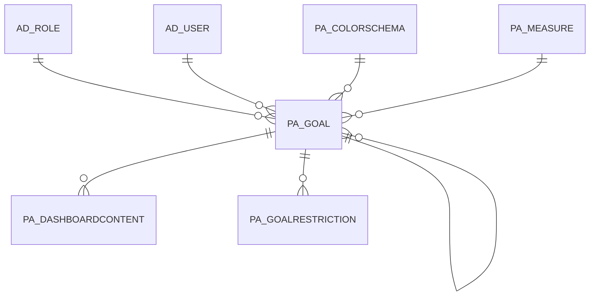

# PA_GOAL

Area [PA](../../data-model/pa/index.md) · class **business** (proposed) · read from database `idempiere-db` (owner `ADEMPIERE`) · 4 row(s) when profiled

Application model: `org.compiere.model.X_PA_Goal`, access level 6 - System - Client.

## Columns

| column | type | key | not null | business name | references (code) | nulls | distinct |
|---|---|---|---|---|---|---|---|
| `PA_GOAL_ID` | NUMBER(10,0) | PK | yes | Goal |  | 0 | 4 |
| `AD_CLIENT_ID` | NUMBER(10,0) |  | yes | Tenant |  | 0 | 1 |
| `AD_ORG_ID` | NUMBER(10,0) |  | yes | Organization |  | 0 | 1 |
| `ISACTIVE` | CHAR(1) |  | yes | Active |  | 0 | 1 |
| `CREATED` | DATE |  | yes | Created |  | 0 | 4 |
| `CREATEDBY` | NUMBER(10,0) |  | yes | Created By |  | 0 | 1 |
| `UPDATED` | DATE |  | yes | Updated |  | 0 | 2 |
| `UPDATEDBY` | NUMBER(10,0) |  | yes | Updated By |  | 0 | 1 |
| `SEQNO` | NUMBER(10,0) |  | yes | Sequence |  | 0 | 1 |
| `NAME` | VARCHAR2(60 CHAR) |  | yes | Name |  | 0 | 4 |
| `DESCRIPTION` | VARCHAR2(255 CHAR) |  |  | Description |  | 0 | 4 |
| `NOTE` | VARCHAR2(2000 CHAR) |  |  | Note |  | 4 | 0 |
| `AD_USER_ID` | NUMBER(10,0) |  |  | User/Contact | [AD_USER](../../data-model/ad/ad_user.md) | 4 | 0 |
| `PA_COLORSCHEMA_ID` | NUMBER(10,0) |  | yes | Color Schema | [PA_COLORSCHEMA](../../data-model/pa/pa_colorschema.md) | 0 | 2 |
| `ISSUMMARY` | CHAR(1) |  | yes | Summary Level |  | 0 | 1 |
| `PA_GOALPARENT_ID` | NUMBER(10,0) |  |  | Parent Goal | [PA_GOAL](../../data-model/pa/pa_goal.md) | 4 | 0 |
| `PA_MEASURE_ID` | NUMBER(10,0) |  |  | Measure | [PA_MEASURE](../../data-model/pa/pa_measure.md) | 0 | 4 |
| `RELATIVEWEIGHT` | NUMBER |  |  | Relative Weight |  | 0 | 1 |
| `MEASURETARGET` | NUMBER |  | yes | Measure Target |  | 0 | 3 |
| `MEASURESCOPE` | CHAR(1) |  | yes | Measure Scope |  | 0 | 3 |
| `MEASUREDISPLAY` | CHAR(1) |  |  | Measure Display |  | 2 | 1 |
| `DATEFROM` | DATE |  |  | Date From |  | 4 | 0 |
| `DATETO` | DATE |  |  | Date To |  | 4 | 0 |
| `MEASUREACTUAL` | NUMBER |  |  | Measure Actual |  | 0 | 3 |
| `GOALPERFORMANCE` | NUMBER |  |  | Performance Goal |  | 0 | 3 |
| `DATELASTRUN` | DATE |  |  | Date Last Run |  | 0 | 2 |
| `AD_ROLE_ID` | NUMBER(10,0) |  |  | Role | [AD_ROLE](../../data-model/ad/ad_role.md) | 4 | 0 |
| `CHARTTYPE` | VARCHAR2(2 CHAR) |  | yes | Chart Type |  | 0 | 1 |
| `PA_GOAL_UU` | VARCHAR2(36 CHAR) |  |  | PA_Goal_UU |  | 0 | 4 |

*references (code)* is the table the application model's code says a column points to; *Foreign keys* below are the constraints the database declares. Counts come from the profile; no value is ever shown.

## Check constraints

| name | expression |
|---|---|
| `SYS_C0020478` | `IsActive in ('Y','N')` |

## Foreign keys

**References**

| table | columns | on delete |
|---|---|---|
| [AD_ROLE](../../data-model/ad/ad_role.md) | PA_GOAL.AD_ROLE_ID → AD_ROLE.AD_ROLE_ID | NO ACTION |
| [AD_USER](../../data-model/ad/ad_user.md) | PA_GOAL.AD_USER_ID → AD_USER.AD_USER_ID | NO ACTION |
| [PA_COLORSCHEMA](../../data-model/pa/pa_colorschema.md) | PA_GOAL.PA_COLORSCHEMA_ID → PA_COLORSCHEMA.PA_COLORSCHEMA_ID | NO ACTION |
| [PA_GOAL](../../data-model/pa/pa_goal.md) | PA_GOAL.PA_GOALPARENT_ID → PA_GOAL.PA_GOAL_ID | NO ACTION |
| [PA_MEASURE](../../data-model/pa/pa_measure.md) | PA_GOAL.PA_MEASURE_ID → PA_MEASURE.PA_MEASURE_ID | NO ACTION |

**Referenced by**

| table | columns | on delete |
|---|---|---|
| [PA_DASHBOARDCONTENT](../../data-model/pa/pa_dashboardcontent.md) | PA_DASHBOARDCONTENT.PA_GOAL_ID → PA_GOAL.PA_GOAL_ID | NO ACTION |
| [PA_GOAL](../../data-model/pa/pa_goal.md) | PA_GOAL.PA_GOALPARENT_ID → PA_GOAL.PA_GOAL_ID | NO ACTION |
| [PA_GOALRESTRICTION](../../data-model/pa/pa_goalrestriction.md) | PA_GOALRESTRICTION.PA_GOAL_ID → PA_GOAL.PA_GOAL_ID | NO ACTION |

## Write behaviour

- updates: **po_only**
- deletes: **deleted_by_users**
- change log: **recorded**
- evidence: 1 citation(s)

## Schema history

31 change(s); the latest:

| applied | release | operation | column | tickets |
|---|---|---|---|---|
| 2023-04-09T15:47 | iD11 | `add_constraint` |  | IDEMPIERE-5567 |
| 2023-04-09T15:47 | iD11 | `add_constraint` |  | IDEMPIERE-5567 |
| 2021-12-05T16:45 | i8.2z | `drop_constraint` |  | IDEMPIERE-5075 |
| 2021-12-05T16:45 | i8.2z | `add_constraint` |  | IDEMPIERE-5075 |
| 2021-12-05T16:45 | i8.2z | `add_constraint` |  | IDEMPIERE-5075 |
| 2021-12-05T16:45 | i8.2z | `drop_constraint` |  | IDEMPIERE-5075 |
| 2021-12-05T16:45 | i8.2z | `drop_constraint` |  | IDEMPIERE-5075 |
| 2021-12-05T16:45 | i8.2z | `add_constraint` |  | IDEMPIERE-5075 |
| 2021-12-05T16:45 | i8.2z | `add_constraint` |  | IDEMPIERE-5075 |
| 2021-12-05T16:45 | i8.2z | `drop_constraint` |  | IDEMPIERE-5075 |
| 2021-12-05T16:45 | i8.2z | `add_constraint` |  | IDEMPIERE-5075 |
| 2021-12-05T16:45 | i8.2z | `drop_constraint` |  | IDEMPIERE-5075 |
| 2020-08-04T01:00 | i7.1z | `drop_column` | tmp_col_4_tmp | IDEMPIERE-3862 |
| 2020-08-04T01:00 | i7.1z | `drop_column` | tmp_col_5_tmp | IDEMPIERE-3862 |
| 2020-08-04T01:00 | i7.1z | `modify_column` | NAME | IDEMPIERE-3862 |

## Open conflicts

| type | attribute | explanation |
|---|---|---|
| `mandatory_but_nullable` | `columns.GoalPerformance.nullable` | unexplained |
| `mandatory_but_nullable` | `columns.MeasureActual.nullable` | unexplained |
| `mandatory_but_nullable` | `columns.RelativeWeight.nullable` | unexplained |

## Notes

<!-- ekos:manual id="table.pa_goal.notes" -->
_Business notes about this table._
<!-- /ekos:manual -->
