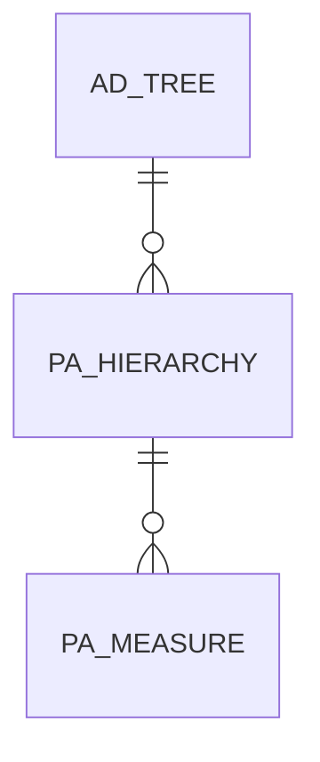

# PA_HIERARCHY

Area [PA](../../data-model/pa/index.md) · class **business** (proposed) · read from database `idempiere-db` (owner `ADEMPIERE`) · 0 row(s) when profiled

Application model: `org.compiere.model.X_PA_Hierarchy`, access level 2 - Client.

## Columns

| column | type | key | not null | business name | references (code) | nulls | distinct |
|---|---|---|---|---|---|---|---|
| `PA_HIERARCHY_ID` | NUMBER(10,0) | PK | yes | Reporting Hierarchy |  | 0 | 0 |
| `AD_CLIENT_ID` | NUMBER(10,0) |  | yes | Tenant |  | 0 | 0 |
| `AD_ORG_ID` | NUMBER(10,0) |  | yes | Organization |  | 0 | 0 |
| `ISACTIVE` | CHAR(1) |  | yes | Active |  | 0 | 0 |
| `CREATED` | DATE |  | yes | Created |  | 0 | 0 |
| `CREATEDBY` | NUMBER(10,0) |  | yes | Created By |  | 0 | 0 |
| `UPDATED` | DATE |  | yes | Updated |  | 0 | 0 |
| `UPDATEDBY` | NUMBER(10,0) |  | yes | Updated By |  | 0 | 0 |
| `NAME` | VARCHAR2(60 CHAR) |  | yes | Name |  | 0 | 0 |
| `DESCRIPTION` | VARCHAR2(255 CHAR) |  |  | Description |  | 0 | 0 |
| `HELP` | VARCHAR2(2000 CHAR) |  |  | Comment/Help |  | 0 | 0 |
| `AD_TREE_ORG_ID` | NUMBER(10,0) |  | yes | Organization Tree | [AD_TREE](../../data-model/ad/ad_tree.md) | 0 | 0 |
| `AD_TREE_BPARTNER_ID` | NUMBER(10,0) |  | yes | BPartner Tree | [AD_TREE](../../data-model/ad/ad_tree.md) | 0 | 0 |
| `AD_TREE_PROJECT_ID` | NUMBER(10,0) |  | yes | Project Tree | [AD_TREE](../../data-model/ad/ad_tree.md) | 0 | 0 |
| `AD_TREE_SALESREGION_ID` | NUMBER(10,0) |  | yes | Sales Region Tree | [AD_TREE](../../data-model/ad/ad_tree.md) | 0 | 0 |
| `AD_TREE_PRODUCT_ID` | NUMBER(10,0) |  | yes | Product Tree | [AD_TREE](../../data-model/ad/ad_tree.md) | 0 | 0 |
| `AD_TREE_CAMPAIGN_ID` | NUMBER(10,0) |  | yes | Campaign Tree | [AD_TREE](../../data-model/ad/ad_tree.md) | 0 | 0 |
| `AD_TREE_ACTIVITY_ID` | NUMBER(10,0) |  | yes | Activity Tree | [AD_TREE](../../data-model/ad/ad_tree.md) | 0 | 0 |
| `AD_TREE_ACCOUNT_ID` | NUMBER(10,0) |  | yes | Account Tree | [AD_TREE](../../data-model/ad/ad_tree.md) | 0 | 0 |
| `PA_HIERARCHY_UU` | VARCHAR2(36 CHAR) |  |  | PA_Hierarchy_UU |  | 0 | 0 |

*references (code)* is the table the application model's code says a column points to; *Foreign keys* below are the constraints the database declares. Counts come from the profile; no value is ever shown.

## Check constraints

| name | expression |
|---|---|
| `SYS_C0021567` | `IsActive in ('Y','N')` |

## Foreign keys

**References**

| table | columns | on delete |
|---|---|---|
| [AD_TREE](../../data-model/ad/ad_tree.md) | PA_HIERARCHY.AD_TREE_ACCOUNT_ID → AD_TREE.AD_TREE_ID | NO ACTION |

**Referenced by**

| table | columns | on delete |
|---|---|---|
| [PA_MEASURE](../../data-model/pa/pa_measure.md) | PA_MEASURE.PA_HIERARCHY_ID → PA_HIERARCHY.PA_HIERARCHY_ID | NO ACTION |

## Write behaviour

- updates: **po_only**
- deletes: **soft_delete_only**
- change log: **recorded**
- evidence: 1 citation(s)

## Schema history

32 change(s); the latest:

| applied | release | operation | column | tickets |
|---|---|---|---|---|
| 2023-04-09T15:47 | iD11 | `add_constraint` |  | IDEMPIERE-5567 |
| 2023-04-09T15:47 | iD11 | `add_constraint` |  | IDEMPIERE-5567 |
| 2021-12-05T16:45 | i8.2z | `add_constraint` |  | IDEMPIERE-5075 |
| 2021-12-05T16:45 | i8.2z | `add_constraint` |  | IDEMPIERE-5075 |
| 2021-12-05T16:45 | i8.2z | `drop_constraint` |  | IDEMPIERE-5075 |
| 2021-12-05T16:45 | i8.2z | `drop_constraint` |  | IDEMPIERE-5075 |
| 2021-12-05T16:45 | i8.2z | `add_constraint` |  | IDEMPIERE-5075 |
| 2021-12-05T16:45 | i8.2z | `drop_constraint` |  | IDEMPIERE-5075 |
| 2021-12-05T16:45 | i8.2z | `drop_constraint` |  | IDEMPIERE-5075 |
| 2021-12-05T16:45 | i8.2z | `add_constraint` |  | IDEMPIERE-5075 |
| 2021-12-05T16:45 | i8.2z | `add_constraint` |  | IDEMPIERE-5075 |
| 2021-12-05T16:45 | i8.2z | `add_constraint` |  | IDEMPIERE-5075 |
| 2021-12-05T16:45 | i8.2z | `add_constraint` |  | IDEMPIERE-5075 |
| 2021-12-05T16:45 | i8.2z | `drop_constraint` |  | IDEMPIERE-5075 |
| 2021-12-05T16:45 | i8.2z | `add_constraint` |  | IDEMPIERE-5075 |

## Notes

<!-- ekos:manual id="table.pa_hierarchy.notes" -->
_Business notes about this table._
<!-- /ekos:manual -->
