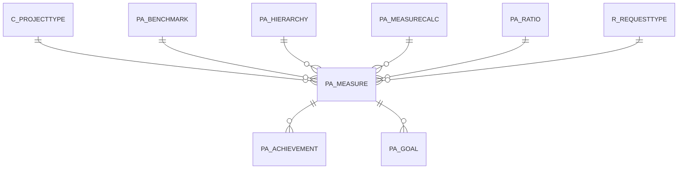

# PA_MEASURE

Area [PA](../../data-model/pa/index.md) · class **business** (proposed) · read from database `idempiere-db` (owner `ADEMPIERE`) · 4 row(s) when profiled

Application model: `org.compiere.model.X_PA_Measure`, access level 6 - System - Client.

## Columns

| column | type | key | not null | business name | references (code) | nulls | distinct |
|---|---|---|---|---|---|---|---|
| `PA_MEASURE_ID` | NUMBER(10,0) | PK | yes | Measure |  | 0 | 4 |
| `AD_CLIENT_ID` | NUMBER(10,0) |  | yes | Tenant |  | 0 | 1 |
| `AD_ORG_ID` | NUMBER(10,0) |  | yes | Organization |  | 0 | 1 |
| `ISACTIVE` | CHAR(1) |  | yes | Active |  | 0 | 1 |
| `CREATED` | DATE |  | yes | Created |  | 0 | 4 |
| `CREATEDBY` | NUMBER(10,0) |  | yes | Created By |  | 0 | 1 |
| `UPDATED` | DATE |  | yes | Updated |  | 0 | 4 |
| `UPDATEDBY` | NUMBER(10,0) |  | yes | Updated By |  | 0 | 2 |
| `NAME` | VARCHAR2(60 CHAR) |  | yes | Name |  | 0 | 4 |
| `DESCRIPTION` | VARCHAR2(255 CHAR) |  |  | Description |  | 4 | 0 |
| `MEASURETYPE` | CHAR(1) |  | yes | Measure Type |  | 0 | 2 |
| `MANUALACTUAL` | NUMBER |  |  | Manual Actual |  | 0 | 1 |
| `MANUALNOTE` | VARCHAR2(2000 CHAR) |  |  | Note |  | 4 | 0 |
| `CALCULATIONCLASS` | VARCHAR2(60 CHAR) |  |  | Calculation Class |  | 4 | 0 |
| `PA_MEASURECALC_ID` | NUMBER(10,0) |  |  | Measure Calculation | [PA_MEASURECALC](../../data-model/pa/pa_measurecalc.md) | 2 | 2 |
| `PA_BENCHMARK_ID` | NUMBER(10,0) |  |  | Benchmark | [PA_BENCHMARK](../../data-model/pa/pa_benchmark.md) | 4 | 0 |
| `PA_RATIO_ID` | NUMBER(10,0) |  |  | Ratio | [PA_RATIO](../../data-model/pa/pa_ratio.md) | 4 | 0 |
| `PA_HIERARCHY_ID` | NUMBER(10,0) |  |  | Reporting Hierarchy | [PA_HIERARCHY](../../data-model/pa/pa_hierarchy.md) | 4 | 0 |
| `MEASUREDATATYPE` | CHAR(1) |  | yes | Measure Data Type |  | 0 | 2 |
| `R_REQUESTTYPE_ID` | NUMBER(10,0) |  |  | Request Type | [R_REQUESTTYPE](../../data-model/r/r_requesttype.md) | 2 | 1 |
| `C_PROJECTTYPE_ID` | NUMBER(10,0) |  |  | Project Type | [C_PROJECTTYPE](../../data-model/c/c_projecttype.md) | 4 | 0 |
| `PA_MEASURE_UU` | VARCHAR2(36 CHAR) |  |  | PA_Measure_UU |  | 0 | 4 |

*references (code)* is the table the application model's code says a column points to; *Foreign keys* below are the constraints the database declares. Counts come from the profile; no value is ever shown.

## Check constraints

| name | expression |
|---|---|
| `SYS_C0020460` | `IsActive in ('Y','N')` |

## Foreign keys

**References**

| table | columns | on delete |
|---|---|---|
| [C_PROJECTTYPE](../../data-model/c/c_projecttype.md) | PA_MEASURE.C_PROJECTTYPE_ID → C_PROJECTTYPE.C_PROJECTTYPE_ID | NO ACTION |
| [PA_BENCHMARK](../../data-model/pa/pa_benchmark.md) | PA_MEASURE.PA_BENCHMARK_ID → PA_BENCHMARK.PA_BENCHMARK_ID | NO ACTION |
| [PA_HIERARCHY](../../data-model/pa/pa_hierarchy.md) | PA_MEASURE.PA_HIERARCHY_ID → PA_HIERARCHY.PA_HIERARCHY_ID | NO ACTION |
| [PA_MEASURECALC](../../data-model/pa/pa_measurecalc.md) | PA_MEASURE.PA_MEASURECALC_ID → PA_MEASURECALC.PA_MEASURECALC_ID | NO ACTION |
| [PA_RATIO](../../data-model/pa/pa_ratio.md) | PA_MEASURE.PA_RATIO_ID → PA_RATIO.PA_RATIO_ID | NO ACTION |
| [R_REQUESTTYPE](../../data-model/r/r_requesttype.md) | PA_MEASURE.R_REQUESTTYPE_ID → R_REQUESTTYPE.R_REQUESTTYPE_ID | NO ACTION |

**Referenced by**

| table | columns | on delete |
|---|---|---|
| [PA_ACHIEVEMENT](../../data-model/pa/pa_achievement.md) | PA_ACHIEVEMENT.PA_MEASURE_ID → PA_MEASURE.PA_MEASURE_ID | NO ACTION |
| [PA_GOAL](../../data-model/pa/pa_goal.md) | PA_GOAL.PA_MEASURE_ID → PA_MEASURE.PA_MEASURE_ID | NO ACTION |

## Write behaviour

- updates: **po_only**
- deletes: **deleted_by_users**
- change log: **recorded**
- evidence: 1 citation(s)

## Schema history

31 change(s); the latest:

| applied | release | operation | column | tickets |
|---|---|---|---|---|
| 2023-04-09T15:47 | iD11 | `add_constraint` |  | IDEMPIERE-5567 |
| 2023-04-09T15:47 | iD11 | `add_constraint` |  | IDEMPIERE-5567 |
| 2021-12-05T16:45 | i8.2z | `drop_constraint` |  | IDEMPIERE-5075 |
| 2021-12-05T16:45 | i8.2z | `drop_constraint` |  | IDEMPIERE-5075 |
| 2021-12-05T16:45 | i8.2z | `add_constraint` |  | IDEMPIERE-5075 |
| 2021-12-05T16:45 | i8.2z | `add_constraint` |  | IDEMPIERE-5075 |
| 2021-12-05T16:45 | i8.2z | `add_constraint` |  | IDEMPIERE-5075 |
| 2021-12-05T16:45 | i8.2z | `add_constraint` |  | IDEMPIERE-5075 |
| 2021-12-05T16:45 | i8.2z | `drop_constraint` |  | IDEMPIERE-5075 |
| 2021-12-05T16:45 | i8.2z | `drop_constraint` |  | IDEMPIERE-5075 |
| 2021-12-05T16:45 | i8.2z | `drop_constraint` |  | IDEMPIERE-5075 |
| 2021-12-05T16:45 | i8.2z | `add_constraint` |  | IDEMPIERE-5075 |
| 2021-12-05T16:45 | i8.2z | `drop_constraint` |  | IDEMPIERE-5075 |
| 2021-12-05T16:45 | i8.2z | `add_constraint` |  | IDEMPIERE-5075 |
| 2020-08-04T01:00 | i7.1z | `add_column` | tmp_col_2_tmp | IDEMPIERE-3862 |

## Notes

<!-- ekos:manual id="table.pa_measure.notes" -->
_Business notes about this table._
<!-- /ekos:manual -->
