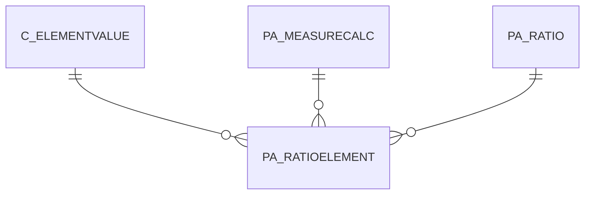

# PA_RATIOELEMENT

Area [PA](../../data-model/pa/index.md) · class **business** (proposed) · read from database `idempiere-db` (owner `ADEMPIERE`) · 3 row(s) when profiled

Application model: `org.compiere.model.X_PA_RatioElement`, access level 2 - Client.

## Columns

| column | type | key | not null | business name | references (code) | nulls | distinct |
|---|---|---|---|---|---|---|---|
| `PA_RATIOELEMENT_ID` | NUMBER(10,0) | PK | yes | Ratio Element |  | 0 | 3 |
| `AD_CLIENT_ID` | NUMBER(10,0) |  | yes | Tenant |  | 0 | 1 |
| `AD_ORG_ID` | NUMBER(10,0) |  | yes | Organization |  | 0 | 1 |
| `ISACTIVE` | CHAR(1) |  | yes | Active |  | 0 | 1 |
| `CREATED` | DATE |  | yes | Created |  | 0 | 3 |
| `CREATEDBY` | NUMBER(10,0) |  | yes | Created By |  | 0 | 1 |
| `UPDATED` | DATE |  | yes | Updated |  | 0 | 3 |
| `UPDATEDBY` | NUMBER(10,0) |  | yes | Updated By |  | 0 | 1 |
| `NAME` | VARCHAR2(60 CHAR) |  | yes | Name |  | 0 | 3 |
| `DESCRIPTION` | VARCHAR2(255 CHAR) |  |  | Description |  | 3 | 0 |
| `PA_RATIO_ID` | NUMBER(10,0) |  | yes | Ratio | [PA_RATIO](../../data-model/pa/pa_ratio.md) | 0 | 1 |
| `RATIOOPERAND` | CHAR(1) |  | yes | Operand |  | 0 | 1 |
| `RATIOELEMENTTYPE` | CHAR(1) |  | yes | Element Type |  | 0 | 1 |
| `ACCOUNT_ID` | NUMBER(10,0) |  |  | Account | [C_ELEMENTVALUE](../../data-model/c/c_elementvalue.md) | 0 | 3 |
| `PA_RATIOUSED_ID` | NUMBER(10,0) |  |  | Ratio Used | [PA_RATIO](../../data-model/pa/pa_ratio.md) | 3 | 0 |
| `PA_MEASURECALC_ID` | NUMBER(10,0) |  |  | Measure Calculation | [PA_MEASURECALC](../../data-model/pa/pa_measurecalc.md) | 3 | 0 |
| `CONSTANTVALUE` | NUMBER |  |  | Constant Value |  | 0 | 1 |
| `SEQNO` | NUMBER(10,0) |  | yes | Sequence |  | 0 | 2 |
| `POSTINGTYPE` | CHAR(1) |  |  | Posting Type |  | 1 | 1 |
| `PA_RATIOELEMENT_UU` | VARCHAR2(36 CHAR) |  |  | PA_RatioElement_UU |  | 0 | 3 |

*references (code)* is the table the application model's code says a column points to; *Foreign keys* below are the constraints the database declares. Counts come from the profile; no value is ever shown.

## Check constraints

| name | expression |
|---|---|
| `SYS_C0022541` | `IsActive in ('Y','N')` |

## Foreign keys

**References**

| table | columns | on delete |
|---|---|---|
| [C_ELEMENTVALUE](../../data-model/c/c_elementvalue.md) | PA_RATIOELEMENT.ACCOUNT_ID → C_ELEMENTVALUE.C_ELEMENTVALUE_ID | NO ACTION |
| [PA_MEASURECALC](../../data-model/pa/pa_measurecalc.md) | PA_RATIOELEMENT.PA_MEASURECALC_ID → PA_MEASURECALC.PA_MEASURECALC_ID | NO ACTION |
| [PA_RATIO](../../data-model/pa/pa_ratio.md) | PA_RATIOELEMENT.PA_RATIOUSED_ID → PA_RATIO.PA_RATIO_ID | NO ACTION |

**Referenced by**

_None._

## Write behaviour

- updates: **po_only**
- deletes: **deleted_by_users**
- change log: **recorded**
- evidence: 1 citation(s)

## Schema history

21 change(s); the latest:

| applied | release | operation | column | tickets |
|---|---|---|---|---|
| 2023-04-09T15:47 | iD11 | `add_constraint` |  | IDEMPIERE-5567 |
| 2023-04-09T15:47 | iD11 | `add_constraint` |  | IDEMPIERE-5567 |
| 2021-12-05T16:45 | i8.2z | `add_constraint` |  | IDEMPIERE-5075 |
| 2021-12-05T16:45 | i8.2z | `drop_constraint` |  | IDEMPIERE-5075 |
| 2021-12-05T16:45 | i8.2z | `add_constraint` |  | IDEMPIERE-5075 |
| 2021-12-05T16:45 | i8.2z | `drop_constraint` |  | IDEMPIERE-5075 |
| 2021-12-05T16:45 | i8.2z | `drop_constraint` |  | IDEMPIERE-5075 |
| 2021-12-05T16:45 | i8.2z | `add_constraint` |  | IDEMPIERE-5075 |
| 2021-12-05T16:45 | i8.2z | `add_constraint` |  | IDEMPIERE-5075 |
| 2021-12-05T16:45 | i8.2z | `drop_constraint` |  | IDEMPIERE-5075 |
| 2020-08-04T01:00 | i7.1z | `drop_column` | tmp_col_2_tmp | IDEMPIERE-3862 |
| 2020-08-04T01:00 | i7.1z | `modify_column` | PA_RATIOELEMENT_UU | IDEMPIERE-3862 |
| 2020-08-04T01:00 | i7.1z | `modify_column` | NAME | IDEMPIERE-3862 |
| 2020-08-04T01:00 | i7.1z | `modify_column` | NAME | IDEMPIERE-3862 |
| 2020-08-04T01:00 | i7.1z | `drop_column` | tmp_col_3_tmp | IDEMPIERE-3862 |

## Notes

<!-- ekos:manual id="table.pa_ratioelement.notes" -->
_Business notes about this table._
<!-- /ekos:manual -->
