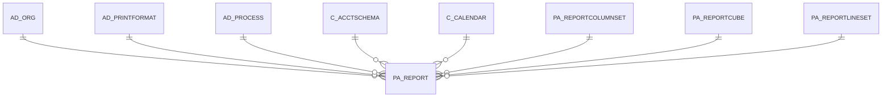

# PA_REPORT

Area [PA](../../data-model/pa/index.md) · class **business** (proposed) · read from database `idempiere-db` (owner `ADEMPIERE`) · 3 row(s) when profiled

Application model: `org.compiere.model.X_PA_Report`, access level 3 - Client - Org.

## Columns

| column | type | key | not null | business name | references (code) | nulls | distinct |
|---|---|---|---|---|---|---|---|
| `PA_REPORT_ID` | NUMBER(10,0) | PK | yes | Financial Report |  | 0 | 3 |
| `AD_CLIENT_ID` | NUMBER(10,0) |  | yes | Tenant |  | 0 | 1 |
| `AD_ORG_ID` | NUMBER(10,0) |  |  | Organization |  | 0 | 1 |
| `ISACTIVE` | CHAR(1) |  | yes | Active |  | 0 | 1 |
| `CREATED` | DATE |  | yes | Created |  | 0 | 3 |
| `CREATEDBY` | NUMBER(10,0) |  | yes | Created By |  | 0 | 2 |
| `UPDATED` | DATE |  | yes | Updated |  | 0 | 3 |
| `UPDATEDBY` | NUMBER(10,0) |  | yes | Updated By |  | 0 | 3 |
| `NAME` | VARCHAR2(60 CHAR) |  | yes | Name |  | 0 | 3 |
| `DESCRIPTION` | VARCHAR2(255 CHAR) |  |  | Description |  | 2 | 1 |
| `PA_REPORTLINESET_ID` | NUMBER(10,0) |  | yes | Report Line Set | [PA_REPORTLINESET](../../data-model/pa/pa_reportlineset.md) | 0 | 3 |
| `PA_REPORTCOLUMNSET_ID` | NUMBER(10,0) |  | yes | Report Column Set | [PA_REPORTCOLUMNSET](../../data-model/pa/pa_reportcolumnset.md) | 0 | 3 |
| `C_ACCTSCHEMA_ID` | NUMBER(10,0) |  | yes | Accounting Schema | [C_ACCTSCHEMA](../../data-model/c/c_acctschema.md) | 0 | 1 |
| `C_CALENDAR_ID` | NUMBER(10,0) |  | yes | Calendar | [C_CALENDAR](../../data-model/c/c_calendar.md) | 0 | 1 |
| `PROCESSING` | CHAR(1) |  | yes | Process Now |  | 0 | 1 |
| `AD_PRINTFORMAT_ID` | NUMBER(10,0) |  |  | Print Format | [AD_PRINTFORMAT](../../data-model/ad/ad_printformat.md) | 3 | 0 |
| `LISTSOURCES` | CHAR(1) |  | yes | List Sources |  | 0 | 2 |
| `LISTTRX` | CHAR(1) |  | yes | List Transactions |  | 0 | 2 |
| `JASPERPROCESS_ID` | NUMBER(10,0) |  |  | Jasper Process | [AD_PROCESS](../../data-model/ad/ad_process.md) | 3 | 0 |
| `JASPERPROCESSING` | CHAR(1) |  |  | Jasper Process Now |  | 3 | 0 |
| `PA_REPORTCUBE_ID` | NUMBER(10,0) |  |  | Report Cube | [PA_REPORTCUBE](../../data-model/pa/pa_reportcube.md) | 3 | 0 |
| `PA_REPORT_UU` | VARCHAR2(36 CHAR) |  |  | PA_Report_UU |  | 0 | 3 |
| `LISTSOURCESXTRX` | CHAR(1) |  |  | Include source accounts with no transaction |  | 0 | 1 |
| `EXCLUDEADJUSTMENTPERIODS` | CHAR(1) |  | yes | Exclude Adjustment Periods |  | 0 | 1 |

*references (code)* is the table the application model's code says a column points to; *Foreign keys* below are the constraints the database declares. Counts come from the profile; no value is ever shown.

## Check constraints

| name | expression |
|---|---|
| `SYS_C0022101` | `IsActive in ('Y','N')` |
| `SYS_C0022103` | `ListSourcesXTrx IN ('Y','N')` |

## Foreign keys

**References**

| table | columns | on delete |
|---|---|---|
| [AD_ORG](../../data-model/ad/ad_org.md) | PA_REPORT.AD_ORG_ID → AD_ORG.AD_ORG_ID | CASCADE |
| [AD_PRINTFORMAT](../../data-model/ad/ad_printformat.md) | PA_REPORT.AD_PRINTFORMAT_ID → AD_PRINTFORMAT.AD_PRINTFORMAT_ID | SET NULL |
| [AD_PROCESS](../../data-model/ad/ad_process.md) | PA_REPORT.JASPERPROCESS_ID → AD_PROCESS.AD_PROCESS_ID | NO ACTION |
| [C_ACCTSCHEMA](../../data-model/c/c_acctschema.md) | PA_REPORT.C_ACCTSCHEMA_ID → C_ACCTSCHEMA.C_ACCTSCHEMA_ID | NO ACTION |
| [C_CALENDAR](../../data-model/c/c_calendar.md) | PA_REPORT.C_CALENDAR_ID → C_CALENDAR.C_CALENDAR_ID | NO ACTION |
| [PA_REPORTCOLUMNSET](../../data-model/pa/pa_reportcolumnset.md) | PA_REPORT.PA_REPORTCOLUMNSET_ID → PA_REPORTCOLUMNSET.PA_REPORTCOLUMNSET_ID | NO ACTION |
| [PA_REPORTCUBE](../../data-model/pa/pa_reportcube.md) | PA_REPORT.PA_REPORTCUBE_ID → PA_REPORTCUBE.PA_REPORTCUBE_ID | NO ACTION |
| [PA_REPORTLINESET](../../data-model/pa/pa_reportlineset.md) | PA_REPORT.PA_REPORTLINESET_ID → PA_REPORTLINESET.PA_REPORTLINESET_ID | NO ACTION |

**Referenced by**

_None._

## Write behaviour

- updates: **po_only**
- deletes: **deleted_by_users, deleted_by_cascade**
- change log: **recorded**
- evidence: 2 citation(s)

## Schema history

33 change(s); the latest:

| applied | release | operation | column | tickets |
|---|---|---|---|---|
| 2023-04-09T15:47 | iD11 | `add_constraint` |  | IDEMPIERE-5567 |
| 2023-04-09T15:47 | iD11 | `add_constraint` |  | IDEMPIERE-5567 |
| 2021-12-05T16:45 | i8.2z | `drop_constraint` |  | IDEMPIERE-5075 |
| 2021-12-05T16:45 | i8.2z | `drop_constraint` |  | IDEMPIERE-5075 |
| 2021-12-05T16:45 | i8.2z | `add_constraint` |  | IDEMPIERE-5075 |
| 2021-12-05T16:45 | i8.2z | `drop_constraint` |  | IDEMPIERE-5075 |
| 2021-12-05T16:45 | i8.2z | `add_constraint` |  | IDEMPIERE-5075 |
| 2021-12-05T16:45 | i8.2z | `add_constraint` |  | IDEMPIERE-5075 |
| 2021-12-05T16:45 | i8.2z | `drop_constraint` |  | IDEMPIERE-5075 |
| 2021-12-05T16:45 | i8.2z | `add_constraint` |  | IDEMPIERE-5075 |
| 2021-12-05T16:45 | i8.2z | `add_constraint` |  | IDEMPIERE-5075 |
| 2021-12-05T16:45 | i8.2z | `add_constraint` |  | IDEMPIERE-5075 |
| 2021-12-05T16:45 | i8.2z | `add_constraint` |  | IDEMPIERE-5075 |
| 2021-12-05T16:45 | i8.2z | `drop_constraint` |  | IDEMPIERE-5075 |
| 2021-12-05T16:45 | i8.2z | `drop_constraint` |  | IDEMPIERE-5075 |

## Notes

<!-- ekos:manual id="table.pa_report.notes" -->
_Business notes about this table._
<!-- /ekos:manual -->
