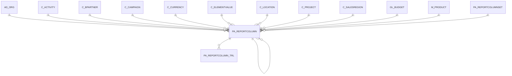

# PA_REPORTCOLUMN

Area [PA](../../data-model/pa/index.md) · class **business** (proposed) · read from database `idempiere-db` (owner `ADEMPIERE`) · 17 row(s) when profiled

Application model: `org.compiere.model.X_PA_ReportColumn`, access level 7 - System - Client - Org.

## Columns

| column | type | key | not null | business name | references (code) | nulls | distinct |
|---|---|---|---|---|---|---|---|
| `PA_REPORTCOLUMN_ID` | NUMBER(10,0) | PK | yes | Report Column |  | 0 | 17 |
| `AD_CLIENT_ID` | NUMBER(10,0) |  | yes | Tenant |  | 0 | 2 |
| `AD_ORG_ID` | NUMBER(10,0) |  | yes | Organization |  | 0 | 2 |
| `ISACTIVE` | CHAR(1) |  | yes | Active |  | 0 | 1 |
| `CREATED` | DATE |  | yes | Created |  | 0 | 17 |
| `CREATEDBY` | NUMBER(10,0) |  | yes | Created By |  | 0 | 2 |
| `UPDATED` | DATE |  | yes | Updated |  | 0 | 12 |
| `UPDATEDBY` | NUMBER(10,0) |  | yes | Updated By |  | 0 | 2 |
| `PA_REPORTCOLUMNSET_ID` | NUMBER(10,0) |  | yes | Report Column Set | [PA_REPORTCOLUMNSET](../../data-model/pa/pa_reportcolumnset.md) | 0 | 3 |
| `NAME` | VARCHAR2(255 CHAR) |  | yes | Name |  | 0 | 17 |
| `SEQNO` | NUMBER(10,0) |  | yes | Sequence |  | 0 | 6 |
| `DESCRIPTION` | VARCHAR2(255 CHAR) |  |  | Description |  | 9 | 8 |
| `ISPRINTED` | CHAR(1) |  | yes | Printed |  | 0 | 1 |
| `POSTINGTYPE` | CHAR(1) |  | yes | Posting Type |  | 0 | 4 |
| `GL_BUDGET_ID` | NUMBER(10,0) |  |  | Budget | [GL_BUDGET](../../data-model/gl/gl_budget.md) | 17 | 0 |
| `COLUMNTYPE` | CHAR(1) |  | yes | Column Type |  | 0 | 2 |
| `RELATIVEPERIOD` | NUMBER(10,0) |  |  | Relative Period |  | 0 | 2 |
| `CURRENCYTYPE` | CHAR(1) |  |  | Currency Type |  | 17 | 0 |
| `CALCULATIONTYPE` | CHAR(1) |  |  | Calculation |  | 0 | 3 |
| `AMOUNTTYPE` | CHAR(2) |  |  |  |  | 2 | 6 |
| `C_CURRENCY_ID` | NUMBER(10,0) |  |  | Currency | [C_CURRENCY](../../data-model/c/c_currency.md) | 17 | 0 |
| `ISADHOCCONVERSION` | CHAR(1) |  |  | Ad hoc Conversion |  | 0 | 1 |
| `OPER_1_ID` | NUMBER(10,0) |  |  | Operand 1 | [PA_REPORTCOLUMN](../../data-model/pa/pa_reportcolumn.md) | 14 | 3 |
| `OPER_2_ID` | NUMBER(10,0) |  |  | Operand 2 | [PA_REPORTCOLUMN](../../data-model/pa/pa_reportcolumn.md) | 14 | 3 |
| `ELEMENTTYPE` | CHAR(2) |  |  | Type |  | 17 | 0 |
| `ORG_ID` | NUMBER(10,0) |  |  | Organization |  | 17 | 0 |
| `C_ELEMENTVALUE_ID` | NUMBER(10,0) |  |  | Account Element | [C_ELEMENTVALUE](../../data-model/c/c_elementvalue.md) | 17 | 0 |
| `C_PROJECT_ID` | NUMBER(10,0) |  |  | Project | [C_PROJECT](../../data-model/c/c_project.md) | 17 | 0 |
| `C_BPARTNER_ID` | NUMBER(10,0) |  |  | Business Partner | [C_BPARTNER](../../data-model/c/c_bpartner.md) | 17 | 0 |
| `M_PRODUCT_ID` | NUMBER(10,0) |  |  | Product | [M_PRODUCT](../../data-model/m/m_product.md) | 17 | 0 |
| `C_CAMPAIGN_ID` | NUMBER(10,0) |  |  | Campaign | [C_CAMPAIGN](../../data-model/c/c_campaign.md) | 17 | 0 |
| `C_LOCATION_ID` | NUMBER(10,0) |  |  | Address | [C_LOCATION](../../data-model/c/c_location.md) | 17 | 0 |
| `C_SALESREGION_ID` | NUMBER(10,0) |  |  | Sales Region | [C_SALESREGION](../../data-model/c/c_salesregion.md) | 17 | 0 |
| `C_ACTIVITY_ID` | NUMBER(10,0) |  |  | Activity | [C_ACTIVITY](../../data-model/c/c_activity.md) | 17 | 0 |
| `USERELEMENT1_ID` | NUMBER(10,0) |  |  | User Column 1 |  | 17 | 0 |
| `USERELEMENT2_ID` | NUMBER(10,0) |  |  | User Column 2 |  | 17 | 0 |
| `ISINCLUDENULLSORG` | CHAR(1) |  | yes | Include Nulls in Org |  | 0 | 1 |
| `ISINCLUDENULLSELEMENTVALUE` | CHAR(1) |  | yes | Include Nulls in Account |  | 0 | 1 |
| `ISINCLUDENULLSBPARTNER` | CHAR(1) |  | yes | Include Nulls in BPartner |  | 0 | 1 |
| `ISINCLUDENULLSPRODUCT` | CHAR(1) |  | yes | Include Nulls in Product |  | 0 | 1 |
| `ISINCLUDENULLSLOCATION` | CHAR(1) |  | yes | Include Nulls in Location |  | 0 | 1 |
| `ISINCLUDENULLSPROJECT` | CHAR(1) |  | yes | Include Nulls in Project |  | 0 | 1 |
| `ISINCLUDENULLSSALESREGION` | CHAR(1) |  | yes | Include Nulls in Sales Region |  | 0 | 1 |
| `ISINCLUDENULLSACTIVITY` | CHAR(1) |  | yes | Include Nulls in Activity |  | 0 | 1 |
| `ISINCLUDENULLSCAMPAIGN` | CHAR(1) |  | yes | Include Nulls in Campaign |  | 0 | 1 |
| `ISINCLUDENULLSUSERELEMENT1` | CHAR(1) |  | yes | Include Nulls in User Element 1 |  | 0 | 1 |
| `ISINCLUDENULLSUSERELEMENT2` | CHAR(1) |  | yes | Include Nulls in User Element 2 |  | 0 | 1 |
| `FACTOR` | CHAR(1) |  |  | Factor |  | 17 | 0 |
| `FORMATPATTERN` | VARCHAR2(22 CHAR) |  |  | Format Pattern |  | 17 | 0 |
| `ISINCLUDENULLSORGTRX` | CHAR(1) |  | yes | Include Nulls in Org Trx |  | 0 | 1 |
| `AD_ORGTRX_ID` | NUMBER(10,0) |  |  | Trx Organization |  | 17 | 0 |
| `PAPERIODTYPE` | CHAR(1) |  |  | Period Type |  | 2 | 3 |
| `PAAMOUNTTYPE` | CHAR(1) |  |  | Amount Type |  | 2 | 4 |
| `PA_REPORTCOLUMN_UU` | VARCHAR2(36 CHAR) |  |  | PA_ReportColumn_UU |  | 0 | 17 |
| `OPER_2_LINENAME` | VARCHAR2(512 CHAR) |  |  | Operand 2 Line Name |  | 17 | 0 |
| `ISALLOWOPPOSITESIGN` | CHAR(1) |  |  | Allow Opposite Sign |  | 0 | 1 |
| `RELATIVEPERIODTO` | NUMBER |  |  | Relative Period To |  | 17 | 0 |
| `ROUNDFACTOR` | NUMBER(10,0) |  |  | Round Factor |  | 17 | 0 |
| `MULTIPLIER` | NUMBER |  |  | Multiplier |  | 17 | 0 |

*references (code)* is the table the application model's code says a column points to; *Foreign keys* below are the constraints the database declares. Counts come from the profile; no value is ever shown.

## Check constraints

| name | expression |
|---|---|
| `SYS_C0019764` | `IsIncludeNullsOrg IN ('Y','N')` |
| `SYS_C0019765` | `IsIncludeNullsOrgTrx IN ('Y','N')` |
| `SYS_C0019766` | `IsIncludeNullsProduct IN ('Y','N')` |
| `SYS_C0019767` | `IsAllowOppositeSign IN ('Y','N')` |
| `SYS_C0019768` | `IsActive in ('Y','N')` |
| `SYS_C0019769` | `IsIncludeNullsElementValue IN ('Y','N')` |
| `SYS_C0019770` | `IsIncludeNullsBPartner IN ('Y','N')` |
| `SYS_C0019772` | `IsIncludeNullsUserElement1 IN ('Y','N')` |
| `SYS_C0019773` | `IsIncludeNullsProject IN ('Y','N')` |
| `SYS_C0019774` | `IsIncludeNullsSalesRegion IN ('Y','N')` |
| `SYS_C0019775` | `IsIncludeNullsActivity IN ('Y','N')` |
| `SYS_C0019776` | `IsAdHocConversion in ('Y','N')` |
| `SYS_C0019777` | `IsIncludeNullsLocation IN ('Y','N')` |
| `SYS_C0019779` | `IsIncludeNullsCampaign IN ('Y','N')` |
| `SYS_C0019780` | `IsIncludeNullsUserElement2 IN ('Y','N')` |
| `SYS_C0019781` | `IsPrinted in ('Y','N')` |

## Foreign keys

**References**

| table | columns | on delete |
|---|---|---|
| [AD_ORG](../../data-model/ad/ad_org.md) | PA_REPORTCOLUMN.AD_ORGTRX_ID → AD_ORG.AD_ORG_ID | NO ACTION |
| [C_ACTIVITY](../../data-model/c/c_activity.md) | PA_REPORTCOLUMN.C_ACTIVITY_ID → C_ACTIVITY.C_ACTIVITY_ID | NO ACTION |
| [C_BPARTNER](../../data-model/c/c_bpartner.md) | PA_REPORTCOLUMN.C_BPARTNER_ID → C_BPARTNER.C_BPARTNER_ID | NO ACTION |
| [C_CAMPAIGN](../../data-model/c/c_campaign.md) | PA_REPORTCOLUMN.C_CAMPAIGN_ID → C_CAMPAIGN.C_CAMPAIGN_ID | NO ACTION |
| [C_CURRENCY](../../data-model/c/c_currency.md) | PA_REPORTCOLUMN.C_CURRENCY_ID → C_CURRENCY.C_CURRENCY_ID | NO ACTION |
| [C_ELEMENTVALUE](../../data-model/c/c_elementvalue.md) | PA_REPORTCOLUMN.C_ELEMENTVALUE_ID → C_ELEMENTVALUE.C_ELEMENTVALUE_ID | NO ACTION |
| [C_LOCATION](../../data-model/c/c_location.md) | PA_REPORTCOLUMN.C_LOCATION_ID → C_LOCATION.C_LOCATION_ID | NO ACTION |
| [C_PROJECT](../../data-model/c/c_project.md) | PA_REPORTCOLUMN.C_PROJECT_ID → C_PROJECT.C_PROJECT_ID | NO ACTION |
| [C_SALESREGION](../../data-model/c/c_salesregion.md) | PA_REPORTCOLUMN.C_SALESREGION_ID → C_SALESREGION.C_SALESREGION_ID | NO ACTION |
| [GL_BUDGET](../../data-model/gl/gl_budget.md) | PA_REPORTCOLUMN.GL_BUDGET_ID → GL_BUDGET.GL_BUDGET_ID | NO ACTION |
| [M_PRODUCT](../../data-model/m/m_product.md) | PA_REPORTCOLUMN.M_PRODUCT_ID → M_PRODUCT.M_PRODUCT_ID | NO ACTION |
| [PA_REPORTCOLUMN](../../data-model/pa/pa_reportcolumn.md) | PA_REPORTCOLUMN.OPER_1_ID → PA_REPORTCOLUMN.PA_REPORTCOLUMN_ID | SET NULL |
| [PA_REPORTCOLUMNSET](../../data-model/pa/pa_reportcolumnset.md) | PA_REPORTCOLUMN.PA_REPORTCOLUMNSET_ID → PA_REPORTCOLUMNSET.PA_REPORTCOLUMNSET_ID | CASCADE |

**Referenced by**

| table | columns | on delete |
|---|---|---|
| [PA_REPORTCOLUMN](../../data-model/pa/pa_reportcolumn.md) | PA_REPORTCOLUMN.OPER_1_ID → PA_REPORTCOLUMN.PA_REPORTCOLUMN_ID | SET NULL |
| [PA_REPORTCOLUMN_TRL](../../data-model/pa/pa_reportcolumn_trl.md) | PA_REPORTCOLUMN_TRL.PA_REPORTCOLUMN_ID → PA_REPORTCOLUMN.PA_REPORTCOLUMN_ID | NO ACTION |

## Write behaviour

- updates: **po_only**
- deletes: **deleted_by_users, deleted_by_cascade**
- change log: **recorded**
- evidence: 2 citation(s)

## Schema history

61 change(s); the latest:

| applied | release | operation | column | tickets |
|---|---|---|---|---|
| 2023-04-09T15:47 | iD11 | `add_constraint` |  | IDEMPIERE-5567 |
| 2023-04-09T15:47 | iD11 | `add_constraint` |  | IDEMPIERE-5567 |
| 2022-10-11T17:20 | i9 | `add_column` | RoundFactor | IDEMPIERE-5445 |
| 2022-10-11T17:20 | i9 | `add_column` | Multiplier | IDEMPIERE-5445 |
| 2022-10-11T17:20 | i9 | `add_column` | Multiplier | IDEMPIERE-5445 |
| 2022-10-11T17:20 | i9 | `add_column` | RoundFactor | IDEMPIERE-5445 |
| 2022-03-26T18:37 | iD10 | `modify_column` | Name | IDEMPIERE-4550 |
| 2022-03-26T18:37 | iD10 | `modify_column` | Name | IDEMPIERE-4550 |
| 2021-12-05T16:45 | i8.2z | `drop_constraint` |  | IDEMPIERE-5075 |
| 2021-12-05T16:45 | i8.2z | `drop_constraint` |  | IDEMPIERE-5075 |
| 2021-12-05T16:45 | i8.2z | `add_constraint` |  | IDEMPIERE-5075 |
| 2021-12-05T16:45 | i8.2z | `add_constraint` |  | IDEMPIERE-5075 |
| 2021-12-05T16:45 | i8.2z | `drop_constraint` |  | IDEMPIERE-5075 |
| 2021-12-05T16:45 | i8.2z | `add_constraint` |  | IDEMPIERE-5075 |
| 2021-12-05T16:45 | i8.2z | `add_constraint` |  | IDEMPIERE-5075 |

## Notes

<!-- ekos:manual id="table.pa_reportcolumn.notes" -->
_Business notes about this table._
<!-- /ekos:manual -->
