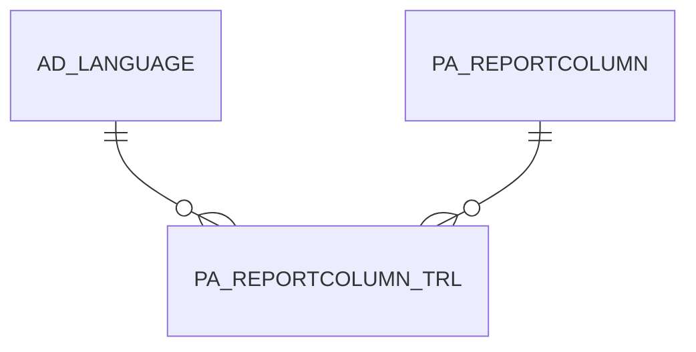

# PA_REPORTCOLUMN_TRL

Area [PA](../../data-model/pa/index.md) · class **translation** (proposed) · read from database `idempiere-db` (owner `ADEMPIERE`) · 17 row(s) when profiled

## Columns

| column | type | key | not null | business name | references (code) | nulls | distinct |
|---|---|---|---|---|---|---|---|
| `AD_CLIENT_ID` | NUMBER(10,0) |  | yes |  |  | 0 | 2 |
| `AD_LANGUAGE` | VARCHAR2(6 CHAR) | PK | yes |  |  | 0 | 1 |
| `AD_ORG_ID` | NUMBER(10,0) |  | yes |  |  | 0 | 2 |
| `CREATED` | DATE |  | yes |  |  | 0 | 17 |
| `CREATEDBY` | NUMBER(10,0) |  | yes |  |  | 0 | 2 |
| `DESCRIPTION` | VARCHAR2(255 CHAR) |  |  |  |  | 9 | 8 |
| `ISACTIVE` | CHAR(1) |  | yes |  |  | 0 | 1 |
| `ISTRANSLATED` | CHAR(1) |  | yes |  |  | 0 | 1 |
| `NAME` | VARCHAR2(255 CHAR) |  | yes |  |  | 0 | 17 |
| `PA_REPORTCOLUMN_ID` | NUMBER(10,0) | PK | yes |  |  | 0 | 17 |
| `PA_REPORTCOLUMN_TRL_UU` | VARCHAR2(36 CHAR) |  |  |  |  | 17 | 0 |
| `UPDATED` | DATE |  | yes |  |  | 0 | 12 |
| `UPDATEDBY` | NUMBER(10,0) |  | yes |  |  | 0 | 2 |

*references (code)* is the table the application model's code says a column points to; *Foreign keys* below are the constraints the database declares. Counts come from the profile; no value is ever shown.

## Check constraints

| name | expression |
|---|---|
| `SYS_C0022361` | `IsTranslated IN ('Y','N')` |
| `SYS_C0022363` | `IsActive IN ('Y','N')` |

## Foreign keys

**References**

| table | columns | on delete |
|---|---|---|
| [AD_LANGUAGE](../../data-model/ad/ad_language.md) | PA_REPORTCOLUMN_TRL.AD_LANGUAGE → AD_LANGUAGE.AD_LANGUAGE | NO ACTION |
| [PA_REPORTCOLUMN](../../data-model/pa/pa_reportcolumn.md) | PA_REPORTCOLUMN_TRL.PA_REPORTCOLUMN_ID → PA_REPORTCOLUMN.PA_REPORTCOLUMN_ID | NO ACTION |

**Referenced by**

_None._

## Write behaviour

- updates: **po_only**
- deletes: **deleted_by_users**
- change log: **not_recorded**
- evidence: 1 citation(s)

## Schema history

12 change(s); the latest:

| applied | release | operation | column | tickets |
|---|---|---|---|---|
| 2020-08-04T01:00 | i7.1z | `modify_column` | PA_REPORTCOLUMN_TRL_UU | IDEMPIERE-3862 |
| 2020-08-04T01:00 | i7.1z | `modify_column` | DESCRIPTION | IDEMPIERE-3862 |
| 2020-08-04T01:00 | i7.1z | `modify_column` | AD_LANGUAGE | IDEMPIERE-3862 |
| 2020-08-04T01:00 | i7.1z | `modify_column` | NAME | IDEMPIERE-3862 |
| 2019-08-22T11:15 | i6.2z | `add_constraint` |  | IDEMPIERE-4032 |
| 2019-08-22T11:15 | i6.2z | `add_constraint` |  | IDEMPIERE-4032 |
| 2019-08-22T11:15 | i6.2z | `add_constraint` |  | IDEMPIERE-4032 |
| 2019-08-22T11:15 | i6.2z | `add_constraint` |  | IDEMPIERE-4032 |
| 2019-08-22T11:15 | i6.2z | `add_constraint` |  | IDEMPIERE-4032 |
| 2019-08-22T11:15 | i6.2z | `create_table` |  | IDEMPIERE-4032 |
| 2019-08-22T11:15 | i6.2z | `create_table` |  | IDEMPIERE-4032 |
| 2019-08-22T11:15 | i6.2z | `add_constraint` |  | IDEMPIERE-4032 |

## Open conflicts

| type | attribute | explanation |
|---|---|---|
| `table_without_model` | `model_class` | unexplained |

## Notes

<!-- ekos:manual id="table.pa_reportcolumn_trl.notes" -->
_Business notes about this table._
<!-- /ekos:manual -->
