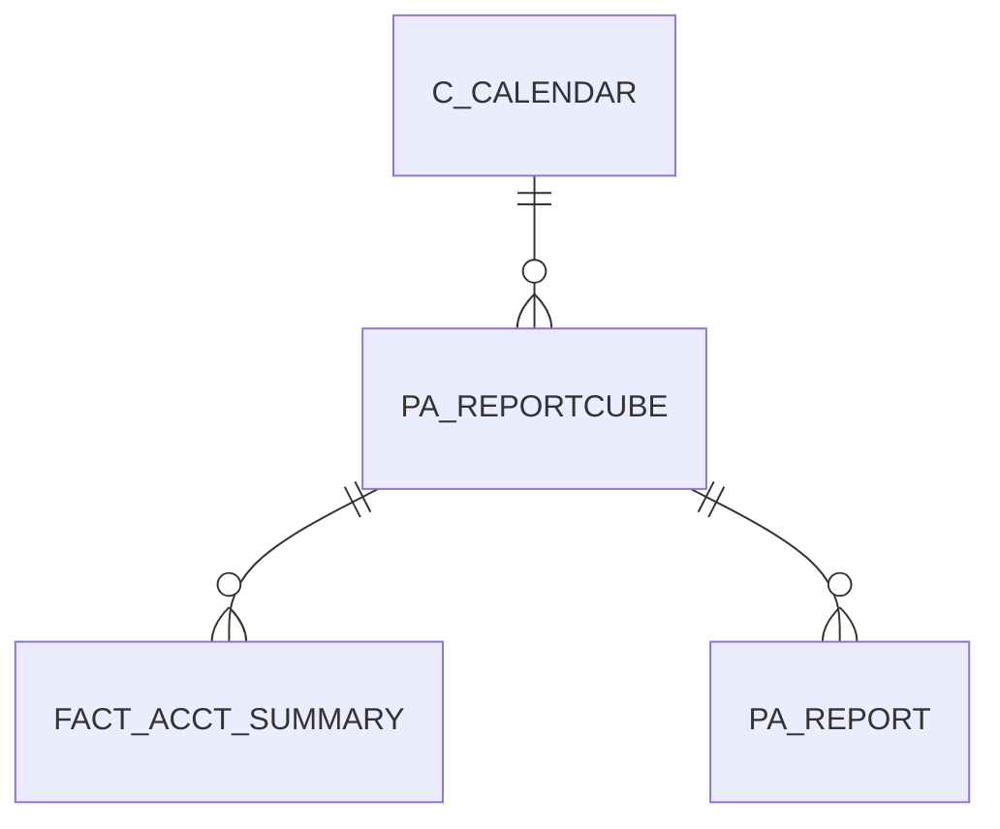

# PA_REPORTCUBE

Area [PA](../../data-model/pa/index.md) · class **business** (proposed) · read from database `idempiere-db` (owner `ADEMPIERE`) · 0 row(s) when profiled

Application model: `org.compiere.model.X_PA_ReportCube`, access level 3 - Client - Org.

## Columns

| column | type | key | not null | business name | references (code) | nulls | distinct |
|---|---|---|---|---|---|---|---|
| `AD_CLIENT_ID` | NUMBER(10,0) |  | yes | Tenant |  | 0 | 0 |
| `AD_ORG_ID` | NUMBER(10,0) |  | yes | Organization |  | 0 | 0 |
| `C_CALENDAR_ID` | NUMBER(10,0) |  | yes | Calendar | [C_CALENDAR](../../data-model/c/c_calendar.md) | 0 | 0 |
| `CREATED` | DATE |  | yes | Created |  | 0 | 0 |
| `CREATEDBY` | NUMBER(10,0) |  | yes | Created By |  | 0 | 0 |
| `DESCRIPTION` | VARCHAR2(255 CHAR) |  |  | Description |  | 0 | 0 |
| `ISACTIVE` | CHAR(1) |  |  | Active |  | 0 | 0 |
| `ISACTIVITYDIM` | CHAR(1) |  |  | Activity Dimension |  | 0 | 0 |
| `ISBPARTNERDIM` | CHAR(1) |  |  | Business Partner Dimension |  | 0 | 0 |
| `ISCAMPAIGNDIM` | CHAR(1) |  |  | Campaign Dimension |  | 0 | 0 |
| `ISGLBUDGETDIM` | CHAR(1) |  |  | GL Budget Dimension |  | 0 | 0 |
| `ISLOCFROMDIM` | CHAR(1) |  |  | Location From Dimension |  | 0 | 0 |
| `ISLOCTODIM` | CHAR(1) |  |  | Location To  Dimension |  | 0 | 0 |
| `ISORGTRXDIM` | CHAR(1) |  |  | OrgTrx Dimension |  | 0 | 0 |
| `ISPRODUCTDIM` | CHAR(1) |  |  | Product Dimension |  | 0 | 0 |
| `ISPROJECTDIM` | CHAR(1) |  |  | Project Dimension |  | 0 | 0 |
| `ISPROJECTPHASEDIM` | CHAR(1) |  |  | Project Phase  Dimension |  | 0 | 0 |
| `ISPROJECTTASKDIM` | CHAR(1) |  |  | Project Task  Dimension |  | 0 | 0 |
| `ISSALESREGIONDIM` | CHAR(1) |  |  | Sales Region Dimension |  | 0 | 0 |
| `ISSUBACCTDIM` | CHAR(1) |  |  | Sub Acct Dimension |  | 0 | 0 |
| `ISUSER1DIM` | CHAR(1) |  |  | User Element List 1 Dimension |  | 0 | 0 |
| `ISUSER2DIM` | CHAR(1) |  |  | User Element List 2 Dimension |  | 0 | 0 |
| `NAME` | VARCHAR2(60 CHAR) |  | yes | Name |  | 0 | 0 |
| `PA_REPORTCUBE_ID` | NUMBER(10,0) | PK | yes | Report Cube |  | 0 | 0 |
| `UPDATED` | DATE |  | yes | Updated |  | 0 | 0 |
| `UPDATEDBY` | NUMBER(10,0) |  | yes | Updated By |  | 0 | 0 |
| `PROCESSING` | CHAR(1) |  | yes | Process Now |  | 0 | 0 |
| `LASTRECALCULATED` | DATE |  |  | Last Recalculated |  | 0 | 0 |
| `ISUSERELEMENT2DIM` | CHAR(1) |  |  | User Column 2 Dimension |  | 0 | 0 |
| `ISUSERELEMENT1DIM` | CHAR(1) |  |  | User Column 1 Dimension |  | 0 | 0 |
| `PA_REPORTCUBE_UU` | VARCHAR2(36 CHAR) |  |  | PA_ReportCube_UU |  | 0 | 0 |

*references (code)* is the table the application model's code says a column points to; *Foreign keys* below are the constraints the database declares. Counts come from the profile; no value is ever shown.

## Check constraints

| name | expression |
|---|---|
| `SYS_C0020006` | `IsGLBudgetDim IN ('Y','N')` |
| `SYS_C0020007` | `IsUser2Dim IN ('Y','N')` |
| `SYS_C0020008` | `IsLocToDim IN ('Y','N')` |
| `SYS_C0020009` | `IsProjectPhaseDim IN ('Y','N')` |
| `SYS_C0020010` | `IsCampaignDim IN ('Y','N')` |
| `SYS_C0020011` | `IsProductDim IN ('Y','N')` |
| `SYS_C0020012` | `IsActivityDim IN ('Y','N')` |
| `SYS_C0020013` | `IsSalesRegionDim IN ('Y','N')` |
| `SYS_C0020014` | `IsOrgTrxDim IN ('Y','N')` |
| `SYS_C0020015` | `IsUser1Dim IN ('Y','N')` |
| `SYS_C0020017` | `IsProjectTaskDim IN ('Y','N')` |
| `SYS_C0020018` | `Processing IN ('Y','N')` |
| `SYS_C0020019` | `IsLocFromDim IN ('Y','N')` |
| `SYS_C0020020` | `IsBPartnerDim IN ('Y','N')` |
| `SYS_C0020022` | `IsActive IN ('Y','N')` |
| `SYS_C0020023` | `IsUserElement2Dim IN ('Y','N')` |
| `SYS_C0020024` | `IsSubAcctDim IN ('Y','N')` |
| `SYS_C0020025` | `IsProjectDim IN ('Y','N')` |
| `SYS_C0020026` | `IsUserElement1Dim IN ('Y','N')` |

## Foreign keys

**References**

| table | columns | on delete |
|---|---|---|
| [C_CALENDAR](../../data-model/c/c_calendar.md) | PA_REPORTCUBE.C_CALENDAR_ID → C_CALENDAR.C_CALENDAR_ID | NO ACTION |

**Referenced by**

| table | columns | on delete |
|---|---|---|
| [FACT_ACCT_SUMMARY](../../data-model/fact/fact_acct_summary.md) | FACT_ACCT_SUMMARY.PA_REPORTCUBE_ID → PA_REPORTCUBE.PA_REPORTCUBE_ID | NO ACTION |
| [PA_REPORT](../../data-model/pa/pa_report.md) | PA_REPORT.PA_REPORTCUBE_ID → PA_REPORTCUBE.PA_REPORTCUBE_ID | NO ACTION |

## Write behaviour

- updates: **raw_sql_skips_updated**
- deletes: **deleted_by_users**
- change log: **recorded**
- evidence: 3 citation(s)

## Schema history

23 change(s); the latest:

| applied | release | operation | column | tickets |
|---|---|---|---|---|
| 2023-04-09T15:47 | iD11 | `add_constraint` |  | IDEMPIERE-5567 |
| 2023-04-09T15:47 | iD11 | `add_constraint` |  | IDEMPIERE-5567 |
| 2021-12-05T16:45 | i8.2z | `drop_constraint` |  | IDEMPIERE-5075 |
| 2021-12-05T16:45 | i8.2z | `add_constraint` |  | IDEMPIERE-5075 |
| 2020-08-04T01:00 | i7.1z | `modify_column` | NAME | IDEMPIERE-3862 |
| 2020-08-04T01:00 | i7.1z | `add_column` | tmp_col_1_tmp | IDEMPIERE-3862 |
| 2020-08-04T01:00 | i7.1z | `drop_column` | tmp_col_3_tmp | IDEMPIERE-3862 |
| 2020-08-04T01:00 | i7.1z | `drop_column` | tmp_col_1_tmp | IDEMPIERE-3862 |
| 2020-08-04T01:00 | i7.1z | `modify_column` | NAME | IDEMPIERE-3862 |
| 2020-08-04T01:00 | i7.1z | `modify_column` | DESCRIPTION | IDEMPIERE-3862 |
| 2020-08-04T01:00 | i7.1z | `add_column` | tmp_col_2_tmp | IDEMPIERE-3862 |
| 2020-08-04T01:00 | i7.1z | `modify_column` | NAME | IDEMPIERE-3862 |
| 2020-08-04T01:00 | i7.1z | `add_column` | tmp_col_3_tmp | IDEMPIERE-3862 |
| 2020-08-04T01:00 | i7.1z | `modify_column` | PA_REPORTCUBE_UU | IDEMPIERE-3862 |
| 2020-08-04T01:00 | i7.1z | `drop_column` | tmp_col_2_tmp | IDEMPIERE-3862 |

## Notes

<!-- ekos:manual id="table.pa_reportcube.notes" -->
_Business notes about this table._
<!-- /ekos:manual -->
