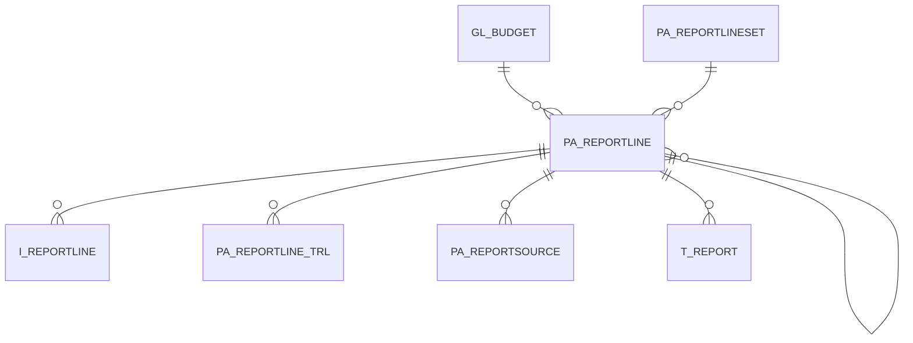

# PA_REPORTLINE

Area [PA](../../data-model/pa/index.md) · class **business** (proposed) · read from database `idempiere-db` (owner `ADEMPIERE`) · 113 row(s) when profiled

Application model: `org.compiere.model.X_PA_ReportLine`, access level 3 - Client - Org.

## Columns

| column | type | key | not null | business name | references (code) | nulls | distinct |
|---|---|---|---|---|---|---|---|
| `PA_REPORTLINE_ID` | NUMBER(10,0) | PK | yes | Report Line |  | 0 | 113 |
| `AD_CLIENT_ID` | NUMBER(10,0) |  | yes | Tenant |  | 0 | 1 |
| `AD_ORG_ID` | NUMBER(10,0) |  | yes | Organization |  | 0 | 2 |
| `ISACTIVE` | CHAR(1) |  | yes | Active |  | 0 | 1 |
| `CREATED` | DATE |  | yes | Created |  | 0 | 48 |
| `CREATEDBY` | NUMBER(10,0) |  | yes | Created By |  | 0 | 2 |
| `UPDATED` | DATE |  | yes | Updated |  | 0 | 76 |
| `UPDATEDBY` | NUMBER(10,0) |  | yes | Updated By |  | 0 | 3 |
| `PA_REPORTLINESET_ID` | NUMBER(10,0) |  | yes | Report Line Set | [PA_REPORTLINESET](../../data-model/pa/pa_reportlineset.md) | 0 | 3 |
| `NAME` | VARCHAR2(255 CHAR) |  | yes | Name |  | 0 | 107 |
| `SEQNO` | NUMBER(10,0) |  | yes | Sequence |  | 0 | 106 |
| `DESCRIPTION` | VARCHAR2(255 CHAR) |  |  | Description |  | 0 | 106 |
| `ISPRINTED` | CHAR(1) |  | yes | Printed |  | 0 | 1 |
| `PARENT_ID` | NUMBER(10,0) |  |  |  |  | 113 | 0 |
| `ISSUMMARY` | CHAR(1) |  | yes |  |  | 0 | 1 |
| `LINETYPE` | CHAR(1) |  | yes | Line Type |  | 0 | 2 |
| `CALCULATIONTYPE` | CHAR(1) |  |  | Calculation |  | 61 | 3 |
| `OPER_1_ID` | NUMBER(10,0) |  |  | Operand 1 | [PA_REPORTLINE](../../data-model/pa/pa_reportline.md) | 89 | 23 |
| `OPER_2_ID` | NUMBER(10,0) |  |  | Operand 2 | [PA_REPORTLINE](../../data-model/pa/pa_reportline.md) | 89 | 24 |
| `POSTINGTYPE` | CHAR(1) |  |  | Posting Type |  | 113 | 0 |
| `GL_BUDGET_ID` | NUMBER(10,0) |  |  | Budget | [GL_BUDGET](../../data-model/gl/gl_budget.md) | 113 | 0 |
| `AMOUNTTYPE` | CHAR(2) |  |  |  |  | 113 | 0 |
| `PAAMOUNTTYPE` | CHAR(1) |  |  | Amount Type |  | 113 | 0 |
| `PAPERIODTYPE` | CHAR(1) |  |  | Period Type |  | 113 | 0 |
| `PA_REPORTLINE_UU` | VARCHAR2(36 CHAR) |  |  | PA_ReportLine_UU |  | 0 | 113 |
| `ISINVERSEDEBITCREDITONLY` | CHAR(1) |  | yes | Inverse Operation for Debit/Credit Only Column |  | 0 | 1 |
| `ISSHOWOPPOSITESIGN` | CHAR(1) |  |  | Show Opposite Sign |  | 0 | 1 |
| `OVERLINESTROKETYPE` | VARCHAR2(3 CHAR) |  |  | Overline Stroke Type |  | 113 | 0 |
| `UNDERLINESTROKETYPE` | VARCHAR2(3 CHAR) |  |  | Underline Stroke Type |  | 113 | 0 |
| `ROUNDFACTOR` | NUMBER(10,0) |  |  | Round Factor |  | 113 | 0 |
| `MULTIPLIER` | NUMBER |  |  | Multiplier |  | 113 | 0 |

*references (code)* is the table the application model's code says a column points to; *Foreign keys* below are the constraints the database declares. Counts come from the profile; no value is ever shown.

## Check constraints

| name | expression |
|---|---|
| `SYS_C0021502` | `IsPrinted in ('Y','N')` |
| `SYS_C0021503` | `IsShowOppositeSign IN ('Y','N')` |
| `SYS_C0021505` | `IsInverseDebitCreditOnly IN ('Y','N')` |
| `SYS_C0021507` | `IsActive in ('Y','N')` |

## Foreign keys

**References**

| table | columns | on delete |
|---|---|---|
| [GL_BUDGET](../../data-model/gl/gl_budget.md) | PA_REPORTLINE.GL_BUDGET_ID → GL_BUDGET.GL_BUDGET_ID | NO ACTION |
| [PA_REPORTLINE](../../data-model/pa/pa_reportline.md) | PA_REPORTLINE.OPER_1_ID → PA_REPORTLINE.PA_REPORTLINE_ID | SET NULL |
| [PA_REPORTLINESET](../../data-model/pa/pa_reportlineset.md) | PA_REPORTLINE.PA_REPORTLINESET_ID → PA_REPORTLINESET.PA_REPORTLINESET_ID | CASCADE |

**Referenced by**

| table | columns | on delete |
|---|---|---|
| `I_REPORTLINE` | I_REPORTLINE.PA_REPORTLINE_ID → PA_REPORTLINE.PA_REPORTLINE_ID | SET NULL |
| [PA_REPORTLINE](../../data-model/pa/pa_reportline.md) | PA_REPORTLINE.OPER_1_ID → PA_REPORTLINE.PA_REPORTLINE_ID | SET NULL |
| [PA_REPORTLINE_TRL](../../data-model/pa/pa_reportline_trl.md) | PA_REPORTLINE_TRL.PA_REPORTLINE_ID → PA_REPORTLINE.PA_REPORTLINE_ID | CASCADE |
| [PA_REPORTSOURCE](../../data-model/pa/pa_reportsource.md) | PA_REPORTSOURCE.PA_REPORTLINE_ID → PA_REPORTLINE.PA_REPORTLINE_ID | CASCADE |
| [T_REPORT](../../data-model/t/t_report.md) | T_REPORT.PA_REPORTLINE_ID → PA_REPORTLINE.PA_REPORTLINE_ID | CASCADE |

## Write behaviour

- updates: **raw_sql_sets_updated**
- deletes: **deleted_by_users, deleted_by_cascade**
- change log: **recorded**
- evidence: 3 citation(s)

## Schema history

37 change(s); the latest:

| applied | release | operation | column | tickets |
|---|---|---|---|---|
| 2023-04-09T15:47 | iD11 | `add_constraint` |  | IDEMPIERE-5567 |
| 2023-04-09T15:47 | iD11 | `add_constraint` |  | IDEMPIERE-5567 |
| 2022-10-11T17:20 | i9 | `add_column` | RoundFactor | IDEMPIERE-5445 |
| 2022-10-11T17:20 | i9 | `add_column` | Multiplier | IDEMPIERE-5445 |
| 2022-10-11T17:20 | i9 | `add_column` | RoundFactor | IDEMPIERE-5445 |
| 2022-10-11T17:20 | i9 | `add_column` | Multiplier | IDEMPIERE-5445 |
| 2022-03-26T18:37 | iD10 | `modify_column` | Name | IDEMPIERE-4550 |
| 2022-03-26T18:37 | iD10 | `modify_column` | Name | IDEMPIERE-4550 |
| 2021-12-05T16:45 | i8.2z | `drop_constraint` |  | IDEMPIERE-5075 |
| 2021-12-05T16:45 | i8.2z | `drop_constraint` |  | IDEMPIERE-5075 |
| 2021-12-05T16:45 | i8.2z | `add_constraint` |  | IDEMPIERE-5075 |
| 2021-12-05T16:45 | i8.2z | `add_constraint` |  | IDEMPIERE-5075 |
| 2021-12-05T16:45 | i8.2z | `add_constraint` |  | IDEMPIERE-5075 |
| 2021-12-05T16:45 | i8.2z | `drop_constraint` |  | IDEMPIERE-5075 |
| 2021-12-05T16:45 | i8.2z | `add_constraint` |  | IDEMPIERE-5075 |

## Notes

<!-- ekos:manual id="table.pa_reportline.notes" -->
_Business notes about this table._
<!-- /ekos:manual -->
