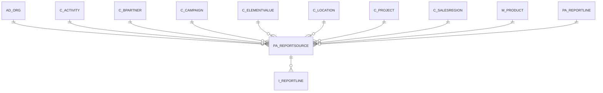

# PA_REPORTSOURCE

Area [PA](../../data-model/pa/index.md) · class **business** (proposed) · read from database `idempiere-db` (owner `ADEMPIERE`) · 93 row(s) when profiled

Application model: `org.compiere.model.X_PA_ReportSource`, access level 3 - Client - Org.

## Columns

| column | type | key | not null | business name | references (code) | nulls | distinct |
|---|---|---|---|---|---|---|---|
| `PA_REPORTSOURCE_ID` | NUMBER(10,0) | PK | yes | Report Source |  | 0 | 93 |
| `AD_CLIENT_ID` | NUMBER(10,0) |  | yes | Tenant |  | 0 | 1 |
| `AD_ORG_ID` | NUMBER(10,0) |  | yes | Organization |  | 0 | 2 |
| `ISACTIVE` | CHAR(1) |  | yes | Active |  | 0 | 1 |
| `CREATED` | DATE |  | yes | Created |  | 0 | 39 |
| `CREATEDBY` | NUMBER(10,0) |  | yes | Created By |  | 0 | 2 |
| `UPDATED` | DATE |  | yes | Updated |  | 0 | 41 |
| `UPDATEDBY` | NUMBER(10,0) |  | yes | Updated By |  | 0 | 3 |
| `DESCRIPTION` | VARCHAR2(255 CHAR) |  |  | Description |  | 62 | 30 |
| `PA_REPORTLINE_ID` | NUMBER(10,0) |  | yes | Report Line | [PA_REPORTLINE](../../data-model/pa/pa_reportline.md) | 0 | 93 |
| `ELEMENTTYPE` | CHAR(2) |  | yes | Type |  | 0 | 1 |
| `ORG_ID` | NUMBER(10,0) |  |  | Organization |  | 93 | 0 |
| `C_ELEMENTVALUE_ID` | NUMBER(10,0) |  |  | Account Element | [C_ELEMENTVALUE](../../data-model/c/c_elementvalue.md) | 8 | 61 |
| `C_PROJECT_ID` | NUMBER(10,0) |  |  | Project | [C_PROJECT](../../data-model/c/c_project.md) | 93 | 0 |
| `C_BPARTNER_ID` | NUMBER(10,0) |  |  | Business Partner | [C_BPARTNER](../../data-model/c/c_bpartner.md) | 93 | 0 |
| `M_PRODUCT_ID` | NUMBER(10,0) |  |  | Product | [M_PRODUCT](../../data-model/m/m_product.md) | 93 | 0 |
| `C_CAMPAIGN_ID` | NUMBER(10,0) |  |  | Campaign | [C_CAMPAIGN](../../data-model/c/c_campaign.md) | 93 | 0 |
| `C_LOCATION_ID` | NUMBER(10,0) |  |  | Address | [C_LOCATION](../../data-model/c/c_location.md) | 93 | 0 |
| `C_SALESREGION_ID` | NUMBER(10,0) |  |  | Sales Region | [C_SALESREGION](../../data-model/c/c_salesregion.md) | 93 | 0 |
| `C_ACTIVITY_ID` | NUMBER(10,0) |  |  | Activity | [C_ACTIVITY](../../data-model/c/c_activity.md) | 93 | 0 |
| `USERELEMENT1_ID` | NUMBER(10,0) |  |  | User Column 1 |  | 93 | 0 |
| `USERELEMENT2_ID` | NUMBER(10,0) |  |  | User Column 2 |  | 93 | 0 |
| `ISINCLUDENULLSORG` | CHAR(1) |  | yes | Include Nulls in Org |  | 0 | 1 |
| `ISINCLUDENULLSELEMENTVALUE` | CHAR(1) |  | yes | Include Nulls in Account |  | 0 | 1 |
| `ISINCLUDENULLSBPARTNER` | CHAR(1) |  | yes | Include Nulls in BPartner |  | 0 | 1 |
| `ISINCLUDENULLSPRODUCT` | CHAR(1) |  | yes | Include Nulls in Product |  | 0 | 1 |
| `ISINCLUDENULLSLOCATION` | CHAR(1) |  | yes | Include Nulls in Location |  | 0 | 1 |
| `ISINCLUDENULLSPROJECT` | CHAR(1) |  | yes | Include Nulls in Project |  | 0 | 1 |
| `ISINCLUDENULLSSALESREGION` | CHAR(1) |  | yes | Include Nulls in Sales Region |  | 0 | 1 |
| `ISINCLUDENULLSACTIVITY` | CHAR(1) |  | yes | Include Nulls in Activity |  | 0 | 1 |
| `ISINCLUDENULLSCAMPAIGN` | CHAR(1) |  | yes | Include Nulls in Campaign |  | 0 | 1 |
| `ISINCLUDENULLSUSERELEMENT1` | CHAR(1) |  | yes | Include Nulls in User Element 1 |  | 0 | 1 |
| `ISINCLUDENULLSUSERELEMENT2` | CHAR(1) |  | yes | Include Nulls in User Element 2 |  | 0 | 1 |
| `ISINCLUDENULLSORGTRX` | CHAR(1) |  | yes | Include Nulls in Org Trx |  | 0 | 1 |
| `AD_ORGTRX_ID` | NUMBER(10,0) |  |  | Trx Organization |  | 93 | 0 |
| `PA_REPORTSOURCE_UU` | VARCHAR2(36 CHAR) |  |  | PA_ReportSource_UU |  | 0 | 93 |

*references (code)* is the table the application model's code says a column points to; *Foreign keys* below are the constraints the database declares. Counts come from the profile; no value is ever shown.

## Check constraints

| name | expression |
|---|---|
| `SYS_C0021468` | `IsIncludeNullsUserElement2 IN ('Y','N')` |
| `SYS_C0021469` | `IsIncludeNullsOrg IN ('Y','N')` |
| `SYS_C0021471` | `IsIncludeNullsBPartner IN ('Y','N')` |
| `SYS_C0021472` | `IsIncludeNullsActivity IN ('Y','N')` |
| `SYS_C0021473` | `IsIncludeNullsElementValue IN ('Y','N')` |
| `SYS_C0021474` | `IsIncludeNullsCampaign IN ('Y','N')` |
| `SYS_C0021475` | `IsActive in ('Y','N')` |
| `SYS_C0021476` | `IsIncludeNullsSalesRegion IN ('Y','N')` |
| `SYS_C0021477` | `IsIncludeNullsOrgTrx IN ('Y','N')` |
| `SYS_C0021478` | `IsIncludeNullsProduct IN ('Y','N')` |
| `SYS_C0021479` | `IsIncludeNullsUserElement1 IN ('Y','N')` |
| `SYS_C0021480` | `IsIncludeNullsLocation IN ('Y','N')` |
| `SYS_C0021481` | `IsIncludeNullsProject IN ('Y','N')` |

## Foreign keys

**References**

| table | columns | on delete |
|---|---|---|
| [AD_ORG](../../data-model/ad/ad_org.md) | PA_REPORTSOURCE.AD_ORGTRX_ID → AD_ORG.AD_ORG_ID | NO ACTION |
| [C_ACTIVITY](../../data-model/c/c_activity.md) | PA_REPORTSOURCE.C_ACTIVITY_ID → C_ACTIVITY.C_ACTIVITY_ID | NO ACTION |
| [C_BPARTNER](../../data-model/c/c_bpartner.md) | PA_REPORTSOURCE.C_BPARTNER_ID → C_BPARTNER.C_BPARTNER_ID | NO ACTION |
| [C_CAMPAIGN](../../data-model/c/c_campaign.md) | PA_REPORTSOURCE.C_CAMPAIGN_ID → C_CAMPAIGN.C_CAMPAIGN_ID | NO ACTION |
| [C_ELEMENTVALUE](../../data-model/c/c_elementvalue.md) | PA_REPORTSOURCE.C_ELEMENTVALUE_ID → C_ELEMENTVALUE.C_ELEMENTVALUE_ID | NO ACTION |
| [C_LOCATION](../../data-model/c/c_location.md) | PA_REPORTSOURCE.C_LOCATION_ID → C_LOCATION.C_LOCATION_ID | NO ACTION |
| [C_PROJECT](../../data-model/c/c_project.md) | PA_REPORTSOURCE.C_PROJECT_ID → C_PROJECT.C_PROJECT_ID | NO ACTION |
| [C_SALESREGION](../../data-model/c/c_salesregion.md) | PA_REPORTSOURCE.C_SALESREGION_ID → C_SALESREGION.C_SALESREGION_ID | NO ACTION |
| [M_PRODUCT](../../data-model/m/m_product.md) | PA_REPORTSOURCE.M_PRODUCT_ID → M_PRODUCT.M_PRODUCT_ID | NO ACTION |
| [PA_REPORTLINE](../../data-model/pa/pa_reportline.md) | PA_REPORTSOURCE.PA_REPORTLINE_ID → PA_REPORTLINE.PA_REPORTLINE_ID | CASCADE |

**Referenced by**

| table | columns | on delete |
|---|---|---|
| `I_REPORTLINE` | I_REPORTLINE.PA_REPORTSOURCE_ID → PA_REPORTSOURCE.PA_REPORTSOURCE_ID | SET NULL |

## Write behaviour

- updates: **raw_sql_sets_updated**
- deletes: **deleted_by_app, deleted_by_users, deleted_by_cascade**
- change log: **recorded**
- evidence: 4 citation(s)

## Schema history

30 change(s); the latest:

| applied | release | operation | column | tickets |
|---|---|---|---|---|
| 2023-04-09T15:47 | iD11 | `add_constraint` |  | IDEMPIERE-5567 |
| 2023-04-09T15:47 | iD11 | `add_constraint` |  | IDEMPIERE-5567 |
| 2021-12-05T16:45 | i8.2z | `add_constraint` |  | IDEMPIERE-5075 |
| 2021-12-05T16:45 | i8.2z | `drop_constraint` |  | IDEMPIERE-5075 |
| 2021-12-05T16:45 | i8.2z | `add_constraint` |  | IDEMPIERE-5075 |
| 2021-12-05T16:45 | i8.2z | `add_constraint` |  | IDEMPIERE-5075 |
| 2021-12-05T16:45 | i8.2z | `add_constraint` |  | IDEMPIERE-5075 |
| 2021-12-05T16:45 | i8.2z | `add_constraint` |  | IDEMPIERE-5075 |
| 2021-12-05T16:45 | i8.2z | `add_constraint` |  | IDEMPIERE-5075 |
| 2021-12-05T16:45 | i8.2z | `drop_constraint` |  | IDEMPIERE-5075 |
| 2021-12-05T16:45 | i8.2z | `drop_constraint` |  | IDEMPIERE-5075 |
| 2021-12-05T16:45 | i8.2z | `add_constraint` |  | IDEMPIERE-5075 |
| 2021-12-05T16:45 | i8.2z | `drop_constraint` |  | IDEMPIERE-5075 |
| 2021-12-05T16:45 | i8.2z | `drop_constraint` |  | IDEMPIERE-5075 |
| 2021-12-05T16:45 | i8.2z | `add_constraint` |  | IDEMPIERE-5075 |

## Notes

<!-- ekos:manual id="table.pa_reportsource.notes" -->
_Business notes about this table._
<!-- /ekos:manual -->
