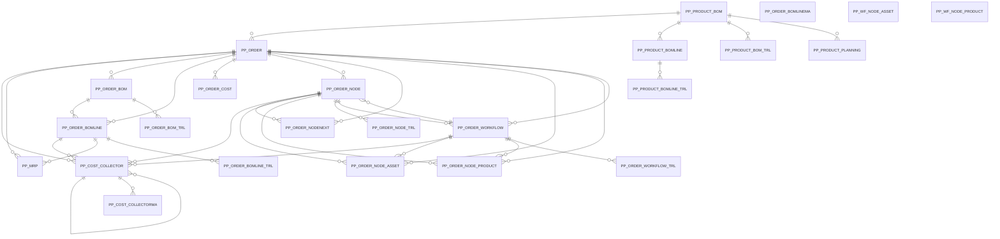

# Area PP

24 table(s), 24 in scope.

| table | class | scope | rows | description |
|---|---|---|---|---|
| [PP_COST_COLLECTOR](../../data-model/pp/pp_cost_collector.md) | business | in | 0 |  |
| [PP_COST_COLLECTORMA](../../data-model/pp/pp_cost_collectorma.md) | business | in | 0 |  |
| [PP_MRP](../../data-model/pp/pp_mrp.md) | business | in | 56 |  |
| [PP_ORDER](../../data-model/pp/pp_order.md) | business | in | 2 |  |
| [PP_ORDER_BOM](../../data-model/pp/pp_order_bom.md) | business | in | 2 |  |
| [PP_ORDER_BOMLINE](../../data-model/pp/pp_order_bomline.md) | business | in | 4 |  |
| [PP_ORDER_BOMLINEMA](../../data-model/pp/pp_order_bomlinema.md) | unclassified | in |  |  |
| [PP_ORDER_BOMLINE_TRL](../../data-model/pp/pp_order_bomline_trl.md) | translation | in | 4 |  |
| [PP_ORDER_BOM_TRL](../../data-model/pp/pp_order_bom_trl.md) | translation | in | 2 |  |
| [PP_ORDER_COST](../../data-model/pp/pp_order_cost.md) | business | in | 0 |  |
| [PP_ORDER_NODE](../../data-model/pp/pp_order_node.md) | business | in | 2 |  |
| [PP_ORDER_NODENEXT](../../data-model/pp/pp_order_nodenext.md) | business | in | 0 |  |
| [PP_ORDER_NODE_ASSET](../../data-model/pp/pp_order_node_asset.md) | business | in | 0 |  |
| [PP_ORDER_NODE_PRODUCT](../../data-model/pp/pp_order_node_product.md) | business | in | 0 |  |
| [PP_ORDER_NODE_TRL](../../data-model/pp/pp_order_node_trl.md) | translation | in | 2 |  |
| [PP_ORDER_WORKFLOW](../../data-model/pp/pp_order_workflow.md) | business | in | 2 |  |
| [PP_ORDER_WORKFLOW_TRL](../../data-model/pp/pp_order_workflow_trl.md) | translation | in | 2 |  |
| [PP_PRODUCT_BOM](../../data-model/pp/pp_product_bom.md) | business | in | 7 |  |
| [PP_PRODUCT_BOMLINE](../../data-model/pp/pp_product_bomline.md) | business | in | 21 |  |
| [PP_PRODUCT_BOMLINE_TRL](../../data-model/pp/pp_product_bomline_trl.md) | translation | in | 21 |  |
| [PP_PRODUCT_BOM_TRL](../../data-model/pp/pp_product_bom_trl.md) | translation | in | 7 |  |
| [PP_PRODUCT_PLANNING](../../data-model/pp/pp_product_planning.md) | business | in | 219 |  |
| [PP_WF_NODE_ASSET](../../data-model/pp/pp_wf_node_asset.md) | business | in | 0 |  |
| [PP_WF_NODE_PRODUCT](../../data-model/pp/pp_wf_node_product.md) | business | in | 0 |  |
