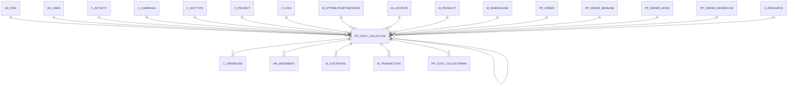

# PP_COST_COLLECTOR

Area [PP](../../data-model/pp/index.md) · class **business** (proposed) · read from database `idempiere-db` (owner `ADEMPIERE`) · 0 row(s) when profiled

Application model: `org.eevolution.model.X_PP_Cost_Collector`, access level 1 - Org.

## Columns

| column | type | key | not null | business name | references (code) | nulls | distinct |
|---|---|---|---|---|---|---|---|
| `M_PRODUCT_ID` | NUMBER(10,0) |  | yes | Product | [M_PRODUCT](../../data-model/m/m_product.md) | 0 | 0 |
| `AD_ORGTRX_ID` | NUMBER(10,0) |  |  | Trx Organization |  | 0 | 0 |
| `AD_ORG_ID` | NUMBER(10,0) |  | yes | Organization |  | 0 | 0 |
| `AD_USER_ID` | NUMBER(10,0) |  |  | User/Contact | [AD_USER](../../data-model/ad/ad_user.md) | 0 | 0 |
| `C_ACTIVITY_ID` | NUMBER(10,0) |  |  | Activity | [C_ACTIVITY](../../data-model/c/c_activity.md) | 0 | 0 |
| `C_CAMPAIGN_ID` | NUMBER(10,0) |  |  | Campaign | [C_CAMPAIGN](../../data-model/c/c_campaign.md) | 0 | 0 |
| `C_DOCTYPETARGET_ID` | NUMBER(10,0) |  | yes | Target Document Type | [C_DOCTYPE](../../data-model/c/c_doctype.md) | 0 | 0 |
| `C_DOCTYPE_ID` | NUMBER(10,0) |  | yes | Document Type | [C_DOCTYPE](../../data-model/c/c_doctype.md) | 0 | 0 |
| `C_PROJECT_ID` | NUMBER(10,0) |  |  | Project | [C_PROJECT](../../data-model/c/c_project.md) | 0 | 0 |
| `C_UOM_ID` | NUMBER(10,0) |  |  | UOM | [C_UOM](../../data-model/c/c_uom.md) | 0 | 0 |
| `CREATED` | DATE |  | yes | Created |  | 0 | 0 |
| `CREATEDBY` | NUMBER(10,0) |  | yes | Created By |  | 0 | 0 |
| `DATEACCT` | DATE |  | yes | Account Date |  | 0 | 0 |
| `DESCRIPTION` | VARCHAR2(255 CHAR) |  |  | Description |  | 0 | 0 |
| `DOCACTION` | CHAR(2) |  |  | Document Action |  | 0 | 0 |
| `DOCSTATUS` | CHAR(2) |  |  | Document Status |  | 0 | 0 |
| `DURATIONREAL` | NUMBER |  |  | Duration Real |  | 0 | 0 |
| `ISACTIVE` | CHAR(1) |  | yes | Active |  | 0 | 0 |
| `ISBATCHTIME` | CHAR(1) |  |  | Is Batch Time |  | 0 | 0 |
| `M_ATTRIBUTESETINSTANCE_ID` | NUMBER(10,0) |  |  | Attribute Set Instance | [M_ATTRIBUTESETINSTANCE](../../data-model/m/m_attributesetinstance.md) | 0 | 0 |
| `M_LOCATOR_ID` | NUMBER(10,0) |  | yes | Locator | [M_LOCATOR](../../data-model/m/m_locator.md) | 0 | 0 |
| `M_WAREHOUSE_ID` | NUMBER(10,0) |  | yes | Warehouse | [M_WAREHOUSE](../../data-model/m/m_warehouse.md) | 0 | 0 |
| `MOVEMENTDATE` | DATE |  | yes | Movement Date |  | 0 | 0 |
| `MOVEMENTQTY` | NUMBER |  | yes | Movement Quantity |  | 0 | 0 |
| `PP_COST_COLLECTOR_ID` | NUMBER(10,0) | PK | yes | Manufacturing Cost Collector |  | 0 | 0 |
| `PP_ORDER_BOMLINE_ID` | NUMBER(10,0) |  |  | Manufacturing Order BOM Line | [PP_ORDER_BOMLINE](../../data-model/pp/pp_order_bomline.md) | 0 | 0 |
| `PP_ORDER_ID` | NUMBER(10,0) |  | yes | Manufacturing Order | [PP_ORDER](../../data-model/pp/pp_order.md) | 0 | 0 |
| `PP_ORDER_NODE_ID` | NUMBER(10,0) |  |  | Manufacturing Order Activity | [PP_ORDER_NODE](../../data-model/pp/pp_order_node.md) | 0 | 0 |
| `PP_ORDER_WORKFLOW_ID` | NUMBER(10,0) |  |  | Manufacturing Order Workflow | [PP_ORDER_WORKFLOW](../../data-model/pp/pp_order_workflow.md) | 0 | 0 |
| `POSTED` | CHAR(1) |  | yes | Posted |  | 0 | 0 |
| `PROCESSED` | CHAR(1) |  | yes | Processed |  | 0 | 0 |
| `PROCESSING` | CHAR(1) |  |  | Process Now |  | 0 | 0 |
| `QTYREJECT` | NUMBER |  |  | Qty Reject |  | 0 | 0 |
| `S_RESOURCE_ID` | NUMBER(10,0) |  | yes | Resource | [S_RESOURCE](../../data-model/s/s_resource.md) | 0 | 0 |
| `SCRAPPEDQTY` | NUMBER |  |  | Scrapped Quantity |  | 0 | 0 |
| `SETUPTIMEREAL` | NUMBER |  |  | Setup Time Real |  | 0 | 0 |
| `UPDATED` | DATE |  | yes | Updated |  | 0 | 0 |
| `UPDATEDBY` | NUMBER(10,0) |  | yes | Updated By |  | 0 | 0 |
| `USER1_ID` | NUMBER(10,0) |  |  | User Element List 1 | [AD_USER](../../data-model/ad/ad_user.md) | 0 | 0 |
| `AD_CLIENT_ID` | NUMBER(10,0) |  | yes | Tenant |  | 0 | 0 |
| `USER2_ID` | NUMBER(10,0) |  |  | User Element List 2 | [AD_USER](../../data-model/ad/ad_user.md) | 0 | 0 |
| `REVERSAL_ID` | NUMBER(10,0) |  |  | Reversal ID | [PP_COST_COLLECTOR](../../data-model/pp/pp_cost_collector.md) | 0 | 0 |
| `COSTCOLLECTORTYPE` | VARCHAR2(3 CHAR) |  | yes | Cost Collector Type |  | 0 | 0 |
| `ISSUBCONTRACTING` | CHAR(1) |  |  | Is Subcontracting |  | 0 | 0 |
| `DOCUMENTNO` | VARCHAR2(30 CHAR) |  | yes | Document No |  | 0 | 0 |
| `PROCESSEDON` | NUMBER |  |  | Processed On |  | 0 | 0 |
| `PP_COST_COLLECTOR_UU` | VARCHAR2(36 CHAR) |  |  | PP_Cost_Collector_UU |  | 0 | 0 |

*references (code)* is the table the application model's code says a column points to; *Foreign keys* below are the constraints the database declares. Counts come from the profile; no value is ever shown.

## Check constraints

| name | expression |
|---|---|
| `SYS_C0019888` | `IsSubcontracting IN ('Y','N')` |
| `SYS_C0019889` | `IsActive IN ('Y','N')` |
| `SYS_C0019891` | `IsBatchTime IN ('Y','N')` |
| `SYS_C0019892` | `Processed IN ('Y','N')` |

## Foreign keys

**References**

| table | columns | on delete |
|---|---|---|
| [AD_ORG](../../data-model/ad/ad_org.md) | PP_COST_COLLECTOR.AD_ORGTRX_ID → AD_ORG.AD_ORG_ID | NO ACTION |
| [AD_USER](../../data-model/ad/ad_user.md) | PP_COST_COLLECTOR.AD_USER_ID → AD_USER.AD_USER_ID | NO ACTION |
| [C_ACTIVITY](../../data-model/c/c_activity.md) | PP_COST_COLLECTOR.C_ACTIVITY_ID → C_ACTIVITY.C_ACTIVITY_ID | NO ACTION |
| [C_CAMPAIGN](../../data-model/c/c_campaign.md) | PP_COST_COLLECTOR.C_CAMPAIGN_ID → C_CAMPAIGN.C_CAMPAIGN_ID | NO ACTION |
| [C_DOCTYPE](../../data-model/c/c_doctype.md) | PP_COST_COLLECTOR.C_DOCTYPETARGET_ID → C_DOCTYPE.C_DOCTYPE_ID | NO ACTION |
| [C_PROJECT](../../data-model/c/c_project.md) | PP_COST_COLLECTOR.C_PROJECT_ID → C_PROJECT.C_PROJECT_ID | NO ACTION |
| [C_UOM](../../data-model/c/c_uom.md) | PP_COST_COLLECTOR.C_UOM_ID → C_UOM.C_UOM_ID | NO ACTION |
| [M_ATTRIBUTESETINSTANCE](../../data-model/m/m_attributesetinstance.md) | PP_COST_COLLECTOR.M_ATTRIBUTESETINSTANCE_ID → M_ATTRIBUTESETINSTANCE.M_ATTRIBUTESETINSTANCE_ID | NO ACTION |
| [M_LOCATOR](../../data-model/m/m_locator.md) | PP_COST_COLLECTOR.M_LOCATOR_ID → M_LOCATOR.M_LOCATOR_ID | NO ACTION |
| [M_PRODUCT](../../data-model/m/m_product.md) | PP_COST_COLLECTOR.M_PRODUCT_ID → M_PRODUCT.M_PRODUCT_ID | NO ACTION |
| [M_WAREHOUSE](../../data-model/m/m_warehouse.md) | PP_COST_COLLECTOR.M_WAREHOUSE_ID → M_WAREHOUSE.M_WAREHOUSE_ID | NO ACTION |
| [PP_COST_COLLECTOR](../../data-model/pp/pp_cost_collector.md) | PP_COST_COLLECTOR.REVERSAL_ID → PP_COST_COLLECTOR.PP_COST_COLLECTOR_ID | NO ACTION |
| [PP_ORDER](../../data-model/pp/pp_order.md) | PP_COST_COLLECTOR.PP_ORDER_ID → PP_ORDER.PP_ORDER_ID | NO ACTION |
| [PP_ORDER_BOMLINE](../../data-model/pp/pp_order_bomline.md) | PP_COST_COLLECTOR.PP_ORDER_BOMLINE_ID → PP_ORDER_BOMLINE.PP_ORDER_BOMLINE_ID | NO ACTION |
| [PP_ORDER_NODE](../../data-model/pp/pp_order_node.md) | PP_COST_COLLECTOR.PP_ORDER_NODE_ID → PP_ORDER_NODE.PP_ORDER_NODE_ID | NO ACTION |
| [PP_ORDER_WORKFLOW](../../data-model/pp/pp_order_workflow.md) | PP_COST_COLLECTOR.PP_ORDER_WORKFLOW_ID → PP_ORDER_WORKFLOW.PP_ORDER_WORKFLOW_ID | NO ACTION |
| [S_RESOURCE](../../data-model/s/s_resource.md) | PP_COST_COLLECTOR.S_RESOURCE_ID → S_RESOURCE.S_RESOURCE_ID | NO ACTION |

**Referenced by**

| table | columns | on delete |
|---|---|---|
| [C_ORDERLINE](../../data-model/c/c_orderline.md) | C_ORDERLINE.PP_COST_COLLECTOR_ID → PP_COST_COLLECTOR.PP_COST_COLLECTOR_ID | NO ACTION |
| [HR_MOVEMENT](../../data-model/hr/hr_movement.md) | HR_MOVEMENT.PP_COST_COLLECTOR_ID → PP_COST_COLLECTOR.PP_COST_COLLECTOR_ID | NO ACTION |
| [M_COSTDETAIL](../../data-model/m/m_costdetail.md) | M_COSTDETAIL.PP_COST_COLLECTOR_ID → PP_COST_COLLECTOR.PP_COST_COLLECTOR_ID | NO ACTION |
| [M_TRANSACTION](../../data-model/m/m_transaction.md) | M_TRANSACTION.PP_COST_COLLECTOR_ID → PP_COST_COLLECTOR.PP_COST_COLLECTOR_ID | NO ACTION |
| [PP_COST_COLLECTOR](../../data-model/pp/pp_cost_collector.md) | PP_COST_COLLECTOR.REVERSAL_ID → PP_COST_COLLECTOR.PP_COST_COLLECTOR_ID | NO ACTION |
| [PP_COST_COLLECTORMA](../../data-model/pp/pp_cost_collectorma.md) | PP_COST_COLLECTORMA.PP_COST_COLLECTOR_ID → PP_COST_COLLECTOR.PP_COST_COLLECTOR_ID | NO ACTION |

## Write behaviour

- updates: **po_only**
- deletes: **deleted_by_users**
- change log: **recorded**
- evidence: 1 citation(s)

## Read by

| kind | name |
|---|---|
| View | `RV_PP_ORDER_TRANSACTIONS` |
| View | `rv_pp_order_transactions` |

## Schema history

68 change(s); the latest:

| applied | release | operation | column | tickets |
|---|---|---|---|---|
| 2023-04-09T15:47 | iD11 | `add_constraint` |  | IDEMPIERE-5567 |
| 2023-04-09T15:47 | iD11 | `add_constraint` |  | IDEMPIERE-5567 |
| 2021-12-05T16:45 | i8.2z | `drop_constraint` |  | IDEMPIERE-5075 |
| 2021-12-05T16:45 | i8.2z | `drop_constraint` |  | IDEMPIERE-5075 |
| 2021-12-05T16:45 | i8.2z | `add_constraint` |  | IDEMPIERE-5075 |
| 2021-12-05T16:45 | i8.2z | `add_constraint` |  | IDEMPIERE-5075 |
| 2021-12-05T16:45 | i8.2z | `drop_constraint` |  | IDEMPIERE-5075 |
| 2021-12-05T16:45 | i8.2z | `add_constraint` |  | IDEMPIERE-5075 |
| 2021-12-05T16:45 | i8.2z | `add_constraint` |  | IDEMPIERE-5075 |
| 2021-12-05T16:45 | i8.2z | `drop_constraint` |  | IDEMPIERE-5075 |
| 2021-12-05T16:45 | i8.2z | `add_constraint` |  | IDEMPIERE-5075 |
| 2021-12-05T16:45 | i8.2z | `drop_constraint` |  | IDEMPIERE-5075 |
| 2021-12-05T16:45 | i8.2z | `add_constraint` |  | IDEMPIERE-5075 |
| 2021-12-05T16:45 | i8.2z | `add_constraint` |  | IDEMPIERE-5075 |
| 2021-12-05T16:45 | i8.2z | `add_constraint` |  | IDEMPIERE-5075 |

## Notes

<!-- ekos:manual id="table.pp_cost_collector.notes" -->
_Business notes about this table._
<!-- /ekos:manual -->
