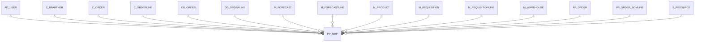

# PP_MRP

Area [PP](../../data-model/pp/index.md) · class **business** (proposed) · read from database `idempiere-db` (owner `ADEMPIERE`) · 56 row(s) when profiled

Application model: `org.eevolution.model.X_PP_MRP`, access level 3 - Client - Org.

## Columns

| column | type | key | not null | business name | references (code) | nulls | distinct |
|---|---|---|---|---|---|---|---|
| `NAME` | VARCHAR2(120 CHAR) |  |  | Name |  | 0 | 3 |
| `AD_ORG_ID` | NUMBER(10,0) |  | yes | Organization |  | 0 | 3 |
| `C_BPARTNER_ID` | NUMBER(10,0) |  |  | Business Partner | [C_BPARTNER](../../data-model/c/c_bpartner.md) | 56 | 0 |
| `C_ORDERLINE_ID` | NUMBER(10,0) |  |  | Sales Order Line | [C_ORDERLINE](../../data-model/c/c_orderline.md) | 56 | 0 |
| `C_ORDER_ID` | NUMBER(10,0) |  |  | Order | [C_ORDER](../../data-model/c/c_order.md) | 56 | 0 |
| `CREATED` | DATE |  | yes | Created |  | 0 | 56 |
| `CREATEDBY` | NUMBER(10,0) |  | yes | Created By |  | 0 | 1 |
| `DATECONFIRM` | DATE |  |  | Date Confirm |  | 56 | 0 |
| `DATEFINISHSCHEDULE` | DATE |  |  | Date Finish Schedule |  | 0 | 6 |
| `DATEORDERED` | DATE |  | yes | Date Ordered |  | 0 | 5 |
| `DATEPROMISED` | DATE |  | yes | Date Promised |  | 0 | 5 |
| `DATESIMULATION` | DATE |  |  | Date Simulation |  | 0 | 56 |
| `DATESTART` | DATE |  |  | Date Start |  | 56 | 0 |
| `DATESTARTSCHEDULE` | DATE |  |  | Date Start Schedule |  | 0 | 5 |
| `DESCRIPTION` | VARCHAR2(1020 CHAR) |  |  | Description |  | 6 | 3 |
| `DOCSTATUS` | VARCHAR2(2 CHAR) |  |  | Document Status |  | 0 | 2 |
| `ISACTIVE` | CHAR(1) |  | yes | Active |  | 0 | 1 |
| `ISAVAILABLE` | CHAR(1) |  |  | Available |  | 0 | 1 |
| `M_FORECASTLINE_ID` | NUMBER(10,0) |  |  | Forecast Line | [M_FORECASTLINE](../../data-model/m/m_forecastline.md) | 6 | 50 |
| `M_FORECAST_ID` | NUMBER(10,0) |  |  | Forecast | [M_FORECAST](../../data-model/m/m_forecast.md) | 6 | 4 |
| `M_PRODUCT_ID` | NUMBER(10,0) |  |  | Product | [M_PRODUCT](../../data-model/m/m_product.md) | 0 | 6 |
| `M_REQUISITIONLINE_ID` | NUMBER(10,0) |  |  | Requisition Line | [M_REQUISITIONLINE](../../data-model/m/m_requisitionline.md) | 56 | 0 |
| `M_REQUISITION_ID` | NUMBER(10,0) |  |  | Requisition | [M_REQUISITION](../../data-model/m/m_requisition.md) | 56 | 0 |
| `M_WAREHOUSE_ID` | NUMBER(10,0) |  | yes | Warehouse | [M_WAREHOUSE](../../data-model/m/m_warehouse.md) | 0 | 4 |
| `PP_MRP_ID` | NUMBER(10,0) | PK | yes | Material Requirement Planning |  | 0 | 56 |
| `PP_ORDER_BOMLINE_ID` | NUMBER(10,0) |  |  | Manufacturing Order BOM Line | [PP_ORDER_BOMLINE](../../data-model/pp/pp_order_bomline.md) | 52 | 4 |
| `PP_ORDER_ID` | NUMBER(10,0) |  |  | Manufacturing Order | [PP_ORDER](../../data-model/pp/pp_order.md) | 50 | 2 |
| `PLANNER_ID` | NUMBER(10,0) |  |  | Planner | [AD_USER](../../data-model/ad/ad_user.md) | 56 | 0 |
| `PRIORITY` | VARCHAR2(10 CHAR) |  |  | Priority |  | 56 | 0 |
| `QTY` | NUMBER |  |  | Quantity |  | 0 | 11 |
| `S_RESOURCE_ID` | NUMBER(10,0) |  |  | Resource | [S_RESOURCE](../../data-model/s/s_resource.md) | 50 | 1 |
| `ORDERTYPE` | VARCHAR2(3 CHAR) |  |  | Order Type |  | 0 | 2 |
| `TYPEMRP` | CHAR(1) |  |  | MRP Type |  | 0 | 2 |
| `UPDATED` | DATE |  | yes | Updated |  | 0 | 56 |
| `UPDATEDBY` | NUMBER(10,0) |  | yes | Updated By |  | 0 | 1 |
| `VALUE` | VARCHAR2(80 CHAR) |  | yes | Search Key |  | 0 | 40 |
| `AD_CLIENT_ID` | NUMBER(10,0) |  | yes | Tenant |  | 0 | 1 |
| `VERSION` | NUMBER |  |  | Version |  | 56 | 0 |
| `DD_ORDER_ID` | NUMBER(10,0) |  |  | Distribution Order | [DD_ORDER](../../data-model/dd/dd_order.md) | 56 | 0 |
| `DD_ORDERLINE_ID` | NUMBER(10,0) |  |  | Distribution Order Line | [DD_ORDERLINE](../../data-model/dd/dd_orderline.md) | 56 | 0 |
| `PP_MRP_UU` | VARCHAR2(36 CHAR) |  |  | PP_MRP_UU |  | 0 | 56 |

*references (code)* is the table the application model's code says a column points to; *Foreign keys* below are the constraints the database declares. Counts come from the profile; no value is ever shown.

## Check constraints

| name | expression |
|---|---|
| `SYS_C0021557` | `IsActive IN ('Y','N')` |
| `SYS_C0021558` | `IsAvailable IN ('Y','N')` |

## Foreign keys

**References**

| table | columns | on delete |
|---|---|---|
| [AD_USER](../../data-model/ad/ad_user.md) | PP_MRP.PLANNER_ID → AD_USER.AD_USER_ID | NO ACTION |
| [C_BPARTNER](../../data-model/c/c_bpartner.md) | PP_MRP.C_BPARTNER_ID → C_BPARTNER.C_BPARTNER_ID | NO ACTION |
| [C_ORDER](../../data-model/c/c_order.md) | PP_MRP.C_ORDER_ID → C_ORDER.C_ORDER_ID | NO ACTION |
| [C_ORDERLINE](../../data-model/c/c_orderline.md) | PP_MRP.C_ORDERLINE_ID → C_ORDERLINE.C_ORDERLINE_ID | NO ACTION |
| [DD_ORDER](../../data-model/dd/dd_order.md) | PP_MRP.DD_ORDER_ID → DD_ORDER.DD_ORDER_ID | NO ACTION |
| [DD_ORDERLINE](../../data-model/dd/dd_orderline.md) | PP_MRP.DD_ORDERLINE_ID → DD_ORDERLINE.DD_ORDERLINE_ID | NO ACTION |
| [M_FORECAST](../../data-model/m/m_forecast.md) | PP_MRP.M_FORECAST_ID → M_FORECAST.M_FORECAST_ID | NO ACTION |
| [M_FORECASTLINE](../../data-model/m/m_forecastline.md) | PP_MRP.M_FORECASTLINE_ID → M_FORECASTLINE.M_FORECASTLINE_ID | NO ACTION |
| [M_PRODUCT](../../data-model/m/m_product.md) | PP_MRP.M_PRODUCT_ID → M_PRODUCT.M_PRODUCT_ID | NO ACTION |
| [M_REQUISITION](../../data-model/m/m_requisition.md) | PP_MRP.M_REQUISITION_ID → M_REQUISITION.M_REQUISITION_ID | NO ACTION |
| [M_REQUISITIONLINE](../../data-model/m/m_requisitionline.md) | PP_MRP.M_REQUISITIONLINE_ID → M_REQUISITIONLINE.M_REQUISITIONLINE_ID | NO ACTION |
| [M_WAREHOUSE](../../data-model/m/m_warehouse.md) | PP_MRP.M_WAREHOUSE_ID → M_WAREHOUSE.M_WAREHOUSE_ID | NO ACTION |
| [PP_ORDER](../../data-model/pp/pp_order.md) | PP_MRP.PP_ORDER_ID → PP_ORDER.PP_ORDER_ID | NO ACTION |
| [PP_ORDER_BOMLINE](../../data-model/pp/pp_order_bomline.md) | PP_MRP.PP_ORDER_BOMLINE_ID → PP_ORDER_BOMLINE.PP_ORDER_BOMLINE_ID | NO ACTION |
| [S_RESOURCE](../../data-model/s/s_resource.md) | PP_MRP.S_RESOURCE_ID → S_RESOURCE.S_RESOURCE_ID | NO ACTION |

**Referenced by**

_None._

## Write behaviour

- updates: **po_only**
- deletes: **deleted_by_users**
- change log: **recorded**
- evidence: 1 citation(s)

## Read by

| kind | name |
|---|---|
| Procedure | [documentNo](../../logic/documentno.md) |
| View | `RV_PP_MRP` |
| View | `rv_pp_mrp` |

## Schema history

63 change(s); the latest:

| applied | release | operation | column | tickets |
|---|---|---|---|---|
| 2023-04-09T15:47 | iD11 | `add_constraint` |  | IDEMPIERE-5567 |
| 2023-04-09T15:47 | iD11 | `add_constraint` |  | IDEMPIERE-5567 |
| 2021-12-05T16:45 | i8.2z | `add_constraint` |  | IDEMPIERE-5075 |
| 2021-12-05T16:45 | i8.2z | `add_constraint` |  | IDEMPIERE-5075 |
| 2021-12-05T16:45 | i8.2z | `add_constraint` |  | IDEMPIERE-5075 |
| 2021-12-05T16:45 | i8.2z | `add_constraint` |  | IDEMPIERE-5075 |
| 2021-12-05T16:45 | i8.2z | `drop_constraint` |  | IDEMPIERE-5075 |
| 2021-12-05T16:45 | i8.2z | `drop_constraint` |  | IDEMPIERE-5075 |
| 2021-12-05T16:45 | i8.2z | `add_constraint` |  | IDEMPIERE-5075 |
| 2021-12-05T16:45 | i8.2z | `add_constraint` |  | IDEMPIERE-5075 |
| 2021-12-05T16:45 | i8.2z | `drop_constraint` |  | IDEMPIERE-5075 |
| 2021-12-05T16:45 | i8.2z | `drop_constraint` |  | IDEMPIERE-5075 |
| 2021-12-05T16:45 | i8.2z | `add_constraint` |  | IDEMPIERE-5075 |
| 2021-12-05T16:45 | i8.2z | `add_constraint` |  | IDEMPIERE-5075 |
| 2021-12-05T16:45 | i8.2z | `drop_constraint` |  | IDEMPIERE-5075 |

## Notes

<!-- ekos:manual id="table.pp_mrp.notes" -->
_Business notes about this table._
<!-- /ekos:manual -->
