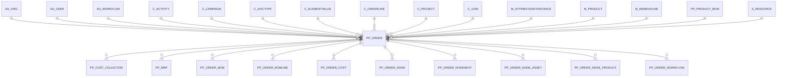

# PP_ORDER

Area [PP](../../data-model/pp/index.md) · class **business** (proposed) · read from database `idempiere-db` (owner `ADEMPIERE`) · 2 row(s) when profiled

Application model: `org.eevolution.model.X_PP_Order`, access level 1 - Org.

## Columns

| column | type | key | not null | business name | references (code) | nulls | distinct |
|---|---|---|---|---|---|---|---|
| `DOCUMENTNO` | VARCHAR2(60 CHAR) |  | yes | Document No |  | 0 | 2 |
| `S_RESOURCE_ID` | NUMBER(10,0) |  | yes | Resource | [S_RESOURCE](../../data-model/s/s_resource.md) | 0 | 1 |
| `M_PRODUCT_ID` | NUMBER(10,0) |  | yes | Product | [M_PRODUCT](../../data-model/m/m_product.md) | 0 | 2 |
| `M_WAREHOUSE_ID` | NUMBER(10,0) |  | yes | Warehouse | [M_WAREHOUSE](../../data-model/m/m_warehouse.md) | 0 | 1 |
| `ASSAY` | NUMBER |  |  | Quantity Assay |  | 0 | 1 |
| `C_ACTIVITY_ID` | NUMBER(10,0) |  |  | Activity | [C_ACTIVITY](../../data-model/c/c_activity.md) | 2 | 0 |
| `C_CAMPAIGN_ID` | NUMBER(10,0) |  |  | Campaign | [C_CAMPAIGN](../../data-model/c/c_campaign.md) | 2 | 0 |
| `C_DOCTYPETARGET_ID` | NUMBER(10,0) |  | yes | Target Document Type | [C_DOCTYPE](../../data-model/c/c_doctype.md) | 0 | 1 |
| `C_DOCTYPE_ID` | NUMBER(10,0) |  |  | Document Type | [C_DOCTYPE](../../data-model/c/c_doctype.md) | 0 | 1 |
| `C_ORDERLINE_ID` | NUMBER(10,0) |  |  | Sales Order Line | [C_ORDERLINE](../../data-model/c/c_orderline.md) | 2 | 0 |
| `C_PROJECT_ID` | NUMBER(10,0) |  |  | Project | [C_PROJECT](../../data-model/c/c_project.md) | 2 | 0 |
| `C_UOM_ID` | NUMBER(10,0) |  | yes | UOM | [C_UOM](../../data-model/c/c_uom.md) | 0 | 1 |
| `COPYFROM` | CHAR(1) |  |  | Copy From |  | 2 | 0 |
| `CREATED` | DATE |  | yes | Created |  | 0 | 2 |
| `CREATEDBY` | NUMBER(10,0) |  | yes | Created By |  | 0 | 1 |
| `DATECONFIRM` | DATE |  |  | Date Confirm |  | 2 | 0 |
| `DATEDELIVERED` | DATE |  |  | Date Delivered |  | 2 | 0 |
| `DATEFINISH` | DATE |  |  | Finish Date |  | 2 | 0 |
| `DATEFINISHSCHEDULE` | DATE |  |  | Date Finish Schedule |  | 0 | 1 |
| `DATEORDERED` | DATE |  | yes | Date Ordered |  | 0 | 1 |
| `DATEPROMISED` | DATE |  | yes | Date Promised |  | 0 | 1 |
| `DATESTART` | DATE |  |  | Date Start |  | 2 | 0 |
| `DATESTARTSCHEDULE` | DATE |  | yes | Date Start Schedule |  | 0 | 1 |
| `DESCRIPTION` | VARCHAR2(510 CHAR) |  |  | Description |  | 2 | 0 |
| `DOCACTION` | CHAR(2) |  | yes | Document Action |  | 0 | 1 |
| `DOCSTATUS` | CHAR(2) |  | yes | Document Status |  | 0 | 1 |
| `FLOATAFTER` | NUMBER |  |  | Float After |  | 2 | 0 |
| `FLOATBEFORED` | NUMBER |  |  | Float Before |  | 2 | 0 |
| `ISACTIVE` | CHAR(1) |  | yes | Active |  | 0 | 1 |
| `ISAPPROVED` | CHAR(1) |  | yes | Approved |  | 0 | 1 |
| `ISPRINTED` | CHAR(1) |  | yes | Printed |  | 0 | 1 |
| `ISQTYPERCENTAGE` | CHAR(1) |  |  | Is Qty Percentage |  | 0 | 1 |
| `ISSOTRX` | CHAR(1) |  | yes | Sales Transaction |  | 0 | 1 |
| `ISSELECTED` | CHAR(1) |  | yes | Selected |  | 0 | 1 |
| `LINE` | NUMBER(10,0) |  | yes | Line No |  | 0 | 1 |
| `LOT` | VARCHAR2(20 CHAR) |  |  | Lot No |  | 2 | 0 |
| `M_ATTRIBUTESETINSTANCE_ID` | NUMBER(10,0) |  |  | Attribute Set Instance | [M_ATTRIBUTESETINSTANCE](../../data-model/m/m_attributesetinstance.md) | 2 | 0 |
| `ORDERTYPE` | VARCHAR2(1 CHAR) |  |  | Order Type |  | 2 | 0 |
| `PP_ORDER_ID` | NUMBER(10,0) | PK | yes | Manufacturing Order |  | 0 | 2 |
| `PP_PRODUCT_BOM_ID` | NUMBER(10,0) |  | yes | BOM &amp; Formula | [PP_PRODUCT_BOM](../../data-model/pp/pp_product_bom.md) | 0 | 2 |
| `PLANNER_ID` | NUMBER(10,0) |  |  | Planner | [AD_USER](../../data-model/ad/ad_user.md) | 0 | 1 |
| `POSTED` | CHAR(1) |  |  | Posted |  | 0 | 1 |
| `PRIORITYRULE` | CHAR(1) |  | yes | Priority |  | 0 | 1 |
| `PROCESSED` | CHAR(1) |  | yes | Processed |  | 0 | 1 |
| `PROCESSING` | CHAR(1) |  |  | Process Now |  | 0 | 1 |
| `QTYBATCHSIZE` | NUMBER |  |  | Qty Batch Size |  | 0 | 1 |
| `QTYBATCHS` | NUMBER |  |  | Qty Batch |  | 0 | 1 |
| `QTYDELIVERED` | NUMBER |  | yes | Delivered Quantity |  | 0 | 1 |
| `QTYENTERED` | NUMBER |  |  | Quantity |  | 0 | 1 |
| `QTYORDERED` | NUMBER |  | yes | Ordered Quantity |  | 0 | 1 |
| `QTYREJECT` | NUMBER |  | yes | Qty Reject |  | 0 | 1 |
| `QTYRESERVED` | NUMBER |  |  | Reserved Quantity |  | 2 | 0 |
| `QTYSCRAP` | NUMBER |  | yes | Scrap % |  | 0 | 1 |
| `SCHEDULETYPE` | VARCHAR2(1 CHAR) |  |  | Schedule Type |  | 0 | 1 |
| `SERNO` | VARCHAR2(20 CHAR) |  |  | Serial No |  | 2 | 0 |
| `UPDATED` | DATE |  | yes | Updated |  | 0 | 2 |
| `UPDATEDBY` | NUMBER(10,0) |  | yes | Updated By |  | 0 | 1 |
| `USER1_ID` | NUMBER(10,0) |  |  | User Element List 1 | [C_ELEMENTVALUE](../../data-model/c/c_elementvalue.md) | 2 | 0 |
| `USER2_ID` | NUMBER(10,0) |  |  | User Element List 2 | [C_ELEMENTVALUE](../../data-model/c/c_elementvalue.md) | 2 | 0 |
| `AD_CLIENT_ID` | NUMBER(10,0) |  | yes | Tenant |  | 0 | 1 |
| `YIELD` | NUMBER |  | yes | Yield % |  | 0 | 1 |
| `AD_ORGTRX_ID` | NUMBER(10,0) |  |  | Trx Organization |  | 2 | 0 |
| `AD_ORG_ID` | NUMBER(10,0) |  | yes | Organization |  | 0 | 1 |
| `AD_WORKFLOW_ID` | NUMBER(10,0) |  | yes | Workflow | [AD_WORKFLOW](../../data-model/ad/ad_workflow.md) | 0 | 1 |
| `PROCESSEDON` | NUMBER |  |  | Processed On |  | 2 | 0 |
| `PP_ORDER_UU` | VARCHAR2(36 CHAR) |  |  | PP_Order_UU |  | 0 | 2 |

*references (code)* is the table the application model's code says a column points to; *Foreign keys* below are the constraints the database declares. Counts come from the profile; no value is ever shown.

## Check constraints

| name | expression |
|---|---|
| `SYS_C0022035` | `IsActive IN ('Y','N')` |
| `SYS_C0022036` | `IsSelected IN ('Y','N')` |
| `SYS_C0022037` | `Processed IN ('Y','N')` |
| `SYS_C0022038` | `IsApproved IN ('Y','N')` |
| `SYS_C0022040` | `IsQtyPercentage IN ('Y','N')` |
| `SYS_C0022041` | `IsSOTrx IN ('Y','N')` |
| `SYS_C0022042` | `IsPrinted IN ('Y','N')` |

## Foreign keys

**References**

| table | columns | on delete |
|---|---|---|
| [AD_ORG](../../data-model/ad/ad_org.md) | PP_ORDER.AD_ORGTRX_ID → AD_ORG.AD_ORG_ID | NO ACTION |
| [AD_USER](../../data-model/ad/ad_user.md) | PP_ORDER.PLANNER_ID → AD_USER.AD_USER_ID | NO ACTION |
| [AD_WORKFLOW](../../data-model/ad/ad_workflow.md) | PP_ORDER.AD_WORKFLOW_ID → AD_WORKFLOW.AD_WORKFLOW_ID | NO ACTION |
| [C_ACTIVITY](../../data-model/c/c_activity.md) | PP_ORDER.C_ACTIVITY_ID → C_ACTIVITY.C_ACTIVITY_ID | NO ACTION |
| [C_CAMPAIGN](../../data-model/c/c_campaign.md) | PP_ORDER.C_CAMPAIGN_ID → C_CAMPAIGN.C_CAMPAIGN_ID | NO ACTION |
| [C_DOCTYPE](../../data-model/c/c_doctype.md) | PP_ORDER.C_DOCTYPETARGET_ID → C_DOCTYPE.C_DOCTYPE_ID | NO ACTION |
| [C_ELEMENTVALUE](../../data-model/c/c_elementvalue.md) | PP_ORDER.USER1_ID → C_ELEMENTVALUE.C_ELEMENTVALUE_ID | NO ACTION |
| [C_ORDERLINE](../../data-model/c/c_orderline.md) | PP_ORDER.C_ORDERLINE_ID → C_ORDERLINE.C_ORDERLINE_ID | NO ACTION |
| [C_PROJECT](../../data-model/c/c_project.md) | PP_ORDER.C_PROJECT_ID → C_PROJECT.C_PROJECT_ID | NO ACTION |
| [C_UOM](../../data-model/c/c_uom.md) | PP_ORDER.C_UOM_ID → C_UOM.C_UOM_ID | NO ACTION |
| [M_ATTRIBUTESETINSTANCE](../../data-model/m/m_attributesetinstance.md) | PP_ORDER.M_ATTRIBUTESETINSTANCE_ID → M_ATTRIBUTESETINSTANCE.M_ATTRIBUTESETINSTANCE_ID | NO ACTION |
| [M_PRODUCT](../../data-model/m/m_product.md) | PP_ORDER.M_PRODUCT_ID → M_PRODUCT.M_PRODUCT_ID | NO ACTION |
| [M_WAREHOUSE](../../data-model/m/m_warehouse.md) | PP_ORDER.M_WAREHOUSE_ID → M_WAREHOUSE.M_WAREHOUSE_ID | NO ACTION |
| [PP_PRODUCT_BOM](../../data-model/pp/pp_product_bom.md) | PP_ORDER.PP_PRODUCT_BOM_ID → PP_PRODUCT_BOM.PP_PRODUCT_BOM_ID | NO ACTION |
| [S_RESOURCE](../../data-model/s/s_resource.md) | PP_ORDER.S_RESOURCE_ID → S_RESOURCE.S_RESOURCE_ID | NO ACTION |

**Referenced by**

| table | columns | on delete |
|---|---|---|
| [PP_COST_COLLECTOR](../../data-model/pp/pp_cost_collector.md) | PP_COST_COLLECTOR.PP_ORDER_ID → PP_ORDER.PP_ORDER_ID | NO ACTION |
| [PP_MRP](../../data-model/pp/pp_mrp.md) | PP_MRP.PP_ORDER_ID → PP_ORDER.PP_ORDER_ID | NO ACTION |
| [PP_ORDER_BOM](../../data-model/pp/pp_order_bom.md) | PP_ORDER_BOM.PP_ORDER_ID → PP_ORDER.PP_ORDER_ID | NO ACTION |
| [PP_ORDER_BOMLINE](../../data-model/pp/pp_order_bomline.md) | PP_ORDER_BOMLINE.PP_ORDER_ID → PP_ORDER.PP_ORDER_ID | NO ACTION |
| [PP_ORDER_COST](../../data-model/pp/pp_order_cost.md) | PP_ORDER_COST.PP_ORDER_ID → PP_ORDER.PP_ORDER_ID | NO ACTION |
| [PP_ORDER_NODE](../../data-model/pp/pp_order_node.md) | PP_ORDER_NODE.PP_ORDER_ID → PP_ORDER.PP_ORDER_ID | NO ACTION |
| [PP_ORDER_NODENEXT](../../data-model/pp/pp_order_nodenext.md) | PP_ORDER_NODENEXT.PP_ORDER_ID → PP_ORDER.PP_ORDER_ID | NO ACTION |
| [PP_ORDER_NODE_ASSET](../../data-model/pp/pp_order_node_asset.md) | PP_ORDER_NODE_ASSET.PP_ORDER_ID → PP_ORDER.PP_ORDER_ID | NO ACTION |
| [PP_ORDER_NODE_PRODUCT](../../data-model/pp/pp_order_node_product.md) | PP_ORDER_NODE_PRODUCT.PP_ORDER_ID → PP_ORDER.PP_ORDER_ID | NO ACTION |
| [PP_ORDER_WORKFLOW](../../data-model/pp/pp_order_workflow.md) | PP_ORDER_WORKFLOW.PP_ORDER_ID → PP_ORDER.PP_ORDER_ID | NO ACTION |

## Write behaviour

- updates: **po_only**
- deletes: **deleted_by_users**
- change log: **recorded**
- evidence: 1 citation(s)

## Read by

| kind | name |
|---|---|
| Procedure | [documentNo](../../logic/documentno.md) |
| View | `PP_ORDER_BOMLINE_V` |
| View | `PP_ORDER_BOMLINE_VT` |
| View | `PP_ORDER_BOM_HEADER_V` |
| View | `PP_ORDER_BOM_HEADER_VT` |
| View | `PP_ORDER_HEADER_V` |
| View | `PP_ORDER_HEADER_VT` |
| View | `PP_ORDER_WORKFLOW_HEADER_V` |
| View | `PP_ORDER_WORKFLOW_HEADER_VT` |
| View | `RV_PP_ORDER` |
| View | `RV_PP_ORDER_BOMLINE` |
| View | `RV_PP_ORDER_STORAGE` |
| View | `RV_PP_ORDER_TRANSACTIONS` |
| View | `pp_order_bom_header_v` |
| View | `pp_order_bom_header_vt` |
| View | `pp_order_bomline_v` |
| View | `pp_order_bomline_vt` |
| View | `pp_order_header_v` |
| View | `pp_order_header_vt` |
| View | `pp_order_workflow_header_v` |
| View | `pp_order_workflow_header_vt` |
| View | `rv_pp_order` |
| View | `rv_pp_order_bomline` |
| View | `rv_pp_order_storage` |
| View | `rv_pp_order_transactions` |

## Schema history

77 change(s); the latest:

| applied | release | operation | column | tickets |
|---|---|---|---|---|
| 2024-05-14T13:59 | iD13 | `add_constraint` |  | IDEMPIERE-5598 |
| 2024-05-14T13:59 | iD13 | `add_column` | C_CostCenter_ID | IDEMPIERE-5598 |
| 2024-05-14T13:59 | iD13 | `add_constraint` |  | IDEMPIERE-5598 |
| 2024-05-14T13:59 | iD13 | `add_column` | C_Department_ID | IDEMPIERE-5598 |
| 2024-05-14T13:59 | iD13 | `add_constraint` |  | IDEMPIERE-5598 |
| 2024-05-14T13:59 | iD13 | `add_constraint` |  | IDEMPIERE-5598 |
| 2024-05-14T13:59 | iD13 | `add_column` | C_CostCenter_ID | IDEMPIERE-5598 |
| 2024-05-14T13:59 | iD13 | `add_column` | C_Department_ID | IDEMPIERE-5598 |
| 2023-04-09T15:47 | iD11 | `add_constraint` |  | IDEMPIERE-5567 |
| 2023-04-09T15:47 | iD11 | `add_constraint` |  | IDEMPIERE-5567 |
| 2021-12-05T16:45 | i8.2z | `drop_constraint` |  | IDEMPIERE-5075 |
| 2021-12-05T16:45 | i8.2z | `add_constraint` |  | IDEMPIERE-5075 |
| 2021-12-05T16:45 | i8.2z | `add_constraint` |  | IDEMPIERE-5075 |
| 2021-12-05T16:45 | i8.2z | `add_constraint` |  | IDEMPIERE-5075 |
| 2021-12-05T16:45 | i8.2z | `add_constraint` |  | IDEMPIERE-5075 |

## Open conflicts

| type | attribute | explanation |
|---|---|---|
| `model_column_missing` | `columns.C_CostCenter_ID` | unexplained |
| `model_column_missing` | `columns.C_Department_ID` | unexplained |

## Notes

<!-- ekos:manual id="table.pp_order.notes" -->
_Business notes about this table._
<!-- /ekos:manual -->
