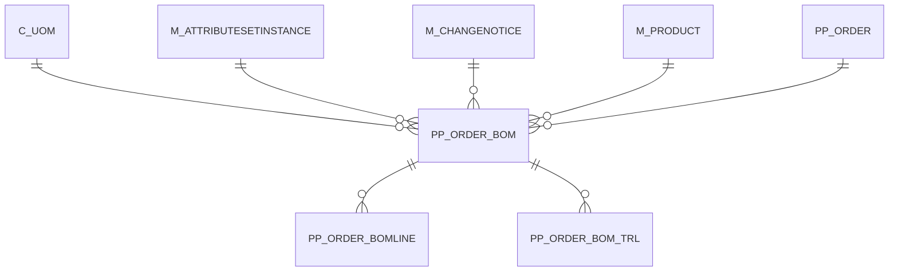

# PP_ORDER_BOM

Area [PP](../../data-model/pp/index.md) · class **business** (proposed) · read from database `idempiere-db` (owner `ADEMPIERE`) · 2 row(s) when profiled

Application model: `org.eevolution.model.X_PP_Order_BOM`, access level 3 - Client - Org.

## Columns

| column | type | key | not null | business name | references (code) | nulls | distinct |
|---|---|---|---|---|---|---|---|
| `NAME` | VARCHAR2(60 CHAR) |  | yes | Name |  | 0 | 2 |
| `AD_ORG_ID` | NUMBER(10,0) |  | yes | Organization |  | 0 | 1 |
| `BOMTYPE` | CHAR(1) |  |  | BOM Type |  | 0 | 1 |
| `BOMUSE` | CHAR(1) |  |  | BOM Use |  | 0 | 1 |
| `C_UOM_ID` | NUMBER(10,0) |  | yes | UOM | [C_UOM](../../data-model/c/c_uom.md) | 0 | 1 |
| `COPYFROM` | CHAR(1) |  |  | Copy From |  | 2 | 0 |
| `CREATED` | DATE |  | yes | Created |  | 0 | 2 |
| `CREATEDBY` | NUMBER(10,0) |  | yes | Created By |  | 0 | 1 |
| `DESCRIPTION` | VARCHAR2(255 CHAR) |  |  | Description |  | 0 | 2 |
| `DOCUMENTNO` | VARCHAR2(20 CHAR) |  |  | Document No |  | 0 | 2 |
| `HELP` | VARCHAR2(2000 CHAR) |  |  | Comment/Help |  | 2 | 0 |
| `ISACTIVE` | CHAR(1) |  | yes | Active |  | 0 | 1 |
| `M_ATTRIBUTESETINSTANCE_ID` | NUMBER(10,0) |  |  | Attribute Set Instance | [M_ATTRIBUTESETINSTANCE](../../data-model/m/m_attributesetinstance.md) | 2 | 0 |
| `M_CHANGENOTICE_ID` | NUMBER(10,0) |  |  | Change Notice | [M_CHANGENOTICE](../../data-model/m/m_changenotice.md) | 2 | 0 |
| `M_PRODUCT_ID` | NUMBER(10,0) |  | yes | Product | [M_PRODUCT](../../data-model/m/m_product.md) | 0 | 2 |
| `PP_ORDER_BOM_ID` | NUMBER(10,0) | PK | yes | Manufacturing Order BOM |  | 0 | 2 |
| `PP_ORDER_ID` | NUMBER(10,0) |  | yes | Manufacturing Order | [PP_ORDER](../../data-model/pp/pp_order.md) | 0 | 2 |
| `PROCESSING` | CHAR(1) |  |  | Process Now |  | 0 | 1 |
| `REVISION` | VARCHAR2(10 CHAR) |  |  | Revision |  | 2 | 0 |
| `UPDATED` | DATE |  | yes | Updated |  | 0 | 2 |
| `UPDATEDBY` | NUMBER(10,0) |  | yes | Updated By |  | 0 | 1 |
| `VALIDFROM` | DATE |  | yes | Valid from |  | 0 | 1 |
| `VALIDTO` | DATE |  |  | Valid to |  | 2 | 0 |
| `AD_CLIENT_ID` | NUMBER(10,0) |  | yes | Tenant |  | 0 | 1 |
| `VALUE` | VARCHAR2(80 CHAR) |  | yes | Search Key |  | 0 | 2 |
| `PP_ORDER_BOM_UU` | VARCHAR2(36 CHAR) |  |  | PP_Order_BOM_UU |  | 0 | 2 |

*references (code)* is the table the application model's code says a column points to; *Foreign keys* below are the constraints the database declares. Counts come from the profile; no value is ever shown.

## Check constraints

| name | expression |
|---|---|
| `SYS_C0022118` | `IsActive IN ('Y','N')` |

## Foreign keys

**References**

| table | columns | on delete |
|---|---|---|
| [C_UOM](../../data-model/c/c_uom.md) | PP_ORDER_BOM.C_UOM_ID → C_UOM.C_UOM_ID | NO ACTION |
| [M_ATTRIBUTESETINSTANCE](../../data-model/m/m_attributesetinstance.md) | PP_ORDER_BOM.M_ATTRIBUTESETINSTANCE_ID → M_ATTRIBUTESETINSTANCE.M_ATTRIBUTESETINSTANCE_ID | NO ACTION |
| [M_CHANGENOTICE](../../data-model/m/m_changenotice.md) | PP_ORDER_BOM.M_CHANGENOTICE_ID → M_CHANGENOTICE.M_CHANGENOTICE_ID | NO ACTION |
| [M_PRODUCT](../../data-model/m/m_product.md) | PP_ORDER_BOM.M_PRODUCT_ID → M_PRODUCT.M_PRODUCT_ID | NO ACTION |
| [PP_ORDER](../../data-model/pp/pp_order.md) | PP_ORDER_BOM.PP_ORDER_ID → PP_ORDER.PP_ORDER_ID | NO ACTION |

**Referenced by**

| table | columns | on delete |
|---|---|---|
| [PP_ORDER_BOMLINE](../../data-model/pp/pp_order_bomline.md) | PP_ORDER_BOMLINE.PP_ORDER_BOM_ID → PP_ORDER_BOM.PP_ORDER_BOM_ID | NO ACTION |
| [PP_ORDER_BOM_TRL](../../data-model/pp/pp_order_bom_trl.md) | PP_ORDER_BOM_TRL.PP_ORDER_BOM_ID → PP_ORDER_BOM.PP_ORDER_BOM_ID | NO ACTION |

## Write behaviour

- updates: **po_only**
- deletes: **deleted_by_users**
- change log: **recorded**
- evidence: 1 citation(s)

## Read by

| kind | name |
|---|---|
| View | `PP_ORDER_BOM_HEADER_V` |
| View | `PP_ORDER_BOM_HEADER_VT` |
| View | `pp_order_bom_header_v` |
| View | `pp_order_bom_header_vt` |

## Schema history

45 change(s); the latest:

| applied | release | operation | column | tickets |
|---|---|---|---|---|
| 2023-04-09T15:47 | iD11 | `add_constraint` |  | IDEMPIERE-5567 |
| 2023-04-09T15:47 | iD11 | `add_constraint` |  | IDEMPIERE-5567 |
| 2021-12-05T16:45 | i8.2z | `drop_constraint` |  | IDEMPIERE-5075 |
| 2021-12-05T16:45 | i8.2z | `drop_constraint` |  | IDEMPIERE-5075 |
| 2021-12-05T16:45 | i8.2z | `add_constraint` |  | IDEMPIERE-5075 |
| 2021-12-05T16:45 | i8.2z | `drop_constraint` |  | IDEMPIERE-5075 |
| 2021-12-05T16:45 | i8.2z | `add_constraint` |  | IDEMPIERE-5075 |
| 2021-12-05T16:45 | i8.2z | `add_constraint` |  | IDEMPIERE-5075 |
| 2021-12-05T16:45 | i8.2z | `add_constraint` |  | IDEMPIERE-5075 |
| 2021-12-05T16:45 | i8.2z | `drop_constraint` |  | IDEMPIERE-5075 |
| 2021-12-05T16:45 | i8.2z | `drop_constraint` |  | IDEMPIERE-5075 |
| 2021-12-05T16:45 | i8.2z | `add_constraint` |  | IDEMPIERE-5075 |
| 2020-08-04T01:00 | i7.1z | `modify_column` | DESCRIPTION | IDEMPIERE-3862 |
| 2020-08-04T01:00 | i7.1z | `add_column` | tmp_col_4_tmp | IDEMPIERE-3862 |
| 2020-08-04T01:00 | i7.1z | `modify_column` | NAME | IDEMPIERE-3862 |

## Notes

<!-- ekos:manual id="table.pp_order_bom.notes" -->
_Business notes about this table._
<!-- /ekos:manual -->
