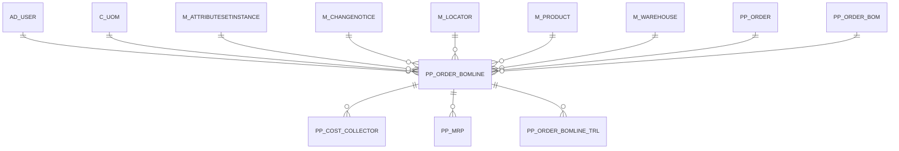

# PP_ORDER_BOMLINE

Area [PP](../../data-model/pp/index.md) · class **business** (proposed) · read from database `idempiere-db` (owner `ADEMPIERE`) · 4 row(s) when profiled

Application model: `org.eevolution.model.X_PP_Order_BOMLine`, access level 3 - Client - Org.

## Columns

| column | type | key | not null | business name | references (code) | nulls | distinct |
|---|---|---|---|---|---|---|---|
| `DESCRIPTION` | VARCHAR2(255 CHAR) |  |  | Description |  | 4 | 0 |
| `FEATURE` | VARCHAR2(30 CHAR) |  |  | Feature |  | 4 | 0 |
| `M_PRODUCT_ID` | NUMBER(10,0) |  | yes | Product | [M_PRODUCT](../../data-model/m/m_product.md) | 0 | 3 |
| `BACKFLUSHGROUP` | VARCHAR2(30 CHAR) |  |  | Backflush Group |  | 4 | 0 |
| `C_UOM_ID` | NUMBER(10,0) |  | yes | UOM | [C_UOM](../../data-model/c/c_uom.md) | 0 | 2 |
| `COMPONENTTYPE` | CHAR(2) |  |  | Component Type |  | 0 | 2 |
| `CREATED` | DATE |  | yes | Created |  | 0 | 4 |
| `CREATEDBY` | NUMBER(10,0) |  | yes | Created By |  | 0 | 1 |
| `DATEDELIVERED` | DATE |  |  | Date Delivered |  | 4 | 0 |
| `FORECAST` | NUMBER |  |  | Forecast |  | 0 | 1 |
| `HELP` | VARCHAR2(2000 CHAR) |  |  | Comment/Help |  | 4 | 0 |
| `ISACTIVE` | CHAR(1) |  | yes | Active |  | 0 | 1 |
| `ISCRITICAL` | CHAR(1) |  | yes | Is Critical Component |  | 0 | 1 |
| `ISQTYPERCENTAGE` | CHAR(1) |  |  | Is Qty Percentage |  | 0 | 1 |
| `ISSUEMETHOD` | CHAR(1) |  |  | Issue Method |  | 0 | 1 |
| `LEADTIMEOFFSET` | NUMBER(10,0) |  |  | Lead Time Offset |  | 0 | 1 |
| `LINE` | NUMBER(10,0) |  | yes | Line No |  | 0 | 2 |
| `M_ATTRIBUTESETINSTANCE_ID` | NUMBER(10,0) |  |  | Attribute Set Instance | [M_ATTRIBUTESETINSTANCE](../../data-model/m/m_attributesetinstance.md) | 4 | 0 |
| `M_CHANGENOTICE_ID` | NUMBER(10,0) |  |  | Change Notice | [M_CHANGENOTICE](../../data-model/m/m_changenotice.md) | 4 | 0 |
| `M_LOCATOR_ID` | NUMBER(10,0) |  |  | Locator | [M_LOCATOR](../../data-model/m/m_locator.md) | 4 | 0 |
| `M_WAREHOUSE_ID` | NUMBER(10,0) |  | yes | Warehouse | [M_WAREHOUSE](../../data-model/m/m_warehouse.md) | 0 | 1 |
| `PP_ORDER_BOMLINE_ID` | NUMBER(10,0) | PK | yes | Manufacturing Order BOM Line |  | 0 | 4 |
| `PP_ORDER_BOM_ID` | NUMBER(10,0) |  | yes | Manufacturing Order BOM | [PP_ORDER_BOM](../../data-model/pp/pp_order_bom.md) | 0 | 2 |
| `PP_ORDER_ID` | NUMBER(10,0) |  | yes | Manufacturing Order | [PP_ORDER](../../data-model/pp/pp_order.md) | 0 | 2 |
| `QTYBOM` | NUMBER |  | yes | Quantity |  | 0 | 3 |
| `QTYBATCH` | NUMBER |  | yes | Quantity in % |  | 0 | 1 |
| `QTYDELIVERED` | NUMBER |  | yes | Delivered Quantity |  | 0 | 1 |
| `QTYENTERED` | NUMBER |  |  | Quantity |  | 0 | 1 |
| `QTYPOST` | NUMBER |  | yes | Qty Post |  | 0 | 1 |
| `QTYREJECT` | NUMBER |  | yes | Qty Reject |  | 0 | 1 |
| `QTYREQUIERED` | NUMBER |  | yes | Qty Required |  | 0 | 3 |
| `QTYRESERVED` | NUMBER |  | yes | Reserved Quantity |  | 0 | 1 |
| `QTYSCRAP` | NUMBER |  | yes | Scrap % |  | 0 | 1 |
| `SCRAP` | NUMBER |  |  | Scrap % |  | 0 | 2 |
| `UPDATED` | DATE |  | yes | Updated |  | 0 | 4 |
| `UPDATEDBY` | NUMBER(10,0) |  | yes | Updated By |  | 0 | 1 |
| `VALIDFROM` | DATE |  | yes | Valid from |  | 0 | 1 |
| `AD_CLIENT_ID` | NUMBER(10,0) |  | yes | Tenant |  | 0 | 1 |
| `VALIDTO` | DATE |  |  | Valid to |  | 4 | 0 |
| `AD_ORG_ID` | NUMBER(10,0) |  | yes | Organization |  | 0 | 1 |
| `ASSAY` | NUMBER |  |  | Quantity Assay |  | 0 | 1 |
| `AD_USER_ID` | NUMBER(10,0) |  |  | User/Contact | [AD_USER](../../data-model/ad/ad_user.md) | 4 | 0 |
| `COSTALLOCATIONPERC` | NUMBER |  |  | Cost Allocation Percent |  | 0 | 1 |
| `PP_ORDER_BOMLINE_UU` | VARCHAR2(36 CHAR) |  |  | PP_Order_BOMLine_UU |  | 0 | 4 |

*references (code)* is the table the application model's code says a column points to; *Foreign keys* below are the constraints the database declares. Counts come from the profile; no value is ever shown.

## Check constraints

| name | expression |
|---|---|
| `SYS_C0022355` | `IsQtyPercentage IN ('Y','N')` |
| `SYS_C0022358` | `IsCritical IN ('Y','N')` |
| `SYS_C0022359` | `IsActive IN ('Y','N')` |

## Foreign keys

**References**

| table | columns | on delete |
|---|---|---|
| [AD_USER](../../data-model/ad/ad_user.md) | PP_ORDER_BOMLINE.AD_USER_ID → AD_USER.AD_USER_ID | NO ACTION |
| [C_UOM](../../data-model/c/c_uom.md) | PP_ORDER_BOMLINE.C_UOM_ID → C_UOM.C_UOM_ID | NO ACTION |
| [M_ATTRIBUTESETINSTANCE](../../data-model/m/m_attributesetinstance.md) | PP_ORDER_BOMLINE.M_ATTRIBUTESETINSTANCE_ID → M_ATTRIBUTESETINSTANCE.M_ATTRIBUTESETINSTANCE_ID | NO ACTION |
| [M_CHANGENOTICE](../../data-model/m/m_changenotice.md) | PP_ORDER_BOMLINE.M_CHANGENOTICE_ID → M_CHANGENOTICE.M_CHANGENOTICE_ID | NO ACTION |
| [M_LOCATOR](../../data-model/m/m_locator.md) | PP_ORDER_BOMLINE.M_LOCATOR_ID → M_LOCATOR.M_LOCATOR_ID | NO ACTION |
| [M_PRODUCT](../../data-model/m/m_product.md) | PP_ORDER_BOMLINE.M_PRODUCT_ID → M_PRODUCT.M_PRODUCT_ID | NO ACTION |
| [M_WAREHOUSE](../../data-model/m/m_warehouse.md) | PP_ORDER_BOMLINE.M_WAREHOUSE_ID → M_WAREHOUSE.M_WAREHOUSE_ID | NO ACTION |
| [PP_ORDER](../../data-model/pp/pp_order.md) | PP_ORDER_BOMLINE.PP_ORDER_ID → PP_ORDER.PP_ORDER_ID | NO ACTION |
| [PP_ORDER_BOM](../../data-model/pp/pp_order_bom.md) | PP_ORDER_BOMLINE.PP_ORDER_BOM_ID → PP_ORDER_BOM.PP_ORDER_BOM_ID | NO ACTION |

**Referenced by**

| table | columns | on delete |
|---|---|---|
| [PP_COST_COLLECTOR](../../data-model/pp/pp_cost_collector.md) | PP_COST_COLLECTOR.PP_ORDER_BOMLINE_ID → PP_ORDER_BOMLINE.PP_ORDER_BOMLINE_ID | NO ACTION |
| [PP_MRP](../../data-model/pp/pp_mrp.md) | PP_MRP.PP_ORDER_BOMLINE_ID → PP_ORDER_BOMLINE.PP_ORDER_BOMLINE_ID | NO ACTION |
| [PP_ORDER_BOMLINE_TRL](../../data-model/pp/pp_order_bomline_trl.md) | PP_ORDER_BOMLINE_TRL.PP_ORDER_BOMLINE_ID → PP_ORDER_BOMLINE.PP_ORDER_BOMLINE_ID | NO ACTION |

## Write behaviour

- updates: **po_only**
- deletes: **deleted_by_users**
- change log: **recorded**
- evidence: 1 citation(s)

## Read by

| kind | name |
|---|---|
| View | `PP_ORDER_BOMLINE_V` |
| View | `PP_ORDER_BOMLINE_VT` |
| View | `RV_PP_ORDER_BOMLINE` |
| View | `RV_PP_ORDER_RECEIPT_ISSUE` |
| View | `RV_PP_ORDER_STORAGE` |
| View | `RV_PP_ORDER_TRANSACTIONS` |
| View | `pp_order_bomline_v` |
| View | `pp_order_bomline_vt` |
| View | `rv_pp_order_bomline` |
| View | `rv_pp_order_receipt_issue` |
| View | `rv_pp_order_storage` |
| View | `rv_pp_order_transactions` |

## Schema history

43 change(s); the latest:

| applied | release | operation | column | tickets |
|---|---|---|---|---|
| 2023-04-09T15:47 | iD11 | `add_constraint` |  | IDEMPIERE-5567 |
| 2023-04-09T15:47 | iD11 | `add_constraint` |  | IDEMPIERE-5567 |
| 2021-12-05T16:45 | i8.2z | `add_constraint` |  | IDEMPIERE-5075 |
| 2021-12-05T16:45 | i8.2z | `drop_constraint` |  | IDEMPIERE-5075 |
| 2021-12-05T16:45 | i8.2z | `drop_constraint` |  | IDEMPIERE-5075 |
| 2021-12-05T16:45 | i8.2z | `drop_constraint` |  | IDEMPIERE-5075 |
| 2021-12-05T16:45 | i8.2z | `add_constraint` |  | IDEMPIERE-5075 |
| 2021-12-05T16:45 | i8.2z | `add_constraint` |  | IDEMPIERE-5075 |
| 2021-12-05T16:45 | i8.2z | `drop_constraint` |  | IDEMPIERE-5075 |
| 2021-12-05T16:45 | i8.2z | `drop_constraint` |  | IDEMPIERE-5075 |
| 2021-12-05T16:45 | i8.2z | `drop_constraint` |  | IDEMPIERE-5075 |
| 2021-12-05T16:45 | i8.2z | `add_constraint` |  | IDEMPIERE-5075 |
| 2021-12-05T16:45 | i8.2z | `add_constraint` |  | IDEMPIERE-5075 |
| 2021-12-05T16:45 | i8.2z | `add_constraint` |  | IDEMPIERE-5075 |
| 2021-12-05T16:45 | i8.2z | `add_constraint` |  | IDEMPIERE-5075 |

## Notes

<!-- ekos:manual id="table.pp_order_bomline.notes" -->
_Business notes about this table._
<!-- /ekos:manual -->
