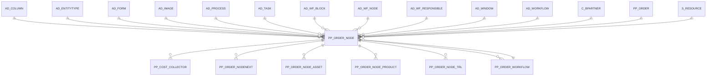

# PP_ORDER_NODE

Area [PP](../../data-model/pp/index.md) · class **business** (proposed) · read from database `idempiere-db` (owner `ADEMPIERE`) · 2 row(s) when profiled

Application model: `org.eevolution.model.X_PP_Order_Node`, access level 3 - Client - Org.

## Columns

| column | type | key | not null | business name | references (code) | nulls | distinct |
|---|---|---|---|---|---|---|---|
| `NAME` | VARCHAR2(60 CHAR) |  | yes | Name |  | 0 | 1 |
| `AD_COLUMN_ID` | NUMBER(10,0) |  |  | Column | [AD_COLUMN](../../data-model/ad/ad_column.md) | 2 | 0 |
| `AD_FORM_ID` | NUMBER(10,0) |  |  | Special Form | [AD_FORM](../../data-model/ad/ad_form.md) | 2 | 0 |
| `AD_IMAGE_ID` | NUMBER(10,0) |  |  | Image | [AD_IMAGE](../../data-model/ad/ad_image.md) | 2 | 0 |
| `AD_ORG_ID` | NUMBER(10,0) |  | yes | Organization |  | 0 | 1 |
| `AD_PROCESS_ID` | NUMBER(10,0) |  |  | Process | [AD_PROCESS](../../data-model/ad/ad_process.md) | 2 | 0 |
| `AD_TASK_ID` | NUMBER(10,0) |  |  | OS Task | [AD_TASK](../../data-model/ad/ad_task.md) | 2 | 0 |
| `AD_WF_BLOCK_ID` | NUMBER(10,0) |  |  | Workflow Block | [AD_WF_BLOCK](../../data-model/ad/ad_wf_block.md) | 2 | 0 |
| `AD_WF_NODE_ID` | NUMBER(10,0) |  | yes | Node | [AD_WF_NODE](../../data-model/ad/ad_wf_node.md) | 0 | 1 |
| `AD_WF_RESPONSIBLE_ID` | NUMBER(10,0) |  |  | Workflow Responsible | [AD_WF_RESPONSIBLE](../../data-model/ad/ad_wf_responsible.md) | 2 | 0 |
| `AD_WINDOW_ID` | NUMBER(10,0) |  |  | Window | [AD_WINDOW](../../data-model/ad/ad_window.md) | 2 | 0 |
| `AD_WORKFLOW_ID` | NUMBER(10,0) |  | yes | Workflow | [AD_WORKFLOW](../../data-model/ad/ad_workflow.md) | 0 | 1 |
| `ACTION` | CHAR(1) |  | yes | Action |  | 0 | 1 |
| `ATTRIBUTENAME` | VARCHAR2(60 CHAR) |  |  | Attribute Name |  | 2 | 0 |
| `ATTRIBUTEVALUE` | VARCHAR2(60 CHAR) |  |  | Attribute Value |  | 2 | 0 |
| `C_BPARTNER_ID` | NUMBER(10,0) |  |  | Business Partner | [C_BPARTNER](../../data-model/c/c_bpartner.md) | 2 | 0 |
| `COST` | NUMBER |  | yes | Cost |  | 0 | 1 |
| `CREATED` | DATE |  | yes | Created |  | 0 | 1 |
| `CREATEDBY` | NUMBER(10,0) |  | yes | Created By |  | 0 | 1 |
| `DATEFINISH` | DATE |  |  | Finish Date |  | 2 | 0 |
| `DATEFINISHSCHEDULE` | DATE |  |  | Date Finish Schedule |  | 2 | 0 |
| `DATESTART` | DATE |  |  | Date Start |  | 2 | 0 |
| `DATESTARTSCHEDULE` | DATE |  |  | Date Start Schedule |  | 2 | 0 |
| `DESCRIPTION` | VARCHAR2(255 CHAR) |  |  | Description |  | 2 | 0 |
| `DOCACTION` | CHAR(2) |  |  | Document Action |  | 0 | 1 |
| `DOCSTATUS` | CHAR(2) |  |  | Document Status |  | 2 | 0 |
| `DURATION` | NUMBER(10,0) |  |  | Duration |  | 0 | 1 |
| `DURATIONREAL` | NUMBER(10,0) |  |  | Duration Real |  | 2 | 0 |
| `DURATIONREQUIERED` | NUMBER(10,0) |  |  | Duration Required |  | 0 | 1 |
| `ENTITYTYPE` | VARCHAR2(40 CHAR) |  | yes | Entity Type |  | 0 | 1 |
| `FINISHMODE` | CHAR(1) |  |  | Finish Mode |  | 2 | 0 |
| `HELP` | VARCHAR2(2000 CHAR) |  |  | Comment/Help |  | 2 | 0 |
| `ISACTIVE` | CHAR(1) |  | yes | Active |  | 0 | 1 |
| `ISCENTRALLYMAINTAINED` | CHAR(1) |  | yes | Centrally maintained |  | 0 | 1 |
| `ISMILESTONE` | CHAR(1) |  |  | Is Milestone |  | 0 | 1 |
| `ISSUBCONTRACTING` | CHAR(1) |  |  | Is Subcontracting |  | 0 | 1 |
| `JOINELEMENT` | CHAR(1) |  | yes | Join Element |  | 0 | 1 |
| `LIMIT` | NUMBER(10,0) |  | yes | Duration Limit |  | 0 | 1 |
| `MOVINGTIME` | NUMBER(10,0) |  |  | Moving Time |  | 0 | 1 |
| `OVERLAPUNITS` | NUMBER(10,0) |  |  | Overlap Units |  | 2 | 0 |
| `PP_ORDER_ID` | NUMBER(10,0) |  | yes | Manufacturing Order | [PP_ORDER](../../data-model/pp/pp_order.md) | 0 | 2 |
| `PP_ORDER_NODE_ID` | NUMBER(10,0) | PK | yes | Manufacturing Order Activity |  | 0 | 2 |
| `PP_ORDER_WORKFLOW_ID` | NUMBER(10,0) |  | yes | Manufacturing Order Workflow | [PP_ORDER_WORKFLOW](../../data-model/pp/pp_order_workflow.md) | 0 | 2 |
| `PRIORITY` | NUMBER(10,0) |  | yes | Priority |  | 0 | 1 |
| `QTYDELIVERED` | NUMBER |  |  | Delivered Quantity |  | 2 | 0 |
| `QTYREJECT` | NUMBER |  |  | Qty Reject |  | 2 | 0 |
| `QTYREQUIERED` | NUMBER |  |  | Qty Required |  | 2 | 0 |
| `QTYSCRAP` | NUMBER |  |  | Scrap % |  | 2 | 0 |
| `QUEUINGTIME` | NUMBER(10,0) |  |  | Queuing Time |  | 0 | 1 |
| `S_RESOURCE_ID` | NUMBER(10,0) |  |  | Resource | [S_RESOURCE](../../data-model/s/s_resource.md) | 0 | 1 |
| `SETUPTIME` | NUMBER(10,0) |  |  | Setup Time |  | 0 | 1 |
| `SETUPTIMEREAL` | NUMBER(10,0) |  |  | Setup Time Real |  | 2 | 0 |
| `SETUPTIMEREQUIERED` | NUMBER(10,0) |  |  | Setup Time Required |  | 0 | 1 |
| `SPLITELEMENT` | CHAR(1) |  | yes | Split Element |  | 0 | 1 |
| `STARTMODE` | CHAR(1) |  |  | Start Mode |  | 2 | 0 |
| `SUBFLOWEXECUTION` | CHAR(1) |  |  | Subflow Execution |  | 2 | 0 |
| `UNITSCYCLES` | NUMBER(10,0) |  |  | Units by Cycles |  | 2 | 0 |
| `UPDATED` | DATE |  | yes | Updated |  | 0 | 2 |
| `UPDATEDBY` | NUMBER(10,0) |  | yes | Updated By |  | 0 | 1 |
| `VALIDFROM` | DATE |  |  | Valid from |  | 2 | 0 |
| `VALIDTO` | DATE |  |  | Valid to |  | 2 | 0 |
| `VALUE` | VARCHAR2(40 CHAR) |  | yes | Search Key |  | 0 | 1 |
| `WAITINGTIME` | NUMBER(10,0) |  | yes | Waiting Time |  | 0 | 1 |
| `WORKFLOW_ID` | NUMBER(10,0) |  |  | Workflow | [AD_WORKFLOW](../../data-model/ad/ad_workflow.md) | 2 | 0 |
| `WORKINGTIME` | NUMBER(10,0) |  | yes | Working Time |  | 0 | 1 |
| `XPOSITION` | NUMBER(10,0) |  | yes | X Position |  | 0 | 1 |
| `AD_CLIENT_ID` | NUMBER(10,0) |  | yes | Tenant |  | 0 | 1 |
| `YPOSITION` | NUMBER(10,0) |  | yes | Y Position |  | 0 | 1 |
| `YIELD` | NUMBER(10,0) |  |  | Yield % |  | 2 | 0 |
| `PP_ORDER_NODE_UU` | VARCHAR2(36 CHAR) |  |  | PP_Order_Node_UU |  | 0 | 2 |

*references (code)* is the table the application model's code says a column points to; *Foreign keys* below are the constraints the database declares. Counts come from the profile; no value is ever shown.

## Check constraints

| name | expression |
|---|---|
| `SYS_C0020689` | `IsActive IN ('Y','N')` |
| `SYS_C0020690` | `IsMilestone IN ('Y','N')` |
| `SYS_C0020691` | `IsCentrallyMaintained IN ('Y','N')` |
| `SYS_C0020693` | `IsSubcontracting IN ('Y','N')` |

## Foreign keys

**References**

| table | columns | on delete |
|---|---|---|
| [AD_COLUMN](../../data-model/ad/ad_column.md) | PP_ORDER_NODE.AD_COLUMN_ID → AD_COLUMN.AD_COLUMN_ID | NO ACTION |
| [AD_ENTITYTYPE](../../data-model/ad/ad_entitytype.md) | PP_ORDER_NODE.ENTITYTYPE → AD_ENTITYTYPE.ENTITYTYPE | NO ACTION |
| [AD_FORM](../../data-model/ad/ad_form.md) | PP_ORDER_NODE.AD_FORM_ID → AD_FORM.AD_FORM_ID | NO ACTION |
| [AD_IMAGE](../../data-model/ad/ad_image.md) | PP_ORDER_NODE.AD_IMAGE_ID → AD_IMAGE.AD_IMAGE_ID | NO ACTION |
| [AD_PROCESS](../../data-model/ad/ad_process.md) | PP_ORDER_NODE.AD_PROCESS_ID → AD_PROCESS.AD_PROCESS_ID | NO ACTION |
| [AD_TASK](../../data-model/ad/ad_task.md) | PP_ORDER_NODE.AD_TASK_ID → AD_TASK.AD_TASK_ID | NO ACTION |
| [AD_WF_BLOCK](../../data-model/ad/ad_wf_block.md) | PP_ORDER_NODE.AD_WF_BLOCK_ID → AD_WF_BLOCK.AD_WF_BLOCK_ID | NO ACTION |
| [AD_WF_NODE](../../data-model/ad/ad_wf_node.md) | PP_ORDER_NODE.AD_WF_NODE_ID → AD_WF_NODE.AD_WF_NODE_ID | NO ACTION |
| [AD_WF_RESPONSIBLE](../../data-model/ad/ad_wf_responsible.md) | PP_ORDER_NODE.AD_WF_RESPONSIBLE_ID → AD_WF_RESPONSIBLE.AD_WF_RESPONSIBLE_ID | NO ACTION |
| [AD_WINDOW](../../data-model/ad/ad_window.md) | PP_ORDER_NODE.AD_WINDOW_ID → AD_WINDOW.AD_WINDOW_ID | NO ACTION |
| [AD_WORKFLOW](../../data-model/ad/ad_workflow.md) | PP_ORDER_NODE.AD_WORKFLOW_ID → AD_WORKFLOW.AD_WORKFLOW_ID | NO ACTION |
| [C_BPARTNER](../../data-model/c/c_bpartner.md) | PP_ORDER_NODE.C_BPARTNER_ID → C_BPARTNER.C_BPARTNER_ID | NO ACTION |
| [PP_ORDER](../../data-model/pp/pp_order.md) | PP_ORDER_NODE.PP_ORDER_ID → PP_ORDER.PP_ORDER_ID | NO ACTION |
| [PP_ORDER_WORKFLOW](../../data-model/pp/pp_order_workflow.md) | PP_ORDER_NODE.PP_ORDER_WORKFLOW_ID → PP_ORDER_WORKFLOW.PP_ORDER_WORKFLOW_ID | NO ACTION |
| [S_RESOURCE](../../data-model/s/s_resource.md) | PP_ORDER_NODE.S_RESOURCE_ID → S_RESOURCE.S_RESOURCE_ID | NO ACTION |

**Referenced by**

| table | columns | on delete |
|---|---|---|
| [PP_COST_COLLECTOR](../../data-model/pp/pp_cost_collector.md) | PP_COST_COLLECTOR.PP_ORDER_NODE_ID → PP_ORDER_NODE.PP_ORDER_NODE_ID | NO ACTION |
| [PP_ORDER_NODENEXT](../../data-model/pp/pp_order_nodenext.md) | PP_ORDER_NODENEXT.PP_ORDER_NEXT_ID → PP_ORDER_NODE.PP_ORDER_NODE_ID | NO ACTION |
| [PP_ORDER_NODE_ASSET](../../data-model/pp/pp_order_node_asset.md) | PP_ORDER_NODE_ASSET.PP_ORDER_NODE_ID → PP_ORDER_NODE.PP_ORDER_NODE_ID | NO ACTION |
| [PP_ORDER_NODE_PRODUCT](../../data-model/pp/pp_order_node_product.md) | PP_ORDER_NODE_PRODUCT.PP_ORDER_NODE_ID → PP_ORDER_NODE.PP_ORDER_NODE_ID | NO ACTION |
| [PP_ORDER_NODE_TRL](../../data-model/pp/pp_order_node_trl.md) | PP_ORDER_NODE_TRL.PP_ORDER_NODE_ID → PP_ORDER_NODE.PP_ORDER_NODE_ID | NO ACTION |
| [PP_ORDER_WORKFLOW](../../data-model/pp/pp_order_workflow.md) | PP_ORDER_WORKFLOW.PP_ORDER_NODE_ID → PP_ORDER_NODE.PP_ORDER_NODE_ID | NO ACTION |

## Write behaviour

- updates: **po_only**
- deletes: **deleted_by_users**
- change log: **recorded**
- evidence: 1 citation(s)

## Read by

| kind | name |
|---|---|
| View | `PP_ORDER_NODE_V` |
| View | `PP_ORDER_NODE_VT` |
| View | `RV_PP_OPERATION_ACTIVITY` |
| View | `RV_PP_ORDER_WORKFLOW` |
| View | `pp_order_node_v` |
| View | `pp_order_node_vt` |
| View | `rv_pp_operation_activity` |
| View | `rv_pp_order_workflow` |

## Schema history

68 change(s); the latest:

| applied | release | operation | column | tickets |
|---|---|---|---|---|
| 2023-04-09T15:47 | iD11 | `add_constraint` |  | IDEMPIERE-5567 |
| 2023-04-09T15:47 | iD11 | `add_constraint` |  | IDEMPIERE-5567 |
| 2021-12-05T16:45 | i8.2z | `add_constraint` |  | IDEMPIERE-5075 |
| 2021-12-05T16:45 | i8.2z | `add_constraint` |  | IDEMPIERE-5075 |
| 2021-12-05T16:45 | i8.2z | `drop_constraint` |  | IDEMPIERE-5075 |
| 2021-12-05T16:45 | i8.2z | `drop_constraint` |  | IDEMPIERE-5075 |
| 2021-12-05T16:45 | i8.2z | `drop_constraint` |  | IDEMPIERE-5075 |
| 2021-12-05T16:45 | i8.2z | `drop_constraint` |  | IDEMPIERE-5075 |
| 2021-12-05T16:45 | i8.2z | `add_constraint` |  | IDEMPIERE-5075 |
| 2021-12-05T16:45 | i8.2z | `add_constraint` |  | IDEMPIERE-5075 |
| 2021-12-05T16:45 | i8.2z | `add_constraint` |  | IDEMPIERE-5075 |
| 2021-12-05T16:45 | i8.2z | `drop_constraint` |  | IDEMPIERE-5075 |
| 2021-12-05T16:45 | i8.2z | `drop_constraint` |  | IDEMPIERE-5075 |
| 2021-12-05T16:45 | i8.2z | `drop_constraint` |  | IDEMPIERE-5075 |
| 2021-12-05T16:45 | i8.2z | `drop_constraint` |  | IDEMPIERE-5075 |

## Notes

<!-- ekos:manual id="table.pp_order_node.notes" -->
_Business notes about this table._
<!-- /ekos:manual -->
