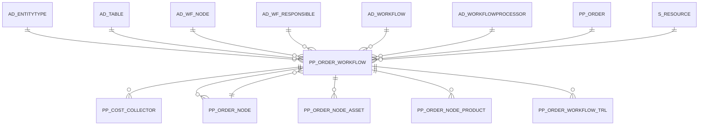

# PP_ORDER_WORKFLOW

Area [PP](../../data-model/pp/index.md) · class **business** (proposed) · read from database `idempiere-db` (owner `ADEMPIERE`) · 2 row(s) when profiled

Application model: `org.eevolution.model.X_PP_Order_Workflow`, access level 3 - Client - Org.

## Columns

| column | type | key | not null | business name | references (code) | nulls | distinct |
|---|---|---|---|---|---|---|---|
| `WORKFLOWTYPE` | CHAR(1) |  |  | Workflow Type |  | 0 | 1 |
| `NAME` | VARCHAR2(60 CHAR) |  | yes | Name |  | 0 | 1 |
| `AD_TABLE_ID` | NUMBER(10,0) |  |  | Table | [AD_TABLE](../../data-model/ad/ad_table.md) | 2 | 0 |
| `AD_WF_NODE_ID` | NUMBER(10,0) |  |  | Node | [AD_WF_NODE](../../data-model/ad/ad_wf_node.md) | 0 | 1 |
| `AD_WF_RESPONSIBLE_ID` | NUMBER(10,0) |  |  | Workflow Responsible | [AD_WF_RESPONSIBLE](../../data-model/ad/ad_wf_responsible.md) | 2 | 0 |
| `AD_WORKFLOWPROCESSOR_ID` | NUMBER(10,0) |  |  | Workflow Processor | [AD_WORKFLOWPROCESSOR](../../data-model/ad/ad_workflowprocessor.md) | 2 | 0 |
| `AD_WORKFLOW_ID` | NUMBER(10,0) |  | yes | Workflow | [AD_WORKFLOW](../../data-model/ad/ad_workflow.md) | 0 | 1 |
| `ACCESSLEVEL` | CHAR(1) |  | yes | Data Access Level |  | 0 | 1 |
| `AUTHOR` | VARCHAR2(20 CHAR) |  | yes | Author |  | 0 | 1 |
| `COST` | NUMBER |  |  | Cost |  | 0 | 1 |
| `CREATED` | DATE |  | yes | Created |  | 0 | 1 |
| `CREATEDBY` | NUMBER(10,0) |  | yes | Created By |  | 0 | 1 |
| `DESCRIPTION` | VARCHAR2(255 CHAR) |  |  | Description |  | 0 | 1 |
| `DOCUMENTNO` | VARCHAR2(32 CHAR) |  |  | Document No |  | 0 | 2 |
| `DURATION` | NUMBER(10,0) |  | yes | Duration |  | 0 | 1 |
| `DURATIONUNIT` | CHAR(1) |  | yes | Duration Unit |  | 0 | 1 |
| `ENTITYTYPE` | VARCHAR2(40 CHAR) |  | yes | Entity Type |  | 0 | 1 |
| `HELP` | VARCHAR2(2000 CHAR) |  |  | Comment/Help |  | 2 | 0 |
| `ISACTIVE` | CHAR(1) |  | yes | Active |  | 0 | 1 |
| `ISDEFAULT` | CHAR(1) |  |  | Default |  | 0 | 1 |
| `LIMIT` | NUMBER(10,0) |  | yes | Duration Limit |  | 0 | 1 |
| `MOVINGTIME` | NUMBER(10,0) |  |  | Moving Time |  | 0 | 1 |
| `PP_ORDER_ID` | NUMBER(10,0) |  | yes | Manufacturing Order | [PP_ORDER](../../data-model/pp/pp_order.md) | 0 | 2 |
| `PP_ORDER_NODE_ID` | NUMBER(10,0) |  |  | Manufacturing Order Activity | [PP_ORDER_NODE](../../data-model/pp/pp_order_node.md) | 0 | 2 |
| `PP_ORDER_WORKFLOW_ID` | NUMBER(10,0) | PK | yes | Manufacturing Order Workflow |  | 0 | 2 |
| `PRIORITY` | NUMBER(10,0) |  | yes | Priority |  | 0 | 1 |
| `PROCESSTYPE` | CHAR(2) |  |  | Process Type |  | 0 | 1 |
| `PUBLISHSTATUS` | CHAR(1) |  | yes | Publication Status |  | 0 | 1 |
| `QTYBATCHSIZE` | NUMBER |  |  | Qty Batch Size |  | 0 | 1 |
| `QUEUINGTIME` | NUMBER(10,0) |  |  | Queuing Time |  | 0 | 1 |
| `S_RESOURCE_ID` | NUMBER(10,0) |  |  | Resource | [S_RESOURCE](../../data-model/s/s_resource.md) | 0 | 1 |
| `SETUPTIME` | NUMBER(10,0) |  |  | Setup Time |  | 0 | 1 |
| `UPDATED` | DATE |  | yes | Updated |  | 0 | 2 |
| `UPDATEDBY` | NUMBER(10,0) |  | yes | Updated By |  | 0 | 1 |
| `VALIDFROM` | DATE |  |  | Valid from |  | 2 | 0 |
| `VALIDTO` | DATE |  |  | Valid to |  | 2 | 0 |
| `VALIDATEWORKFLOW` | CHAR(1) |  |  | Validate Workflow |  | 0 | 1 |
| `VALUE` | VARCHAR2(240 CHAR) |  |  | Search Key |  | 0 | 1 |
| `VERSION` | NUMBER(10,0) |  | yes | Version |  | 0 | 1 |
| `WAITINGTIME` | NUMBER(10,0) |  | yes | Waiting Time |  | 0 | 1 |
| `AD_CLIENT_ID` | NUMBER(10,0) |  | yes | Tenant |  | 0 | 1 |
| `WORKINGTIME` | NUMBER(10,0) |  |  | Working Time |  | 0 | 1 |
| `AD_ORG_ID` | NUMBER(10,0) |  | yes | Organization |  | 0 | 1 |
| `YIELD` | NUMBER(10,0) |  |  | Yield % |  | 2 | 0 |
| `UNITSCYCLES` | NUMBER |  |  | Units by Cycles |  | 2 | 0 |
| `OVERLAPUNITS` | NUMBER |  |  | Overlap Units |  | 2 | 0 |
| `PP_ORDER_WORKFLOW_UU` | VARCHAR2(36 CHAR) |  |  | PP_Order_Workflow_UU |  | 0 | 2 |

*references (code)* is the table the application model's code says a column points to; *Foreign keys* below are the constraints the database declares. Counts come from the profile; no value is ever shown.

## Check constraints

| name | expression |
|---|---|
| `SYS_C0020943` | `IsActive IN ('Y','N')` |
| `SYS_C0020944` | `IsDefault IN ('Y','N')` |

## Foreign keys

**References**

| table | columns | on delete |
|---|---|---|
| [AD_ENTITYTYPE](../../data-model/ad/ad_entitytype.md) | PP_ORDER_WORKFLOW.ENTITYTYPE → AD_ENTITYTYPE.ENTITYTYPE | NO ACTION |
| [AD_TABLE](../../data-model/ad/ad_table.md) | PP_ORDER_WORKFLOW.AD_TABLE_ID → AD_TABLE.AD_TABLE_ID | NO ACTION |
| [AD_WF_NODE](../../data-model/ad/ad_wf_node.md) | PP_ORDER_WORKFLOW.AD_WF_NODE_ID → AD_WF_NODE.AD_WF_NODE_ID | NO ACTION |
| [AD_WF_RESPONSIBLE](../../data-model/ad/ad_wf_responsible.md) | PP_ORDER_WORKFLOW.AD_WF_RESPONSIBLE_ID → AD_WF_RESPONSIBLE.AD_WF_RESPONSIBLE_ID | NO ACTION |
| [AD_WORKFLOW](../../data-model/ad/ad_workflow.md) | PP_ORDER_WORKFLOW.AD_WORKFLOW_ID → AD_WORKFLOW.AD_WORKFLOW_ID | NO ACTION |
| [AD_WORKFLOWPROCESSOR](../../data-model/ad/ad_workflowprocessor.md) | PP_ORDER_WORKFLOW.AD_WORKFLOWPROCESSOR_ID → AD_WORKFLOWPROCESSOR.AD_WORKFLOWPROCESSOR_ID | NO ACTION |
| [PP_ORDER](../../data-model/pp/pp_order.md) | PP_ORDER_WORKFLOW.PP_ORDER_ID → PP_ORDER.PP_ORDER_ID | NO ACTION |
| [PP_ORDER_NODE](../../data-model/pp/pp_order_node.md) | PP_ORDER_WORKFLOW.PP_ORDER_NODE_ID → PP_ORDER_NODE.PP_ORDER_NODE_ID | NO ACTION |
| [S_RESOURCE](../../data-model/s/s_resource.md) | PP_ORDER_WORKFLOW.S_RESOURCE_ID → S_RESOURCE.S_RESOURCE_ID | NO ACTION |

**Referenced by**

| table | columns | on delete |
|---|---|---|
| [PP_COST_COLLECTOR](../../data-model/pp/pp_cost_collector.md) | PP_COST_COLLECTOR.PP_ORDER_WORKFLOW_ID → PP_ORDER_WORKFLOW.PP_ORDER_WORKFLOW_ID | NO ACTION |
| [PP_ORDER_NODE](../../data-model/pp/pp_order_node.md) | PP_ORDER_NODE.PP_ORDER_WORKFLOW_ID → PP_ORDER_WORKFLOW.PP_ORDER_WORKFLOW_ID | NO ACTION |
| [PP_ORDER_NODE_ASSET](../../data-model/pp/pp_order_node_asset.md) | PP_ORDER_NODE_ASSET.PP_ORDER_WORKFLOW_ID → PP_ORDER_WORKFLOW.PP_ORDER_WORKFLOW_ID | NO ACTION |
| [PP_ORDER_NODE_PRODUCT](../../data-model/pp/pp_order_node_product.md) | PP_ORDER_NODE_PRODUCT.PP_ORDER_WORKFLOW_ID → PP_ORDER_WORKFLOW.PP_ORDER_WORKFLOW_ID | NO ACTION |
| [PP_ORDER_WORKFLOW_TRL](../../data-model/pp/pp_order_workflow_trl.md) | PP_ORDER_WORKFLOW_TRL.PP_ORDER_WORKFLOW_ID → PP_ORDER_WORKFLOW.PP_ORDER_WORKFLOW_ID | NO ACTION |

## Write behaviour

- updates: **po_only**
- deletes: **deleted_by_users**
- change log: **recorded**
- evidence: 1 citation(s)

## Read by

| kind | name |
|---|---|
| View | `PP_ORDER_WORKFLOW_HEADER_V` |
| View | `PP_ORDER_WORKFLOW_HEADER_VT` |
| View | `RV_PP_ORDER_WORKFLOW` |
| View | `pp_order_workflow_header_v` |
| View | `pp_order_workflow_header_vt` |
| View | `rv_pp_order_workflow` |

## Schema history

54 change(s); the latest:

| applied | release | operation | column | tickets |
|---|---|---|---|---|
| 2023-04-09T15:47 | iD11 | `add_constraint` |  | IDEMPIERE-5567 |
| 2023-04-09T15:47 | iD11 | `add_constraint` |  | IDEMPIERE-5567 |
| 2021-12-05T16:45 | i8.2z | `add_constraint` |  | IDEMPIERE-5075 |
| 2021-12-05T16:45 | i8.2z | `drop_constraint` |  | IDEMPIERE-5075 |
| 2021-12-05T16:45 | i8.2z | `drop_constraint` |  | IDEMPIERE-5075 |
| 2021-12-05T16:45 | i8.2z | `drop_constraint` |  | IDEMPIERE-5075 |
| 2021-12-05T16:45 | i8.2z | `add_constraint` |  | IDEMPIERE-5075 |
| 2021-12-05T16:45 | i8.2z | `add_constraint` |  | IDEMPIERE-5075 |
| 2021-12-05T16:45 | i8.2z | `add_constraint` |  | IDEMPIERE-5075 |
| 2021-12-05T16:45 | i8.2z | `drop_constraint` |  | IDEMPIERE-5075 |
| 2021-12-05T16:45 | i8.2z | `drop_constraint` |  | IDEMPIERE-5075 |
| 2021-12-05T16:45 | i8.2z | `add_constraint` |  | IDEMPIERE-5075 |
| 2021-12-05T16:45 | i8.2z | `add_constraint` |  | IDEMPIERE-5075 |
| 2021-12-05T16:45 | i8.2z | `add_constraint` |  | IDEMPIERE-5075 |
| 2021-12-05T16:45 | i8.2z | `add_constraint` |  | IDEMPIERE-5075 |

## Open conflicts

| type | attribute | explanation |
|---|---|---|
| `mandatory_but_nullable` | `columns.Cost.nullable` | unexplained |

## Notes

<!-- ekos:manual id="table.pp_order_workflow.notes" -->
_Business notes about this table._
<!-- /ekos:manual -->
