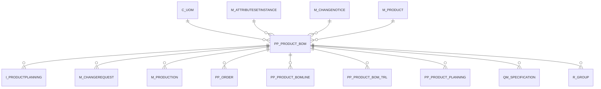

# PP_PRODUCT_BOM

Area [PP](../../data-model/pp/index.md) · class **business** (proposed) · read from database `idempiere-db` (owner `ADEMPIERE`) · 7 row(s) when profiled

Application model: `org.eevolution.model.X_PP_Product_BOM`, access level 3 - Client - Org.

## Columns

| column | type | key | not null | business name | references (code) | nulls | distinct |
|---|---|---|---|---|---|---|---|
| `VALUE` | VARCHAR2(80 CHAR) |  | yes | Search Key |  | 0 | 7 |
| `NAME` | VARCHAR2(60 CHAR) |  | yes | Name |  | 0 | 7 |
| `DOCUMENTNO` | VARCHAR2(22 CHAR) |  |  |  |  | 0 | 7 |
| `REVISION` | VARCHAR2(10 CHAR) |  |  | Revision |  | 7 | 0 |
| `DESCRIPTION` | VARCHAR2(255 CHAR) |  |  | Description |  | 3 | 4 |
| `COPYFROM` | CHAR(1) |  |  | Copy From |  | 1 | 1 |
| `CREATED` | DATE |  | yes | Created |  | 0 | 7 |
| `CREATEDBY` | NUMBER(10,0) |  | yes | Created By |  | 0 | 1 |
| `HELP` | VARCHAR2(2000 CHAR) |  |  | Comment/Help |  | 7 | 0 |
| `ISACTIVE` | CHAR(1) |  | yes | Active |  | 0 | 1 |
| `AD_CLIENT_ID` | NUMBER(10,0) |  | yes | Tenant |  | 0 | 1 |
| `M_CHANGENOTICE_ID` | NUMBER(10,0) |  |  | Change Notice | [M_CHANGENOTICE](../../data-model/m/m_changenotice.md) | 7 | 0 |
| `M_PRODUCT_ID` | NUMBER(10,0) |  | yes | Product | [M_PRODUCT](../../data-model/m/m_product.md) | 0 | 7 |
| `PP_PRODUCT_BOM_ID` | NUMBER(10,0) | PK | yes | BOM &amp; Formula |  | 0 | 7 |
| `PROCESSING` | CHAR(1) |  |  | Process Now |  | 1 | 1 |
| `UPDATED` | DATE |  | yes | Updated |  | 0 | 7 |
| `UPDATEDBY` | NUMBER(10,0) |  | yes | Updated By |  | 0 | 1 |
| `VALIDFROM` | DATE |  |  | Valid from |  | 0 | 2 |
| `VALIDTO` | DATE |  |  | Valid to |  | 7 | 0 |
| `M_ATTRIBUTESETINSTANCE_ID` | NUMBER(10,0) |  |  | Attribute Set Instance | [M_ATTRIBUTESETINSTANCE](../../data-model/m/m_attributesetinstance.md) | 7 | 0 |
| `AD_ORG_ID` | NUMBER(10,0) |  | yes | Organization |  | 0 | 1 |
| `BOMTYPE` | CHAR(1) |  |  | BOM Type |  | 0 | 1 |
| `BOMUSE` | CHAR(1) |  |  | BOM Use |  | 0 | 1 |
| `C_UOM_ID` | NUMBER(10,0) |  |  | UOM | [C_UOM](../../data-model/c/c_uom.md) | 0 | 2 |
| `PP_PRODUCT_BOM_UU` | VARCHAR2(36 CHAR) |  |  | PP_Product_BOM_UU |  | 0 | 7 |

*references (code)* is the table the application model's code says a column points to; *Foreign keys* below are the constraints the database declares. Counts come from the profile; no value is ever shown.

## Check constraints

| name | expression |
|---|---|
| `SYS_C0020840` | `IsActive IN ('Y','N')` |

## Foreign keys

**References**

| table | columns | on delete |
|---|---|---|
| [C_UOM](../../data-model/c/c_uom.md) | PP_PRODUCT_BOM.C_UOM_ID → C_UOM.C_UOM_ID | NO ACTION |
| [M_ATTRIBUTESETINSTANCE](../../data-model/m/m_attributesetinstance.md) | PP_PRODUCT_BOM.M_ATTRIBUTESETINSTANCE_ID → M_ATTRIBUTESETINSTANCE.M_ATTRIBUTESETINSTANCE_ID | NO ACTION |
| [M_CHANGENOTICE](../../data-model/m/m_changenotice.md) | PP_PRODUCT_BOM.M_CHANGENOTICE_ID → M_CHANGENOTICE.M_CHANGENOTICE_ID | NO ACTION |
| [M_PRODUCT](../../data-model/m/m_product.md) | PP_PRODUCT_BOM.M_PRODUCT_ID → M_PRODUCT.M_PRODUCT_ID | NO ACTION |

**Referenced by**

| table | columns | on delete |
|---|---|---|
| `I_PRODUCTPLANNING` | I_PRODUCTPLANNING.PP_PRODUCT_BOM_ID → PP_PRODUCT_BOM.PP_PRODUCT_BOM_ID | NO ACTION |
| [M_CHANGEREQUEST](../../data-model/m/m_changerequest.md) | M_CHANGEREQUEST.PP_PRODUCT_BOM_ID → PP_PRODUCT_BOM.PP_PRODUCT_BOM_ID | NO ACTION |
| [M_PRODUCTION](../../data-model/m/m_production.md) | M_PRODUCTION.PP_PRODUCT_BOM_ID → PP_PRODUCT_BOM.PP_PRODUCT_BOM_ID | NO ACTION |
| [PP_ORDER](../../data-model/pp/pp_order.md) | PP_ORDER.PP_PRODUCT_BOM_ID → PP_PRODUCT_BOM.PP_PRODUCT_BOM_ID | NO ACTION |
| [PP_PRODUCT_BOMLINE](../../data-model/pp/pp_product_bomline.md) | PP_PRODUCT_BOMLINE.PP_PRODUCT_BOM_ID → PP_PRODUCT_BOM.PP_PRODUCT_BOM_ID | NO ACTION |
| [PP_PRODUCT_BOM_TRL](../../data-model/pp/pp_product_bom_trl.md) | PP_PRODUCT_BOM_TRL.PP_PRODUCT_BOM_ID → PP_PRODUCT_BOM.PP_PRODUCT_BOM_ID | NO ACTION |
| [PP_PRODUCT_PLANNING](../../data-model/pp/pp_product_planning.md) | PP_PRODUCT_PLANNING.PP_PRODUCT_BOM_ID → PP_PRODUCT_BOM.PP_PRODUCT_BOM_ID | NO ACTION |
| [QM_SPECIFICATION](../../data-model/qm/qm_specification.md) | QM_SPECIFICATION.PP_PRODUCT_BOM_ID → PP_PRODUCT_BOM.PP_PRODUCT_BOM_ID | NO ACTION |
| [R_GROUP](../../data-model/r/r_group.md) | R_GROUP.PP_PRODUCT_BOM_ID → PP_PRODUCT_BOM.PP_PRODUCT_BOM_ID | NO ACTION |

## Write behaviour

- updates: **po_only**
- deletes: **deleted_by_users**
- change log: **recorded**
- evidence: 1 citation(s)

## Read by

| kind | name |
|---|---|
| Procedure | [Bomqtyonhand](../../logic/bomqtyonhand.md) |
| Procedure | [BomqtyonhandASI](../../logic/bomqtyonhandasi.md) |
| Procedure | [Bomqtyordered](../../logic/bomqtyordered.md) |
| Procedure | [BomqtyorderedASI](../../logic/bomqtyorderedasi.md) |
| Procedure | [Bomqtyreserved](../../logic/bomqtyreserved.md) |
| Procedure | [BomqtyreservedASI](../../logic/bomqtyreservedasi.md) |
| View | `C_INVOICE_LINETAX_V` |
| View | `C_INVOICE_LINETAX_VT` |
| View | `C_ORDER_LINETAX_V` |
| View | `C_ORDER_LINETAX_VT` |
| View | `M_INOUT_LINE_V` |
| View | `M_INOUT_LINE_VT` |
| View | `M_PRODUCT_BOM` |
| View | `RV_M_PRODUCT_WHEREUSED_V` |
| View | `c_invoice_linetax_v` |
| View | `c_invoice_linetax_vt` |
| View | `c_order_linetax_v` |
| View | `c_order_linetax_vt` |
| View | `m_inout_line_v` |
| View | `m_inout_line_vt` |
| View | `m_product_bom` |
| View | `pp_product_bom_header_v` |
| View | `pp_product_bom_header_vt` |
| View | `rv_m_product_whereused_v` |

## Schema history

50 change(s); the latest:

| applied | release | operation | column | tickets |
|---|---|---|---|---|
| 2024-04-03T14:29 | iD11 | `create_index` |  | IDEMPIERE-6086 |
| 2024-04-03T14:29 | iD11 | `create_index` |  | IDEMPIERE-6086 |
| 2023-04-09T15:47 | iD11 | `add_constraint` |  | IDEMPIERE-5567 |
| 2023-04-09T15:47 | iD11 | `add_constraint` |  | IDEMPIERE-5567 |
| 2021-12-05T16:45 | i8.2z | `drop_constraint` |  | IDEMPIERE-5075 |
| 2021-12-05T16:45 | i8.2z | `add_constraint` |  | IDEMPIERE-5075 |
| 2021-12-05T16:45 | i8.2z | `drop_constraint` |  | IDEMPIERE-5075 |
| 2021-12-05T16:45 | i8.2z | `add_constraint` |  | IDEMPIERE-5075 |
| 2021-12-05T16:45 | i8.2z | `add_constraint` |  | IDEMPIERE-5075 |
| 2021-12-05T16:45 | i8.2z | `add_constraint` |  | IDEMPIERE-5075 |
| 2021-12-05T16:45 | i8.2z | `drop_constraint` |  | IDEMPIERE-5075 |
| 2021-12-05T16:45 | i8.2z | `drop_constraint` |  | IDEMPIERE-5075 |
| 2021-09-29T16:00 | i8.2z | `modify_column` | ValidFrom | IDEMPIERE-1250 |
| 2021-09-29T16:00 | i8.2z | `modify_column` | ValidFrom | IDEMPIERE-1250 |
| 2021-09-29T16:00 | i8.2z | `modify_column` | ValidFrom | IDEMPIERE-1250 |

## Notes

<!-- ekos:manual id="table.pp_product_bom.notes" -->
_Business notes about this table._
<!-- /ekos:manual -->
