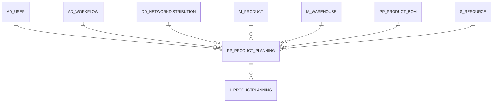

# PP_PRODUCT_PLANNING

Area [PP](../../data-model/pp/index.md) · class **business** (proposed) · read from database `idempiere-db` (owner `ADEMPIERE`) · 219 row(s) when profiled

Application model: `org.eevolution.model.X_PP_Product_Planning`, access level 3 - Client - Org.

## Columns

| column | type | key | not null | business name | references (code) | nulls | distinct |
|---|---|---|---|---|---|---|---|
| `AD_CLIENT_ID` | NUMBER(10,0) |  | yes | Tenant |  | 0 | 1 |
| `AD_ORG_ID` | NUMBER(10,0) |  | yes | Organization |  | 0 | 7 |
| `AD_WORKFLOW_ID` | NUMBER(10,0) |  |  | Workflow | [AD_WORKFLOW](../../data-model/ad/ad_workflow.md) | 213 | 4 |
| `CREATED` | DATE |  | yes | Created |  | 0 | 153 |
| `CREATEDBY` | NUMBER(10,0) |  | yes | Created By |  | 0 | 1 |
| `DELIVERYTIME_PROMISED` | NUMBER |  |  | Promised Delivery Time |  | 0 | 3 |
| `ISACTIVE` | CHAR(1) |  | yes | Active |  | 0 | 1 |
| `ISCREATEPLAN` | CHAR(1) |  | yes | Create Plan |  | 0 | 1 |
| `ISISSUE` | CHAR(1) |  | yes |  |  | 0 | 1 |
| `ISMPS` | CHAR(1) |  |  | Is MPS |  | 0 | 1 |
| `ISPHANTOM` | CHAR(1) |  | yes | Phantom |  | 0 | 2 |
| `ISREQUIREDMRP` | CHAR(1) |  | yes | Required Calculate MRP |  | 0 | 1 |
| `M_PRODUCT_ID` | NUMBER(10,0) |  | yes | Product | [M_PRODUCT](../../data-model/m/m_product.md) | 0 | 53 |
| `M_WAREHOUSE_ID` | NUMBER(10,0) |  |  | Warehouse | [M_WAREHOUSE](../../data-model/m/m_warehouse.md) | 0 | 7 |
| `ORDER_MAX` | NUMBER |  |  | Maximum Order Qty |  | 0 | 1 |
| `ORDER_MIN` | NUMBER |  |  | Minimum Order Qty |  | 0 | 4 |
| `ORDER_PACK` | NUMBER |  |  | Order Pack Qty |  | 0 | 3 |
| `ORDER_PERIOD` | NUMBER |  |  | Order Period |  | 0 | 1 |
| `ORDER_POLICY` | VARCHAR2(3 CHAR) |  |  | Order Policy |  | 0 | 1 |
| `ORDER_QTY` | NUMBER |  |  | Order Qty |  | 0 | 2 |
| `PP_PRODUCT_BOM_ID` | NUMBER(10,0) |  |  | BOM &amp; Formula | [PP_PRODUCT_BOM](../../data-model/pp/pp_product_bom.md) | 213 | 5 |
| `PP_PRODUCT_PLANNING_ID` | NUMBER(10,0) | PK | yes | Product Planning |  | 0 | 219 |
| `PLANNER_ID` | NUMBER(10,0) |  |  | Planner | [AD_USER](../../data-model/ad/ad_user.md) | 110 | 2 |
| `S_RESOURCE_ID` | NUMBER(10,0) |  |  | Resource | [S_RESOURCE](../../data-model/s/s_resource.md) | 0 | 2 |
| `TIMEFENCE` | NUMBER |  |  | Time Fence |  | 0 | 2 |
| `TRANSFERTTIME` | NUMBER |  |  | Transfer Time |  | 99 | 1 |
| `UPDATED` | DATE |  | yes | Updated |  | 0 | 102 |
| `UPDATEDBY` | NUMBER(10,0) |  | yes | Updated By |  | 0 | 1 |
| `WORKINGTIME` | NUMBER |  |  | Working Time |  | 0 | 1 |
| `YIELD` | NUMBER(10,0) |  |  | Yield % |  | 0 | 1 |
| `DD_NETWORKDISTRIBUTION_ID` | NUMBER(10,0) |  |  | Network Distribution | [DD_NETWORKDISTRIBUTION](../../data-model/dd/dd_networkdistribution.md) | 154 | 2 |
| `SAFETYSTOCK` | NUMBER |  |  | Safety Stock Qty |  | 0 | 2 |
| `ISREQUIREDDRP` | CHAR(1) |  | yes | Required Calculate DRP |  | 0 | 1 |
| `PP_PRODUCT_PLANNING_UU` | VARCHAR2(36 CHAR) |  |  | PP_Product_Planning_UU |  | 0 | 219 |

*references (code)* is the table the application model's code says a column points to; *Foreign keys* below are the constraints the database declares. Counts come from the profile; no value is ever shown.

## Check constraints

| name | expression |
|---|---|
| `SYS_C0020359` | `IsRequiredDRP IN ('Y','N')` |
| `SYS_C0020360` | `IsIssue IN ('Y','N')` |
| `SYS_C0020361` | `IsCreatePlan IN ('Y','N')` |
| `SYS_C0020363` | `IsRequiredMRP IN ('Y','N')` |
| `SYS_C0020365` | `IsMPS IN ('Y','N')` |
| `SYS_C0020366` | `IsActive IN ('Y','N')` |
| `SYS_C0020367` | `IsPhantom IN ('Y','N')` |

## Foreign keys

**References**

| table | columns | on delete |
|---|---|---|
| [AD_USER](../../data-model/ad/ad_user.md) | PP_PRODUCT_PLANNING.PLANNER_ID → AD_USER.AD_USER_ID | NO ACTION |
| [AD_WORKFLOW](../../data-model/ad/ad_workflow.md) | PP_PRODUCT_PLANNING.AD_WORKFLOW_ID → AD_WORKFLOW.AD_WORKFLOW_ID | NO ACTION |
| [DD_NETWORKDISTRIBUTION](../../data-model/dd/dd_networkdistribution.md) | PP_PRODUCT_PLANNING.DD_NETWORKDISTRIBUTION_ID → DD_NETWORKDISTRIBUTION.DD_NETWORKDISTRIBUTION_ID | NO ACTION |
| [M_PRODUCT](../../data-model/m/m_product.md) | PP_PRODUCT_PLANNING.M_PRODUCT_ID → M_PRODUCT.M_PRODUCT_ID | NO ACTION |
| [M_WAREHOUSE](../../data-model/m/m_warehouse.md) | PP_PRODUCT_PLANNING.M_WAREHOUSE_ID → M_WAREHOUSE.M_WAREHOUSE_ID | NO ACTION |
| [PP_PRODUCT_BOM](../../data-model/pp/pp_product_bom.md) | PP_PRODUCT_PLANNING.PP_PRODUCT_BOM_ID → PP_PRODUCT_BOM.PP_PRODUCT_BOM_ID | NO ACTION |
| [S_RESOURCE](../../data-model/s/s_resource.md) | PP_PRODUCT_PLANNING.S_RESOURCE_ID → S_RESOURCE.S_RESOURCE_ID | NO ACTION |

**Referenced by**

| table | columns | on delete |
|---|---|---|
| `I_PRODUCTPLANNING` | I_PRODUCTPLANNING.PP_PRODUCT_PLANNING_ID → PP_PRODUCT_PLANNING.PP_PRODUCT_PLANNING_ID | NO ACTION |

## Write behaviour

- updates: **po_only**
- deletes: **deleted_by_users**
- change log: **recorded**
- evidence: 1 citation(s)

## Read by

| kind | name |
|---|---|
| View | `RV_PP_MRP` |
| View | `rv_pp_mrp` |

## Schema history

30 change(s); the latest:

| applied | release | operation | column | tickets |
|---|---|---|---|---|
| 2023-04-09T15:47 | iD11 | `add_constraint` |  | IDEMPIERE-5567 |
| 2023-04-09T15:47 | iD11 | `add_constraint` |  | IDEMPIERE-5567 |
| 2021-12-05T16:45 | i8.2z | `drop_constraint` |  | IDEMPIERE-5075 |
| 2021-12-05T16:45 | i8.2z | `add_constraint` |  | IDEMPIERE-5075 |
| 2021-12-05T16:45 | i8.2z | `add_constraint` |  | IDEMPIERE-5075 |
| 2021-12-05T16:45 | i8.2z | `drop_constraint` |  | IDEMPIERE-5075 |
| 2021-12-05T16:45 | i8.2z | `drop_constraint` |  | IDEMPIERE-5075 |
| 2021-12-05T16:45 | i8.2z | `drop_constraint` |  | IDEMPIERE-5075 |
| 2021-12-05T16:45 | i8.2z | `add_constraint` |  | IDEMPIERE-5075 |
| 2021-12-05T16:45 | i8.2z | `add_constraint` |  | IDEMPIERE-5075 |
| 2021-12-05T16:45 | i8.2z | `add_constraint` |  | IDEMPIERE-5075 |
| 2021-12-05T16:45 | i8.2z | `drop_constraint` |  | IDEMPIERE-5075 |
| 2021-12-05T16:45 | i8.2z | `drop_constraint` |  | IDEMPIERE-5075 |
| 2021-12-05T16:45 | i8.2z | `drop_constraint` |  | IDEMPIERE-5075 |
| 2021-12-05T16:45 | i8.2z | `add_constraint` |  | IDEMPIERE-5075 |

## Notes

<!-- ekos:manual id="table.pp_product_planning.notes" -->
_Business notes about this table._
<!-- /ekos:manual -->
